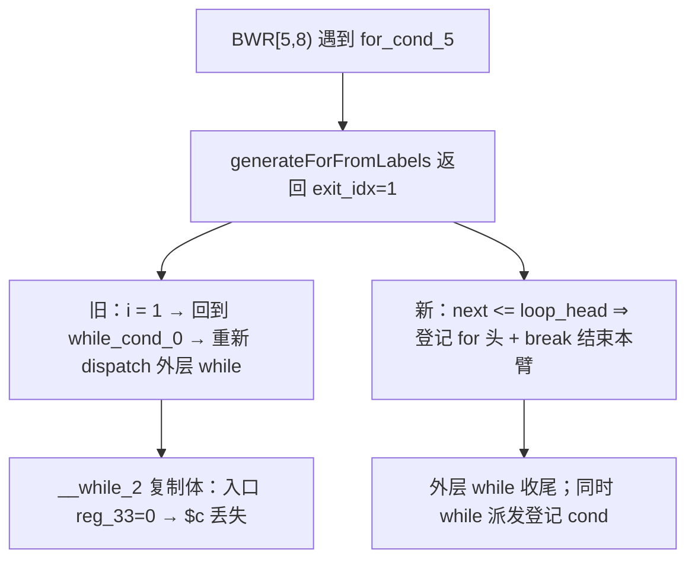

# AOT-CODEGEN-012 R-297：walker 循环派发的前向续走与头块登记（F-206-c / F-206-c-b 闭环）

- 日期：2026-10-26
- 代次锚：**`nlk ddff2cbd89c725b5ed9d42b27364c2c0`**（本轮唯一改动）；`tpl 3408c5bdce84957f0fbf54c3d7574df3`／`opti 553a2e540da638f3766911b1f0941dd1`／`irg 0b7106338d5ffe1342caee961734b8d8`／`ir fb2bb442ca27b98cf1df7e109a240e1f` 未变
- 工单：`docs/known-issues/AOT-CODEGEN-012-class-name-case-insensitive-lookup.md` §205
- 提交：未提交（HEAD `01e8c61`）

## 1. 高层摘要（TL;DR）

a8（`while` + `continue` + 内层 `for`）在 R-296 之后已不挂起，但 `$c` 恒 0。本轮定位到**块行走器**的两个互为掩护的缺陷：①for 派发直接采用生成器返回的**循环出口块索引**作续走起点——内层 for 的出口恰是外层 `while_cond_0`（索引更小）⇒ walker 回退并重新 dispatch 外层 while，生成 `__while_N` 复制体（第二份增量、入口把携带变量重置为初值）；②外层 while 的 cond 块**从未登记 processed**（while 生成器只标 body/exit），此前靠复制体的第二次调用“顺带”登记，否则编译报 `unprocessed blocks`。两处同批修正后 a8 与 PHP 逐字节一致（`6 i=12`）。

## 2. 影响范围

| 层 | 影响 |
|---|---|
| 发射器（`native_linker.zig` / `generateLabelDrivenBlockRange`） | for 派发的前向判定 + 循环头登记；while 派发的头块登记 |
| 语义面 | 所有「循环体含嵌套循环、且嵌套循环出口落在外层控制块」的形状 |
| 两个循环生成器内部 | 未动（R-295/R-296 的账目保持） |
| 运行期模板 / 优化器 / IR | 未动 |

## 3. 核心变更

| # | 变更 | 说明 |
|---|---|---|
| 1 | for 派发前向判定 | `next_i = generateForFromLabels(...)`；`next_i <= loop_head` ⇒ 登记头块后 `break` 结束本臂行走；否则登记后 `i = next_i` |
| 2 | while_cond_ 派发登记 | 调用后 `processed.put(loop_head)` |
| 3 | while_body_ 派发登记 | 同上（`while(true)` 无 cond 块的入口形态） |

**归因链（三轮取证）**
1. `ZIGPHP_TRACE_WH` + 调用点 tag：两次 `generateWhileFromLabels(while_cond_0)` 的 tag 都是 1（主派发器）。
2. 行走轨迹 `BWR[0,8)→BWR[5,8)→BWR[7,8)→WHCALL`；块序 `entry0 while_cond1 while_body2 exit3 merge4 for_cond5 for_body6 merge7`。
3. `generateForFromLabels` 的返回值为 `exit_idx`（内层 for 的出口＝1）⇒ walker `i = 1` 回退。

## 4. 可视化概览（Code & Logic Map）



```mermaid
sequenceDiagram
  participant W as walker[5,8)
  participant F as for 生成器
  participant O as 外层 while
  W->>F: dispatch for_cond_5
  F-->>W: exit_idx = while_cond_0 (1)
  W->>W: 1 <= 5 ⇒ put(for_cond_5); break
  O->>O: cond 已由 while 派发登记（新增）
  Note over W,O: 不再回退、不再复制 while 体
```

## 5. 详细变更分析

| 文件 | 变更点 |
|---|---|
| `src/aot/native_linker.zig` | `generateLabelDrivenBlockRange`：for / while_cond_ / while_body_ 派发的头块登记与前向判定 |
| `fuzzy_scripts_720/tmp/c339_latch_then_arm_gate_tmp.sh` | a8 加回门内（14 臂） |
| `fuzzy_scripts_720/tmp/c339_latch_then_arm_tmp.tsv` | 门读数 |

## 6. 影响与风险评估

- **破坏式变更**：无输出语义变化；修复的是「行走器回退导致循环体重复发射」与「循环头未登记」。
- **风险**：`break` 结束本臂行走只发生在出口不前进时（外层控制块）；for 之后的块由外层生成器收尾，回归套件与八邻门已验证。
- **性能**：编译期多一次比较与一次 map 写入；运行期无变化。
- **盘满插曲**：首次构建 `NoSpaceLeft`——`.zig-cache` 涨到 73G、磁盘 100%（治理项 #112）；清缓存后全量重建 79 s，全部证据取自清理后的同一二进制。
- **复测路径**：`bash fuzzy_scripts_720/tmp/c339_latch_then_arm_gate_tmp.sh`；自证 `AOT_BIN=/bin/false`；邻居 C328–C338。
- **读数**：C339 **14/14**（69 s，自证 14 CF）、C338 **15/15**、C337 **16/16**、C336 **18/18**；邻居 C328 6/6、C329 4/8（F-191）、C330 5/5、C331 7/7、C332 13/13、C333 7/7、C334 8/8、C335 14/14；`zig build test` **21/21、326/326**；主回归 **PASS=68 FAIL=0**（`SELF_CHECK_OK rows=68 uniq=68 total=68`）

## 7. 遗留问题/潜在问题

- **F-206-d**：`if/else` 分支内 continue + 内层循环 ⇒ AOT 输出为空（a10，未在门内）。
- **F-206-b**：嵌套循环体内带 `echo` 的字符串累加值丢失（b4d，F-117/F-158 家族）。
- `.zig-cache` 73G/盘满为已知治理项 #112，本轮只是清理，未做机制治理（建议加定期清理或改用有界 cache 目录）。

## 8. 后续建议

| 优先级 | 建议 | 影响面 | 落地成本 |
|---|---|---|---|
| P0 | F-206-d：if/else 臂内 continue 的空输出 | 循环发射 | 中 |
| P1 | F-206-b：循环体 merge phi 值面（并 F-117/F-158） | 循环发射 | 高 |
| P1 | #112 `.zig-cache` 治理（bounded cache / 定期清理 / 变更后重建策略） | 构建基础设施 | 低 |
| P2 | F-206-d/b 闭后把 a10/b4d 加回 C339 | 门覆盖 | 低 |
