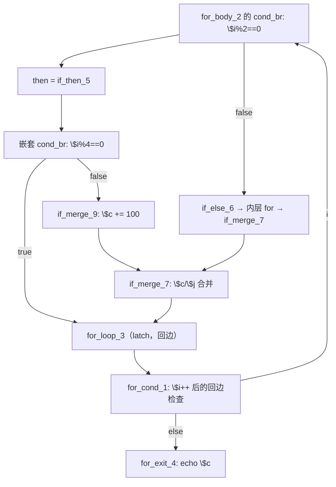

# AOT-CODEGEN-012 R-298：then 臂嵌套 if 的回边链式发射与 latch PHI 物化（F-206-d 闭环）

- 日期：2026-10-26
- 代次锚：**`nlk 719703dfe924e2bac4246ce0b68cc3e4`**（本轮最终态；中间态 `469f3b63…` 已被外部提交 `234c81d` 入库）；`tpl 3408c5bdce84957f0fbf54c3d7574df3`／`opti 553a2e540da638f3766911b1f0941dd1`／`irg 0b7106338d5ffe1342caee961734b8d8`／`ir fb2bb442ca27b98cf1df7e109a240e1f` 未变
- 工单：`docs/known-issues/AOT-CODEGEN-012-class-name-case-insensitive-lookup.md` §206
- 提交：外部提交 `234c81d`（08:06，回归期间落地）已把中间态 `nlk 469f3b63…` 一并入库；**最终态 `719703df…`（链式 helper 泛化）未提交**，本文档与门 C338/C339 亦未提交

## 1. 高层摘要（TL;DR）

a10（`for` 体内 `if/else`，then 臂嵌 `if (c) continue;`、else 臂是内层 `for`）在 AOT 只输出一个换行、`$c` 为 null（PHP `306`）。两条根因：

1. **嵌套 if 整段被吞**：then 臂的嵌套 `cond_br` 走通用回退，`nested_end` 被取成「嵌套 then 块（回边块）的 br 目标索引 + 1」＝`for_cond_1`(1)+1＝2，而 `nested_start`＝then 块索引+1＝6 ⇒ `generateLabelDrivenBlockRange(6, 2)` 空范围，嵌套 `if` 与 `$c += 100` 都没有发射。
2. **latch PHI 缺物化**：`cond_br` 体尾段行走停在回边前驱（`if_merge_7`）时，latch（`for_loop_3`）的 phi 只打 `// PHI: (handled in terminator)` 占位注释，**该前驱 br→latch 的 PHI 边从未赋值** ⇒ 跨迭代寄存器 `$c` 在 else 路径被赋值成 null。

修法：新增 `generateNestedContinueChain`（识别「嵌套 then 边直达回边 + else 侧单后继 `.br` 链折返 latch」，按 `if (c) { <latch 尾段> }` ＋链式展开 else 侧发射）与 `emitForLatchContinue`（latch PHI／增量／cond PHI／continue 四段统一），并在尾段行走后按 `last_back_edge` 精确物化 latch PHIs。a10 全部 n 与 PHP 逐字节一致（n=12 → `306`）。

## 2. 影响范围

| 层 | 影响 |
|---|---|
| 发射器（`native_linker.zig` / `generateForFromLabels`） | then 臂嵌套 cond_br 的派发：新增链式识别分支 |
| 发射器（`generateForFromLabels` / `cond_br` 体尾段） | 尾段行走后补 latch PHI 物化 |
| 语义面 | 「循环体 if/else 的一臂内嵌 `continue`／`break` + 另一臂含内层循环或后续赋值」的形状 |
| while / foreach / do-while 生成器 | 未动（`while` 版同形另立 **F-206-d-b**） |
| 运行期模板 / 优化器 / IR 生成器 | 未动 |

## 3. 核心变更

| # | 变更 | 站点 | 说明 |
|---|---|---|---|
| 1 | `generateNestedContinueChain` | `native_linker.zig:14036` | 先对 then/else 两条链做**纯 CFG dry-run**；任一不成链 ⇒ 返回 false 且**不落任何发射** |
| 2 | `collectChainToCond` | `native_linker.zig:14074` | 收集 `[start → cond)` 的单后继 `.br` 链：链内去重防环（IR 块序可与源码序相反，允许回跳）、遇其它循环头即失败；不查 `processed` |
| 3 | `emitChainToCond` | `native_linker.zig:14116` | 逐块「进入该块的 PHI ← 来源块 → 块内非 PHI 指令」，末块之后物化 cond PHI 并 `continue`；latch 只是链上普通一块（增量随块发射） |
| 4 | `chainBlockHasOutsidePred` | `native_linker.zig:14151` | 链上块若被链外前驱指向（＝与本层另一条臂共享的汇合块），**照发但不登记 processed** |
| 5 | 派发点（for） | `native_linker.zig:14811` | then 臂嵌套 cond_br：两条链都成链则链式发射，成功即跳过 or-sc 短路分支与通用回退 |
| 6 | 尾段 latch PHI 物化 | `native_linker.zig:15768` | `last_back_edge` 的终结符确为 `br → latch` 时 `materializeEdgePhi(latch, last_back_edge)`；仅在 cond_br 体路径、且未 return/break 时生效 |

**归因链（三轮取证）**
1. 生成码对照：then 臂在 `reg_18 = php_eq($i%4, 0)` 之后**直接闭合**，`if` 体、`$c+100`、`continue` 全无；`reg_40/reg_45`（latch PHI）只有声明没有赋值。
2. `--emit-ir` 块序：`entry0 for_cond1 for_body2 for_loop3 exit4 if_then5 if_else6 if_merge7 if_merge8 for_cond9 for_body10 if_merge11`；`if_then_5` 的 `cond_br` 两支 = `for_loop_3`（then，回边）／`if_merge_9`（else）。
3. 复算 `nested_end`：扫描到 `nested_cb.then_block`＝`for_loop_3` 的 `.br` 目标 `for_cond_1`(1) ⇒ `nested_end=2 < nested_start=6` ⇒ 空范围。

## 4. 可视化概览（Code & Logic Map）



```mermaid
sequenceDiagram
  participant E as 发射器
  participant N as generateNestedContinueChain
  participant L as emitForLatchContinue
  E->>N: nested_then_is_be=true（then 直达回边）
  N->>N: dry-run 链 [if_merge_9 → if_merge_7]，止于 latch
  N->>L: if (reg_18) { latch PHI ← if_then_5; \$i++; cond PHI; continue }
  N->>N: 发射 if_merge_9（\$c += 100）→ if_merge_7 PHI
  N->>L: 链尾 → latch PHI ← if_merge_7; \$i++; cond PHI; continue
  Note over E,L: 尾段行走另按 last_back_edge 物化 latch PHI（else 路径）
```

## 5. 详细变更分析

| 文件 | 变更点 |
|---|---|
| `src/aot/native_linker.zig` | 新增 `generateNestedContinueChain` / `emitForLatchContinue`；then 臂嵌套 cond_br 派发；`cond_br` 体尾段 latch PHI 物化 |
| `fuzzy_scripts_720/tmp/c339_latch_then_arm_gate_tmp.sh` | **a10 加回门内**（15 臂），头部注释更新 |
| `fuzzy_scripts_720/tmp/c339_latch_then_arm_tmp.tsv` | 门读数（a10 `SAME PHP[306] AOT[306]`） |

**踩坑留痕**
- 首版把 latch PHI 的来源块写成 `nested_cb.then_block`（目标＝latch 自身）⇒ `materializeEdgePhi(latch, latch)` 空转，`$c` 仍 null；正确来源是**持有 cond_br 的块** `then_blk`（n=1 复现定位）。
- 首版 dry-run 只认前向边（`ti_c <= cur` 即放弃），而 `if_merge_9`(8) → `if_merge_7`(7) 是**回跳**；IR 块序与源码序不必一致，改为链内去重防环。

## 6. 影响与风险评估

- **破坏式变更**：无。新增分支只在 `nested_then_is_be` 命中且 else 侧形态完全匹配时生效，其余走原路径。
- **风险**：链式发射会把 else 侧块登记 `processed`，避免尾段重发；`break_generated` 置位后由既有「then/else 状态 AND 合并」逻辑复位，else 臂不受影响。
- **性能**：编译期多一次链扫描（≤24 块）；运行期无变化。
- **复测路径**：`bash fuzzy_scripts_720/tmp/c339_latch_then_arm_gate_tmp.sh`；自证 `AOT_BIN=/bin/false`；邻居 C328–C338；反证矩阵 `/tmp/f206/*.php` × n∈{0,1,5,12}。
- **读数**：C339 **15/15**（74 s，自证 15 CF）、C338 15/15、C337 16/16、C336 18/18、C335 14/14、C334 8/8、C333 7/7、C332 13/13、C331 7/7、C330 5/5、C328 6/6、C329 4/8（F-191 既有红，零转移）；`zig build test` **21/21、326/326**；主回归（`719703df` 泛化后重跑）**PASS=68 FAIL=0**（`SELF_CHECK_OK rows=68 uniq=68 total=68`；`/tmp/r298b_regression.log`）

## 7. 遗留问题/潜在问题

- **F-206-d-b（新立，P1）**：`while` 版同形仍红（n≥5 输出为空，n=0/1 正常；复现 `/tmp/f206d/w1.php`）。本轮实测结论：
  - 把同一链式发射接到 `generateWhileFromLabels` 后 **then 路径正确**；残余卡在 **else 路径尾段的 cond PHI 取值**——尾段取「第一个回边 incoming」（`if_then_6`），生成 `reg_48=reg_48`／`reg_45=reg_20`（then 边增量结果）这类自赋值/错源 ⇒ `$i` 不前进、`rc=124`。
  - 同轮发现并修好的附带项：`if_merge_5`（`$i++`）既是嵌套 if 的 else 链尾、又是本层 else 臂的汇合块；链式发射若登记它 processed，另一臂回退行走会跳过其副作用（死循环）。已由 `chainBlockHasOutsidePred` 处理，for 路径同样受益。
  - while 调用点已**回退**，避免带未验证改动入库；下一轮先修该尾段 PHI 选取再挂链。
- **F-206-b 仍在**：嵌套循环体内字符串累加值丢失（b4d，F-117/F-158 家族）。
- 本轮的 `nested_end` 计算缺陷只在 then 臂回退分支被绕开；or-sc / 其余通用回退若遇到「回边目标索引小于 `nested_start`」仍会产出空范围，属同一类风险，未逐一普查。

## 8. 后续建议

| 优先级 | 建议 | 影响面 | 落地成本 |
|---|---|---|---|
| P0 | F-206-d-b：`while` 生成器接同一链式发射 | 循环发射 | 中 |
| P1 | 普查 `nested_end` 取「br 目标索引+1」的全部站点（for/foreach/while）是否都会产生空范围 | 发射器 | 中 |
| P1 | F-206-b：循环体 merge phi 值面（并 F-117/F-158） | 循环发射 | 高 |
| P2 | F-206-d-b 闭后把 w1 形状加回 C339 | 门覆盖 | 低 |
