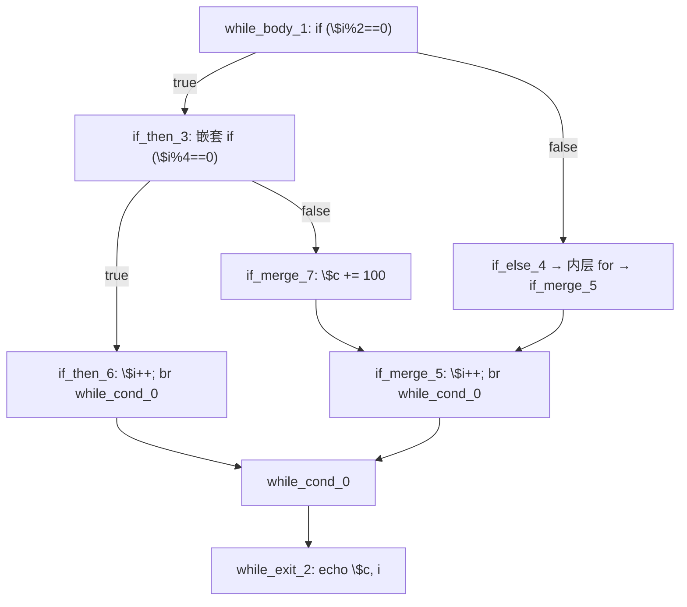
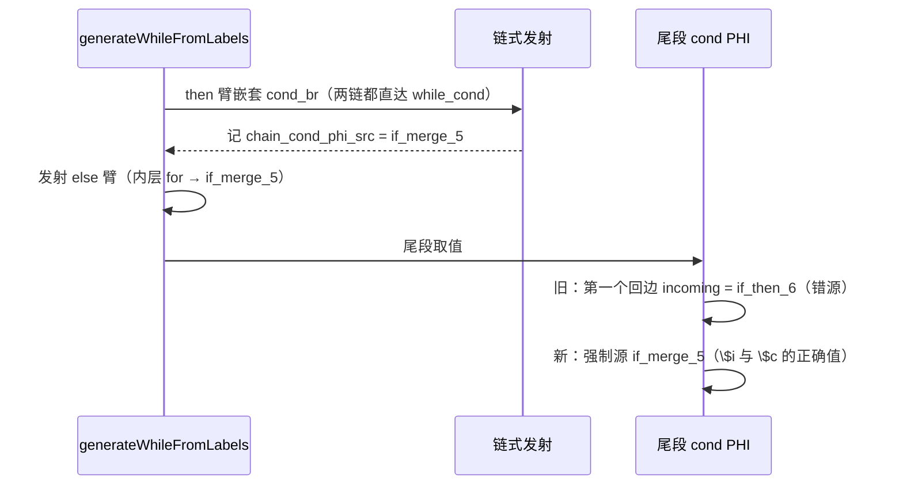

# AOT-CODEGEN-012 R-299：while 尾段 cond PHI 取 else 链尾块（F-206-d-b 闭环）

- 日期：2026-10-26
- 代次锚：**`nlk 4a42588fea990972bbe8002fea88d7d6`**（本轮唯一改动）；`tpl 3408c5bdce84957f0fbf54c3d7574df3`／`opti 553a2e540da638f3766911b1f0941dd1`／`irg 0b7106338d5ffe1342caee961734b8d8`／`ir fb2bb442ca27b98cf1df7e109a240e1f` 未变
- 工单：`docs/known-issues/AOT-CODEGEN-012-class-name-case-insensitive-lookup.md` §207
- 提交：未提交（HEAD `234c81d`）

## 1. 高层摘要（TL;DR）

`while` 体内 `if/else`、then 臂嵌 `if ($i%4==0) { $i++; continue; }`、else 臂是内层 `for`（R-298 的 `for` 版同形已闭，此为 while 版）——AOT 在 n≥2 时输出为空，PHP 为 `306 i=12`。

根因两条，本轮全部收口：
1. **尾段 cond PHI 取值错源**：`generateWhileFromLabels` 尾段按「第一个落在循环范围内的 incoming」取值，命中 `if_then_6`（then 边，已在臂内被 `continue` 消费）⇒ 生成 `reg_48=reg_48`／`reg_45=reg_20`（then 边增量结果）这类自赋值/错源，else 路径的 `$i` 永不前进（`rc=124` 挂起）。
2. **共享汇合块的副作用**：`if_merge_5`（`$i++`）既是嵌套 if 的 else 链尾、又是本层 else 臂（内层 for 出口）的汇合块——由 R-298 的 `chainBlockHasOutsidePred`（共享块照发不登记 processed）解决。

修法：链式发射成功时记录 **else 链尾块索引**（`chain_cond_phi_src`），while 尾段优先只取该块的 incoming；并把 while 调用点接回链式派发（R-298 曾因该缺陷回退）。

## 2. 影响范围

| 层 | 影响 |
|---|---|
| 发射器（`native_linker.zig` / `generateWhileFromLabels`） | 尾段 cond PHI 取值新增强制源；then 臂嵌套 cond_br 新增链式派发 |
| 发射器（链式 helper） | 新增 `record_cond_src` 形参；for 侧传 false（零行为变化） |
| 语义面 | 「while 体内 if/else 的一臂内嵌 `continue`、另一臂含内层循环或后续赋值」 |
| 运行期模板 / 优化器 / IR 生成器 / for、foreach、do-while 生成器 | 未动 |

## 3. 核心变更

| # | 变更 | 站点 | 说明 |
|---|---|---|---|
| 1 | 新字段 `chain_cond_phi_src` | `native_linker.zig:368` | 记录本层 while 体链式发射的 else 链尾块 |
| 2 | `generateNestedContinueChain` 增加 `record_cond_src` | `native_linker.zig:14051` | 成功后 `self.chain_cond_phi_src = echain[en - 1]`（`:14072`） |
| 3 | while 调用点 | `native_linker.zig:16535` | then 臂嵌套 `cond_br`：两条链都成链则链式发射，否则走原 `nested_start/nested_end` 回退 |
| 4 | 尾段强制源 | `native_linker.zig:17468` | 取用并即刻清空；命中时 cond PHI 只取该块 incoming，其它 incoming 一律跳过 |
| 5 | 入循环清空 | `native_linker.zig:16016` | `generateWhileFromLabels` 入口清空，避免跨循环错配 |

**判定依据**：`while_cond_0` 的 phi incoming 顺序为 `[entry] → [if_then_6] → [if_merge_5]`。then 边已在臂内以 `continue` 收尾，落空路径的真正前驱只有 `if_merge_5`；旧口径取「第一个」必然命中 `if_then_6`。

## 4. 可视化概览（Code & Logic Map）

## 5. 详细变更分析

| 文件 | 变更点 |
|---|---|
| `src/aot/native_linker.zig` | 新字段；链式 helper `record_cond_src`；while 调用点；尾段强制源；入循环清空 |
| `fuzzy_scripts_720/tmp/c339_latch_then_arm_gate_tmp.sh` | **新增 a13 臂**（while 版同形）；`ALL_ARMS` 扩到 13 语义臂（16 臂含 s1–s3） |
| `fuzzy_scripts_720/tmp/c339_latch_then_arm_tmp.tsv` | 门读数（a13 `SAME PHP[306 i=12]`） |

## 6. 影响与风险评估

- **破坏式变更**：无。强制源只在链式发射成功时写入，且消费即清空；未写入时完全保持原口径。
- **风险**：若 else 臂里再嵌 while，内层 `generateWhileFromLabels` 入口会清空外层待用值 ⇒ 只是回到旧口径（不引入新错源）。
- **性能**：编译期多一次可选查找；运行期无变化。
- **复测路径**：`bash fuzzy_scripts_720/tmp/c339_latch_then_arm_gate_tmp.sh`；自证 `AOT_BIN=/bin/false`；邻居 C328–C338；反证矩阵 `/tmp/f206/*.php` + `/tmp/f206d/w1.php` × n∈{0,1,3,5,12}。
- **读数**：C339 **16/16**（79 s，自证 16 CF）、C338 15/15、C337 16/16、C336 18/18、C335 14/14、C334 8/8、C333 7/7、C332 13/13、C331 7/7、C330 5/5、C328 6/6、C329 4/8（F-191）；`zig build test` **21/21、326/326**；主回归 **PASS=68 FAIL=0**（`SELF_CHECK_OK rows=68 uniq=68 total=68`）

## 7. 遗留问题/潜在问题

- 尾段「第一个回边 incoming」仍是默认口径（本轮只对链式发射路径强制）；其它形状若出现同源问题仍会错，建议后续按「实际落空前驱」统一改造。
- **F-206-b 仍在**：嵌套循环体内字符串累加值丢失（b4d，F-117/F-158 家族）。

## 8. 后续建议

| 优先级 | 建议 | 影响面 | 落地成本 |
|---|---|---|---|
| P1 | 尾段 cond PHI 统一改为「实际落空前驱」（用 walker 的记录取代 first-incoming 启发式） | 发射器 | 中 |
| P1 | F-206-b：循环体 merge phi 值面（并 F-117/F-158） | 循环发射 | 高 |
| P2 | 把 `w1` 形状与 for 版 a10 抽成同一族的门内互证（现已有 a10/a13） | 门覆盖 | 低 |
