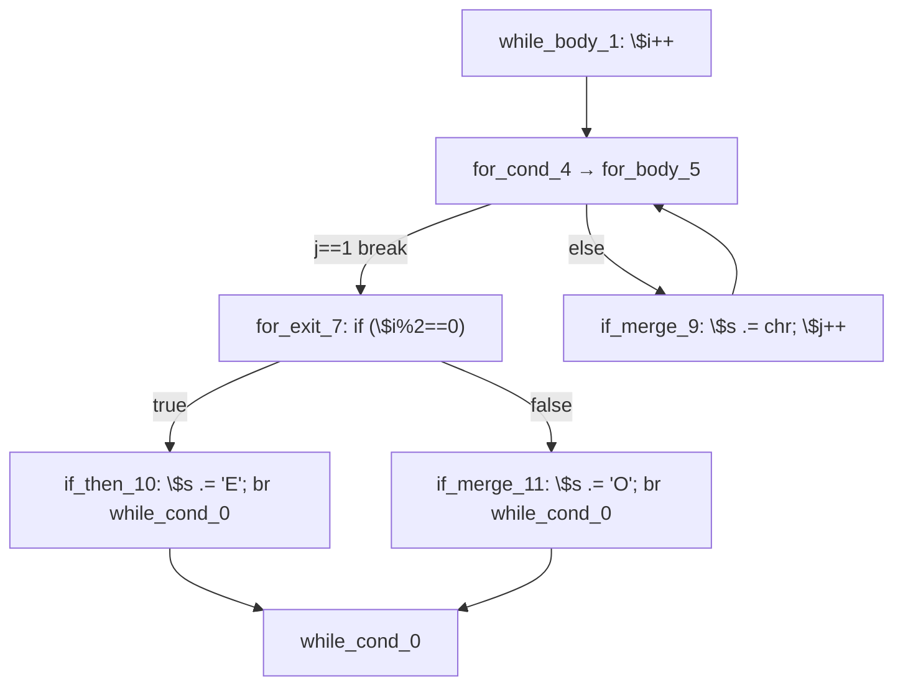

# AOT-CODEGEN-012 R-300：walker 通用 cond_br 交链式发射（F-208 闭环）

- 日期：2026-10-26
- 代次锚：**`nlk d0c5dfae8424c5438a8e1b0d75df7a6d`**（本轮唯一改动）；`tpl 3408c5bdce84957f0fbf54c3d7574df3`／`opti 553a2e540da638f3766911b1f0941dd1`／`irg 0b7106338d5ffe1342caee961734b8d8`／`ir fb2bb442ca27b98cf1df7e109a240e1f` 未变
- 工单：`docs/known-issues/AOT-CODEGEN-012-class-name-case-insensitive-lookup.md` §208
- 提交：未提交（HEAD `234c81d`）

## 1. 高层摘要（TL;DR）

合法 PHP 程序**直接编译失败**：`[AST-DIRECT-FAIL] function=run unprocessed blocks: 9:if_merge_11`。形态为 `while` 体内只有内层 `for`，循环之后是一个 `if/else`，**两臂都以 `continue` 收尾**。

根因：内层 for 的 exit 块承载循环之后的 if 代码，for 生成器按约定 `processed.remove(exit_idx)` 后交还；walker 续走到该块后，其 `cond_br` 由通用 if/else 行走处理 —— then 臂（`br → while_cond_0`）发成 `continue` 并置 `break_generated`，else 臂（同样 `br → while_cond_0`）因此整段跳过；walker 因 `break_generated` 提前返回（`markReachableRestBlocks` 刻意不标记它）⇒ 未处理块检查报错。

修法：walker 通用 `cond_br` 分支开头先做纯 CFG 预检（两条分支是否都能沿单后继 `.br` 链到达本循环 cond），命中则「先发条件计算 → 链式发射两臂 → 登记本块续走」。

## 2. 影响范围

| 层 | 影响 |
|---|---|
| 发射器（`native_linker.zig` / `generateLabelDrivenBlockRange`） | 通用 `cond_br` 分支新增链式派发前置判定 |
| 发射器（链式 helper） | 新增 `chainsReachCond` 纯 CFG 预检（复用 `collectChainToCond`） |
| 语义面 | 「循环之后的 if/else 两臂都 continue」 |
| 运期模板 / 优化器 / IR 生成器 / 各循环生成器 | 未动 |

## 3. 核心变更

| # | 变更 | 站点 | 说明 |
|---|---|---|---|
| 1 | `chainsReachCond` | `native_linker.zig:14150` | 两次 `collectChainToCond`，不落任何发射 |
| 2 | walker 通用 `cond_br` 前置派发 | `native_linker.zig:9333` | 命中：发块内条件计算 → `generateNestedContinueChain(..., false)` → `processed.put(i)` → `i += 1` → `continue`；未命中走原路径 |
| 3 | 门 | `c339_latch_then_arm_gate_tmp.sh` | 新增 **a14** 臂（本缺陷复现），门扩到 17 臂 |

**归因链**：临时插桩 `ZIGPHP_TRACE_BWR`（**已移除**，`grep -c 'ZIGPHP_TRACE_BWR\|dbg_bwr'` = 0）打印 `i=6 for_exit_7 proc=false` → `i=7 if_merge_9 proc=true` → `[BWR-RET] i=7 rg=false bg=true`，证明 then 臂 `continue` 置位后 walker 直接返回。

**首版坑**：链式发射放在块内指令发射之前 ⇒ 生成码里 `continue` 之后又出现条件计算，Zig 报 `unreachable code`（`main.zig:484`）。修正为「预检 → 发块内指令 → 发链」。

## 4. 可视化概览（Code & Logic Map）



```mermaid
sequenceDiagram
  participant W as walker
  participant F as for 生成器
  participant C as 链式发射
  W->>F: dispatch for_cond_4
  F-->>W: exit=for_exit_7（已 remove(processed)）
  W->>W: 走到 for_exit_7 的 cond_br
  Note over W: 旧：then 臂 continue → break_generated → else 臂跳过 → 未处理块报错
  W->>C: 新：chainsReachCond 预检通过
  C-->>W: if (cond) { ..continue } <else 链> continue
  W->>W: processed.put(7); i += 1
```

## 5. 详细变更分析

| 文件 | 变更点 |
|---|---|
| `src/aot/native_linker.zig` | `chainsReachCond`；walker 通用 `cond_br` 的前置链式派发 |
| `fuzzy_scripts_720/tmp/c339_latch_then_arm_gate_tmp.sh` | 新增 a14 臂；`ALL_ARMS` 扩到 14 语义臂（17 臂含 s1–s3） |
| `fuzzy_scripts_720/tmp/c339_latch_then_arm_tmp.tsv` | 门读数（a14 `SAME PHP[bOcEdOeEfOgEhOiEjOkElOmE|24]`） |

## 6. 影响与风险评估

- **破坏式变更**：无。预检不命中时完全走原路径；命中形态此前是**编译失败**，不存在行为回退。
- **风险**：预检只认纯 `.br` 单后继链，含内层循环/嵌套 if 的分支不会命中。
- **性能**：编译期多两次链扫描（各 ≤24 块）；运行期无变化。
- **复测路径**：`bash fuzzy_scripts_720/tmp/c339_latch_then_arm_gate_tmp.sh`；自证 `AOT_BIN=/bin/false`；邻居 C328–C338；复现 `/tmp/f206b/v2.php`。
- **读数**：C339 **17/17**（84 s，自证 17 CF）、C338 15/15、C337 16/16、C336 18/18、C335 14/14、C334 8/8、C333 7/7、C332 13/13、C331 7/7、C330 5/5、C328 6/6、C329 4/8（F-191）；`zig build test` **21/21、326/326**；主回归 **PASS=68 FAIL=0**（`SELF_CHECK_OK rows=68 uniq=68 total=68`）

## 7. 遗留问题/潜在问题

- **F-208-b（新立，P1）**：walker 通用 `cond_br` 在「then 臂 continue + else 臂不 continue」时是否也有漏发面，本轮未做反向普查（只验证了双臂都 continue）。
- **F-206-b 已实测转绿**：本轮反证矩阵 v1/v3/v4（嵌套循环字符串累加）与 b4d 全 n 一致 ⇒ 该缺陷随 R-297…R-300 关闭，不再单列。

## 8. 后续建议

| 优先级 | 建议 | 影响面 | 落地成本 |
|---|---|---|---|
| P1 | F-208-b：通用 cond_br 单臂 continue 的漏发普查（构造 4 形反向臂） | 发射器 | 中 |
| P2 | 把「循环后 if/else 两臂 continue/break」抽成门内常驻族（a14 已起步，可加 break 变体） | 门覆盖 | 低 |
| P2 | 清理 `generateLabelDrivenBlockRange` 中已不再触发的历史分支（需先做可达性普查） | 发射器 | 高 |
