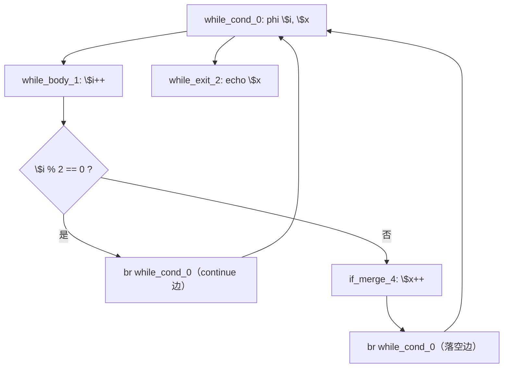
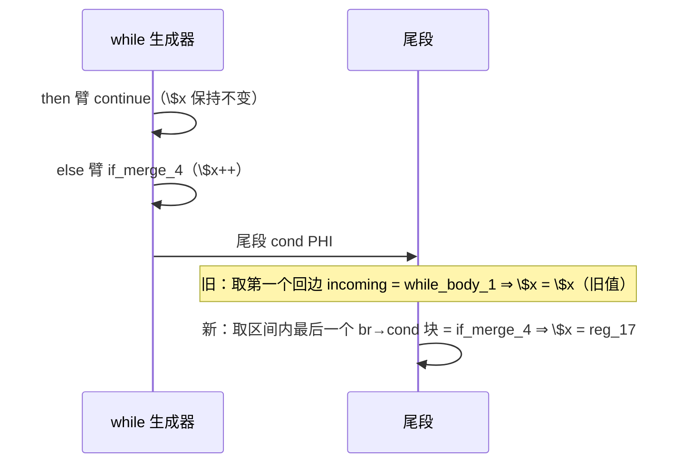

# AOT-CODEGEN-012 R-301：while 尾段按落空前驱取 PHI（F-209 / F-209-b 闭环）

- 日期：2026-10-26
- 代次锚：**`nlk 06a5147c2d89f404f2e843145428f6f3`**（本轮唯一改动）；`tpl 3408c5bdce84957f0fbf54c3d7574df3`／`opti 553a2e540da638f3766911b1f0941dd1`／`irg 0b7106338d5ffe1342caee961734b8d8`／`ir fb2bb442ca27b98cf1df7e109a240e1f` 未变
- 工单：`docs/known-issues/AOT-CODEGEN-012-class-name-case-insensitive-lookup.md` §209
- 提交：未提交（HEAD `234c81d`）

## 1. 高层摘要（TL;DR）

`while ($i<$n) { $i++; if ($i%2==0) continue; $x++; }` 在 AOT 恒为 **0**（PHP n=12 → `6`；`for` 族同形全对，属 while 专有；副作用照常执行，只有跨迭代累加失效）。两个子面：

1. **F-209（尾段落空前驱）**：while 尾段 cond PHI 默认取「第一个回边 incoming」，命中的是循环体自身的 continue 边（`$x` 自身）⇒ 落空路径拿到旧值。修法：在 `chain_cond_phi_src` 缺失时，取 `[body_idx+1, extended_end)` 内**最后一个 `br → 本层 cond` 的块**作来源。
2. **F-209-b（then 臂 br→cond 缺 PHI）**：`if (..) { $x++; continue; }` 展开后是「then 块内联 → br 到 cond」，原实现只发 `continue` **不物化**循环携带 PHI ⇒ `$x` 不进入下一轮、出口打印空（s2 形状）。

两处同批修好后，m1/m3/s1/s2 与 for 族反证全部与 PHP 逐字节一致。

## 2. 影响范围

| 层 | 影响 |
|---|---|
| 发射器（`generateWhileFromLabels` 尾段） | cond PHI 强制源新增结构化回退 |
| 发射器（`generateWhileFromLabels` then 臂 `br→cond`） | 补 PHI 物化（与 R-296 同账目） |
| 语义面 | 所有「while 体内 if continue + 尾随语句」「then 臂内联后 br 回边」的形状 |
| 运期模板 / 优化器 / IR 生成器 / for、foreach、do-while | 未动 |

## 3. 核心变更

| # | 变更 | 站点 | 说明 |
|---|---|---|---|
| 1 | 尾段强制源回退 | `native_linker.zig:17524` | `chain_cond_phi_src` → 否则取区间内最后一个 `br→cond` 块 → 否则保持旧口径 |
| 2 | then 臂 `br→cond` PHI | `native_linker.zig:16649` | continue 前按 `then_blk` 边物化 cond PHI |

**判定依据**
- m1 IR：`$x`(reg_20) 的 phi incoming ＝ `[entry:2]`／`[while_body_1: 20（自身）]`／`[if_merge_4: 17]`；尾段代码位于 if/else 之后，只有落空路径能到达 ⇒ 必须取 `if_merge_4`。
- s2 生成码：then 路径 `continue :__while_0` 之前没有任何 PHI 赋值 ⇒ `$x` 的增量丢失。

## 4. 可视化概览（Code & Logic Map）

## 5. 详细变更分析

| 文件 | 变更点 |
|---|---|
| `src/aot/native_linker.zig` | 尾段 `forced_cond_src` 结构化回退；then 臂 `br→cond` 补 PHI |
| `fuzzy_scripts_720/tmp/c339_latch_then_arm_gate_tmp.sh` | 新增 **a15**（m1 形状）、**a16**（s2 形状）臂；门扩到 19 臂 |
| `fuzzy_scripts_720/tmp/c339_latch_then_arm_tmp.tsv` | 门读数（a15 `6 i=12`、a16 `6 6`） |

**归因方法留痕（两次否证 → 一次命中）**
1. 假设「walker 记录 `br→本层 cond` 的块」⇒ 该块实际由 else 臂内联发射，记录点未触发 ⇒ 读数不变（已回退）。
2. 假设「else 臂直落 cond 时记录」⇒ 同样不变（已回退）。
3. **结构化判据**（区间内最后一个 `br→cond` 块）一次命中 ⇒ 尾段来源应由 CFG 结构直接给出，而不是依赖沿途记录。

## 6. 影响与风险评估

- **破坏式变更**：无。a8 的区间内没有 `br→while_cond` 的块 ⇒ 回退旧口径；w1 由 `chain_cond_phi_src` 先命中 ⇒ 行为不变。
- **风险**：若落空路径的最后一块不是 `br→cond`（例如经 merge 链），仍走旧口径；本形状另有 R-298/R-299 的链式发射覆盖。
- **性能**：编译期多一次线性扫描（≤ 块数）；运行期无变化。
- **复测路径**：`bash fuzzy_scripts_720/tmp/c339_latch_then_arm_gate_tmp.sh`；自证 `AOT_BIN=/bin/false`；邻居 C328–C338；复现 `/tmp/f209/m1.php`、`/tmp/f208b/s2.php`。
- **读数**：C339 **19/19**（89 s，自证 19 CF）、C338 15/15、C337 16/16、C336 18/18、C335 14/14、C334 8/8、C333 7/7、C332 13/13、C331 7/7、C330 5/5、C328 6/6、C329 4/8（F-191）；`zig build test` **21/21、326/326**；主回归 **PASS=68 FAIL=0**（`SELF_CHECK_OK rows=68 uniq=68 total=68`）

## 7. 遗留问题/潜在问题

- 尾段默认口径（第一个回边 incoming）在「落空路径末块不是 `br→cond`」的形状下仍可能错源；建议后续统一改造成「按 CFG 落空前驱」。
- **F-208-b 仍在**：通用 cond_br「then 臂 continue + else 不 continue」的漏发普查未做。

## 8. 后续建议

| 优先级 | 建议 | 影响面 | 落地成本 |
|---|---|---|---|
| P1 | 尾段 cond PHI 统一按「落空前驱」改造（覆盖 merge 链收尾的形状） | 发射器 | 中 |
| P1 | F-208-b 反向普查（4 形） | 发射器 | 中 |
| P2 | 把 m1/m3/s1/s2 四形抽成常驻族（现已入 C339 a15/a16，可补 m3/s1 变体） | 门覆盖 | 低 |
