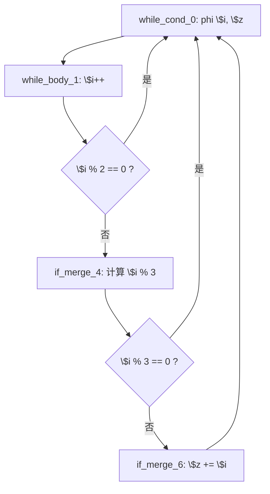
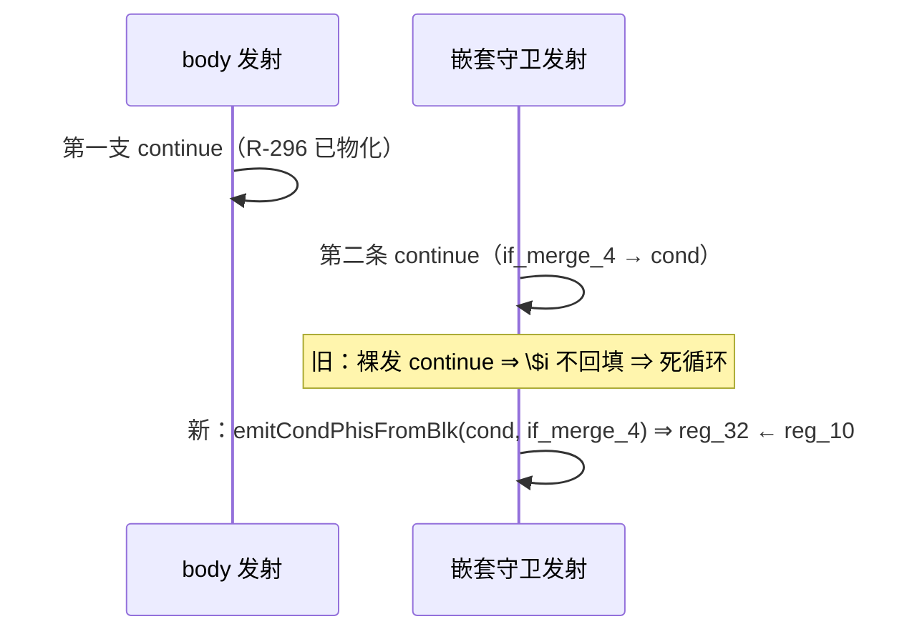

# AOT-CODEGEN-012 R-302：嵌套守卫 continue 前物化 cond PHI（F-210 闭环）

- 日期：2026-10-26
- 代次锚：**`nlk 3ae8f808d637c878281085a7af53a64e`**（本轮唯一改动）；`tpl 3408c5bdce84957f0fbf54c3d7574df3`／`opti 553a2e540da638f3766911b1f0941dd1`／`irg 0b7106338d5ffe1342caee961734b8d8`／`ir fb2bb442ca27b98cf1df7e109a240e1f` 未变
- 工单：`docs/known-issues/AOT-CODEGEN-012-class-name-case-insensitive-lookup.md` §210
- 提交：未提交（HEAD `234c81d`）

## 1. 高层摘要（TL;DR）

while 循环的**连续守卫**在 AOT 下失效：

| 形状 | PHP（n=12） | 修前 AOT |
|---|---|---|
| `while { $i++; if ($i%2==0) continue; if ($i%3==0) continue; $z += $i; }`（q2） | `24 12` | **死循环**（rc=124，timeout） |
| `while { $i++; if ($i>6) break; if ($i%2==0) continue; $z += $i; }`（q5） | `9 7` | **输出为空** |

根因：**嵌套守卫的 `continue` 只发 `continue :label`，不物化本层 cond 的循环携带 PHI**。q2 中第二条 `continue`（`if_merge_4 → while_cond_0`）缺 `reg_32 ← reg_10`（`$i++` 的结果）⇒ `$i` 永不前进。
R-296 只覆盖「then 块就是 cond 块」，R-301 只覆盖「then 臂 br→cond」——**else 臂内嵌的 cond_br 两支仍裸露**。

修法：抽出 `emitCondPhisFromBlk(cond_blk, src_blk, indent)`，在两处嵌套 `continue` 前按来源块物化。

## 2. 影响范围

| 层 | 影响 |
|---|---|
| 发射器（`generateWhileFromLabels` else 臂嵌套 cond_br） | 两处 continue 补 PHI 物化 + 新 helper |
| 语义面 | 所有「while 体内多级守卫」「break 后跟 continue」的形状 |
| 运期模板 / 优化器 / IR 生成器 / for、foreach、do-while | 未动 |

## 3. 核心变更

| # | 变更 | 站点 | 说明 |
|---|---|---|---|
| 1 | `emitCondPhisFromBlk` | `native_linker.zig:16043` | 按 `src_blk` 把本层 cond 的 phi incoming 逐个物化 |
| 2 | 嵌套 then == cond 支 | `native_linker.zig:17310` | 来源块＝`else_blk`（持有该嵌套 cond_br 的块） |
| 3 | 嵌套 then 以 `br→cond` 收尾支 | `native_linker.zig:17343` | 来源块＝`nested_then_blk` |
| 4 | 门 C339 | `c339_latch_then_arm_gate_tmp.sh` | 新增 a17（q2）、a18（q5），门扩到 21 臂 |

**判定依据（q2 IR）**：`while_cond_0` 的 `$i` phi incoming ＝ `[entry:2]`／`[while_body_1:10]`／`[if_merge_4:10]`／`[if_merge_6:10]`；第二条守卫的 continue 源块是 `if_merge_4`，必须取该边的 `10`。

## 4. 可视化概览（Code & Logic Map）

## 5. 详细变更分析

| 文件 | 变更点 |
|---|---|
| `src/aot/native_linker.zig` | 新 helper；else 臂嵌套 cond_br 两处 continue 补 PHI |
| `fuzzy_scripts_720/tmp/c339_latch_then_arm_gate_tmp.sh` | 新增 a17/a18；`ALL_ARMS` 扩到 18 语义臂（21 臂含 s1–s3） |
| `fuzzy_scripts_720/tmp/c339_latch_then_arm_tmp.tsv` | 门读数（a17 `24 12`、a18 `9 7`） |

**同批普查（8 形，均绿）**：if/else 双写累加（p1）、break+累加（p2）、do-while continue/else（p3/p4）、foreach continue（p5）、elseif 链（p6）、嵌套 for + continue + `break 2`（p7）、switch + `continue 2`（q3）、内层 for + 累加（q4）。

## 6. 影响与风险评估

- **破坏式变更**：无。仅在两处 `continue` 前补赋值；来源块匹配不到时无输出（与旧行为一致）。
- **风险**：只覆盖 while 生成器的这两支；for/foreach/do-while 的同类嵌套守卫未逐族穷举（本轮 p/q 变体全绿）。
- **性能**：编译期每处多一次 phi 遍历；运行期无变化。
- **复测路径**：`bash fuzzy_scripts_720/tmp/c339_latch_then_arm_gate_tmp.sh`；自证 `AOT_BIN=/bin/false`；邻居 C328–C338；复现 `/tmp/f211/q2.php`、`q5.php`。
- **读数**：C339 **21/21**（98 s，自证 21 CF）、C338 15/15、C337 16/16、C336 18/18、C335 14/14、C334 8/8、C333 7/7、C332 13/13、C331 7/7、C330 5/5、C328 6/6、C329 4/8（F-191）；`zig build test` **21/21、326/326**；主回归 **PASS=68 FAIL=0**（`SELF_CHECK_OK rows=68 uniq=68 total=68`）

## 7. 遗留问题/潜在问题

- **F-210-b（建议）**：把「continue 前物化 cond PHI」收口为统一入口，避免再出现「每发现一处补一处」（R-296/R-301/R-302 已是第三次补同族）。
- 尾段 first-incoming 默认口径仍是定时炸弹（§209.5 已记录，落空路径末块不是 `br→cond` 时会错源）。

## 8. 后续建议

| 优先级 | 建议 | 影响面 | 落地成本 |
|---|---|---|---|
| P1 | F-210-b：「循环 continue/break 收尾统一走 emitCondPhisFromBlk」的全站点普查（for/foreach/do-while 各生成器） | 发射器 | 中 |
| P1 | 尾段 cond PHI 统一按落空前驱改造 | 发射器 | 中 |
| P2 | 把本轮 8 形普查的 p1–p7/q3 抽进 C339 常驻族 | 门覆盖 | 低 |
