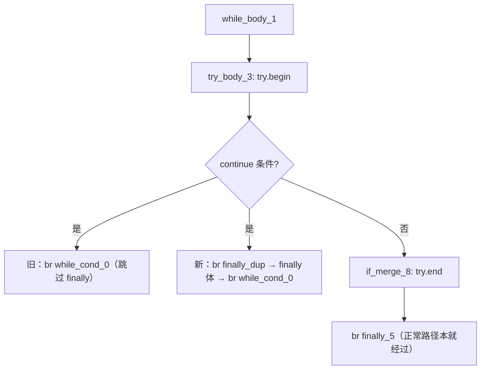
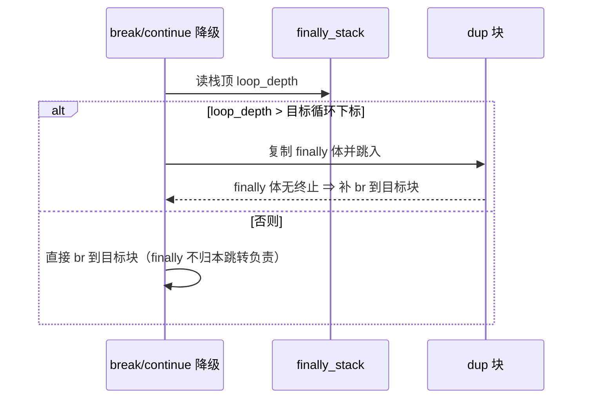

# AOT-CODEGEN-012 R-303：break/continue 穿过 finally 的重定向（F-211 闭环）

- 日期：2026-10-26
- 代次锚：**`irg 63602b6ef6b4c4e46d9840b84e35b7aa`**（本轮唯一改动）；`nlk 3ae8f808d637c878281085a7af53a64e`／`tpl 3408c5bdce84957f0fbf54c3d7574df3`／`opti 553a2e540da638f3766911b1f0941dd1`／`ir fb2bb442ca27b98cf1df7e109a240e1f` 未变
- 工单：`docs/known-issues/AOT-CODEGEN-012-class-name-case-insensitive-lookup.md` §211
- 提交：未提交（HEAD `234c81d`）

## 1. 高层摘要（TL;DR）

`try { … } finally { … }` 里的 `continue` / `break` 在 AOT **不执行 finally 体**（PHP 要求执行）：

| 形状 | PHP（n=12） | 修前 AOT |
|---|---|---|
| `while { $i++; try { if ($i%2==0) continue; $z+=10; } finally { $z+=1; } }` | `72 12` | **`66 12`** |
| `while { $i++; try { if ($i>3) break; $z+=10; } finally { $z+=1; } }` | `34 4` | **`33 4`** |

根因在 **IR 层**：`generateBreakStmt` / `generateContinueStmt` 直接发 `br → break/continue_block`，完全没有 finally 重定向；而同文件里 `return`/`throw` 都会走 `redirectThroughFinally()` 复制 finally 体。t2 的 IR 证据：`if_then_7: br while_cond_0`（裸边）。

修法：`FinallyContext` 记录 push 时的循环栈深度；break/continue 仅当 **目标循环下标 < loop_depth**（即 try 位于目标循环体内侧）时，先把 finally 体复制到新块再跳转。

## 2. 影响范围

| 层 | 影响 |
|---|---|
| IR 生成器（`ir_generator.zig`） | `FinallyContext` 增字段；break/continue 新增 finally 重定向 |
| 语义面 | 所有「循环体内 try/finally 中 break/continue」的形状 |
| 发射器 / 运行期模板 / 优化器 / ir.zig | 未动 |

## 3. 核心变更

| # | 变更 | 站点 | 说明 |
|---|---|---|---|
| 1 | `FinallyContext.loop_depth` | `ir_generator.zig:196` | push 时记录循环栈深度 |
| 2 | push 赋值 | `:3645` | `.loop_depth = self.loop_stack.items.len` |
| 3 | `redirectLoopJumpThroughFinally(target_loop_idx)` | `:4074` | `ctx.loop_depth > target_loop_idx` 才调 `redirectThroughFinally(false)` |
| 4 | break / continue 接线 | `:4255` / `:4285` | 先重定向；若 finally 体自身未终止，再 `setTerminator(.br → 目标)` |

**深度判据为什么这样取**
- `while { try { continue; } finally{} }`：push 时 len=1，目标下标=0 ⇒ 1>0 ⇒ **重定向**（正确）。
- `try { while { break; } } finally{}`：push 时 len=0，目标下标=0 ⇒ 0>0 不成立 ⇒ **不重定向**（break 仍在该 try 内，正确）。
- 内层循环 `break`（外层 try 内）：目标下标=1、len=1 ⇒ 不重定向（正确）；`break 2` 目标下标=0 ⇒ 重定向（正确）。

## 4. 可视化概览（Code & Logic Map）

## 5. 详细变更分析

| 文件 | 变更点 |
|---|---|
| `src/aot/ir_generator.zig` | `FinallyContext` / push / 新 helper / break+continue 接线 |
| `fuzzy_scripts_720/tmp/c339_latch_then_arm_gate_tmp.sh` | 新增 a19（continue 穿 finally）、a20（break 穿 finally）；门扩到 23 臂 |
| `fuzzy_scripts_720/tmp/c339_latch_then_arm_tmp.tsv` | 门读数（a19 `72 12`、a20 `34 4`） |

**同批真值矩阵（4 形 × 6 个 n）**：t1 落穿 / t2 continue / t3 break / t4 throw→catch+finally —— 修后全部与 PHP 一致（t4 修前即绿，作为异常路径不回归的证据）。

## 6. 影响与风险评估

- **破坏式变更**：无。仅新增「满足深度判据时」的重定向分支；不满足时与原实现完全一致。
- **风险**：`redirectThroughFinally` 会复制 finally 体（代码体积按 break/continue 站点数增长）；finally 体内若自身 return/throw/break，走既有「已终止则不补 br」逻辑。
- **性能**：编译期多一次上下文比较 + 复制体；运行期无额外开销。
- **复测路径**：`bash fuzzy_scripts_720/tmp/c339_latch_then_arm_gate_tmp.sh`；自证 `AOT_BIN=/bin/false`；邻居 C328–C338 + **异常族门 c249 / c254**；复现 `/tmp/f213/t2.php`、`t3.php`、`/tmp/f214/n1..n5.php`。
- **读数**：C339 **23/23**（107 s，自证 23 CF）、C338 15/15、C337 16/16、C336 18/18、C335 14/14、C334 8/8、C333 7/7、C332 13/13、C331 7/7、C330 5/5、C328 6/6、C329 4/8（F-191）；c249 `12/1/1`、c254 `27/2/1CF`（与记录基线同）；`zig build test` **21/21、326/326**；主回归 **PASS=68 FAIL=0**（`SELF_CHECK_OK rows=68 uniq=68 total=68`）

## 7. 遗留问题/潜在问题

- **F-211-b（新立，P2）**：**两层 finally 只跑最内层**——`while { try { try { if (…) continue; … } finally { $z+=1; } } finally { $z+=100; } }`，n=12 PHP `1272 12` / AOT `672 12`。障碍：`redirectThroughFinally` 在 dup 体生成期间 pop、返回时恢复，朴素循环会重复选同一层；需「多级 dup 链」。
- 未覆盖：`goto` 跳出 try、`yield`（AOT 排除项）等其它跳转形态。

## 8. 后续建议

| 优先级 | 建议 | 影响面 | 落地成本 |
|---|---|---|---|
| P2 | F-211-b：嵌套 finally 的多级重定向 | IR 生成 | 中 |
| P2 | 把 n1/n2/n5（深度判据反例）补进 C339 常驻族 | 门覆盖 | 低 |
| P2 | `redirectThroughFinally` 的复制体去重（同 finally 多站点时共享 dup 块） | IR/代码体积 | 中 |
