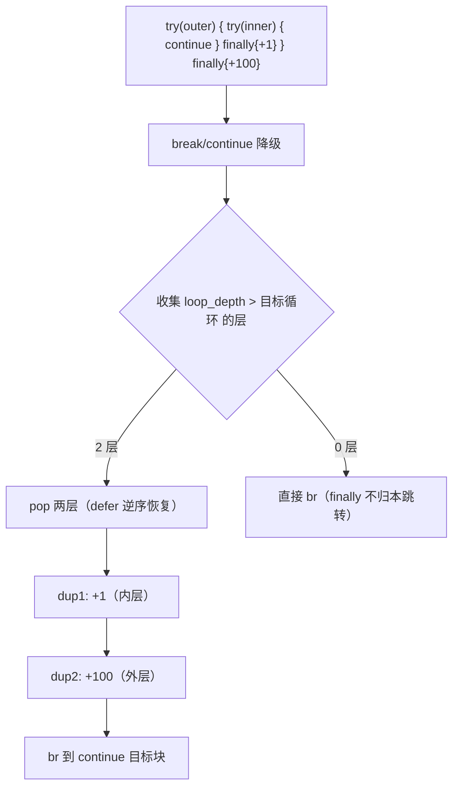
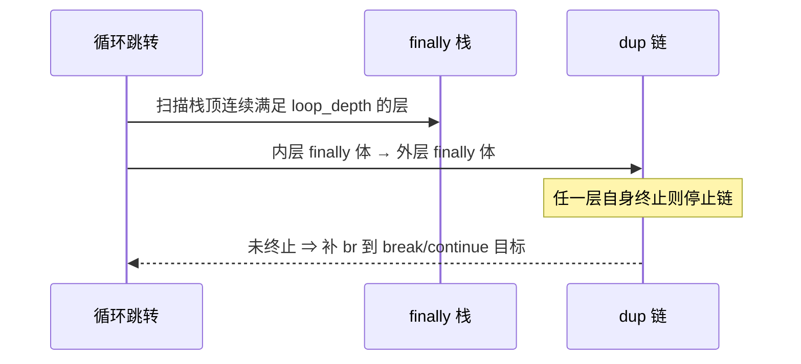

# AOT-CODEGEN-012 R-304：两层 finally 的多级链式重定向（F-211-b 闭环）

- 日期：2026-10-26
- 代次锚：**`irg 98d9eeb7f816ec2b8863835f3da38ea4`**（本轮唯一改动）；`nlk 3ae8f808d637c878281085a7af53a64e`／`tpl 3408c5bdce84957f0fbf54c3d7574df3`／`opti 553a2e540da638f3766911b1f0941dd1`／`ir fb2bb442ca27b98cf1df7e109a240e1f` 未变
- 工单：`docs/known-issues/AOT-CODEGEN-012-class-name-case-insensitive-lookup.md` §211.6
- 提交：未提交（HEAD `234c81d`）

## 1. 高层摘要（TL;DR）

R-303 让 `break`/`continue` 穿过 **一层** finally；**两层**时只跑最内层：

`while { $i++; try { try { if ($i%2==0) continue; $z+=10; } finally { $z+=1; } } finally { $z+=100; } }`
n=12 → PHP `1272 12`／修前 AOT **`672 12`**（每 continue 少 100，共 6 次）。`break` 同形（n6）同样失败。

朴素循环修不通：`redirectThroughFinally` 在 dup 块生成期间 pop 上下文、**返回时恢复**，外层再调会重复选中同一层。

修法：把 `redirectLoopJumpThroughFinally` 改为**一次性收集全部符合条件的 finally 层**（`loop_depth > target_loop_idx`，内层在前）→ 全部 pop（`defer` 逆序恢复）→ 逐层复制 finally 体成 `finally_dup_N` 链（内层先执行）→ 任一层自身终止即停止链。

## 2. 影响范围

| 层 | 影响 |
|---|---|
| IR 生成器（`ir_generator.zig` / `redirectLoopJumpThroughFinally`） | 单层 → 多级链式 |
| 语义面 | 嵌套 `try/finally` 内的 `break`/`continue` |
| return/throw 的多级 finally 路径 | **未改**（仍走原单层 `redirectThroughFinally`） |
| 发射器 / 运行期模板 / 优化器 / ir.zig | 未动 |

## 3. 核心变更

| # | 变更 | 站点 | 说明 |
|---|---|---|---|
| 1 | 收集符合深度条件的层 | `ir_generator.zig:4074` | `loop_depth > target_loop_idx` 从栈顶向下连续收集（上限 8 层） |
| 2 | 全部 pop + 逆序 defer 恢复 | 同上 | 生成期间栈内只剩「更外层且不应执行」的 finally |
| 3 | 逐层复制 finally 体 | 同上 | `finally_dup_N` 链，内层先执行，与 PHP 顺序一致 |
| 4 | 终止即停 | 同上 | finally 体自身 return/throw/break ⇒ 不再链外层 |
| 5 | 门 C339 | `c339_latch_then_arm_gate_tmp.sh` | 新增 **a21**（n3 形状），门扩到 24 臂 |

## 4. 可视化概览（Code & Logic Map）

## 5. 详细变更分析

| 文件 | 变更点 |
|---|---|
| `src/aot/ir_generator.zig` | `redirectLoopJumpThroughFinally` 重写为多级链式 |
| `fuzzy_scripts_720/tmp/c339_latch_then_arm_gate_tmp.sh` | 新增 a21；门扩到 24 臂 |
| `fuzzy_scripts_720/tmp/c339_latch_then_arm_tmp.tsv` | 门读数（a21 `1272 12`） |

## 6. 影响与风险评估

- **破坏式变更**：无。深度条件不满足时行为与 R-303 完全一致（0 层直接 br；1 层单次复制）。
- **风险**：嵌套层数上限截断为 8；finally 体复制随层数线性增长（代码体积）。
- **性能**：编译期多几次上下文比较与复制；运行期无额外开销。
- **复测路径**：`bash fuzzy_scripts_720/tmp/c339_latch_then_arm_gate_tmp.sh`；自证 `AOT_BIN=/bin/false`；邻居 C328–C338 + c249/c254；复现 `/tmp/f214/n3.php`、`n6.php`、`n7.php`、`n8.php`。
- **读数**：C339 **24/24**（113 s，自证 24 CF）、C338 15/15、C337 16/16、C336 18/18、C335 14/14、C334 8/8、C333 7/7、C332 13/13、C331 7/7、C330 5/5、C328 6/6、C329 4/8（F-191）；c249 `12/1/1`、c254 `27/2/1CF`；`zig build test` **21/21、326/326**；主回归 **PASS=68 FAIL=0**（`SELF_CHECK_OK rows=68 uniq=68 total=68`）

## 7. 遗留问题/潜在问题

- **return / throw 的多级 finally 仍走原单层实现**：n7（两层 + return）、n8（try/catch/finally 嵌套 + throw）实测已对，但未按同一「收集-链式复制」判据统一；建议后续合并三处实现，避免「靠巧合正确」。

## 8. 后续建议

| 优先级 | 建议 | 影响面 | 落地成本 |
|---|---|---|---|
| P1 | 把 return/throw/loop-jump 的 finally 重定向统一到「收集-链式复制」单一实现 | IR 生成 | 中 |
| P2 | finally 体复制去重（同 finally 多站点共享 dup 块） | 代码体积 | 中 |
| P2 | 把 n6/n7/n8 补进 C339 常驻族 | 门覆盖 | 低 |
