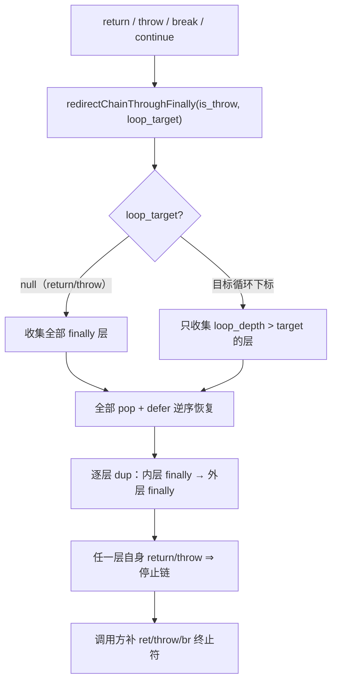
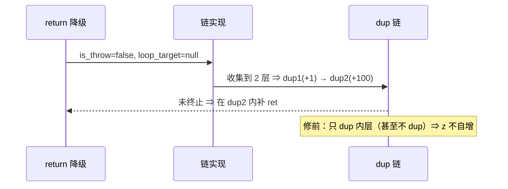

# AOT-CODEGEN-012 R-305：return/throw 与 break/continue 统一到同一 finally 链（F-211-c 闭环）

- 日期：2026-10-26
- 代次锚：**`irg ea35bbdefcfe9789de942bca13888130`**（本轮唯一改动）；`nlk 3ae8f808d637c878281085a7af53a64e`／`tpl 3408c5bdce84957f0fbf54c3d7574df3`／`opti 553a2e540da638f3766911b1f0941dd1`／`ir fb2bb442ca27b98cf1df7e109a240e1f` 未变
- 工单：`docs/known-issues/AOT-CODEGEN-012-class-name-case-insensitive-lookup.md` §212
- 提交：未提交（HEAD `234c81d`）

## 1. 高层摘要（TL;DR）

R-304 把 `break`/`continue` 做成多级 finally 链，但 `return`/`throw` 仍走旧的**单层** `redirectThroughFinally`。实测暴露 F-211-c：

| 形状 | PHP | 修前 AOT |
|---|---|---|
| w1：`try { try { return "r"; } finally { $z+=1; } } finally { $z+=100; echo "z=$z;"; }` | `z=101;r` | **`r`** |
| w3：n≥1 时内层 `try { return "pos"; } finally {+10} } finally {+100; echo}` | `z=110;pos` | **`pos`** |

两条 finally 一条都没跑（旧实现在 dup 生成后把上下文恢复，只覆盖最内层，且 return 的调用点没做二次链）。

修法：三处跳转统一到 `redirectChainThroughFinally(is_throw, loop_target)`：
- `return`/`throw` ⇒ `loop_target = null`：链**所有** finally 层；
- `break`/`continue` ⇒ `loop_target = 目标循环下标`：只链「try 在目标循环内侧」的层。

`redirectThroughFinally` 与 `redirectLoopJumpThroughFinally` 变成薄封装；`is_throw and try_stack.len > 0` 守卫保持原样。

## 2. 影响范围

| 层 | 影响 |
|---|---|
| IR 生成器（`ir_generator.zig`） | 单层重定向 → 统一链式实现 |
| 语义面 | 嵌套 `try/finally` 内的 `return`/`throw`（以及此前的 break/continue 保持） |
| 发射器 / 运行期模板 / 优化器 / ir.zig | 未动 |

## 3. 核心变更

| # | 变更 | 站点 | 说明 |
|---|---|---|---|
| 1 | `redirectThroughFinally` 退化为封装 | `ir_generator.zig:4039` | `→ redirectChainThroughFinally(is_throw, null)` |
| 2 | `redirectLoopJumpThroughFinally` 退化为封装 | `:4046` | `→ redirectChainThroughFinally(false, target_loop_idx)` |
| 3 | `redirectChainThroughFinally` | `:4053` | 收集层（全部 / 按 loop_depth 过滤）→ 一次出栈 → 逆序 defer 恢复 → 逐层复制 `finally_dup_N`（内层先）→ 任一层终止即停 |
| 4 | 门 C339 | `c339_latch_then_arm_gate_tmp.sh` | 新增 **a22**（w1 形状），门扩到 25 臂 |

## 4. 可视化概览（Code & Logic Map）

## 5. 详细变更分析

| 文件 | 变更点 |
|---|---|
| `src/aot/ir_generator.zig` | 三函数重构（旧单层实现删除，统一到链式） |
| `fuzzy_scripts_720/tmp/c339_latch_then_arm_gate_tmp.sh` | 新增 a22；门扩到 25 臂 |
| `fuzzy_scripts_720/tmp/c339_latch_then_arm_tmp.tsv` | 门读数（a22 `z=101;r`） |

## 6. 影响与风险评估

- **破坏式变更**：无。非嵌套时链长=1，与旧实现等价；throw 的 try 内守卫未变。
- **风险**：链层数上限 8；finally 体复制随「站点数 × 层数」放大代码体积。
- **性能**：编译期多几次复制；运行期无额外开销。
- **复测路径**：`bash fuzzy_scripts_720/tmp/c339_latch_then_arm_gate_tmp.sh`；自证 `AOT_BIN=/bin/false`；邻居 C328–C338 + 异常族 c249/c254；复现 `/tmp/f215/w1.php`、`w3.php`。
- **读数**：C339 **25/25**（117 s，自证 25 CF）、C338 15/15、C337 16/16、C336 18/18、C335 14/14、C334 8/8、C333 7/7、C332 13/13、C331 7/7、C330 5/5、C328 6/6、C329 4/8（F-191）；c249 `12/1/1`、c254 `27/2/1CF`；`zig build test` **21/21、326/326**；主回归 **PASS=68 FAIL=0**（`SELF_CHECK_OK rows=68 uniq=68 total=68`）

## 7. 遗留问题/潜在问题

- 8 层上限（`saved: [8]FinallyContext`）截断；finally 体复制未去重（同 finally 多站点共享 dup 块可降体积）。
- `throw` 在 try 内不重定向属既有设计（异常由运行时/catch 路径触发 finally），本轮未改。

## 8. 后续建议

| 优先级 | 建议 | 影响面 | 落地成本 |
|---|---|---|---|
| P2 | finally dup 块去重（同 finally 共享） | 代码体积 | 中 |
| P2 | 把 w1/w3/w4 补进 C339 常驻族（a22 已覆盖 w1） | 门覆盖 | 低 |
| P2 | 8 层上限改为动态数组（极端嵌套） | IR 生成 | 低 |
