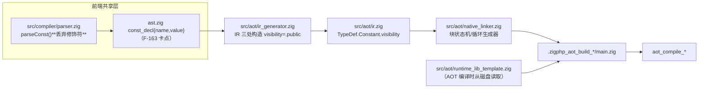
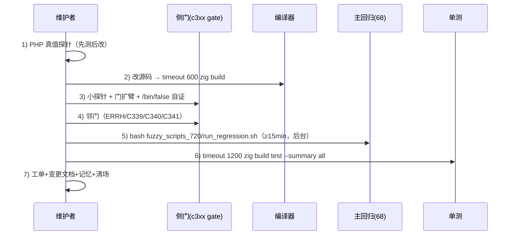

# AOT-CODEGEN-012 交接文档：R-306 → R-317 收口与后续四轮路线（代次 `a9f7a94f`）

- 日期：2026-10-26（交接时点）
- 仓库：`/Users/wangjianjun/products/parser`（Zig 0.16.0 的 PHP AOT 编译器）
- HEAD：`234c81d fix(aot): correct string offset assignment and PHI ownership bugs`（**全部改动未提交**，已 `git add` 到 index）
- **代次锚（五枚源码 md5，接手第一步必须复核）**：

| 文件 | md5 |
|---|---|
| `src/aot/runtime_lib_template.zig`（tpl） | `a54a0df983fdaf650e0a6db5c8008381` |
| `src/aot/native_linker.zig`（nlk） | `a9f7a94f0e0140b7b4d96e480ef41c91` |
| `src/aot/ir_generator.zig`（irg） | `ea35bbdefcfe9789de942bca13888130` |
| `src/aot/optimizer.zig`（opti） | `5532e540da638f3766911b1f0941dd1` |
| `src/aot/ir.zig`（ir） | `fb2bb442ca27b98cf1df7e109a240e1f` |

> 复核命令：`md5 -q src/aot/runtime_lib_template.zig src/aot/native_linker.zig src/aot/ir_generator.zig src/aot/optimizer.zig src/aot/ir.zig`

## 1. 高层摘要（TL;DR）

1. 本轮主线（R-306…R-317）**全部已闭环并验收**：主回归 `PASS=68 FAIL=0`（`SELF_CHECK_OK rows=68 uniq=68 total=68`）、单测 `Build Summary: 21/21 steps succeeded; 326/326 tests passed`、邻门（ERRH 19 / C339 30 / C340 4 / C341 5）全绿。
2. 本会话最后一轮 **R-318（F-162/F-163 类常量 `defined()` 与可见性）只完成取证，代码已逐字节回退**：根因是**共享层 AST 缺字段**（`const_decl` 不存修饰符），按宪法默认「不动共享层」停在待裁点；全部 PHP 真值矩阵与「可直接重落的补丁清单」已写入工单 §224。
3. 当前工作树 = 已验证代次，**无残留半成品**（工作树与 index 一致，五枚锚对齐）。
4. 建议下一轮优先级：**P0 = F-213-d（foreach + elseif 值面，需结构性重写）**；**P1 = F-167+F-168 小批（纯模板、已备真值）**；**P2 = F-162/F-163（等老铁批准跨模式 AST 字段后即可落地）**。

## 2. 影响范围

| 层 | 本会话已落地变更 | 状态 |
|---|---|---|
| 运行期模板 `src/aot/runtime_lib_template.zig` | R-311 `@` 作用域 error_reporting；R-314/R-315 `constant()` 类常量/作用域关键字；R-316/R-317 sprintf 浮点 INF/NAN/`%F`/`%e`/`%g`/`%G` | 已验证、已暂存 |
| 发射器 `src/aot/native_linker.zig` | R-306/R-307/R-308/R-309 循环生成器（foreach/while/for）空臂与 PHI 补发 | 已验证、已暂存 |
| IR 生成 `src/aot/ir_generator.zig` | R-303/R-304/R-305 break/continue/return/throw 穿 finally 重定向 | 已验证（早前轮次）、已暂存 |
| 共享层 `src/compiler/{ast,parser}.zig` | **本轮未动**（F-163 所需，待裁） | 未改 |
| 永久侧门（`fuzzy_scripts_720/tmp/`） | C339（30 臂）/ C340（4 臂）/ C341（5 臂）/ ERRH `c108`（19 臂） | 已扩臂、已暂存部分 |

## 3. 核心变更（本会话闭环清单）

| 轮次 | 缺陷 | 关键修法 | 判据读数 |
|---|---|---|---|
| R-306 | **F-212** foreach 里 `break`+`continue` 双丢（静默值错） | `then_skipped_marked` 旗标 + 空臂补发 `exit PHI + break`，**禁置 `break_generated`** | g5 `16→1`、r7 死循环→`110 0`；C339 28/28 |
| R-307 | **F-213-a** `while`+`elseif` 链内嵌 `continue` 编译失败 | `collectChainToCond` 对 `start == cond` 返回空链（不是越界） | C339 29/29 |
| R-308 | **F-213-b** elseif merge 的 `M→N` 边 PHI 缺物化（值错） | 内层 if/else 闭合后按 `findCommonBrTarget` 补 `materializeEdgePhi`，排除 cond/exit | C339 30/30 |
| R-309 | **F-214-a** for 生成器同形；并做同族普查 | 在 for 的 **F2** 段补同一守卫（用函数参数 `cond_idx/exit_idx` 比较） | `c_for 304→324`；C339 30/30 |
| R-310 | F-128 普查收口 | `.may_raise=false` 全量普查无新增 | 工单 §216 |
| R-311 | **F-217** `@` 作用域 error_reporting 应为 4437 | 抑制栈 `error_suppress_saved[128]` + `global_error_types = E_SUPPRESSED` | ERRH h15、19 臂 |
| R-312 | ERRH 门 `want` 跨臂泄漏 | 逐臂复位 + `NO_WANT` 门错误 | 门卫生 |
| R-313 | **F-98** handler 内抛异常 8 形审计 | 实测全 SAME，审计闭环 | 工单 §219 |
| R-314 | **F-160** `constant('C::X')` 类常量/接口链 | `findClassConstantValue` 父链+接口链递归（深度 32） | C340 4/4 |
| R-315 | **F-161** `constant('self::K')` 等作用域关键字 | 关键字识别 + 两条措辞分开 | C340 k4、ERRH 19 |
| R-316 | **F-165** sprintf 浮点 INF/NAN/`%F`（含 `%e` **死循环**） | `phpFmtSpecialFloat` 短路 + `'f','F'` 合臂 + `%e` 短路前置 | C341 3/3 |
| R-317 | **F-166** `%g/%G` 真实现（PHP 两处特化） | `formatFloatExpNorm` + `formatG` + `'g','G'` 臂 | C341 5/5；回归 68/68；单测 326/326 |

已入档文档（`docs/changes/2026-10-26/`）：
`…R306_foreach_then_break_…43e78937.md`、`…R307_chain_start_cond_…d4c87340.md`、`…R308_elseif_merge_phi_…9c6675bd.md`、`…R309_for_merge_phi_…a9f7a94f.md`、`…R311_at_error_reporting_…3f865396.md`、`…R314_constant_class_const_…a322e6fa.md`、`…R315_constant_scope_kw_…808c2543.md`、`…R316_sprintf_inf_nan_…285a1f58.md`、`…R317_sprintf_percent_g_…a54a0df9.md`。

## 4. 可视化概览（Code & Logic Map）





## 5. 详细变更分析

### 5.1 永久侧门（可直接复用，勿重建）

| 门 | 路径 | 臂数 | 用途/口径 |
|---|---|---|---|
| C339 | `fuzzy_scripts_720/tmp/c339_latch_then_arm_gate_tmp.sh` | 30 | 循环族 latch/`then_is_be`/嵌套 continue（a1…a30） |
| C340 | `fuzzy_scripts_720/tmp/c340_const_class_gate_tmp.sh` | 4 | `constant('C::X')`；k4=作用域关键字 |
| C341 | `fuzzy_scripts_720/tmp/c341_sprintf_float_gate_tmp.sh` | 5 | sprintf 浮点（含 TIMEOUT 判定列） |
| ERRH | `fuzzy_scripts_720/tmp/c108_errh_gate_tmp.sh` | 19 | 错误处理/handler/`@`（h1…h15、g1…g3） |
| SUPB | `fuzzy_scripts_720/tmp/c123_supb_leak_gate_tmp.sh` | 7 | `@` 抑制栈平衡/泄漏 |

门的三条硬纪律（违反会得到假绿）：
1. 臂一律 **heredoc**（`printf` 多层引号会静默产空脚本）；
2. `AOT_BIN=/bin/false bash <gate>` 自证必须**全部 `COMPILE_FAIL`**；
3. 输出走 `TSV_OUT=`，`norm` 统一折叠路径/行号并丢弃 `Stack trace:` 段；`want` 必须**逐臂复位**。

### 5.2 命令配方

```bash
# 编译（在仓库根目录！AOT 编译需要相对路径读取模板）
timeout 600 zig build
# 单文件 AOT 编译（必须在仓库根执行；产物必须叫 aot_compile_<name>）
timeout 300 zig-out/bin/php-interpreter --compile --output=/tmp/x/aot_compile_t /tmp/x/t.php
# 主回归（≥15 分钟，后台跑）
bash fuzzy_scripts_720/run_regression.sh > /tmp/reg.log 2>&1 &
# 单测（判据只认 Build Summary 行）
timeout 1200 zig build test --summary all | tail -5
# 清场
rm -rf .zigphp_aot_build_* ; rm -f ./*.o
```

### 5.3 关键代码坐标（本代次）

| 主题 | 坐标 |
|---|---|
| foreach 生成器 | `native_linker.zig:12060–13827`（`then_skipped_marked` ≈12404/12754/13121） |
| for 生成器 | `:14252–16089`（M→N 补发在 **F2** 段 ≈15726） |
| while 生成器 | `:16089–17748`（R-308 的 M→N 在 ≈17468） |
| `collectChainToCond` | `:8301` 附近（R-307 的空链短路） |
| `php_sprintf` | `runtime_lib_template.zig:31782` 起（标志解析 ≈31822，`'g','G'` ≈31962） |
| 浮点格式化 | `formatFloatPrecision` ≈31706、`formatFloatExpNorm` ≈31727、`formatG` ≈31740、`phpFmtSpecialFloat` ≈31720 |
| 类常量 | `findClassConstantValue` ≈11045、`php_constant_get` ≈11059、`php_defined` ≈11029、`php_get_class_constant_dynamic` ≈25582 |
| ClassMeta | `:17289`（`init` ≈17323、四处内部类字面量 ≈11805/12084/12678/12783） |
| `Value.toString`（F-168 落点） | `:3370`（float 分支 ≈3380；数组告警先例 ≈3392） |
| error 抑制 | `php_error_suppress_*` ≈22930 起 |

## 6. 影响与风险评估

- **是否破坏式变更**：否。R-306…R-317 均为「新增分支/新增臂/补发缺失发射」，主回归与单测全绿；`%g` 是新增格式符实现。
- **已证伪/不可再走的路径**（务必读，避免重复烧时间）：
  1. F-212 的「放宽通用臂 `!processed` 门控」两次尝试都导致 f036 重复 `break`（unreachable code）⇒ 只能用 `then_skipped_marked` 显式旗标。
  2. F-213-c/d 的**三次点补丁全败**（零差异/空输出/部分修复）⇒ 必须做「四处 elseif 段收敛为单点 helper」的结构性重写。
  3. F-162/F-163 **无法在 AOT 侧单独闭环**：irg 拿不到 token/修饰符（已核实 irg 无 context/tokens）；改 AST 属跨模式，须老铁批准。
  4. `defined('C::K')` 若只落「存在性」面会让 private/protected 由 false 变 true（**可见面回归**）⇒ 要么全做，要么不做。
- **风险点**：`native_linker.zig`/`ir_generator.zig` 超大文件，**禁止凭推测改**；同一代码块在 4 个生成器里近似重复，`Edit` 唯一性匹配会失败，须用带唯一上下文的行锚或行号+内容断言（先备份 `cp`）。
- **复测路径**：任何发射器/模板改动后按 §4 流程 2→6 跑；纯模板改动也必须「门 + 自证 + 主回归 + 单测」（r198）。

## 7. 遗留问题清单（含证据指针）

### P0

| 编号 | 事项 | 现状与证据 | 建议 |
|---|---|---|---|
| **F-213-d** | `foreach` + `if/elseif/else` 值面：`c_foreach 501` vs PHP `324`、`c_foreach_noelse 500` vs `320`；三症状（首轮 `$z` 打印空、`c4` 进错臂、逐轮累加不符） | 工单 §215.4；复现件 `/tmp/f213c/c_foreach.php`、`c_foreach_noelse.php`、`c_foreacht.php`（逐迭代轨迹）；IR：`body→(if_then_5, if_else_6)`、`if_merge_9(8)→if_merge_7(7)` **索引回跳** | 与 F-213-c 合并为「elseif 链单点 helper」结构性改造轮（预计改动集中 `native_linker.zig` 四处副本） |
| **F-213-c** | `while` + elseif 内嵌 `if/continue`：`c_while2 4004` vs `4204`，嵌套 if 整段丢失 | 工单 §215.3/§215.5；三次尝试全回退；埋点事实：嵌套 then 是 `.br→cond` 的 continue 块（非 cond 本身），else 是 `if_merge_10` | 同上；判据必须含 `c_while2t` 逐迭代轨迹 |

### P1

| 编号 | 事项 | 现状与证据 | 建议 |
|---|---|---|---|
| **F-167** | 空格标志 `% f`/`% d`/`% 05d` PHP **忽略**、AOT 补空格 | 工单 §222.4；真值：`[% f]`⇒`1.250000`、`[% 5d]`⇒`    3`、`[% 05d]`⇒`00003`、`[% .3f]`⇒`1.250`；AOT 现为 `[ 1.250000]`/`[ 0003]` | 模板 1 处：`runtime_lib_template.zig:31832` 的 `' ' => flag_space = true` 改为只消费不生效，并删 `flag_space` 变量与 **3 处**使用（≈31905、≈31915、≈31990）。**注意：`flag_space` 变量删掉后 3 处使用必须同步删，否则编译失败**（本轮曾只改一半，已回退） |
| **F-168** | `echo NAN` 缺 PHP 告警 | 真值（PHP 8.5.8）：`echo/print/(string)/strval/插值/拼接/sprintf("%s")/implode` 对 NAN **全部**发 `Warning: unexpected NAN value was coerced to string`；`INF` **不发**；`(int)INF/NAN/-INF` 的 `The float X is not representable as an int, cast occurred` **AOT 已正确**（本轮实测） | 模板 1 处：`Value.toString` 的 float 分支（`:3380`）加 `if (std.math.isNan(fv)) emitWarning("unexpected NAN value was coerced to string");`（数组分支已有同样先例）。**风险**：`var_export`/`json_encode` 不告警——确认它们不走 `toString` |
| **F-162/F-163** | `defined('C::K')` 恒 false；类常量可见性未建模 | 工单 §224 全量真值矩阵 + 已写好并**完整回退**的补丁清单（tpl+nlk+irg 三段）+ **唯一硬前置：AST `const_decl` 增 `modifiers`** | **等老铁裁决**；批准后按 §224.3 清单原样重落，本轮不用重新取证 |

### P2（已登记，未开工）

| 编号 | 事项 | 备注 |
|---|---|---|
| F-169 | 常量/静态属性同名空间混淆（`A::prop` 直读/`constant` 取到属性值） | 工单 §224.2；随 F-162/F-163 同批可解 |
| F-170 | 枚举 case 未进常量名单（`defined('E::A')` false） | 同上；case 只进 `static_properties` |
| F-164 | parser 拒绝 PHP 8.3 `C::{$name}` | 跨模式，待裁 |
| F-106-b / F-140-b | trigger_error/handler mask 残面 | P2 |
| F-88 | `throwThrowable` 在未初始化 allocator 下段错误 | 正解＝短路返回 `error.RuntimeNotInitialized` |
| F-95-d | 类常量缺失的 Error 不可 catch（AOT 硬 fatal） | 待收口 |
| F-191 / F-199 / F-201-b / F-202 / F-206-b / F-208-b / F-213-c/d | GC/COW/PHI 各残面 | 见备忘 ledger |

## 8. 后续建议（优先级 / 影响面 / 落地成本）

| 优先级 | 事项 | 影响面 | 落地成本 |
|---|---|---|---|
| P0 | F-213-c + F-213-d 合并为「elseif 链单点 helper」结构性改造 | foreach/while/for 三族循环内嵌 if 链的值面与编译面（含编译失败） | 高（重写 4 处副本，需逐迭代轨迹判据 + 全循环门 + 主回归） |
| P1 | F-167 + F-168 一个模板小批 | sprintf 标志语义 + NAN 字符串化告警 | 低（2 处 + 1 处使用点清理；新建 C342 门 6–8 臂） |
| P2 | F-162/F-163（待裁） | 类常量 `defined`/直读/`constant()` 三面 + F-169/F-170 | 中（AST 3 行 + parser 3 调用点 + irg 3 构造点，AOT 侧补丁已备） |
| P2 | F-88 / F-95-d | 测试直达路径段错误 / Error 可捕获性 | 低–中 |

---

# 附录 A：可直接粘贴给下一个 AGENT 的提示词

> 四段提示词互相独立，按需粘贴；共同前置请先贴 A0。

## A0（公共前置，任何一轮都先贴）

```
你在维护 /Users/wangjianjun/products/parser —— 一个 Zig 0.16.0 的 PHP AOT 编译器。
先读并严格遵守：仓库根 AGENTS.md（含 constitution/ 全部规则）、docs/known-issues/AOT-CODEGEN-012-class-name-case-insensitive-lookup.md 的 §213–§224。
硬性约束（违反即返工）：
1) 修改前必须先读目标文件上下文；native_linker.zig（664KB）与 ir_generator.zig（234KB）禁止凭推测写代码，先 grep 找既有模式。
2) 默认只修 AOT 编译/运行问题；凡涉及 src/compiler/{parser,ast}.zig（共享层）或任何非 AOT 模式，必须先向用户申请批准，未批准不得改动。
3) 禁止简化/打桩/硬编码；禁止删除 .php 源文件；测试产物必须删除；AOT 产物命名 aot_compile_<name>。
4) 所有命令必须带 timeout（PHP 脚本 ≤10s；build ≥600s；主回归 ≥1800s 且后台跑）。单测判据只认 `Build Summary` 行。
5) 先复核代次锚（五枚 md5，见 docs/changes/2026-10-26/AOT-CODEGEN-012_R306-R317_handoff_2026-10-26_a9f7a94f.md 第 0 节）；不一致先停下报告，不得在未知代次上改代码。
6) 每轮流程：PHP 真值探针 → 小探针 → 改代码 → timeout 600 zig build → 侧门扩臂 + AOT_BIN=/bin/false 自证 → 邻门 → 主回归 → 单测 → 工单§ + 变更文档 + 记忆 + 清场。
7) 汇报用中文，称呼用户为「老铁」；建议一律用「优先级(P0/P1/P2)+影响面+落地成本」三列表格；代码块带语言标记+文件名。
```

## A1（F-213-c + F-213-d 结构性改造轮，P0）

```
【任务】修 F-213-c 与 F-213-d：循环内嵌 if/elseif/else 链的结构性归臂错位（native_linker.zig 的四处近似副本）。

【已实测事实，不要重新推翻】
- c_while2（while + elseif 内嵌 if/continue）：AOT 4004 12 vs PHP 4204 12；嵌套 if 的 then/else 整段丢失，c4 出现在 else 臂。
- c_foreach（foreach + 同形）：AOT 501 vs PHP 324；三症状：首轮后 $z 打印为空、c4 的 echo 落在 else 臂、逐轮累加不符。
- 三次点补丁（内联分支 / 回退分支窄守卫 / 内联+M→N 补发）全部无效且部分有害（空输出）⇒ 已完整回退，禁止在现有副本上继续打点补丁。
- 关键埋点事实：嵌套 if 的 then 往往不是 cond 本身，而是「以 .br 直指 cond 的 continue 块」；else 为 if_merge_*，整段 if/else 闭合后需按 M→N 补发 PHI，但排除 cond/exit。
- IR 块序（c_foreach）：body→(if_then_5, if_else_6)；if_then_5→foreach_increment_2 | if_merge_9；if_merge_9(8)→if_merge_7(7)（索引回跳）→foreach_increment_2；if_else_6→(if_then_10, if_else_11)→if_merge_12→if_merge_7。

【目标形态】把 for 生成器（两处）、while 生成器（三处）、foreach 生成器里的「elseif 链发射段」收敛为一个单点 helper：
输入 = (func, 链起始块/终止块, 外层 cond 块, exit 块, indent)；输出 = 是否已发射。
helper 内部统一：①按 cond_br 二分；②then/else 各自递归；③每层闭合后按「公共 merge 块 M → M 的 br 目标 N」补发 M→N 边 PHI（排除 cond/exit）；④then 臂若为 continue/break 预标记块，按 R-306 的 then_skipped_marked 口径补发终结点且不置 break_generated。

【判据（全部必须满足）】
1) /tmp/f213c/ 下 c_while2 = 4204 12、c_while2t 逐迭代轨迹与 PHP 全等；c_foreach = 324、c_foreach_noelse = 320、c_foreacht 逐迭代与 PHP 全等。
2) 反证臂不变：c_dowhile 324 12、c_for 324 12、c_for_noelse 320、c_while2 之外的 g1/g3/g4/g5/g6（/tmp/f216/）全 SAME。
3) C339 30/30、C340 4/4、C341 5/5、ERRH 19 臂（18 same + 1 既有 CF）零转移。
4) 主回归 PASS=68 FAIL=0；单测 21/21 steps + 326/326 tests。
5) 若某形态修不动，允许分两轮交付（先 c_while2 后 c_foreach），但不得留下「部分修复导致空输出/崩溃」的状态——出现即整段回退。

【交付】工单新增 §225（含逐迭代轨迹表、IR 块序、helper 规格）；变更文档 docs/changes/2026-10-26/AOT-CODEGEN-012_R320_elseif_chain_helper_2026-10-26_<新nlk短md5>.md；更新记忆 ledger；清场 .zigphp_aot_build_*。
```

## A2（F-167 + F-168 模板小批，P1，最省时）

```
【任务】一轮收两个 P2：F-167 sprintf 空格标志、F-168 echo NAN 告警。纯模板（runtime_lib_template.zig），不碰别的文件。

【真值（PHP 8.5.8，已实测，直接用）】
F-167：PHP 忽略空格标志——sprintf("[% f][% d][% 5d][%05d][% 05d][% .3f][%+ d]") 于 (1.25,3,3,3,3,1.25,3) ⇒ [1.250000][3][    3][00003][00003][1.250][+3]；"[% s][% 10s][%-10s]" 于 "ab" ⇒ [ab][        ab][ab        ]。AOT 现为 [ 1.250000][ 3][    3][00003][ 0003][ 1.250][+3]。
F-168：NAN 在 echo/print/(string)/strval/插值/拼接/sprintf("%s")/printf("%s")/implode 全部发 Warning: unexpected NAN value was coerced to string（后接 "NAN"）；INF 不发；var_export(NAN) 打 NAN 不告警；json_encode(NAN)=false。(int)INF/NAN/-INF 的 "The float X is not representable as an int, cast occurred" AOT 已正确，不要动。

【修法】
1) F-167：runtime_lib_template.zig 的 php_sprintf 标志解析（≈31822）把 `' ' => flag_space = true` 改为只消费不生效，删除 flag_space 变量，并同步删除它的 3 处使用（≈31905 的 else-if、≈31915 的 else-if、≈31990 的 `else if (flag_space) " "`）。★这三处必须同批删，缺一处就编译失败（此前教训）。
2) F-168：Value.toString（≈3370）的 float 分支（≈3380）在格式化前判 std.math.isNan 发 emitWarning("unexpected NAN value was coerced to string")（数组分支 ≈3392 有同样先例）。先确认 var_export/json_encode 不走该 toString 分支。

【判据】
1) 新建永久门 fuzzy_scripts_720/tmp/c342_sprintf_nan_gate_tmp.sh：臂 p1（F-167 七格式一行）、p2（%s/宽度/左对齐字符串）、n1（echo NAN 含 rc）、n2（print/(string)/strval 三形）、n3（INF 不告警 + var_export/json_encode 反证）、n4（(int)INF/NAN 既有告警不回退）。heredoc + TSV_OUT + `AOT_BIN=/bin/false` 自证必须全 COMPILE_FAIL。
2) 门 6/6 SAME；C341 5/5、ERRH 19、C339 30、C340 4 零转移；主回归 68/68；单测 21/21+326/326。
3) 工单 §225（或 §224 后新增）；变更文档 AOT-CODEGEN-012_R319_sprintf_flag_nan_2026-10-26_<tpl短md5>.md；记忆 ledger 记 R-319；清场。
```

## A3（F-162/F-163 落地轮 —— **仅当老铁明确批准跨模式后**）

```
【前置】用户已批准「共享层增量 AST 字段」。若未获批准，禁止执行本提示词，改为在工单 §224.4 继续等待裁决。

【任务】落地 F-162（defined('C::K')）+ F-163（类常量可见性）+ 顺带 F-169/F-170。

【唯一硬前置】ast.zig:170 的 const_decl 增 `modifiers: ast.Node.Modifier = .{}`（带默认值，其他模式忽略）；
parser.zig:1910 parseConst 接收 modifiers；3 个调用点透传：parser.zig:453（顶层，传默认值）、:745（接口成员，接口常量恒 public 可传默认值）、:949（类成员，手里已有 modifiers）。
ir_generator.zig 三处构造点（≈2004 类、≈2380 枚举、≈2510 trait）把 const_data.modifiers 的可见性映射进 IR；接口路径（≈2204）保持 .public。

【AOT 侧补丁清单，已写好并完整回退过，按此重落（详见工单 §224.3）】
1) 模板：ConstVisibility 枚举 + ClassMeta.const_visibility（名字→可见性；兼作「这个名字是常量」名单）+ setConstVisibility + 四处内部类 ClassMeta{…} 字面量补字段；
   findClassConstant（返回 value/owner/vis；父链/接口链跳过 private——PHP 实测 private 不继承）；constAccessAllowed（public 恒可/private 同一声明类/protected 复用 classMetaSameFamily 双向）；fatalConstAccess（"Cannot access private|protected constant C::K"，类名段：直读用解析后类名、constant() 用字面段）；php_constant_get 接可见性；php_defined 新增 :: 分支（class⇒false、类/常量缺失⇒false、关键字无作用域⇒硬 fatal）；php_get_class_constant_dynamic 第三实参=直接读标志（未命中⇒"Undefined constant C::K"/Class "C" not found；两参调用保持旧口径）。
2) 发射器：类常量（≈4166 后）、trait 常量（≈4185 后）、枚举 case（≈4029 后）三处各补一行 setConstVisibility；枚举 case 记 public。
3) irg：const_vis_cache（与 constant_cache 同键）⇒ 只有 public 允许 compile-time 内联；非 public 走 php_get_class_constant_dynamic(...,1)；本类未声明但沿父/接口链存在的 non-public 也走它；public 继承常量继续 static_property_get（零代价）。

【判据（PHP 真值见工单 §224.2）】
1) 新建 C343 门 8 臂：V1 defined 矩阵（含 NoSuch::X false、A::class false、A::PRI/PRO 于 A 内 true、B::PRI false、D 作用域 false、P 读 Q::QPRO true）；V2 直读 A::PRI fatal；V3 直读 A::PRO fatal；V4 B::PRO 于无关作用域 fatal 且消息 "Cannot access protected constant B::PRO"；V5 constant('A::PRI') fatal；V6 类内/子类/父作用域合法访问取值；V7 constant('A::prop')/defined('A::prop') 走常量口径（F-169）；V8 enum defined/constant（F-170）。heredoc + TSV_OUT + 自证全 CF。
2) C340 4/4（k1–k4 不得转红）、C339 30、C341 5、ERRH 19 零转移；主回归 68/68；单测 21/21+326/326。
3) 特别回归检查：任何语料若依赖「私有常量直读返回真值」的旧错行为都必须先报告，不得直接改语料。
```

## A4（通用续跑提示词，日常推进用）

```
继续推进 /Users/wangjianjun/products/parser 的已知问题修复。工作方式按 docs/changes/2026-10-26/AOT-CODEGEN-012_R306-R317_handoff_2026-10-26_a9f7a94f.md 的 §4 流程执行。

第一步（不得跳过）：
1) 复核五枚源码 md5 是否等于该文档第 0 节的代次锚；不等则停下报告差异，不得在未知代次上继续。
2) 打开工单 docs/known-issues/AOT-CODEGEN-012-class-name-case-insensitive-lookup.md 的「遗留问题清单」对应小节，确认该缺陷仍开（登记可能过期，先跑 3–8 个形状探针；全绿即按审计关闭并更新工单）。

优先级：P0 = F-213-c/F-213-d（结构性改造，见附录 A1）；P1 = F-167+F-168（见 A2）；P2 = F-162/F-163（**必须等老铁批准跨模式**，见 A3）、F-88、F-95-d。

纪律：先测 PHP 真值再改码；每轮一个小批（1–2 个缺陷）；只跑定向门，主回归只在结构改动/里程碑时跑且给足 15 分钟以上；不许并发重建（会串代次）；每轮结束写工单§ + 变更文档 + 记忆 + 清场，并向老铁输出「P0/P1/P2 + 影响面 + 落地成本」三列表格与下一步建议。
```

---

# 附录 B：复现件与探针清单

> ⚠️ **实测更正（交接时点）**：`/tmp` 已被系统清理（`/tmp/f218`、`/tmp/f213c`、`/tmp/f212`、`/tmp/f216` 均已不存在）。下表仅作**用途索引**，文件需按工单对应小节的表格**重建**（成本很低，每份 10–30 行）。不要假设它们还在磁盘上。


| 目录/文件 | 用途 |
|---|---|
| `/tmp/f212/r1..r7.php` | F-212 foreach break+continue 族（r7 是死循环复现） |
| `/tmp/f216/g1..g6.php` | F-212/F-213 反证与对照组（g4=while elseif、g5=foreach 双守卫） |
| `/tmp/f213c/c_for.php`、`c_foreach.php`、`c_dowhile.php`、`c_for_noelse.php`、`c_foreach_noelse.php`、`c_while2.php`、`c_while2t.php`、`c_foreacht.php` | F-213-c/d 与 F-214-a 的形状矩阵（含逐迭代轨迹件） |
| `/tmp/f218/b1..b6.php` | F-162/F-163 的 AOT 修前基线（六臂） |
| `/tmp/f218/p1a/p2/p3/p4/p5/p6.php` | 类常量可见性/消息口径的 PHP 真值探针（六份） |
| `/tmp/f218/s1.php`、`s2.php` | F-167 空格标志与 F-168 NAN 字符串化真值探针 |
| `/tmp/f159/*`、`/tmp/f161/*`、`/tmp/f165/*` | 常量族/sprintf 族历史探针 |

> 注意：`/tmp` 可能被系统清理；若缺失，按工单 §224.2 的表格可 1:1 重建。

# 附录 C：可一键重建的探针脚本（/tmp 被清理后用它）

## C1 类常量可见性矩阵（F-162/F-163 真值 + AOT 对照）

```php
<?php
class A {
    public const PUB=1; protected const PRO=2; private const PRI=3;
    public static function s() {
        echo "A::s "; var_dump(defined('A::PRI'), defined('self::PRI'), defined('B::PRO'), defined('B::PRI'), defined('B::PUB'), defined('A::NOPE'));
    }
}
class B extends A { public static function s() {
    echo "B::s "; var_dump(defined('A::PRO'), defined('A::PRI'), defined('self::PRO'), defined('self::PRI'), defined('parent::PRO'), defined('parent::PRI'));
    try { echo parent::PRI; } catch (Error $e) { echo "parent::PRI => ", $e->getMessage(), "\n"; }
    try { echo B::PRI; } catch (Error $e) { echo "B::PRI => ", $e->getMessage(), "\n"; }
} }
class D { public static function s() { echo "D::s "; var_dump(defined('A::PRO')); try { echo B::PRO; } catch (Error $e) { echo "B::PRO => ", $e->getMessage(), "\n"; } } }
class P { public static function s() { echo "P::s "; var_dump(defined('Q::QPRO')); echo constant('Q::QPRO'), "\n"; } }
class Q extends P { protected const QPRO = 7; }
enum E: int { case A = 1; }
trait TC { const T = "tt"; }
class C { use TC; }
var_dump(defined('NoSuch::X'), defined('A::PUB'), defined('A::class'), defined('E::A'), defined('C::T'));
var_dump(constant('E::A'));
A::s(); B::s(); D::s(); P::s();
```

**期望（PHP 8.5.8，已实测）**：`NoSuch::X`/`A::class` false；`A::PUB`/`E::A`/`C::T` true；A 作用域 PRI/self::PRI true、B::PRI false、B::PRO true；B 作用域 A::PRI/self::PRI/parent::PRI false、其余 true；`parent::PRI` ⇒ `Cannot access private constant A::PRI`；`B::PRI` ⇒ `Undefined constant B::PRI`；D 作用域 `A::PRO` false、`B::PRO` ⇒ `Cannot access protected constant B::PRO`；P 作用域 `Q::QPRO` true 且值 7；`constant('E::A')` ⇒ `enum(E::A)`。

## C2 F-167 空格标志 / F-168 NAN 字符串化

```php
<?php
printf("[% f][% d][% 5d][%05d][% 05d][% .3f][%+ d]\n", 1.25, 3, 3, 3, 3, 1.25, 3);
printf("[% s][% 10s][%-10s]\n", "ab", "ab", "ab");
$n = NAN; $i = INF;
echo "NAN=[", $n, "]\n";            // 期望 Warning: unexpected NAN value was coerced to string + NAN
echo "INF=[", $i, "]\n";            // 期望无告警
echo "cast=[", (string)$n, "]\n";   // 期望同样告警
echo "sprintf=[", sprintf("%s", $n), "]\n";
echo "implode=[", implode(",", [$n, 1]), "]\n";
echo "ve=[", var_export($n, true), "]\n";        // 期望无告警
var_dump(json_encode($n));                        // 期望 false
var_dump((int)INF, (int)NAN);                    // 期望 "not representable as an int" + int(0)
```

**期望**：`[1.250000][3][    3][00003][00003][1.250][+3]`；`[ab][        ab][ab        ]`。

## C3 循环 elseif 形状矩阵（F-213-c/d / F-214-a）

```php
<?php // foreach 版（F-213-d）：期望 PHP 324
$z = 0;
foreach ([1,2,3,4,5,6] as $i) {
    if ($i % 2 == 1) { $z += 1; }
    elseif ($i % 4 == 0) { echo "c4\n"; $z += 1000; }
    else { $z += 10; }
}
echo $z, " ", 12, "\n";
```
```php
<?php // while 版（F-213-c）：期望 PHP 4204 12
$i = 0; $z = 0;
while ($i < 12) {
    $i++;
    if ($i % 2 == 1) { $z += 1; }
    elseif ($i % 2 == 0) { if ($i % 4 == 0) { echo "c4\n"; } $z += 100; }
}
echo $z, " ", $i, "\n";
```
> 逐迭代轨迹版：在循环体首行 `echo "i=$i z=$z\n";` 即可，用于定位「c4 进错臂」「首轮后 z 为空」。

## C4 门脚本模板（新建任何 `c34x` 门都沿用）

```bash
#!/usr/bin/env bash
set -uo pipefail
cd "$(dirname "$0")/../.." || exit 90
PHP=/opt/homebrew/bin/php
AOT="${AOT_BIN:-zig-out/bin/php-interpreter}"
T="$(mktemp -d /tmp/cXXX.XXXXXX)"; trap 'rm -rf "$T"' EXIT
OUT="${TSV_OUT:-fuzzy_scripts_720/tmp/cXXX_tmp.tsv}"
norm() { sed -E -e 's/^[[:space:]]+//' -e 's~[A-Za-z0-9_./-]*/[A-Za-z0-9_.-]+\.php~@FILE@~g' -e 's/on line [0-9]+/on line @N@/g' -e '/^Stack trace:/,$d'; }
cat > "$T/a1.php" <<'PHP'
<?php
// 臂内容（heredoc 必须）
PHP
# 逐臂：compile → PHP 跑 → AOT 跑 → norm 后比 stdout/stderr/rc
```
