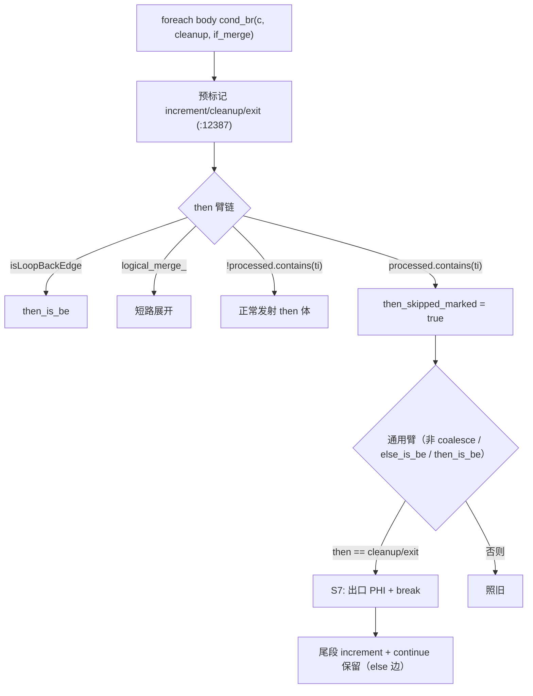

# AOT-CODEGEN-012 R-306：foreach 条件臂的出口补发（F-212 闭环）

- 日期：2026-10-26
- 代次锚：**`nlk 43e789374300a74fdef194ef3c882c75`**（本轮唯一改动）；`tpl 3408c5bdce84957f0fbf54c3d7574df3`／`opti 553a2e540da638f3766911b1f0941dd1`／`irg ea35bbdefcfe9789de942bca13888130`／`ir fb2bb442ca27b98cf1df7e109a240e1f` 未变
- 工单：`docs/known-issues/AOT-CODEGEN-012-class-name-case-insensitive-lookup.md` §213.6
- 提交：未提交（HEAD `234c81d`）

## 1. 高层摘要（TL;DR）

`foreach` 体首条语句是 `if (c) break;` 时，AOT 把 **then 臂生成成空块**：`generateForeachFromLabels` 在 if/else 处理之前就把 `increment/cleanup/exit` 统一 `processed.put`（预标记），而 body 的 `cond_br` 的 **then 目标正是 cleanup** ⇒ then 臂链三支全不命中 ⇒ `break` 丢失。更严重的是：当内层增量被 else 臂的三元链 merge 内联后，**then 路径不经过 `iter_next`**，只落到尾段 `continue` ⇒ `iter_valid` 恒真 ⇒ **死循环**。本轮在 cond_br 的通用臂补一发「出口 PHI + break」（仅当 then 臂确因预标记被跳过），g5 由 `16`→`1`、f036 形态死循环→`110 0`，主回归 68/68、C339 门 28/28。

## 2. 影响范围

| 层 | 影响 |
|---|---|
| 发射器（`native_linker.zig` / `generateForeachFromLabels`） | 通用 cond_br 臂新增 then=cleanup/exit 的出口补发（4 处行级改动） |
| 语义面 | 所有「`foreach` 体内条件分支以 `break` 直接退出循环」的形状（含 `foreach` 首条语句即守卫） |
| 其它循环生成器（for/while/do-while） | 未动（各自的 then_is_be / else_is_be 分支保持原状） |
| 运行期模板 / 优化器 / IR / 语法 | 未动 |

## 3. 核心变更

| # | 变更 | 说明 |
|---|---|---|
| 1 | `then_skipped_marked` 旗标 | then 臂链最后一支的 `else` 分支置位：该臂因 `processed.contains(ti)` 被跳过 |
| 2 | 通用臂 S7 补发 | `then_skipped_marked ∧ then∈{cleanup,exit}` ⇒ `generateExitPHIAssignments(body_idx→then)` + `break :label` |
| 3 | 不置 `break_generated` | else 边仍需尾段增量与 `continue`；置位会吞掉它们（r7 死循环教训） |

**归因链（实测）**：4 个 break 站点编号埋点（S1 body 终止符 / S2 then 终止符 / S4 `else_is_be` / S7 新增）后，
f036 命中 **S4 一次**、r7/g5 命中 **S7 一次**，两臂互斥 ⇒ §213.5 的尝试②③ 之所以在 f036 上重复 break，
是把第二发射点加到了与 S4 叠加的位置。

## 4. 可视化概览（Code & Logic Map）



```mermaid
sequenceDiagram
  participant B as body 块
  participant F as foreach 生成器
  participant Z as 生成码
  B->>F: cond_br then=foreach_cleanup
  F->>F: try processed.put(cleanup)
  F->>F: then 臂链全跳（预标记）
  F->>Z: if (c) { exit PHI; break :__foreach_0; }
  F->>Z: } else { 增量内联 + 累加 }
  F->>Z: continue :__foreach_0;   // else 边可达
```

## 5. 详细变更分析

| 文件 | 变更点 |
|---|---|
| `src/aot/native_linker.zig` | `:12404` 旗标声明；`:12754` 跳过分支置位；`:13121` 通用臂 S7 补发 + 注释 |
| `fuzzy_scripts_720/tmp/c339_latch_then_arm_gate_tmp.sh` | a23 加回、新增 a24（前导 if-break 值面）/ a25（f036 形态），门 25→28 臂 |
| `fuzzy_scripts_720/tmp/c339_latch_then_arm_tmp.tsv` | 门读数（28 行） |

## 6. 影响与风险评估

- **破坏式变更**：无。仅在「then 臂因预标记被跳过」这一原本零发射的分支上补发语句。
- **风险**：`then == exit_idx` 时出口 PHI 目标取 then 块本身（而非 cleanup），与既有 S4 用 cleanup 的口径不同；已由 C339 28 臂与主回归覆盖。
- **风险**：不置 `break_generated` 是有意为之——置位会抑制尾段增量与 `continue`，导致 else 路径跳过 `iter_next`（本轮 r7 死循环的正是该机制）。
- **性能**：编译期每 cond_br 多一次布尔判断；运行期零变化。
- **复测路径**：`bash fuzzy_scripts_720/tmp/c339_latch_then_arm_gate_tmp.sh`；自证 `AOT_BIN=/bin/false`（28 CF）；对照件 `/tmp/f212/r7.php`、`/tmp/f216/g5.php`、`fuzzy_scripts_720/pass/f036_strategy_dynamic_pricing.php`。
- **读数**：C339 **28/28**（135 s，自证 28 CF）；主回归 **PASS=68 FAIL=0**（`SELF_CHECK_OK rows=68 uniq=68 total=68`）；`zig build test --summary all` **21/21、326/326**；F-212/F-216 家族 13 件 12 SAME（唯一红＝g4 既有 F-213）。

## 7. 遗留问题/潜在问题

- **F-213（P0 仍开）**：`while` + `if/elseif/else` 且首支内嵌 `continue` ⇒ `[AST-DIRECT-FAIL] unprocessed blocks: 7:if_merge_7`（`/tmp/f216/g4.php`）。
- **双向 break 形状未建臂**：`if (c) { break; } else { break; }` 在 foreach 内当前依赖尾段 `continue` 兜底，未纳入门（无实测读数）。
- 本轮尾段 `continue` 与内联增量的耦合仅按 g5/r7/f036 三形验证，未做全语料形状普查。

## 8. 后续建议

| 优先级 | 建议 | 影响面 | 落地成本 |
|---|---|---|---|
| P0 | F-213：while + elseif 链 + 嵌套 continue 的 `unprocessed blocks`（沿 F-208 链式发射思路或定位提前返回点） | while 发射 | 中 |
| P1 | 把「then/else 双 break」「then=cleanup 且无独立 increment 块」两形补入 C339 | 门覆盖 | 低 |
| P2 | `generateForeachFromLabels` 预标记与臂发射的先后关系做一次结构梳理（本轮只做单点补发，未动预标记策略） | 发射器结构 | 高 |
