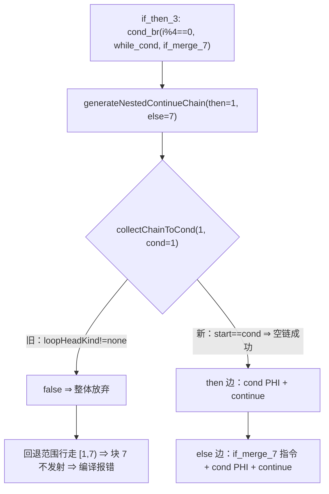

# AOT-CODEGEN-012 R-307：分支即回边的空链（F-213-a 闭环）

- 日期：2026-10-26
- 代次锚：**`nlk d4c873400ba0bfe928c7c5201b3ddc32`**（本轮唯一改动）；`tpl 3408c5bd…`／`opti 553a2e54…`／`irg ea35bbde…`／`ir fb2bb442…` 未变
- 工单：`docs/known-issues/AOT-CODEGEN-012-class-name-case-insensitive-lookup.md` §214
- 提交：未提交（HEAD `234c81d`）

## 1. 高层摘要（TL;DR）

`while` 体内 `if/elseif/else` 且首支再嵌 `continue` 时编译失败（`unprocessed blocks: 7:if_merge_7`）。根因不是"walker 提前返回"，而是**链式发射的起点即 cond 被当成越界**：`collectChainToCond(start == cond_idx)` 第一步就命中 `loopHeadKind != .none` 返回 false，`generateNestedContinueChain` 整体放弃，回退范围行走 `[1, 7)` 全为已处理块 ⇒ `if_merge_7`（`$z += 100`）永不发射。修法是把「起点即 cond」定义为**空链成功**（分支自身即 `continue`），一处 7 行。

## 2. 影响范围

| 层 | 影响 |
|---|---|
| 发射器（`native_linker.zig` / `collectChainToCond`） | 起点==cond 从「失败」改为「空链成功」 |
| 调用面 | walker 链派发（:9346/:9353）、for 生成器（:14874）、while 生成器（:16622）三处语义一致 |
| 语义面 | 所有「循环体内条件分支直接 `continue`（br 直指 cond）」的形状 |
| 运行期模板 / 优化器 / IR / 语法 | 未动 |

## 3. 核心变更

| # | 变更 | 说明 |
|---|---|---|
| 1 | `start_idx == cond_idx` 短路 | `chain_n.* = 0; return true;` ⇒ 空链 |
| 2 | 空链的发射语义 | `emitChainToCond` 对空链只 `materializeEdgePhi(cond, src_blk)` + `continue` |

**归因链**：g4 IR 块序 `… if_then_3(4) → {while_cond(1) | if_merge_7(7)}`；then 臂调用
`generateNestedContinueChain(then=while_cond, else=if_merge_7)`；`collectChainToCond(1,1)` 因 `while_cond_0` 是循环头被拒；
回退行走 `nested_start = then_block 索引 = 1`、`nested_end = loop_end = 7` ⇒ [1,7) 无新块。

## 4. 可视化概览（Code & Logic Map）



```mermaid
sequenceDiagram
  participant G as while 生成器
  participant C as collectChainToCond
  participant Z as 生成码
  G->>C: start=while_cond(1), cond=while_cond(1)
  C-->>G: true, n=0（空链）
  G->>Z: if (i%4==0) { reg_44=...; continue; }
  G->>Z: z += 100; reg_44=...; continue;   // if_merge_7 恢复发射
```

## 5. 详细变更分析

| 文件 | 变更点 |
|---|---|
| `src/aot/native_linker.zig` | `collectChainToCond`：起点==cond 的空链短路（7 行含注释） |
| `docs/known-issues/…lookup.md` | §214 新章（含 F-213-b 新立与已否证方案） |

## 6. 影响与风险评估

- **破坏式变更**：无。旧行为在该形态下是编译失败；新行为给了唯一合法语义（continue）。
- **风险**：`chainsReachCond` 的语义从「必须真的走一步」放宽到「可直接到达」；对既有形状而言分支直指 cond 本来就等价于 continue，C339 28 臂与主回归覆盖。
- **性能**：编译期一次整数比较；运行期零变化。
- **复测路径**：`bash fuzzy_scripts_720/tmp/c339_latch_then_arm_gate_tmp.sh`；对照件 `/tmp/f216/g4.php`、`/tmp/f212/r1..r7.php`、`fuzzy_scripts_720/pass/f036_strategy_dynamic_pricing.php`。
- **读数**：C339 **28/28**（135 s）；F-212/F-216 家族 13 件 12 SAME（g4 由 CF 转为值面 DIFF）；f036 SAME；主回归 **PASS=68 FAIL=0**（`SELF_CHECK_OK rows=68 uniq=68 total=68`）；`zig build test --summary all` **21/21、326/326**。

## 7. 遗留问题/潜在问题

- **F-213-b（P0 新立）**：elseif 分支的 merge PHI 只在 else 路径物化 ⇒ `$z += 10` 丢失（g4 `304` vs `324`）。生成码实证：`reg_42 = reg_43` 只出现在 `} else {` 臂内。
- **已否证的修法**：在 while 生成器 elseif 段（:16982）照搬 foreach f097 的「merge 体后置」形态 —— 对 8 个复现件零差异，说明 g4 的 else 臂不是该段发射（下一轮须先埋点定位真实发射路径）。
- 主回归已过（68/68）与单测（326/326）；F-213-b 为**既有**值面缺口（修前该形状直接编译失败，故不构成回归）。

## 8. 后续建议

| 优先级 | 建议 | 影响面 | 落地成本 |
|---|---|---|---|
| P0 | F-213-b：埋点定位 else 臂真实发射者（walker 通用 cond_br / `generateIfFromLabels` / while elseif 段），补 `materializeEdgePhi(N, M)` | while/foreach 臂发射 | 中 |
| P1 | 把 g4 形状加入 C339（值面判据），F-213-b 闭后再转绿 | 门覆盖 | 低 |
| P2 | `collectChainToCond` 与 `chainsReachCond` 的语义注释统一（「起点==cond 视为空链」） | 可读性 | 低 |
