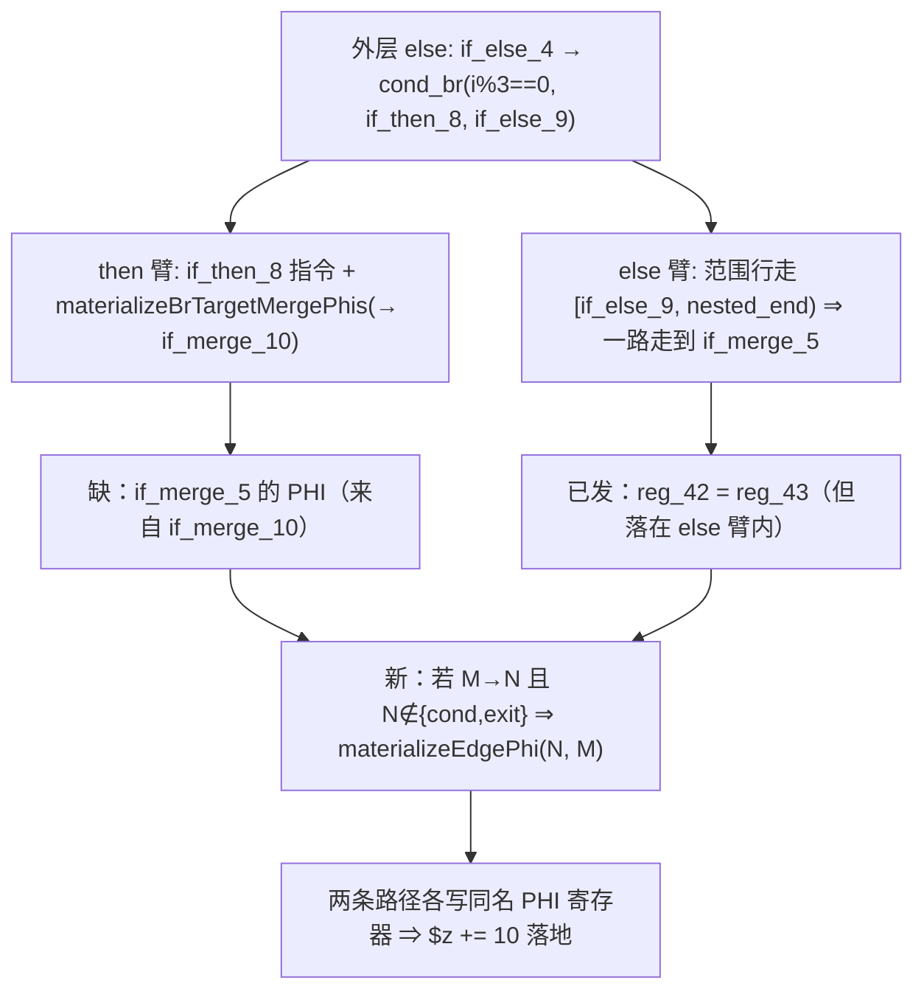

# AOT-CODEGEN-012 R-308：elseif merge 的「M→N」边 PHI 补发（F-213-b 闭环）

- 日期：2026-10-26
- 代次锚：**`nlk 9c6675bd675e8d3edd54913e4cbfd8c3`**（本轮唯一改动）；`tpl 3408c5bd…`／`opti 553a2e54…`／`irg ea35bbde…`／`ir fb2bb442…` 未变
- 工单：`docs/known-issues/AOT-CODEGEN-012-class-name-case-insensitive-lookup.md` §214.5
- 提交：未提交（HEAD `234c81d`）

## 1. 高层摘要（TL;DR）

`while` + `if/elseif/else` 且首支内嵌 `continue` 时，elseif 分支的 `$z += 10` 不生效（g4 `304` vs PHP `324`）。根因：内层 if/else 的合并块 M（if_merge_10）再沿 `.br` 汇入外层 N（if_merge_5），**then 臂只物化「进入 M」一层边 PHI**，而「M→N」的边 PHI 由 else 臂的范围行走顺带发出、落在 `} else {` 之内 ⇒ then 路径缺写。修法是内层 if/else 闭合后按 (N, M) 再物化一次，一处 18 行。

## 2. 影响范围

| 层 | 影响 |
|---|---|
| 发射器（`native_linker.zig` / `generateWhileFromLabels` 的 else 块 cond_br 分支） | 内层 if/else 闭合后补发 merge 边 PHI |
| 语义面 | 循环体内 `if/elseif/else` 链、且内层 then/else 汇聚到同一 merge 后再汇入外层 merge 的形状 |
| 其它循环生成器 | 未动（同族普查见 §8） |
| 运行期模板 / 优化器 / IR / 语法 | 未动 |

## 3. 核心变更

| # | 变更 | 说明 |
|---|---|---|
| 1 | 闭合后补发 | `findCommonBrTarget(nti, nei)` → M；M 的 `.br` 目标 N 非 cond／非 exit ⇒ `materializeEdgePhi(N, M)` |
| 2 | 中性保证 | `materializeEdgePhi` 对无匹配 incoming 是 no-op；两臂写同名 PHI 寄存器，后置赋值取各自路径的值 |

**站点定位（埋点实测）**：4 个候选点加 `ZIGPHP_TRACE_F213` 后，g4 只命中
`D then_blk=if_then_3` 与 `C3 then=if_then_8 else=if_else_9`；walker 通用 cond_br（A）与
`generateIfFromLabels`（B）均未命中 —— 真实发射者是 while 生成器「两个目标都有实际代码」分支的
else 块 cond_br 处理（:17168 起），**不是** §214.4 否证的那一段（:16982，C2 未命中）。

## 4. 可视化概览（Code & Logic Map）



```mermaid
sequenceDiagram
  participant W as while 生成器
  participant Z as 生成码
  W->>Z: if (i%3==0) { reg_31 = reg_44+10; reg_43 = reg_31; }
  W->>Z: } else { reg_34 = reg_44+1; reg_43 = reg_34; reg_42 = reg_43; }
  W->>Z: reg_42 = reg_43;   // R-308 新增（闭合后，两路径共享）
  W->>Z: reg_44 = reg_42; continue;
```

## 5. 详细变更分析

| 文件 | 变更点 |
|---|---|
| `src/aot/native_linker.zig` | `generateWhileFromLabels` else 块 cond_br 分支：内层 if/else 闭合后补发 `materializeEdgePhi(N, M)` |
| `fuzzy_scripts_720/tmp/c339_latch_then_arm_gate_tmp.sh` | 新增 a26＝g4 形状（28→29 臂） |
| `docs/known-issues/…lookup.md` | §214.5/§214.6 |

## 6. 影响与风险评估

- **破坏式变更**：无。补发语句只在「嵌套 then/else 有共同 br 目标 M 且 M 的 br 目标非 cond/exit」时触发。
- **风险**：M→N 若在 else 臂内已物化，会重复一次同名赋值（值相同，无副作用）；对无 PHI 的 N 是 no-op。
- **性能**：编译期一次 CFG 查找；运行期每迭代多一次寄存器赋值（仅该形状）。
- **复测路径**：`bash fuzzy_scripts_720/tmp/c339_latch_then_arm_gate_tmp.sh`（a26）；对照件 `/tmp/f216/g4.php`、`/tmp/f216/g4t.php`、`/tmp/f216/g4u.php`。
- **读数**：C339 **29/29**（163 s，自证 `AOT_BIN=/bin/false` 29 CF）；F-212/F-216 家族 **13/13 SAME**；g4t 逐迭代轨迹与 PHP 逐行一致；主回归 **PASS=68 FAIL=0**（`SELF_CHECK_OK rows=68 uniq=68 total=68`）；`zig build test --summary all` **21/21、326/326**。

## 7. 遗留问题/潜在问题

- 同族普查未做：`for`/`foreach`/`do-while` 的 elseif 链是否存在同样「M→N 只在 else 臂」的缺口（本轮只修 while 的命中站点）。
- 「then 臂一层物化 vs else 臂全链行走」的不对称在三处同源代码里重复，长期应收敛为共用 helper。

## 8. 后续建议

| 优先级 | 建议 | 影响面 | 落地成本 |
|---|---|---|---|
| P1 | 同族普查：其余三个循环生成器的 elseif 链补同形守卫（先建臂再改，避免盲改） | 发射器 | 中 |
| P1 | 同族臂补齐后重跑主回归（本轮已过，后续改动须重跑） | 验收 | 中 |
| P2 | 三处同源 elseif 处理收敛为 `emitElseifChain(...)` 单点实现 | 可读性/一致性 | 高 |
