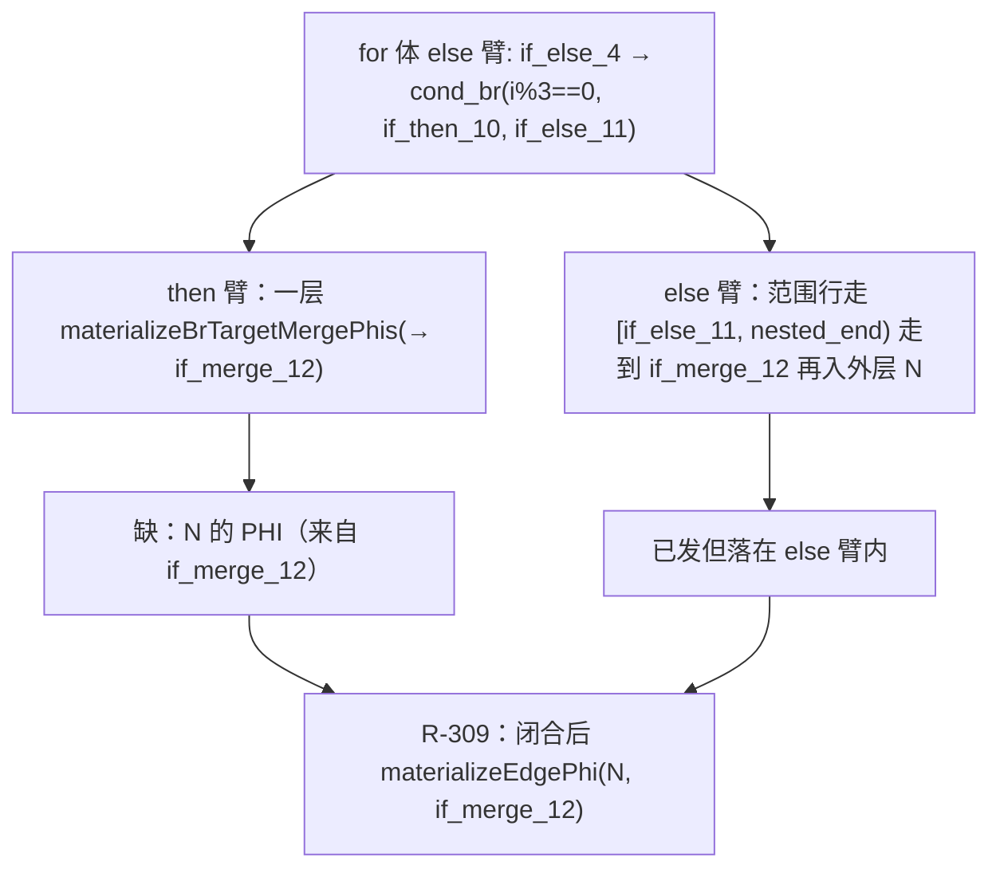

# AOT-CODEGEN-012 R-309：for 生成器的 M→N 边 PHI 补发（F-214-a 闭环）

- 日期：2026-10-26
- 代次锚：**`nlk a9f7a94f0e0140b7b4d96e480ef41c91`**（本轮唯一改动）；`tpl 3408c5bd…`／`opti 553a2e54…`／`irg ea35bbde…`／`ir fb2bb442…` 未变
- 工单：`docs/known-issues/AOT-CODEGEN-012-class-name-case-insensitive-lookup.md` §215
- 提交：未提交（HEAD `234c81d`）

## 1. 高层摘要（TL;DR）

R-308 修好 while 版「elseif merge 的 M→N 边 PHI 只在 else 臂」后，同族普查发现 **`for` 版同形**（`c_for` `304` vs PHP `324`）。for 生成器有两处同源 elseif 段，埋点实测真实发射者是第二处（`F2`）；在该段内层 if/else 闭合后补发与 R-308 同形的 `materializeEdgePhi(N, M)`，`c_for` 转为 `324`。同批普查还新立两个面：**F-213-c**（elseif 内嵌 `if/continue` 整段丢失）与 **F-213-d**（foreach 版量级不同）。

## 2. 影响范围

| 层 | 影响 |
|---|---|
| 发射器（`native_linker.zig` / `generateForFromLabels` elseif 段 F2） | 内层 if/else 闭合后补发 merge 边 PHI |
| 语义面 | `for` 体内 `if/elseif/else` 链、内层 then/else 汇聚到 M 后仍汇入外层 N 的形状 |
| 其它生成器 | while 版已由 R-308 修；foreach / do-while / else 分支见 §7 |
| 运行期 / 优化器 / IR / 语法 | 未动 |

## 3. 核心变更

| # | 变更 | 说明 |
|---|---|---|
| 1 | F2 段补发 | `findCommonBrTarget(nti, nei)` → M；M 的 `.br` 目标 N 非 `func.blocks.items[cond_idx]`、非 `[exit_idx]` ⇒ `materializeEdgePhi(N, M)` |
| 2 | 守卫用参数而非局部指针 | `cond_idx`/`exit_idx` 是函数形参，直接比较指针，避免依赖不同作用域的同名局部 |

**站点编号（埋点实测）**：for 生成器内两处 `const nested_cb = tt.cond_br;`（elseif 段）：`F1` 未命中、`F2` 命中
（`then=if_then_10 else=if_else_11`）⇒ 补丁只落在 F2；F1 保持原样（不排除其它形状会命中它，见 §8）。

## 4. 可视化概览（Code & Logic Map）

## 5. 详细变更分析

| 文件 | 变更点 |
|---|---|
| `src/aot/native_linker.zig` | `generateForFromLabels` F2 elseif 段：内层 if/else 闭合后补发 M→N 边 PHI（19 行） |
| `fuzzy_scripts_720/tmp/c339_latch_then_arm_gate_tmp.sh` | 新增 a27＝for 版 g4 形状（29→30 臂）；门头登记 F-213-c/d 为 KNOWN_RED |
| `docs/known-issues/…lookup.md` | §215（普查表＋两个新面） |

## 6. 影响与风险评估

- **破坏式变更**：无。补发只在「嵌套 then/else 有共同 br 目标 M 且 M 的 br 目标非 cond/exit」时触发。
- **风险**：F1 段未修（未命中本形状），若其它语料命中 F1 仍会缺写；已登记为后续普查项。
- **性能**：编译期一次 CFG 查找；运行期该形状每迭代一次寄存器赋值。
- **复测路径**：`bash fuzzy_scripts_720/tmp/c339_latch_then_arm_gate_tmp.sh`（a27）；对照件 `/tmp/f213c/c_for.php`、`c_dowhile.php`、`/tmp/f216/g4.php`。
- **读数**：C339 **30/30**（145 s，自证 `AOT_BIN=/bin/false` 30 CF）；c_for `304→324`；c_dowhile/c_for_noelse/g4/r7/g5 保持 SAME；主回归 **PASS=68 FAIL=0**（`SELF_CHECK_OK rows=68 uniq=68 total=68`）；`zig build test --summary all` **21/21、326/326**。

## 7. 遗留问题/潜在问题

- **F-213-c（P0）**：elseif 臂内 `if (c) continue; ...` 整段丢失（`c_while2` `4004` vs `4204`）。机制：`emitSpilledNestedIfMerge` 对嵌套 else 为 `if_else_` 直接拒绝，回退区间 `[nti+1, then_end)` 因 `nti+1 == then_end` 为空。
- **F-213-d（P0）**：foreach 同形态量级不同（`501` vs `324`；无 else 版 `500` vs `320`）。
- for 的 **F1** elseif 段未加守卫（本轮命中 F2）。

## 8. 后续建议

| 优先级 | 建议 | 影响面 | 落地成本 |
|---|---|---|---|
| P0 | F-213-c：空区间回退改递归 `generateIfFromLabels(nti, then_end, …)`（先读 `suppress_orphan_if_then_gifl` 的豁免理由） | while/for/foreach 臂发射 | 中 |
| P0 | F-213-d：`--emit-ir` 比对 `c_foreach`/`c_for` 块序，定位 foreach 生成器站点 | foreach 发射 | 中 |
| P1 | for 的 F1 段补同形守卫并加臂（先建 refl 形状） | 发射器 | 低 |
| P2 | 四处 elseif 段收敛为单点 helper（本轮已出现 F1/F2 命中差异，说明副本已漂移） | 可读性/一致性 | 高 |
