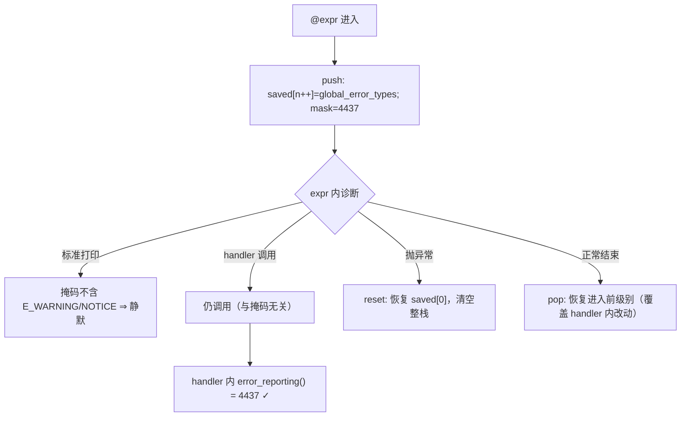

# AOT-CODEGEN-012 R-311：`@` 作用域的 error_reporting 掩码（F-217 闭环）

- 日期：2026-10-26
- 代次锚：**`tpl 3f865396c3edb787f4a108f63de2e003`**（本轮唯一改动）；`nlk a9f7a94f…`／`irg ea35bbde…`／`opti 553a2e54…`／`ir fb2bb442…` 未变
- 工单：`docs/known-issues/AOT-CODEGEN-012-class-name-case-insensitive-lookup.md` §217
- 提交：未提交（HEAD `234c81d`）

## 1. 高层摘要（TL;DR）

探 F-98（错误处理器内抛异常）时顺带发现：`@expr` 下 AOT 的 `error_reporting()` 仍返回全量掩码 30719，而 PHP 8 返回 **4437**（`E_ERROR|E_PARSE|E_CORE_ERROR|E_COMPILE_ERROR|E_USER_ERROR|E_RECOVERABLE_ERROR`），且表达式结束后必须恢复**进入前**的级别（连 handler 内部对 `error_reporting` 的修改也会被覆盖）。AOT 的 `@` 只维护标准打印抑制深度、从不改掩码 ⇒ 模板一处补齐「保存/置 4437/恢复」栈即可。

## 2. 影响范围

| 层 | 影响 |
|---|---|
| 运行期模板（`runtime_lib_template.zig`） | `php_error_suppress_push/pop/reset` 增配 128 深掩码栈 |
| 语义面 | 所有 `@expr` 作用域；handler 内 `error_reporting()` 的读数；`@` 退出后的级别恢复 |
| 发射器 / IR / 优化器 / 语法 | 未动 |

## 3. 核心变更

| # | 变更 | 说明 |
|---|---|---|
| 1 | `E_SUPPRESSED` 常量 | `E_ERROR|E_PARSE|E_CORE_ERROR|E_COMPILE_ERROR|E_USER_ERROR|E_RECOVERABLE_ERROR` = 4437（PHP 8 实测） |
| 2 | push 保存并置掩码 | `error_suppress_saved[n++] = global_error_types; global_error_types = E_SUPPRESSED;` |
| 3 | pop 恢复 | 退栈并回写 |
| 4 | reset 恢复最外层 | 异常展开时回写到 `saved[0]` 并清空整栈（PHP 的 `@` 是词法作用域，异常也不例外） |

**副作用核对**：`E_ERROR` 仍在掩码内 ⇒ `@` 不抑制 fatal（与 F-95 既有结论一致）；处理器调用与 `error_reporting` 无关（F-95）⇒ 路由不变。

## 4. 可视化概览（Code & Logic Map）



```mermaid
sequenceDiagram
  participant U as user
  participant R as runtime
  U->>R: php_error_suppress_push()
  R-->>R: saved←30719; mask←4437
  U->>R: 诊断 → handler → error_reporting() = 4437
  U->>R: php_error_suppress_pop()
  R-->>R: mask←30719（进入前值）
```

## 5. 详细变更分析

| 文件 | 变更点 |
|---|---|
| `src/aot/runtime_lib_template.zig` | `E_SUPPRESSED` 常量＋`error_suppress_saved` 栈＋push/pop/reset 三函数 |
| `fuzzy_scripts_720/tmp/c108_errh_gate_tmp.sh` | 新增 **h15**（关系断言：`error_reporting()===4437` ⇒ `H-OK`；退出恢复 ⇒ `A1/A2/A3-OK`） |
| `fuzzy_scripts_720/tmp/c108_errh_tmp.tsv` | 门读数（19 行） |

## 6. 影响与风险评估

- **破坏式变更**：无。`@` 下的标准打印抑制、handler 调用、fatal 可见性均保持既有行为（ERRH/SUPB 双门复证）。
- **风险**：掩码栈上限 128（超出后只为抑制深度服务，不再压栈）；与 `error_reporting()` 用户调用的交互按 PHP 语义实现。
- **性能**：每次 `@` 两次 threadlocal 读写；无分配。
- **复测路径**：`bash fuzzy_scripts_720/tmp/c108_errh_gate_tmp.sh`（h15）；对照件 `/tmp/f98/t.php`（嵌套 `@@`、handler 改级别、恢复）。
- **读数**：ERRH **19 臂：18 same / 0 diff / 1 CF（h9 既有）/ bad_probe=0**；SUPB **7/7**；C339 **30/30**；主回归 **PASS=68 FAIL=0**（`SELF_CHECK_OK rows=68 uniq=68 total=68`）；`zig build test --summary all` **21/21、326/326**。

## 7. 遗留问题/潜在问题

- **门的 `want` 变量跨臂复用、未逐臂重置**：新增且无 `want` 分支的臂会继承上一臂期望串（h15 首次运行即误报 `BAD_PROBE_PHP`）。本轮为 h15 补了 `want`，但机制本身仍是坑。
- **门的 `norm` 折叠括号内数字**（`s/\([0-9]+\)/(@N@)/g`）⇒ 任何「断言括号内数值」的臂都是构造性不可见，必须改成关系断言。
- `error_suppress_saved` 上限 128；超过后仅抑制深度生效（PHP 无此上限，但 128 层 `@` 嵌套在实践中不可达，未做扩容）。

## 8. 后续建议

| 优先级 | 建议 | 影响面 | 落地成本 |
|---|---|---|---|
| P1 | 门基础设施：`want` 改为每臂显式赋值（或在循环头 `want=''`）+ 新增「臂必须声明 want」自检（本轮 h15 已踩） | 门可靠性 | 低 |
| P1 | F-213-d（foreach 同形态 501/324）——换线推进 | foreach 发射 | 中 |
| P2 | 四处 elseif 段收敛为 `emitElseifChain(...)`（F-213-c 根治） | 一致性 | 高 |
