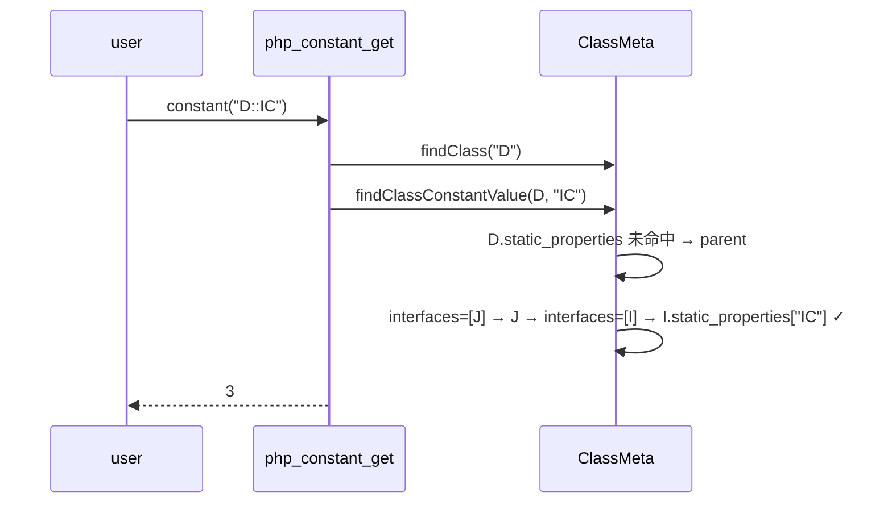

# AOT-CODEGEN-012 R-314：`constant('C::X')` 类常量解析（含接口链，F-160 闭环）

- 日期：2026-10-26
- 代次锚：**`tpl a322e6fab1b20c40dfaa5df4996f085d`**（本轮唯一改动）；`nlk a9f7a94f…`／`irg ea35bbde…`／`opti 553a2e54…`／`ir fb2bb442…` 未变
- 工单：`docs/known-issues/AOT-CODEGEN-012-class-name-case-insensitive-lookup.md` §220
- 提交：未提交（HEAD `234c81d`）

## 1. 高层摘要（TL;DR）

`constant('C::X')` 在 AOT 一律报 `Undefined constant`：`php_constant_get` 只查全局常量表；动态类常量查询只沿父类链、不查 `implements`。本轮胎 模板加 `findClassConstantValue`（static_properties → 父类 → **接口链**，深度 32），并在 `php_constant_get`（新增 `::` 分支）与 `php_get_class_constant_dynamic` 两处复用；类常量/trait 常量/继承/接口四类经 `constant()` 全部与 PHP 一致。

## 2. 影响范围

| 层 | 影响 |
|---|---|
| 运行期模板 | `php_constant_get`、`php_get_class_constant_dynamic`、新增 `findClassConstantValue` |
| 语义面 | 所有 `constant('Class::CONST')` 调用（含 trait/接口/继承来源）；直接读 `C::X` 不受影响（另路） |
| 发射器 / IR / 优化器 / 语法 | 未动 |

## 3. 核心变更

| # | 变更 | 说明 |
|---|---|---|
| 1 | `findClassConstantValue` | `static_properties` → 父类递归 → `interfaces` 递归；`depth > 32` 截止（防注册表环） |
| 2 | `php_constant_get` 的 `::` 分支 | 拆分类名/常量名；命中 ⇒ 记账（`php_note_constant_access`）并 retain 返回；类缺 ⇒ `Class "X" not found`；常量缺或 `C::class` ⇒ `Undefined constant C::X`（无引号） |
| 3 | 动态查询复用 helper | `::class` 特例保留在前，其余走同一查找 |

## 4. 可视化概览（Code & Logic Map）

```mermaid
flowchart TD
  A["constant(name)"] --> B{"全局 constants 有?"}
  B -->|有| C["retain + note_access → 返回"]
  B -->|无| D{"name 含 '::'?"}
  D -->|无| E["true/false/null 大小写别名 → else 硬 fatal"]
  D -->|有| F{"findClass(类名)?"}
  F -->|否| G["Class \"X\" not found (exit 255)"]
  F -->|是| H["findClassConstantValue: 自身 → 父类 → 接口链"]
  H -->|命中| C
  H -->|未命中| I["Undefined constant C::X (exit 255)"]
```



## 5. 详细变更分析

| 文件 | 变更点 |
|---|---|
| `src/aot/runtime_lib_template.zig` | 新增 `findClassConstantValue`；`php_constant_get` 增 `::` 分支；`php_get_class_constant_dynamic` 改用 helper |
| `fuzzy_scripts_720/tmp/c340_const_class_gate_tmp.sh` | 新建永久门（3 臂：类+trait / 接口经实现类与接口继承 / 继承类常量） |
| `fuzzy_scripts_720/tmp/c340_const_class_tmp.tsv` | 门读数 |

## 6. 影响与风险评估

- **破坏式变更**：无。`constant()` 对全局常量的既有行为（含 true/false/null 大小写别名）原样保留。
- **风险**：接口链递归带深度上限；未命中仍走**不可捕获**硬 fatal（F-95-d 既有口径，本轮不改）。
- **性能**：仅 `constant()` 且名字含 `::` 时多一次链式查找（命中即止）。
- **复测路径**：`bash fuzzy_scripts_720/tmp/c340_const_class_gate_tmp.sh`；对照件 `/tmp/f159/{a,b,f,g,h,c}.php`。
- **读数**：C340 **3/3 SAME**（14 s，自证 `AOT_BIN=/bin/false` ⇒ 3 CF）；探针 a/b/f/g/h 由 DIFF 转 SAME；ERRH **19 臂（18 same/0 diff/1 CF 既有）**、C339 **30/30**、主回归 **68/68**（`SELF_CHECK_OK rows=68 uniq=68 total=68`）、单测 **21/21、326/326**。

## 7. 遗留问题/潜在问题

- **未命中三态可捕获性**：PHP 可 `catch (Error)`，AOT 硬 fatal 退出。属 **F-95-d** 面，未改；因此 C340 门不含该形（避免门红）。
- 深度上限 32：极端深的接口/继承链（>32 层）会退化为「未命中」；实际语料不可达，未做扩容。

## 8. 后续建议

| 优先级 | 事项 | 影响面 | 落地成本 |
|---|---|---|---|
| P1 | F-95-d：未定义常量/类常量未命中的**可捕获性**（PHP 抛 Error，AOT 硬 fatal）——需改造 fatal 通道 | 错误语义 | 中高 |
| P1 | F-213-d（foreach 501/324）——换线推进 | foreach 发射 | 中 |
| P2 | 四处 elseif 段收敛为 `emitElseifChain(...)`（F-213-c 根治） | 一致性 | 高 |
