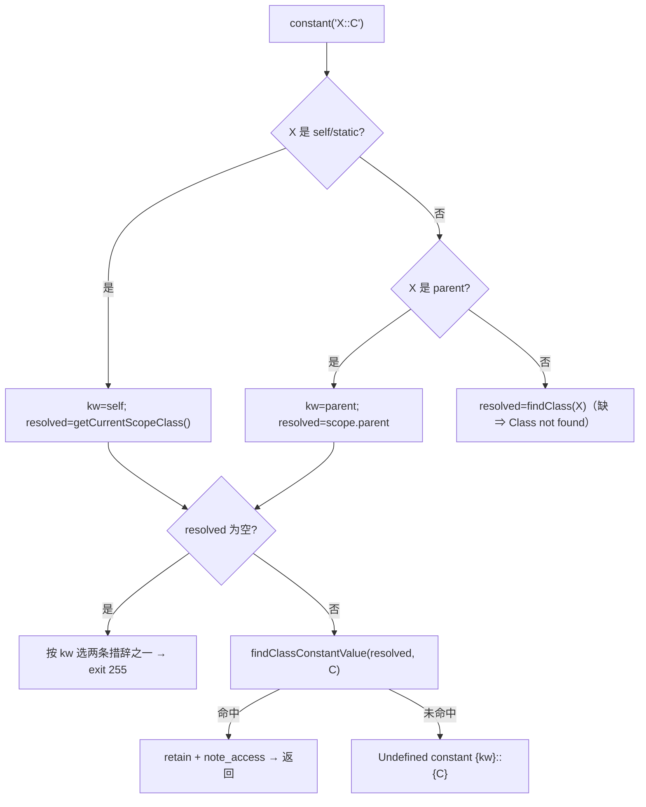
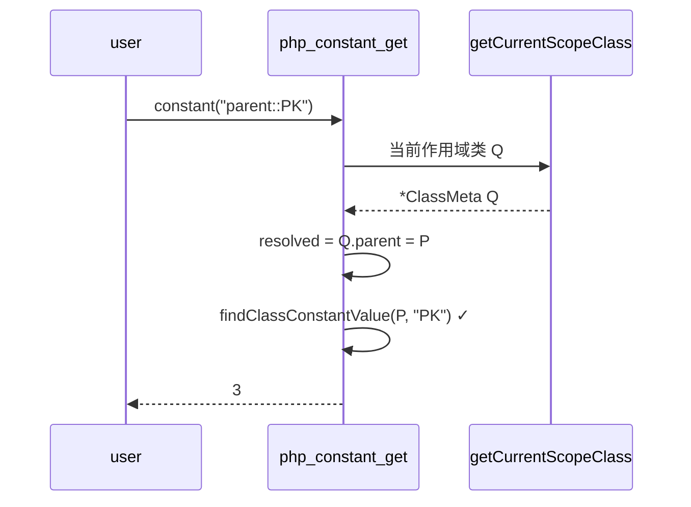

# AOT-CODEGEN-012 R-315：`constant('self|parent|static::X')` 作用域解析（F-161 闭环）

- 日期：2026-10-26
- 代次锚：**`tpl 808c25431c6e1cb6d5ff85a85aaec08f`**（本轮唯一改动）；`nlk a9f7a94f…`／`irg ea35bbde…`／`opti 553a2e54…`／`ir fb2bb442…` 未变
- 工单：`docs/known-issues/AOT-CODEGEN-012-class-name-case-insensitive-lookup.md` §221
- 提交：未提交（HEAD `234c81d`）

## 1. 高层摘要（TL;DR）

`constant('self::K')` / `constant('parent::PK')` 在方法内一律 `Class "self|parent" not found` —— R-314 新增的 `::` 分支只做了 `findClass(类名)`，没识别三个作用域关键字。本轮在 `php_constant_get` 的 `::` 分支前置关键字识别（`self`/`static` ⇒ 当前作用域类；`parent` ⇒ 作用域父类，大小写不敏感），并按 PHP 实测的两条措辞区分「完全无作用域」与「有作用域但无父类」，常量缺失时消息使用**规范化小写关键字**。

## 2. 影响范围

| 层 | 影响 |
|---|---|
| 运行期模板 | `php_constant_get` 的 `::` 分支（作用域关键字三支） |
| 语义面 | 方法/静态方法内 `constant('self::X')`、`constant('parent::X')`、`constant('static::X')`（含大写写法） |
| 发射器 / IR / 优化器 / 语法 | 未动 |

## 3. 核心变更

| # | 变更 | 说明 |
|---|---|---|
| 1 | 关键字识别 | `std.ascii.eqlIgnoreCase` 匹配 `self`/`static`/`parent`（PHP 大小写不敏感，`SELF::K` 实测合法） |
| 2 | 作用域取值 | `getCurrentScopeClass()`；`parent` 取其 `.parent` |
| 3 | 两条措辞 | 无作用域 ⇒ `Cannot access "self|parent" when no class scope is active`；有作用域无父类 ⇒ `Cannot access "parent" when current class scope has no parent` |
| 4 | 常量缺失消息 | `Undefined constant {kw}::{const_name}`（关键字小写化，PHP 实测 `SELF::NOPE` ⇒ `self::NOPE`） |

## 4. 可视化概览（Code & Logic Map）

## 5. 详细变更分析

| 文件 | 变更点 |
|---|---|
| `src/aot/runtime_lib_template.zig` | `php_constant_get` 的 `::` 分支：关键字识别＋作用域解析＋两条措辞＋小写化消息 |
| `fuzzy_scripts_720/tmp/c340_const_class_gate_tmp.sh` | 新增 k4 臂（`parent::`＋`SELF::`） |
| `fuzzy_scripts_720/tmp/c340_const_class_tmp.tsv` | 门读数（4 行） |

## 6. 影响与风险评估

- **破坏式变更**：无。常量名不含 `::`、或 `::` 前是普通类名时，行为与 R-314 完全一致。
- **风险**：`static` 按 `self` 处理（AOT 目前无 LSB 的常量场景实测）；`getCurrentScopeClass()` 在闭包内是否延续外层作用域需另测（未在门内）。
- **性能**：仅 `constant()` 且名字含 `::` 时多两次 `eqlIgnoreCase`。
- **复测路径**：`bash fuzzy_scripts_720/tmp/c340_const_class_gate_tmp.sh`（k4）；对照件 `/tmp/f161/{b,g,h,j,k}.php`。
- **读数**：C340 **4/4 SAME**（18 s，自证 4 CF）；ERRH **19 臂（18 same/0 diff/1 CF 既有）**；C339 **30/30**；主回归 **68/68**（`SELF_CHECK_OK rows=68 uniq=68 total=68`）；单测 **21/21、326/326**。

## 7. 遗留问题/潜在问题

- **F-162（P2）**：`defined('C::K')` 恒 `false`（PHP 公开类常量 ⇒ `true`）；修法需与可见性配套。
- **F-163（P2）**：类常量可见性未建模（`constant('C::P')` 私常常量返回 9；类外直读 `C::P` 措辞亦不同）。
- **F-164（待裁，parser 面）**：PHP 8.3 动态类常量取用 `C::{$name}` 解析失败。
- 闭包内 `self::` 经 `constant()` 的作用域延续未纳入门。

## 8. 后续建议

| 优先级 | 事项 | 影响面 | 落地成本 |
|---|---|---|---|
| P1 | F-163 可见性元数据（常量与静态属性分表或加 visibility 字段）——同时解决 F-162 | 类常量语义 | 中 |
| P2 | 闭包内 `constant('self::X')` 作用域延续探针入 C340 | 门覆盖 | 低 |
| P0 | F-213-d（foreach 501/324）——换线推进 | foreach 发射 | 中 |
