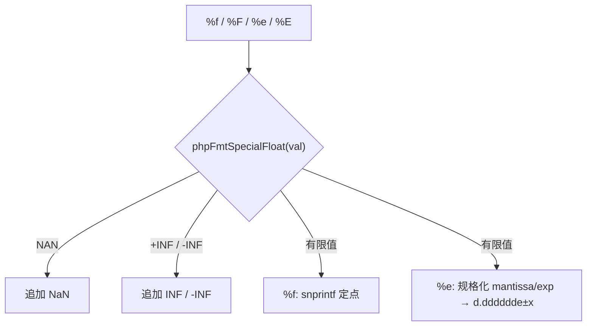
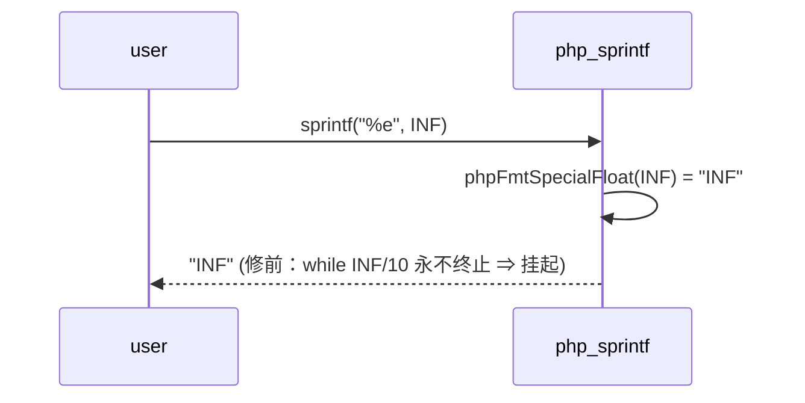

# AOT-CODEGEN-012 R-316：sprintf 浮点的 INF/NAN 与 `%F`（F-165 闭环，含死循环）

- 日期：2026-10-26
- 代次锚：**`tpl 285a1f589dd6db10d2fd3545a0365955`**（本轮唯一改动）；`nlk a9f7a94f…`／`irg ea35bbde…`／`opti 553a2e54…`／`ir fb2bb442…` 未变
- 工单：`docs/known-issues/AOT-CODEGEN-012-class-name-case-insensitive-lookup.md` §222
- 提交：未提交（HEAD `234c81d`）

## 1. 高层摘要（TL;DR）

用 INF/NAN 探针扫 `sprintf` 浮点格式，撞出三缺陷：**①`%e` 对 INF 死循环**（规格化 `while (mantissa >= 10.0) mantissa /= 10.0`，`INF/10 == INF` ⇒ rc=124）；②`%f` 走 C `snprintf` ⇒ 输出小写 `inf`/`nan`，PHP 要 `INF`/`NaN`；③`%F` 未实现（原样输出 `%F`，而 PHP 里 `%F`≡`%f`）。修法是模板里一个 `phpFmtSpecialFloat` 短路 + `'f','F'` 合臂 + `%e` 短路前置。

## 2. 影响范围

| 层 | 影响 |
|---|---|
| 运行期模板（`php_sprintf`） | `%f`/`%F`/`%e`/`%E` 四个分支的入口 |
| 语义面 | 所有 `sprintf/printf/vsprintf/vprintf` 的浮点格式；非有限值不再挂起 |
| 发射器 / IR / 优化器 / 语法 | 未动 |

## 3. 核心变更

| # | 变更 | 说明 |
|---|---|---|
| 1 | `phpFmtSpecialFloat(val) ?[]const u8` | `NaN`／`INF`／`-INF`（PHP 拼写；注意 echo 是 `NAN`） |
| 2 | `'f'` 接短路 + 合并 `'F'` | `%F` 与 `%f` 完全同形（PHP 实测） |
| 3 | `'e'` 短路前置 | 在规格化循环**之前**返回，消除 INF 死循环 |

## 4. 可视化概览（Code & Logic Map）

## 5. 详细变更分析

| 文件 | 变更点 |
|---|---|
| `src/aot/runtime_lib_template.zig` | 新增 `phpFmtSpecialFloat`；`'f','F'` 合臂＋短路；`'e','E'` 短路前置（else 分支包裹原规格化逻辑） |
| `fuzzy_scripts_720/tmp/c341_sprintf_float_gate_tmp.sh` | 新建永久门（s1 常规值 / s2 三特殊值 / s3 宽度·标志·精度），含 **TIMEOUT 判定列** |
| `fuzzy_scripts_720/tmp/c341_sprintf_float_tmp.tsv` | 门读数（3 行） |

## 6. 影响与风险评估

- **破坏式变更**：无。有限值的四分支路径完全不变（s1/s3 覆盖定点、指数、宽度、左对齐、`+`、`%.0f/%.3f/%.10f`）。
- **风险**：特殊值不参与 `+`/空格标志（PHP 实测亦不加）；`%g/%G` 仍未实现（F-166），门内不含。
- **性能**：有限值路径多一次 `isNan/isInf` 判定；无分配。
- **复测路径**：`bash fuzzy_scripts_720/tmp/c341_sprintf_float_gate_tmp.sh`；对照件 `/tmp/f165/{u,t}.php`。
- **读数**：C341 **3/3 SAME**（14 s，自证 3 CF）；ERRH **18 same/0 diff/1 CF（既有 h9）**；C339 **30/30**；C340 **4/4**；主回归 **68/68**（`SELF_CHECK_OK rows=68 uniq=68 total=68`）；单测 **21/21、326/326**。

## 7. 遗留问题/潜在问题

- **F-166（P2）**：`%g`/`%G` 未实现（PHP 语义：精度有效数字、去尾零、`exp<-4 || exp>=精度` 用指数形）。
- **F-167（P2）**：PHP 忽略空格标志（`% f`⇒`1.250000`、`% 5d`⇒`    3`），AOT 会补前导空格。
- **F-168（P2）**：`echo NAN` 缺 `unexpected NAN value was coerced to string` 告警；`(int)INF` 缺 `not representable as an int` 告警（值一致）。
- 门只覆盖 `%f/%F/%e/%E`；`%g` 与空格标志待 F-166/F-167 关闭后补臂。

## 8. 后续建议

| 优先级 | 事项 | 影响面 | 落地成本 |
|---|---|---|---|
| P1 | F-166 `%g/%G` 真实现（含 `%.Ng` 精度语义）——同时把 F-167 空格标志一并裁 | 格式化 | 中 |
| P2 | F-168 两条 NAN/INF 转换告警（`echo` 与 `(int)` 站点） | 诊断 | 低 |
| P0 | F-213-d（foreach 501/324）——换线推进 | foreach 发射 | 中 |
