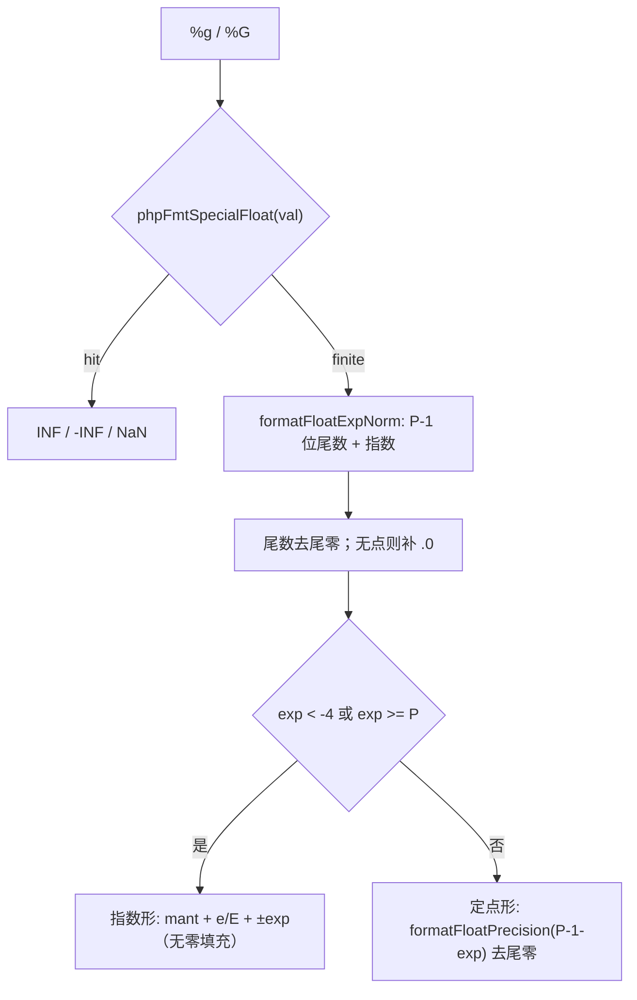
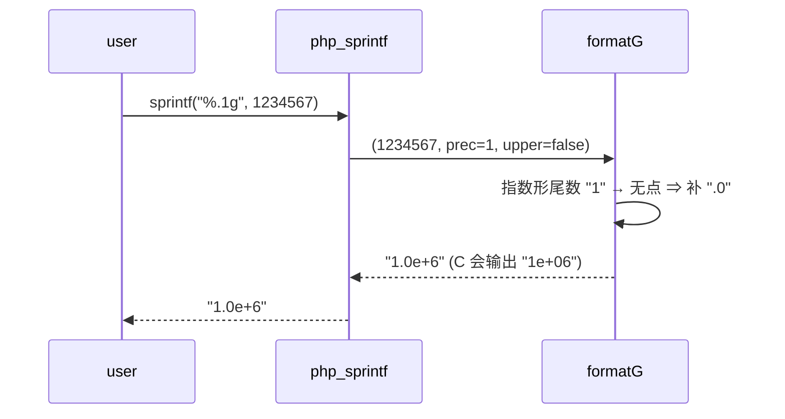

# AOT-CODEGEN-012 R-317：`%g` / `%G` 真实现（F-166 闭环，含 PHP 两处特化）

- 日期：2026-10-26
- 代次锚：**`tpl a54a0df983fdaf650e0a6db5c8008381`**（本轮唯一改动）；`nlk a9f7a94f…`／`irg ea35bbde…`／`opti 553a2e54…`／`ir fb2bb442…` 未变
- 工单：`docs/known-issues/AOT-CODEGEN-012-class-name-case-insensitive-lookup.md` §223
- 提交：未提交（HEAD `234c81d`）

## 1. 高层摘要（TL;DR）

R-316 修 `%f/%F/%e/%E` 时把 `%g/%G` 留成「原样输出格式符」。本轮按 PHP 8.5.8 的 14 值 × 5 形态实测契约补齐：C 语义（P＝有效数字位、`exp<-4 ∨ exp>=P` 走指数形）+ **PHP 两处特化**（指数形尾数至少一位小数、指数不零填充）。落地为模板新增 `formatFloatExpNorm` + `formatG` 两个函数与 `'g','G'` 一臂；`%.1g` 首版漏补 `.0` 的差异当场实测修掉。

## 2. 影响范围

| 层 | 影响 |
|---|---|
| 运行期模板（`php_sprintf`） | 新增 `'g','G'` 分支；`snprintf` 的 `%.Ne` 仅在新函数内使用 |
| 语义面 | 所有 `sprintf/printf/vsprintf/vprintf` 的 `%g/%G`（含宽度/精度组合） |
| 发射器 / IR / 优化器 / 语法 | 未动（`nlk` 代次锚不变） |

## 3. 核心变更

| # | 变更 | 说明 |
|---|---|---|
| 1 | `formatFloatExpNorm(buf, val, prec)` | `snprintf("%.Ne")` 后归一化：去指数零填充、指数恒带符号（`e+6`/`e-5`） |
| 2 | `formatG(buf, val, prec_req, upper)` | P＝`prec==0 ? 1 : prec`；取 `P-1` 位**舍入后**尾数 → 去尾零 → 无小数点补 `.0` → 按 `exp<-4 ∨ exp>=P` 选形；定点形复用 `formatFloatPrecision` 再去尾零/去孤点 |
| 3 | `'g','G'` 臂 | 非有限值先走 `phpFmtSpecialFloat`（`INF`/`-INF`/`NaN`，R-316 已有），其余走 `formatG` |

## 4. 可视化概览（Code & Logic Map）

## 5. 详细变更分析

| 文件 | 变更点 |
|---|---|
| `src/aot/runtime_lib_template.zig` | `formatFloatExpNorm`（:31727）、`formatG`（:31740）、`php_sprintf` 新增 `'g','G'` 臂（:31962） |
| `fuzzy_scripts_720/tmp/c341_sprintf_float_gate_tmp.sh` | 扩到 5 臂：新增 g1（14 值 × `%g/%.3g/%.1g/%.0g`）与 g2（INF/-INF/NaN、`-0.0`、`0.000123456`）；保留 TIMEOUT 判定列 |
| `fuzzy_scripts_720/tmp/c341_sprintf_float_tmp.tsv` | 门读数 5 行 |

## 6. 影响与风险评估

- **破坏式变更**：无。新增分支；`%f/%F/%e/%E` 路径未动（C341 s1/s2/s3 三臂复证全绿）。
- **风险**：`%.0g` 语义在 C 是「视作 1」，已按实测对齐；进位改判形态（`999999.5` ⇒ `1.0e+6`）依赖 `snprintf` 的舍入，已在门内 g1 固化。
- **性能**：仅 `%g/%G` 路径多一次 `snprintf` + 栈上 80 字节缓冲；无堆分配。

## 7. 遗留问题

| 编号 | 说明 | 级别 |
|---|---|---|
| F-167 | 空格标志 `% f`/`% d` 在 PHP 被忽略，AOT 补前导空格（改语义需裁） | P2 |
| F-168 | `echo NAN` 与 `(int)INF` 缺转换告警 | P2 |

## 8. 后续建议

- `%g` 的宽度/左对齐已由 C341 s3 覆盖常规形；若后续接 `%'` 自定义填充符，须与本臂的尾零剥离顺序一并核对（先去尾零再补宽度）。
- 浮点格式化族现已是「特殊值短路 + 定点 + 指数 + 通用」四支，新增格式符（如 `%h/%H`）应直接复用 `phpFmtSpecialFloat` 与 `formatFloatExpNorm`，不要再复制规格化循环（R-316 的 INF 死循环即复制所致）。
