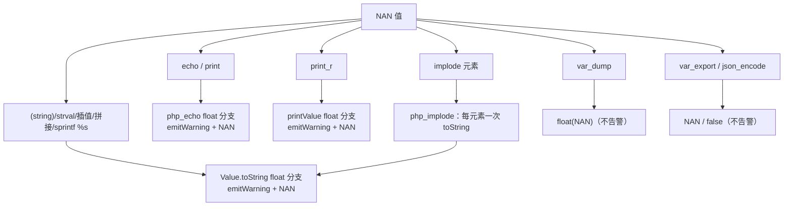
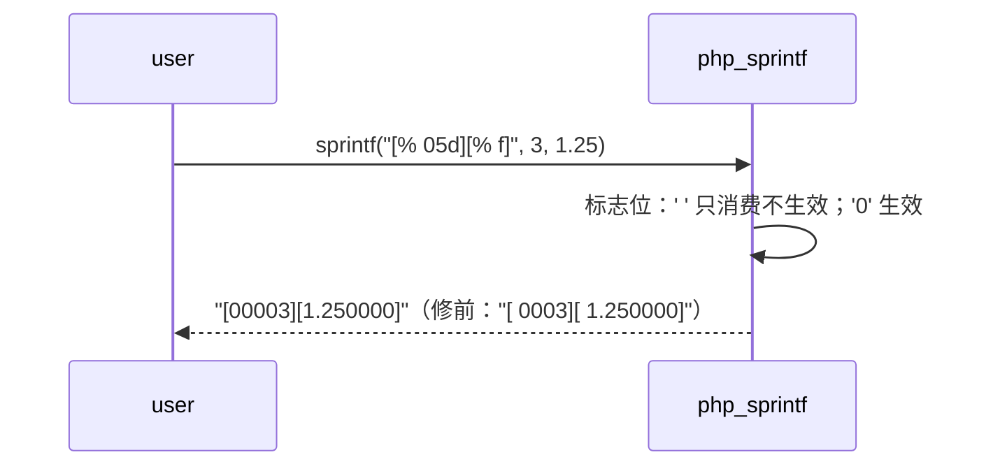

# AOT-CODEGEN-012 R-319：sprintf 空格标志（F-167）＋ NAN 字符串化告警（F-168），顺带修 implode 双转换

- 日期：2026-10-26
- 代次锚：**`tpl 2dfc5d01b745148ddddd3652e7267daf`**（本轮唯一改动）；`nlk a9f7a94f…`／`irg ea35bbde…`／`opti 5532e540…`／`ir fb2bb442…` 未变
- 工单：`docs/known-issues/AOT-CODEGEN-012-class-name-case-insensitive-lookup.md` §225
- 提交：未提交（HEAD `234c81d`）

## 1. 高层摘要（TL;DR）

两个 P2 一轮收：**F-167** AOT 把 sprintf 的空格标志当「补前导空格」，而 PHP 8.5.8 实测**忽略**它（只保留宽度）；**F-168** `echo NAN` 等字符串化路径缺 `unexpected NAN value was coerced to string` 告警。修补过程中浮出两个隐藏面：①echo/print 走 `php_echo`、`print_r` 走 `printValue`，都不经 `Value.toString`，故告警需**三处**落地；②`php_implode` 旧实现对每元素 `toString` **两遍**（长度遍＋写入遍），告警可见化后表现为「每元素两条」，PHP 只有一条 ⇒ 改为首遍转换并保留结果。

## 2. 影响范围

| 层 | 影响 |
|---|---|
| 运行期模板 | `php_sprintf` 标志解析；`Value.toString`／`php_echo`／`printValue` 的 float 分支；`php_implode` 转换次数 |
| 语义面 | 所有 `sprintf/printf/vsprintf/vprintf` 的 `% ` 组合；所有浮点 NAN 的字符串化；`implode/join` 的分配与告警次数 |
| 发射器 / IR / 优化器 / 语法 | 未动（但**必须** `zig build` 一次：本轮之前有过 nlk 回退，旧二进制会误发 `setConstVisibility`，见 §7） |

## 3. 核心变更

| # | 变更 | 说明 |
|---|---|---|
| 1 | 空格标志只消费不生效 | `' ' => {}`，删 `flag_space` 变量与其 3 处使用（`%d/%i`、`%f/%F` 前导空格；`%e/%E` 的 `sign_str`） |
| 2 | `Value.toString` float 分支 NaN 告警 | 覆盖 `(string)`／`strval`／插值／`.` 拼接／`sprintf("%s")` |
| 3 | `php_echo` float 分支 NaN 告警 | 覆盖 `echo`／`print` |
| 4 | `printValue` float 分支 NaN 告警 | 覆盖 `print_r`；`var_dump` 独立分支不受影响 |
| 5 | `php_implode` 单次转换 | `ArrayListUnmanaged(*PHPString)` 首遍收集，统一 release；第二遍零转换 |

## 4. 可视化概览（Code & Logic Map）

## 5. 详细变更分析

| 文件 | 变更点 |
|---|---|
| `src/aot/runtime_lib_template.zig` | `php_sprintf` 标志位（≈31822）；`Value.toString`（≈3380）；`php_echo`（≈10178）；`printValue`（≈10388）；`php_implode`（≈15295） |
| `fuzzy_scripts_720/tmp/c342_sprintf_nan_gate_tmp.sh` | 新建永久门 6 臂（f1 空格标志矩阵 / n1 echo+print / n2 转型族 / n3 sprintf+implode 计数 / n4 反证 / n5 `@` 与 error_reporting） |
| `fuzzy_scripts_720/tmp/c342_sprintf_nan_tmp.tsv` | 门读数 6 行 |

## 6. 影响与风险评估

- **破坏式变更**：无。`%f/%e/%g` 的既有数值面由 C341 5/5 复证；`(int)` 转换告警由 n4 锁定未变。
- **性能**：float→string 每条路径多一次 `isNan` 判定（无分配）；`php_implode` 由「2N 次转换」降为「N 次转换」⇒ 更快。
- **行为收紧**：NAN 字符串化现在**会**发告警，且受 `@`／`error_reporting` 掩码控制（n5 锁定）。若某语料依赖旧的静默行为，会从「无输出」变「多一条 Warning」——这正是与 PHP 对齐的方向。

## 7. 过程教训（写进纪律）

1. **回退后必须重建二进制**：本轮先拿「nlk 回退前构建的二进制」跑门，C340 四臂立刻 `COMPILE_FAIL`（`no field named 'setConstVisibility'`）。模板自磁盘读取、发射器编进二进制 ⇒ 旧发射器配新模板。任何 nlk/irg 改动或回退后，第一件事 `timeout 600 zig build`，再跑任何门。
2. 修复带来的「告警可见化」可能暴露既存的重复转换/重复副作用（本例 `php_implode`）；新告警落地前先枚举所有转换入口，再逐入口计数，不能只看第一处。

## 8. 后续建议

| 优先级 | 事项 | 影响面 | 落地成本 |
|---|---|---|---|
| P0 | F-213-c/F-213-d（elseif 链单点 helper 结构性改造） | foreach/while 值面与编译面 | 高 |
| P2 | F-162/F-163（等老铁批准跨模式 AST 字段） | 类常量三面 + F-169/F-170 | 中 |
| P2 | F-88 / F-95-d | 段错误 / Error 可捕获性 | 低–中 |

> 编排提醒：`php_sprintf` 的宽度/填充逻辑现在以「空格标志永不生效」为前提；若将来接 `%'x` 自定义填充或负宽度，需先补门臂再动代码。
