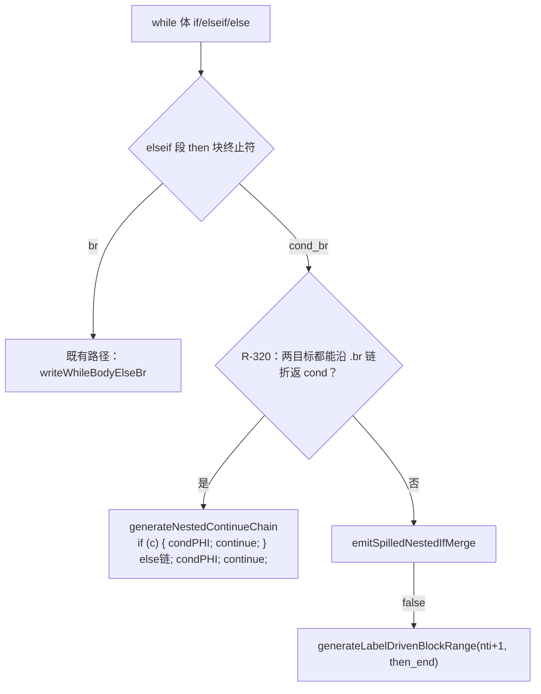

# AOT-CODEGEN-012 R-320：while 的 elseif 段嵌套 cond_br 改「链式发射」（F-213-c 闭环）

- 日期：2026-10-26
- 代次锚：**`nlk 9928379148ad58c6ac6d46db0dbdd041`**（本轮唯一改动）；`tpl 2dfc5d01…`（R-319）／`irg ea35bbde…`／`opti 5532e540…`／`ir fb2bb442…` 未变
- 工单：`docs/known-issues/AOT-CODEGEN-012-class-name-case-insensitive-lookup.md` §226
- 提交：未提交（HEAD `234c81d`）

## 1. 高层摘要（TL;DR）

F-213-c（while + elseif 内嵌 `if (c) continue; stmt;` 值错）在本代次用**形状普查**重新定位：旧工单里的简化形状已经通过，真实复现是 `w1`（PHP 306 / AOT 606）与 `w3`（编译失败 `unprocessed blocks`）。IR 显示嵌套 if 的 then 边直指循环头、else 边是 `$z += 100` 后回边——两边都沿单后继 `.br` 链折返。修法是把 while 生成器 elseif 段的嵌套 `cond_br` 先交给既有的 `generateNestedContinueChain`（纯 CFG dry-run，不成立零发射），成功即收口，失败保持原路径。同轮顺带修掉 `chain_cond_phi_src` 在两链皆空时的下溢隐患。foreach 侧另有两个真缺陷（f3 挂死、f4 break 丢失）被普查筛出，登记为 F-213-d2 / F-213-d3。

## 2. 影响范围

| 层 | 影响 |
|---|---|
| 发射器（`native_linker.zig`） | while 生成器 elseif 段的 `.cond_br` 分支；`generateNestedContinueChain` 的 `chain_cond_phi_src` 回填 |
| 语义面 | `while` 体内 `if/elseif/else` 且嵌套 if 两臂都折返循环头的形状（值面与编译面） |
| 模板 / IR / 优化器 / 语法 | 未动 |

## 3. 核心变更

| # | 变更 | 说明 |
|---|---|---|
| 1 | elseif 段先试链式发射 | `.cond_br` 分支开头解析 `inner_cb` 两目标索引 → `generateNestedContinueChain(..., record_cond_src=true)`；成功即不再走 spill/范围行走 |
| 2 | 失败保持原路径 | `emitSpilledNestedIfMerge` → `generateLabelDrivenBlockRange(nti+1, then_end)` 顺序不变 |
| 3 | 下溢守卫 | `if (record_cond_src and en > 0) self.chain_cond_phi_src = echain[en-1];` |

## 4. 可视化概览（Code & Logic Map）



```mermaid
sequenceDiagram
  participant W as while 生成器
  participant H as generateNestedContinueChain
  W->>H: (then_blk=if_then_6, then=cond, else=if_merge_9)
  H->>H: dry-run：两链均到 cond
  H-->>W: 发射 if(i%4==0){condPHI;continue;} + $z+=100;condPHI;continue;
  Note over W: 修前：if 本体丢失、$z+=100 变成无条件（606 vs 306）
```

## 5. 详细变更分析

| 文件 | 变更点 |
|---|---|
| `src/aot/native_linker.zig` | ① `generateNestedContinueChain` 的 `chain_cond_phi_src` 守卫（≈14118）；② while 生成器 elseif 段 `.cond_br` 分支（≈17432）：链式发射优先 + 失败回退原 spill/范围行走 |
| `fuzzy_scripts_720/tmp/c343_loop_elseif_gate_tmp.sh` | 新建永久门 7 臂（w1/w2/w3/w4/d1/f1/f2，含 TIMEOUT 判定列；f3/f4 待修后并入） |
| `fuzzy_scripts_720/tmp/c343_loop_elseif_tmp.tsv` | 门读数 7 行 |

## 6. 影响与风险评估

- **破坏式变更**：无。链式路径只在「两臂都沿单后继 `br` 折返 cond」时生效，且 helper 内部先做完整 CFG 预检再发射；不成立时不打印任何东西，原路径行为不变。
- **覆盖了「此前静默错误」的形状**：`w3` 以前直接编译失败（`AST-DIRECT-FAIL`），现在能编译且与 PHP 一致；说明该 helper 的适用面比工单原先估计的广。
- **风险**：`generateNestedContinueChain` 现在多了 while-elseif 一类调用者，`chain_cond_phi_src` 的状态会被它写入；已加 `en > 0` 守卫，且 while 循环入口（≈16120）与出口（≈17628）都会复位该字段。
- **性能**：仅多一次「块索引线性查找 + CFG 预检」（编译期，O(块数)），运行期代码不增（反而少一条被误加的分支路径）。

## 7. 遗留问题

| 编号 | 说明 | 级别 |
|---|---|---|
| **F-213-d2** | `foreach` 首臂 `continue` + elseif 内嵌 if ⇒ **挂死**（f3：rc=124；PHP `c4 c4 303`） | P0 |
| **F-213-d3** | `foreach kv` 的嵌套 `if { break; }` 丢失（f4：PHP 1026 / AOT 2048） | P0 |
| F-213-d（旧） | 原复现件已失效（简化形状全绿），按 §226.1 重定为上面两项 | — |

## 8. 后续建议

| 优先级 | 事项 | 影响面 | 落地成本 |
|---|---|---|---|
| P0 | F-213-d2 / F-213-d3：foreach 生成器照 R-320 接链式发射；f3 需先查「首臂 continue 后预标记块」与收尾交互（R-306 同族） | foreach 值面 + 挂死 | 中（一处接入 + 2 臂门） |
| P1 | 把 f3/f4 修好后并入 C343（9 臂） | 回归防护 | 低 |
| P2 | F-162/F-163 待裁；F-88 / F-95-d | — | — |

> 方法学提醒：登记项可能失效（§226.1 即一例）。**改代码前先跑形状普查**，用 PHP 真值筛出仍红的形状，再依据 IR + 生成码定位；不要照工单里的旧复现件直接动手。
