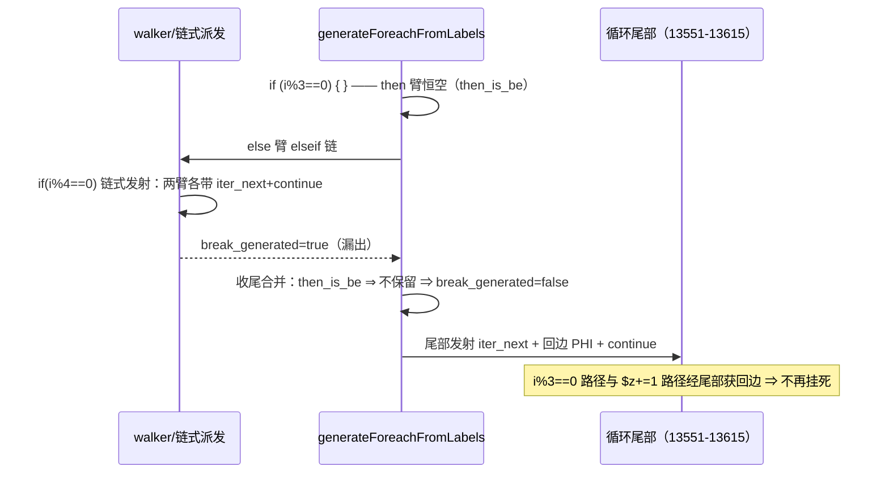

# AOT-CODEGEN-012 R-321：foreach 的 then_is_be 尾部抑制解除 + 嵌套 break 显式守卫（F-213-d2 / F-213-d3 闭环）

- 日期：2026-11-03
- 代次锚：**`nlk d9b463fc13ff0cfc6535fe1d9ab7f4e7`**（本轮唯一改动）；`tpl 2dfc5d01…`／`irg ea35bbde…`／`opti 553a2e54…`／`ir fb2bb442…` 未变
- 工单：`docs/known-issues/AOT-CODEGEN-012-class-name-case-insensitive-lookup.md` §227
- 提交：已随 `8b33878` 入库（2026-11-03，老铁提交；本文档的读数回填在其后完成，见 git 暂存区）
- 附带：opti 锚值笔误订正（`5532e540…`→`553a2e54…`，31 字符不可能值，转写吞字符；仅改工单 §225 锚行 + 两版交接文档共 5 处锚值字符）

## 1. 高层摘要（TL;DR）

F-213-d2（foreach 首臂 `continue` + elseif 嵌套 if ⇒ **死循环**）与 F-213-d3（foreach kv 臂内嵌 `if(c) break` ⇒ break 丢失 + merge 外溢）闭环。两者同根于 foreach 生成器对「臂=循环控制边」的收口缺口：①then 臂为 continue 边时臂体恒空、尾部增量+continue 又被 else 臂链式发射漏出的 `break_generated` 抑制 ⇒ 无回边路径死循环；②then 臂尾部嵌套 if 的 then 边直指循环出口时，通用范围行走算出空区间 ⇒ 嵌套 if 整段丢失、else 延续块外溢被无条件重发。修复共 +41/−3 行，全部落在 `generateForeachFromLabels`（`src/aot/native_linker.zig`）。

## 2. 影响范围

| 层 | 影响 |
|---|---|
| 发射器（`native_linker.zig`） | `generateForeachFromLabels`：①收尾 `break_generated` 合并守卫（≈13491）；②then 臂嵌套 cond_br 新增「嵌套 then=循环出口」分支（≈12551） |
| 语义面 | foreach 体内「首臂 continue + elseif 链」形状（值面+挂死）；foreach 臂尾部 `if(c) break; <延续>` 形状（break 语义与 merge 归臂） |
| 模板 / IR / 优化器 / 语法共享层 | 未动 |
| 门资产 | C343 扩臂 7→9（新增 f3/f4），门头注释更新 |

## 3. 核心变更

| # | 变更 | 说明 |
|---|---|---|
| 1 | 收尾守卫 `else_is_coalesce or then_is_be` → `else_is_coalesce` | then_is_be 时 then 臂恒空（仅置旗标）⇒ 其 break 状态恒 false ⇒ 合并后 `break_generated=false` ⇒ 尾部增量+回边 PHI+continue 恢复发射；链式臂内 continue 的路径不落尾部，无双重发射 |
| 2 | 嵌套 then=循环出口（cleanup/exit）新分支 | 指针比较判定（镜像既有 is_break 口径）⇒ 显式 `if (cond) { 出口PHI; break :label; }`；else 延续块先物化边 PHI 再 `[nei, nei+1)` 单块行走，回边交尾部（walker is_to_increment 口径）；不置 `break_generated`（条件 break，臂仍 fall-through） |

## 4. 可视化概览（Code & Logic Map）

### 4.1 缺陷形状与发射路径

```mermaid
flowchart TD
  subgraph F3["f3：foreach 首臂 continue + elseif 嵌套 if"]
    A1["body cond_br (i%3==0)"] -->|"then=increment（continue 边）"| B1["then_is_be=true<br/>臂体恒空"]
    A1 -->|"else=if_else_6"| C1["elseif 链处理（12911 段）"]
    C1 --> D1["内层 if(i%4==0) 命中 walker F-208 链式派发<br/>generateNestedContinueChain"]
    D1 -->|"break_generated=true 漏出"| E1["收尾守卫 13491<br/>旧：保留 ⇒ 尾部抑制"]
    E1 --> F1["空 then 臂 + else 臂($z+=1) 无回边<br/>⇒ while(true) 空转挂死"]
    E1 -.->|"修后：then_is_be 不入守卫<br/>break_generated=false"| G1["尾部恢复：iter_next+PHI+continue<br/>所有 fall-through 路径获回边"]
  end
  subgraph F4["f4：foreach kv 臂内嵌 if(k>4) break"]
    A2["then 臂 if_then_5 尾部嵌套 cond_br"] -->|"then=cleanup（break）"| B2["分支①②均不命中"]
    A2 -->|"else=if_merge_9（$z+=$k）"| C2["final-else 范围行走"]
    B2 --> C2
    C2 --> D2["nested_start=cleanup(4)<br/>nested_end=increment(3)+1=4<br/>⇒ 空区间 [4,4)"]
    D2 --> E2["嵌套 if 整段丢失；<br/>if_merge_9 未标记 ⇒ 尾部行走无条件重发<br/>⇒ 2048"]
    D2 -.->|"修后：新分支显式守卫"| G2["if(k&gt;4){出口PHI;break}<br/>+ else 延续块臂内单块行走"]
  end
```



### 4.2 修后执行流程（f3）



## 5. 详细变更分析

| 文件 | 变更点 |
|---|---|
| `src/aot/native_linker.zig` | ① ≈13491：收尾 `break_generated` 合并守卫移除 `or then_is_be`（注释重写为机理说明）；② ≈12551：then 臂嵌套 cond_br 分支链在 `then_terminates+else_is_loop_continuation` 之后、final-else 范围行走之前插入「嵌套 then=循环出口」分支（+38 行含注释） |
| `fuzzy_scripts_720/tmp/c343_loop_elseif_gate_tmp.sh` | 扩臂 7→9（新增 f3/f4 heredoc）；门头注释更新（f3/f4 闭环说明 + 同族仍开登记 g_for/g_while/f6） |
| `fuzzy_scripts_720/tmp/c343_loop_elseif_tmp.tsv` | 门读数 9 行全 SAME |
| 工单 §227 | 新增本轮记录（根因/修法/读数/同族新发现/锚值订正说明） |
| 两版交接文档 + 工单 §225 锚行 | opti 锚值笔误订正（仅锚值字符） |

### 关键代码切片

```zig
// src/aot/native_linker.zig ≈13494（变更①：then_is_be 不再保留 else 臂漏出的 break_generated）
self.return_generated = loop_cond_br_then_returned and self.return_generated;
if (else_is_coalesce) {
    // break_generated 保持不变（来自 merge 块/else 分支的回边检测）
} else {
    self.break_generated = loop_cond_br_then_breaked and self.break_generated;
}
```

```zig
// src/aot/native_linker.zig ≈12551（变更②：嵌套 then=循环出口 显式守卫 break）
} else if (nested_cb.then_block == func.blocks.items[cleanup_idx] or
    (exit_idx != null and nested_cb.then_block == func.blocks.items[exit_idx.?]))
{
    try writer.print("{s}if (", .{then_indent});
    try self.writeConditionExpr(writer, nested_cb.cond.id, nested_cb.cond.type_);
    try writer.print(") {{\n", .{});
    const brk_indent = try std.fmt.allocPrint(self.allocator, "{s}    ", .{then_indent});
    defer self.allocator.free(brk_indent);
    try self.generateExitPHIAssignments(writer, func, ti, nested_ti.?, brk_indent, false);
    try writer.print("{s}break :{s};\n", .{ brk_indent, label_name });
    try writer.print("{s}}}\n", .{then_indent});
    if (nested_ei) |nei_brk| {
        if (!processed.contains(nei_brk)) {
            // save/restore return/break 标志
            try self.materializeEdgePhi(writer, func.blocks.items[nei_brk], then_blk, then_indent);
            try self.generateLabelDrivenBlockRange(writer, func, nei_brk, nei_brk + 1, cleanup_regs, processed, loop_label_counter, then_indent);
            // restore
        }
    }
}
```

## 6. 影响与风险评估

- **破坏式变更**：无。变更①只在 then_is_be（then 臂恒空）时改变 `break_generated` 合并结果，尾部恢复发射的路径（空 then 臂 / is_to_increment 的 else 臂）本就依赖尾部；臂内已自含 continue 的路径经 `continue` 跳走、不可达尾部，无双重执行。变更②的新分支仅在「嵌套 then 目标=循环出口」时命中——该形状旧路径恒为空区间（必坏），不存在被抢占的正常形状。
- **性能**：编译期仅多一次指针比较；运行期生成码对 f3 形状少一次空转（死循环消除），其余形状零差异。
- **验证**：C343 9/9（自证 9 CF）；C339 30/30、C340 4/4、C341 5/5、C342 6/6、ERRH 18 same+1 既有 CF（residue=0）；主回归 **PASS=68 FAIL=0**（`SELF_CHECK_OK rows=68 uniq=68 total=68`，failures TSV 与基线逐字节一致、无新增）；单测 **`21/21 steps; 326/326 tests`**。
- **复测路径**：`bash fuzzy_scripts_720/tmp/c343_loop_elseif_gate_tmp.sh`（9 臂全 SAME 即通过）。

## 7. 遗留问题 / 潜在问题

| 编号 | 说明 | 级别 |
|---|---|---|
| **F-213-d6** | foreach **else 臂**副本（≈12911 / ≈13188）缺同一「嵌套 then=循环出口」分支：f6（elseif 臂内嵌 break）AOT 34 vs PHP 22 | P0（下一轮，同模式 +30 行） |
| **F-213-d4 / d5** | for/while 生成器同族：g_for 2048、g_while 2032（vs PHP 1026）；for 侧副本在 ≈14929，while 侧发射路径不同（merge 不外溢、仅丢 break） | P0（待裁决扩散） |
| 锚值笔误残留 | R-319/R-320 变更文档首行短形式 `opti 5532e540…`（不在本轮「两版交接文档」字面范围内，未动） | P2 |

## 8. 后续建议

| 优先级 | 事项 | 影响面 | 落地成本 |
|---|---|---|---|
| P0 | F-213-d6：else 臂两副本接同一分支（f6 入 C343 第 10 臂） | foreach 值面 | 低（模式已验证） |
| P0 | F-213-d4/d5：for/while 同族修复（g_for/g_while 入门） | 跨生成器一致性 | 中 |
| P1 | 把「嵌套 then=循环出口」判定收敛为共用 helper（then/else 臂 × foreach/for/while 六处副本） | 可读性/防再漏 | 中 |
| P2 | F-162/F-163（共享层，等批准）、F-88、F-95-d；R-319/R-320 变更文档锚值短形式顺手订正 | — | — |

> 方法学沉淀：①「登记的红可能是过期红，先普查再动手」本轮再次成立（f3 前两代症状从空输出变为挂死）；②巨型生成器里「旗标 save/restore 不全 = 漏出」是这类尾部抑制的共性根因，新增分支务必成对核对 `return_generated`/`break_generated` 的恢复路径；③验证前先想「这条路径的回边由谁发射」——尾部、臂内链式、walker is_to_increment 三套口径各司其职，缺一会挂死。