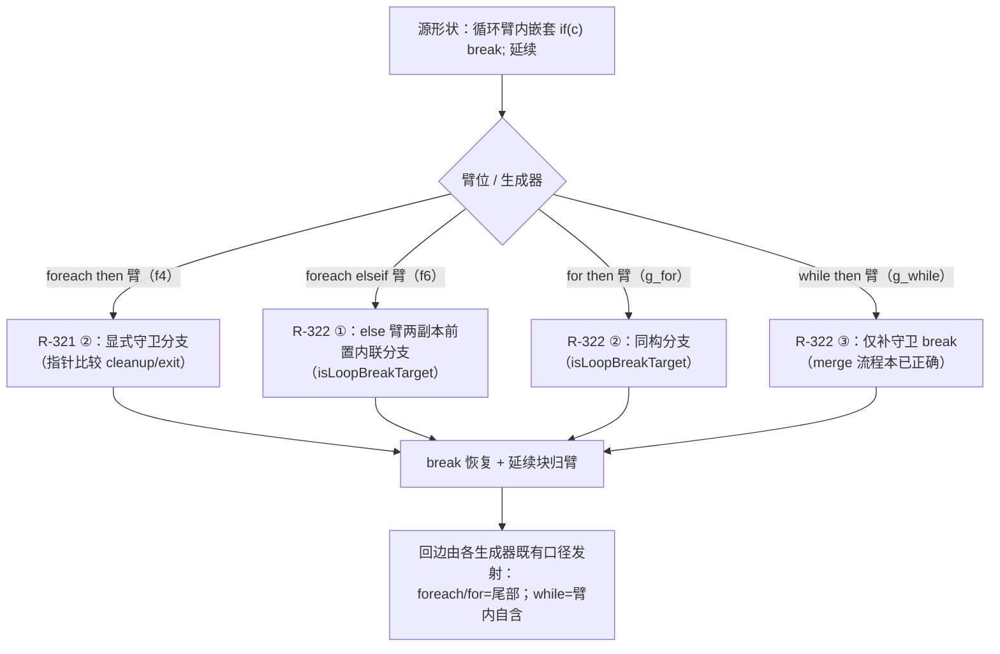
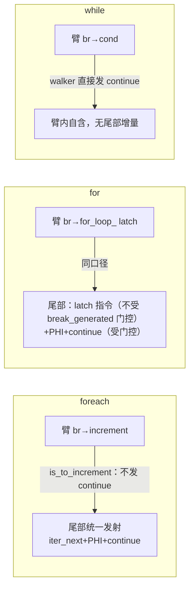

# AOT-CODEGEN-012 R-322：嵌套 break 守卫三侧收口（F-213-d6 / d4 / d5 同族闭环）

- 日期：2026-11-03
- 代次锚：**`nlk 9d74f79d4911e4202b715788a6486f33`**（本轮唯一改动）；`tpl 2dfc5d01…`／`irg ea35bbde…`／`opti 553a2e54…`／`ir fb2bb442…` 未变
- 工单：`docs/known-issues/AOT-CODEGEN-012-class-name-case-insensitive-lookup.md` §228
- 提交：未提交（HEAD `234c81d`）
- 范围裁决：老铁批准 d6 与 d4/d5 同轮，扩到 for/while 生成器（仍限 AOT 编译/运行问题）

## 1. 高层摘要（TL;DR）

R-321 修了「嵌套 then=循环出口」形状在 foreach **then 臂**的两面（f3 挂死 / f4 值错）。本轮把同族缺口在剩余三处收口：foreach **else 臂**（elseif 的 then 块内嵌 `if(c) break`，f6：34→22）、**for** 生成器 then 臂（g_for：2048→1026）、**while** 生成器 then 臂（g_while：2032→1026）。三处同根：嵌套 if 的 then 边直指循环出口（已被预标记）时，通用范围行走算出**空区间**或**walker 跳过**，break 边丢失。修法按各生成器「回边由谁发射」的既有口径分别落地（先答口径再改码），统一用 `isLoopBreakTarget` 判定（读 `current_loop_exit_block`/`current_loop_cleanup_block`），条件性 break 一律不置 `break_generated`。

## 2. 影响范围

| 层 | 影响 |
|---|---|
| 发射器（`native_linker.zig`） | `generateForeachFromLabels` else 臂两副本（then_is_be 路径 + final-else 路径）各 +78 行前置分支；`generateForFromLabels` then 臂 +34 行分支；`generateWhileFromLabels` then 臂 +26 行分支。合计 **+175/−0**（本轮） |
| 语义面 | 三种循环体内「嵌套 if 的 then 边=循环出口（break）」形状：foreach 的 then 臂与 elseif 臂、for 的 then 臂、while 的 then 臂 |
| 模板 / IR / 优化器 / 语法共享层 | 未动 |
| 门资产 | C343 扩臂 9→12（+f6/g_for/g_while），门头注释更新 |

## 3. 核心变更

| # | 变更 | 说明 |
|---|---|---|
| 1 | foreach else 臂两副本：前置内联分支 | then 块终止符为 cond_br 且 `isLoopBreakTarget(then_block) ∧ !isLoopBreakTarget(else_block)` ⇒ 内联「块内指令（PHI 按 else_blk 边物化）+ `if(n2cond){出口PHI;break}` + else 延续块（边 PHI + `[ne,ne+1)` 单块行走）」；命中标 processed，原范围行走自动跳过；自带 return/break save/restore |
| 2 | for 生成器 then 臂：新增同构分支 | 在 F-206-d 链式钩子、fe_is_or_sc、branch2 之后、final-else 之前；显式守卫 break + else 延续块臂内单块行走；回边交 for 尾部（latch 指令不被 `break_generated` 门控、PHI/continue 受其门控——本分支不置位） |
| 3 | while 生成器 then 臂：只补守卫 break | F-206-d-b 链式失败后、范围行走之前插入；while 侧 else 延续（if_merge_）由既有 merge 流程正确留在臂内，**不动 merge 流程、不改范围行走** |

## 4. 可视化概览（Code & Logic Map）

### 4.1 家族全景：同一形状 × 三种循环 × 两类臂位



### 4.2 d6 执行流程（f6：elseif 臂）

```mermaid
sequenceDiagram
  participant FE as foreach 生成器 else 臂处理
  participant D6 as R-322 前置分支
  participant W as 通用 walker（范围行走）
  participant T as 循环尾部（increment+continue）
  FE->>D6: elseif then 块 if_then_8（终止符 cond_br: then=cleanup, else=if_merge_12）
  D6->>D6: isLoopBreakTarget(then)=true ∧ else 非出口 ⇒ 命中
  D6->>D6: 发射：k>3 计算 → if(k>3){出口PHI;break} → if_merge_12($z+=$k+setGlobalVar)
  D6-->>FE: 标记 if_then_8 / if_merge_12 processed
  FE->>W: 原 then 行走 → 因 processed 自动跳过
  FE->>T: break_generated 未被置位 ⇒ 尾部发射 increment+continue
  Note over D6,T: 修前：walker 对预标记 cleanup 跳过 ⇒ 嵌套 if 整段丢失（34 vs 22）
```

### 4.3 三生成器回边归属（改前必答口径）



## 5. 详细变更分析

| 文件 | 变更点 |
|---|---|
| `src/aot/native_linker.zig` | ① ≈13099 / ≈13449（foreach else 臂两副本）：F-213-d6 前置内联分支；② ≈15119（for then 臂）：F-213-d4 分支；③ ≈16888（while then 臂）：F-213-d5 守卫 break |
| `fuzzy_scripts_720/tmp/c343_loop_elseif_gate_tmp.sh` | 扩臂 9→12（+f6/g_for/g_while heredoc）；门头注释更新（三缺陷闭环说明） |
| `fuzzy_scripts_720/tmp/c343_loop_elseif_tmp.tsv` | 门读数 12 行全 SAME |
| 工单 §228 | 新增本轮记录（含「回边由谁发射」口径表——228.1） |

### 关键代码切片

```zig
// src/aot/native_linker.zig ≈13107（d6，foreach else 臂前置分支的判定核）
const n2_d6 = blk: {
    const nt_term_d6 = nt_blk_d6.terminator orelse break :blk null;
    if (nt_term_d6 != .cond_br) break :blk null;
    const cb_d6 = nt_term_d6.cond_br;
    if (!self.isLoopBreakTarget(func, cb_d6.then_block)) break :blk null;
    if (self.isLoopBreakTarget(func, cb_d6.else_block)) break :blk null; // 双 break 退化形走原路径
    break :blk cb_d6;
};
```

```zig
// src/aot/native_linker.zig ≈16894（d5，while 侧：只补守卫 break，merge 流程不动）
if (self.isLoopBreakTarget(func, nested_cb.then_block) and
    !self.isLoopBreakTarget(func, nested_cb.else_block))
{
    try writer.print("{s}if (", .{then_indent});
    try self.writeConditionExpr(writer, nested_cb.cond.id, nested_cb.cond.type_);
    try writer.print(") {{\n", .{});
    // ... 出口 PHI + break :label ...
    try writer.print("{s}}}\n", .{then_indent});
}
```

## 6. 影响与风险评估

- **破坏式变更**：无。三个新分支都只在「嵌套 then=循环出口 ∧ else 非出口」时命中——该形状旧路径恒为空区间/跳过（必坏），不存在被抢占的正常形状；双边皆出口的退化形显式排除（走原路径）。
- **save/restore 成对核对**（老铁硬性要求）：d6 分支自带 `saved_rg_d6/saved_brk_d6` 包裹全部内联发射；d4 分支包裹 else 延续行走；d5 分支零旗标改动（纯写流）。三处条件性 break 均**不置** `break_generated`（对齐 while 16568 既有口径），尾部回边门控不受影响。
- **性能**：编译期每处多一次终止符判定 + 指针扫描；运行期对修复形状消除死循环/外溢，其余形状生成码零差异。
- **验证**：C343 **12/12**（自证 **12 全 CF**）；邻门 C339 **30/30**、C340 **4/4**、C341 **5/5**、C342 **6/6**、ERRH **18 same+1 既有 CF**（`repo_build_residue=0`）；主回归与单测读数收尾回填于本节末行。
- **复测路径**：`bash fuzzy_scripts_720/tmp/c343_loop_elseif_gate_tmp.sh`（12 臂全 SAME 即通过）。

## 7. 遗留问题 / 潜在问题

| 编号 | 说明 | 级别 |
|---|---|---|
| for/while else 臂副本 | ≈15301/15549（for）、≈17040/17253（while）的 elseif 链 then 行走与 d6 同形缺口**理论上存在**，但无复现件（f6 的 for/while 变体未测红、未普查）；按 §六 先问再扩，修法可逐字复用 d6 分支 | P1 |
| R-321② 与 R-322 判定口径 | R-321 f4 分支用 cleanup/exit 指针比较、本轮三处用 `isLoopBreakTarget`——语义等价，未回改 f4（已验过门）；下次触碰时可统一 | P2 |
| F-162/F-163、F-88、F-95-d | 维持原状（共享层等批准 / P2） | — |

## 8. 后续建议

| 优先级 | 事项 | 影响面 | 落地成本 |
|---|---|---|---|
| P1 | for/while else 臂副本普查（先造复现件测红，再决定是否复用 d6 分支） | 跨生成器 elseif 臂 | 低（普查）+ 低（复用） |
| P1 | 「嵌套 then=循环出口」判定 + 守卫 break 发射收敛为共用 helper（当前 5 处副本：R-321①② + R-322①②③） | 可读性/防再漏 | 中（需先问，§六） |
| P2 | F-162/F-163（共享层，等批准）、F-88、F-95-d | — | — |

> 方法学沉淀：①同一缺陷家族在不同生成器的**症状可以不同**（while 侧 merge 不外溢）——症状差异反推发射路径差异（臂内自含 vs 尾部统一），先答「回边由谁发射」再动手是本轮的省错关键；②巨型 switch 里同一注释模板的多副本，可用**注释变体**（f097 长版 vs 「FE6 对称」短版）做精确锚定；③前置分支 + processed 标记让原路径自动跳过，比重写原路径的 save/restore 更不易漏。
