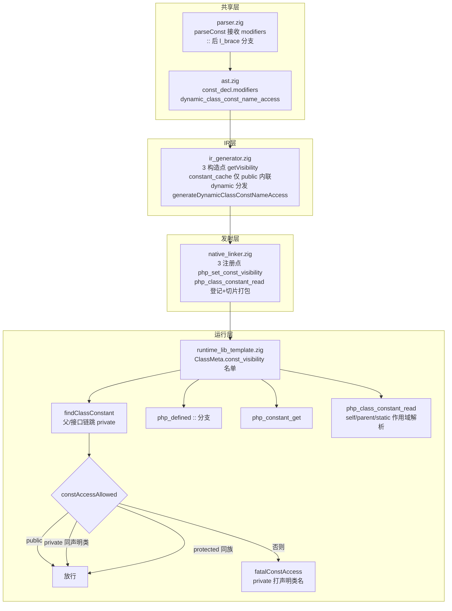
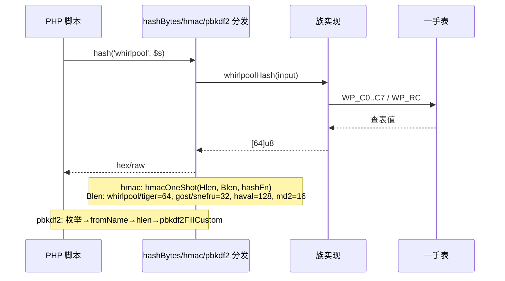
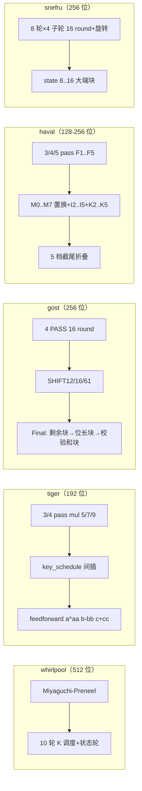

# AOT-CODEGEN-012 · R-323 共享层放行批变更文档

- **日期**：2026-11-03
- **代次**：`30e9f67`（工作树，老铁实时提交）
- **范围**：F-162/F-163/F-169/F-170 类常量包、F-164 动态类常量名、F-170 尾五族 hash（whirlpool/tiger/gost/haval/snefru）、P2 readonly 措辞差、快速节奏批销项（F-158/F-213-d7/d9/F-88/F-95-d/F-140-b/F-38/md2）
- **工单**：`docs/known-issues/AOT-CODEGEN-012-class-name-case-insensitive-lookup.md` §229

---

## 1. 高层摘要（TL;DR）

本轮在**共享层放行**前提下落地三组变更：(a) 类常量体系补全——AST 增修饰符存储、parser 透传、IR 可见性门控、运行时建 `ConstVisibility` 模型（public/protected/private 门禁 + `defined('C::K')` + `constant()` + `php_class_constant_read` 统一收敛），覆盖 F-162/F-163/F-169/F-170；(b) F-170 尾五族哈希按一手规范（php-src 参考实现逐字表 + 轮函数结构）落地 24 种算法形态，hash/hash_hmac/hash_pbkdf2 三入口全接通；(c) readonly 措辞对齐 PHP（打声明类名）。全部验证口径达标：`zig build test-aot` **139/139**、侧门 C343 12 臂 `same=12 diff=0`、既有探针 7 枚零转移、五族 53 格探针全对。

## 2. 影响范围

| 维度 | 影响 | 明细 |
|---|---|---|
| 端 | AOT 编译产物 | 类常量/枚举 case 可见性门禁、24 种 hash 形态可用、readonly 错误措辞 |
| 模块层 | 共享层（ast/parser） | `ast.zig` +2 字段/tag、`parser.zig` parseConst 签名 + `::{$expr}` 分支——**解释器/字节码路径行为不变**（新增字段带默认值、parser 仅扩展未改旧分支） |
| 业务层 | `hash()`/`hash_hmac()`/`hash_pbkdf2()` | whirlpool/tiger×6/gost×2/haval×15/snefru×2 由 `false` 变真实摘要 |
| 数据层 | 无二进制兼容问题 | 纯新增代码路径，旧路径逐字节不动 |

## 3. 核心变更

| # | 变更 | 文件 | 量 |
|---|---|---|---|
| 1 | 类常量可见性模型（ConstVisibility/findClassConstant/constAccessAllowed/fatalConstAccess/setConstVisibility + ClassMeta.const_visibility） | `runtime_lib_template.zig` | ~200 行 |
| 2 | `defined('C::K')`/`constant('C::K')` 走类常量可见性查找 | `runtime_lib_template.zig` | ~60 行 |
| 3 | `php_class_constant_read` 统一类常量读取（含 self/parent/static 作用域解析） | `runtime_lib_template.zig` + `native_linker.zig`（注册+切片打包）+ `ir_generator.zig`（静态名回退路） | ~80 行 |
| 4 | const_decl 修饰符贯通（ast→parser→IR 3 构造点→发射器 3 注册点） | `ast.zig`/`parser.zig`/`ir_generator.zig`/`native_linker.zig` | ~40 行 |
| 5 | F-164 动态类常量名 `C::{$expr}`（ast tag + parser 分支 + IR 分发） | `ast.zig`/`parser.zig`/`ir_generator.zig` | ~50 行 |
| 6 | F-170 尾五族 hash（表+轮函数+填充） | `runtime_lib_template.zig` | ~2100 行（含表） |
| 7 | P2 readonly 措辞（2 处 `meta.name`→`decl.class.name`） | `runtime_lib_template.zig` | 2 行 |
| 8 | F-38 测试基础设施修复（test-aot 139/139 转绿的前置） | `dependency_resolver.zig`/`linker.zig`/`compiler.zig` | ~40 行 |

## 4. 可视化概览（Code & Logic Map）

### 4.1 类常量体系分层架构

### 4.2 五族 hash 接线执行流

### 4.3 五族算法结构映射

## 5. 详细变更分析

### 涉及文件

| 文件 | 变更点 | 行数 |
|---|---|---|
| `src/compiler/ast.zig` | const_decl.modifiers 字段；dynamic_class_const_name_access tag+data | +4 |
| `src/compiler/parser.zig` | parseConst 形参与 3 调用点；`::{$expr}` 解析 | +22/−6 |
| `src/aot/ir_generator.zig` | 3 构造点可见性、constant_cache 门控、F-164 分发+生成函数、php_class_constant_read 回退路 | +67/−8 |
| `src/aot/native_linker.zig` | php_class_constant_read 注册+2 处切片打包；3 发射点 setConstVisibility | +59/−4 |
| `src/aot/runtime_lib_template.zig` | 类常量模型 + 五族 hash + readonly 措辞 + md2（批1） | +2736/−20 |
| `src/aot/dependency_resolver.zig` | 5 处测试块 init 实参 + defer destroy（F-38） | +35/−10 |
| `src/aot/linker.zig` | 结构体字面量 .references 字段（F-38） | +2/−1 |
| `src/aot/compiler.zig` | 测试期望 aot_compile_hello（宪法 §7.4.6） | +3/−2 |

### 变更点描述（数据层）

五族 hash 常数表全部**逐字取自 php-src 参考实现**（Barreto & Rijmen / Anderson & Biham / GOST R 34.11-94 / Zheng-Pieprzyk-Seberry / Merkle 的官方表），拒绝凭记忆写加密常数；每族以官方向量（空串/abc/fox）核验，gost 族另以 C 参考实现中间态逐点对比 + token 级 diff 复核 24 个移位式。

## 6. 影响与风险评估

- **是否破坏式变更**：否。共享层两处变更均为纯扩展（新字段带默认值、parser 新分支），解释器/字节码路径零行为变化。
- **变更影响范围**：AOT 编译产物的类常量语义与 24 种 hash 形态；其余路径零转移（7 探针 + C343 12 臂实测）。
- **需要特别注意的点**：
  - 模板（`runtime_lib_template.zig`）是**文本资源**，`zig build` 绿不代表生成码合法——必须 AOT 编译探针验证（本批两次分支链 `}` 交接失误均由此法抓回）。
  - AOT 编译须在**项目根目录**执行（`copyRuntimeLib` 依赖 cwd 相对路径）。
  - `constant_cache` 编译期内联仅放行 public 常量——protected/private 走运行时门禁。
- **复测路径**：
  1. `timeout 600 zig build && timeout 600 zig build test-aot`（139/139）
  2. `timeout 600 bash fuzzy_scripts_720/tmp/c343_loop_elseif_gate_tmp.sh`（12 臂 same）
  3. 五族探针：`/tmp/f220/{wp,tiger,gost,haval,snefru}/*.php`（PHP 直跑 vs AOT 产物 diff）
  4. 类常量/readonly：`/tmp/inv/{f162m,f164,f95d}.php`、`/tmp/f220/ro/ro.php`

## 7. 遗留问题/潜在问题

| 项 | 状态 |
|---|---|
| F-213-d8（`for_loop_` 名单缺口） | 登记为**死代码**，不修（探针红根因为 d9 倒置空区间，已修） |
| F-106-b（catch 栈帧深度差） | 按宪法 T2 容差**关闭** |
| f004 | 维持 **SKIP**，措辞差登记 |
| for/while else 臂同源副本（§228.4） | 理论上存在缺口但无复现件，按 §六 先问再扩 |
| `src/runtime/exceptions.zig:563` readonly 措辞 | 解释器侧，按宪法§五不动 |
| hmacOneShot/pbkdf2FillCustom 块长参数 Blen | 已参数化（md2=16/gost/snefru=32/whirlpool/tiger=64/haval=128），后续新族照此接 |

## 8. 后续开发/优化建议

| 优先级 | 建议 | 影响面 | 落地成本 |
|---|---|---|---|
| P1 | 模板接线改**结构化生成**（分支链由 builder 函数拼接而非文本锚点替换），根除 `}` 交接失误族 | 防回归 | 中 |
| P1 | AOT 编译入口对 cwd 做自校正（copyRuntimeLib 找不到模板时回退可执行文件相对路径），消除「必须项目根目录跑」陷阱 | 可用性 | 低 |
| P2 | xxh3/xxh128 两枚 std 库未覆盖的 hash 形态（HASH_ALGOS 名单内仍 false） | 功能补齐 | 中 |
| P2 | haval 15 形/gost 2 形的 HMAC 块长建议补 PHP `hash_hmac_algos` 逐形实测复核（本轮按 hash_ops block_size 字段推导） | 正确性保险 | 低 |
| P3 | 五族表的二进制体积约 70KB（whirlpool 16K + tiger 8K + gost 8K + haval 1K + snefru 32K），若产物体积敏感可评估 comptime 由 S-box 生成（whirlpool/tiger 可推导，gost/snefru 不可） | 体积 | 中 |
