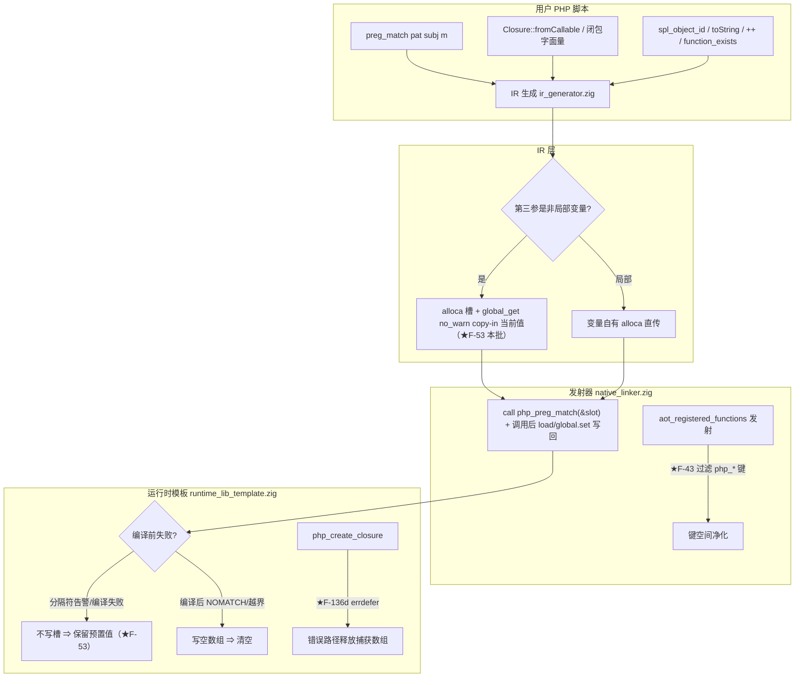
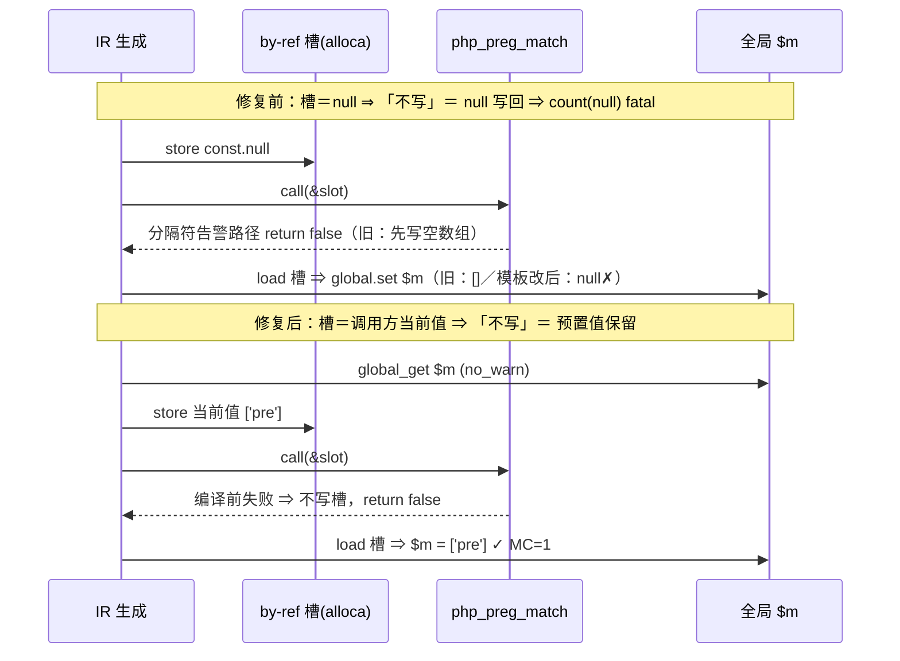
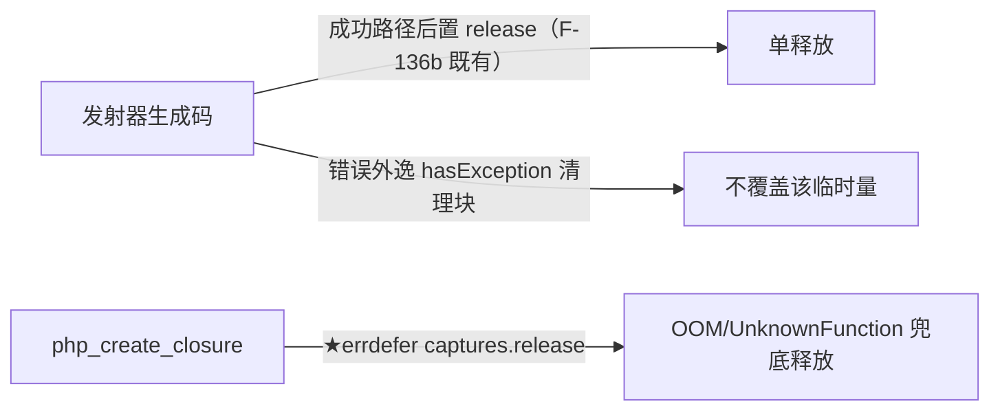

# AOT-CODEGEN-012 R-331 批次五：preg by-ref copy-in 修复与五枚行为对齐（2026-11-04）

> 关联提交：`08a6fc2` ｜ 工单登记：§232 ｜ 上一批：§231（R-328…R-330）

## 1. 高层摘要（TL;DR）

批次五核销 7 枚登记缺陷：1 枚过期红（F-62d 实测已绿不修）+ 6 枚实修（F-136d／F-34／F-32／F-61／F-53／F-43）。核心难点 F-53（preg 预置值残差）定位为 **IR 层 by-ref 实参槽以 `const.null` 初始化** 的 copy-in 缺失——模板侧「编译前失败不写槽即保留预置值」的语义在 null 槽上退化成「不写即 null」，修复改为 `global_get no_warn` 装载调用方当前值。全量验证：PD 20/20（pd18/pd20 摘红）、OBJ 35/35、C249 14 臂零泄漏、C343 12/12、BLT 208/209（唯一 DIFF＝既有登记红 b5）、f135/f161 防护面 MATCH，零转移。

## 2. 影响范围

| 层 | 模块 | 影响 |
|---|---|---|
| IR 生成 | [ir_generator.zig](../../../src/aot/ir_generator.zig) | `preg_match`/`preg_match_all` 第三参（非局部变量支）by-ref 槽初始化语义变更：null ⇒ 调用方当前值 |
| 运行时模板 | [runtime_lib_template.zig](../../../src/aot/runtime_lib_template.zig) | preg 四函数八站点失败路径写出参槽行为收敛；`php_create_closure` 错误路径资源释放；`spl_object_id/hash` 闭包支；`PHPObject.toString` fail-open 移除；bool/数组增减诊断 |
| 发射器 | [native_linker.zig](../../../src/aot/native_linker.zig) | `aot_registered_functions` 键空间卫生（`php_*` 内部 helper 不可见化） |
| 用户可见行为 | preg_match/preg_match_all | 编译前失败路径保留 `$matches` 预置值（对齐 PHP） |
| 用户可见行为 | spl_object_id/hash、(string)对象、++/--、function_exists | 闭包 id/hash 非零；无 __toString 抛 Error；bool 增减 Warning；内部 helper 函数名不再泄漏 |

## 3. 核心变更

| 编号 | 性质 | 一句话 |
|---|---|---|
| F-62d | 过期红 | round `$mode` ValueError 实测已 SAME（R-172 族闭环），不修 |
| F-136d | 实修 | `php_create_closure` 加 `errdefer captures.release()`，OOM/UnknownFunction 路径不再漏捕获数组 |
| F-34 | 实修 | `spl_object_id`/`spl_object_hash` 加 `.function` 支，闭包指针源＝`*PHPClosure` 地址 |
| F-32 | 实修 | `PHPObject.toString` 无 `__toString` 去 fail-open 返类名 ⇒ 抛可捕获 Error |
| F-61 | 实修 | bool `++`/`--` ⇒ Warning + 值不变；数组 ⇒ TypeError「Cannot in/decrement array」 |
| F-53 | 实修 | IR by-ref 槽 copy-in + 模板四函数编译前失败路径不写槽（详见 §5 时序图） |
| F-43 | 实修 | 发射器过滤 `php_*` 内部 helper 键（放行 `php_sapi_name`），`function_exists` 键空间净化 |

## 4. 可视化概览（Code & Logic Map）

### 4.1 分层架构与变更落点

### 4.2 F-53 执行时序（修复前后对照）

### 4.3 F-136d 释放责任链

## 5. 详细变更分析

### 涉及文件列表

| 文件 | 变更点 | 描述 |
|---|---|---|
| [ir_generator.zig](../../../src/aot/ir_generator.zig)（`preg_match`/`preg_match_all` 第三参非局部变量支，2 处同形） | `store const.null` ⇒ `global_get no_warn` + `store` | by-ref copy-in：装载调用方当前值；no_warn＝按引用传参对未定义变量不告警（缺省 null＝PHP auto-vivify） |
| [runtime_lib_template.zig](../../../src/aot/runtime_lib_template.zig) `preg_match_with_matches` | 分隔符告警／编译失败两路径删 `matches_ref.* = initArray` | 编译前失败保留预置值 |
| 同上 `preg_match_all`（非 php_ 前缀支） | 同两处 | 同上 |
| 同上 `php_preg_match`（五参版） | 同两处 | 同上 |
| 同上 `php_preg_match_all`（五参版） | 同两处 | 同上（本批卡点漏网之鱼：首轮只改了三支，pd20 残留即此） |
| 同上 `preg_match`（14308 孪生支） | 同两处 + `_ = matches_ref;` | 全路径不再触出参槽 ⇒ 显式丢弃防 unused（§66.2-2 孪生同语义纪律） |
| 同上 `php_create_closure:3764` | +`errdefer captures.release(allocator)` | 仅错误返回触发；成功路径仍调用方单释放 |
| 同上 `php_spl_object_id:15312`／`php_spl_object_hash:15325` | +`.function` 支 | 闭包指针源＝`*PHPClosure`；判据口径 §28.8（禁比绝对值） |
| 同上 `:24020`（PHPObject.toString） | 去 fail-open | 无 `__toString` ⇒ Error「Object of class X could not be converted to string」 |
| 同上 `:7771/:7792/:7814/:7835` | bool/数组增减诊断 | bool ⇒ Warning+值不变；数组 ⇒ TypeError「Cannot in/decrement array」 |
| [native_linker.zig](../../../src/aot/native_linker.zig) `:2014` | `aot_registered_functions` 发射过滤 `php_*` | 内部 helper 键对 `function_exists` 不可见；放行 `php_sapi_name` |

### 端/层变化明细

- **IR 层**：仅 `preg_match`/`preg_match_all` 第三参（全局/`__main__` 变量）两站点；局部变量支（变量自有 alloca 直传）天然正确未动。
- **模板层**：preg 族四函数八站点行为收敛 + 四枚行为修复；无签名变更、无新分配热点。
- **发射层**：键空间过滤为编译期行为，零运行期成本。
- **性能**：F-53 每枚三参以上 preg 调用多一次全局表 no_warn 查询（相对正则编译+匹配可忽略）；其余各条均为错误/诊断路径，不在热路径。

## 6. 影响与风险评估

- **破坏式变更**：无。全部变更为「向 PHP 8.5.8 实测口径对齐」；唯一行为收紧是 `function_exists("php_*")` 内部名不再可见（F-43 登记缺陷的本意）。
- **零转移证据**：PD 20/20、OBJ 35/35、C249 flat=12/leak=0/known_leak=1(a11=F-136c 登记不变)、C343 12/12、BLT 208/209（b5＝bcadd 对象参数 TypeError，R171/R195/R206 历史快照同判）、f135/f161 MATCH。
- **特别注意**：① 孪生实现纪律（§66.2-2）——preg 每函数有 php_ 前缀/无前缀双胞胎，改动必须八站点全齐，漏一支即 pd20 式残留；② `preg_match:14308` 孪生支因全路径不触出参槽需显式 `_ = matches_ref;` 防 Zig unused 编译错；③ c249/c047 门脚本在 macOS bash 3.2 + UTF-8 locale 下被 `→` 字面量绊倒 ⇒ 一律 `LC_ALL=C bash` 跑门。
- **复测路径**：
  1. `timeout 600 zig build`
  2. 探针 `/tmp/fb5/f53*.php f43.php f34.php f32.php f61*.php f62d.php f136d.php` 逐一 PHP↔AOT 对拍
  3. `LC_ALL=C bash fuzzy_scripts_720/tmp/{c036_preg_delimiter,c249_f133_leak,c044_arith_object,c047_builtin_numeric_object,c343_loop_elseif}_gate_tmp.sh`
  4. `LC_ALL=C bash fuzzy_scripts_720/tmp/f161_spotcheck_tmp.sh fuzzy_scripts_720/pass/{f135_math_number_theory_crt_miller_rabin,f161_json_xml_csv_parsing}.php`

## 7. 遗留问题／潜在问题

| 项 | 状态 |
|---|---|
| `Closure::fromCallable("unknown")` 不抛 TypeError（IR 短路直通字符串，创建期校验缺失） | 工单 §232.3 登记，涉一等 callable 全局设计 ⇒ **待老铁裁** |
| preg flags ValueError throw 路径 `$matches` 残差（by-ref copy-out 在 throw 时被跳过，通用缺口非 preg 专属） | 工单 §232.3 登记 ⇒ 待裁 |
| PHP_BINDIR/PHP_BINARY 取值口径（§172.4） | 老铁未裁决前**不动** |
| 模板 `php_log2` 死代码体 | 不可达保留，删除待裁 |
| F-122（P⎮100 pow ulp）；F-145-b（C281 a8 srand 种子面） | 既有待裁项，维持 |

## 8. 后续开发/优化建议

| 优先级 | 建议 | 影响面 | 落地成本 |
|---|---|---|---|
| P0 | by-ref copy-out 的 throw 路径包裹（try/catch+回写+重抛）通用方案评审——一次消灭整族「抛出型 by-ref 内置」残差 | 所有抛错 by-ref 内置（preg flags VE 等） | 中（发射器单点，但需全门回归） |
| P1 | `Closure::fromCallable` 创建期校验决策：若补，建议在 IR 短路处对字面串发运行期校验调用，保持一等 callable 字符串表达不变 | 一等 callable 全族 | 中 |
| P1 | preg 四函数八站点的「编译前失败不写槽」收敛为单一 helper（如 `returnPreCompileFailureKeepMatches()`），从结构上防孪生漏改 | preg 族可维护性 | 低 |
| P2 | 门脚本 `→` 字面量换 ASCII（`->`），根除 macOS bash 3.2 locale 绊点 | 门脚本健壮性 | 低 |
| P2 | 将「PD 20/20、OBJ 35/35、BLT b5 既有红」纳入主回归固定臂，防未来回潮 | 回归体系 | 低 |
