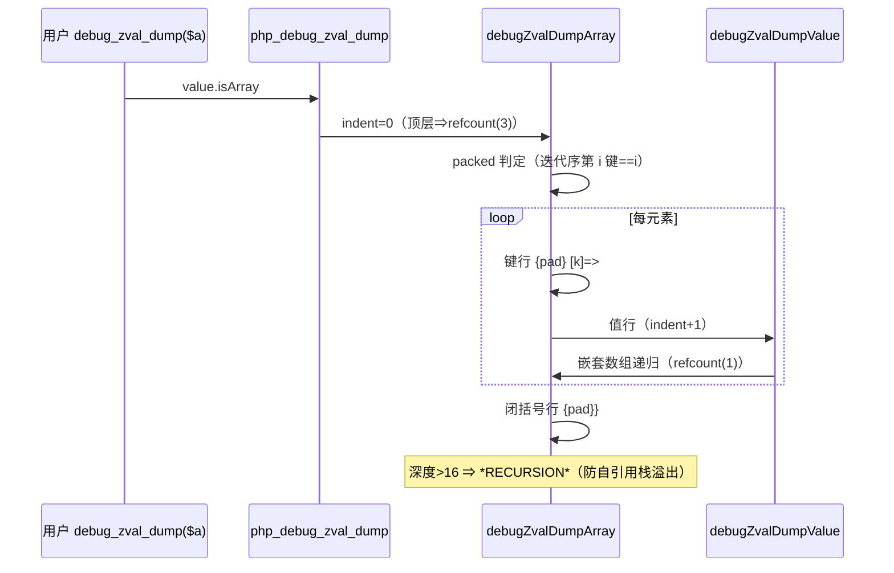
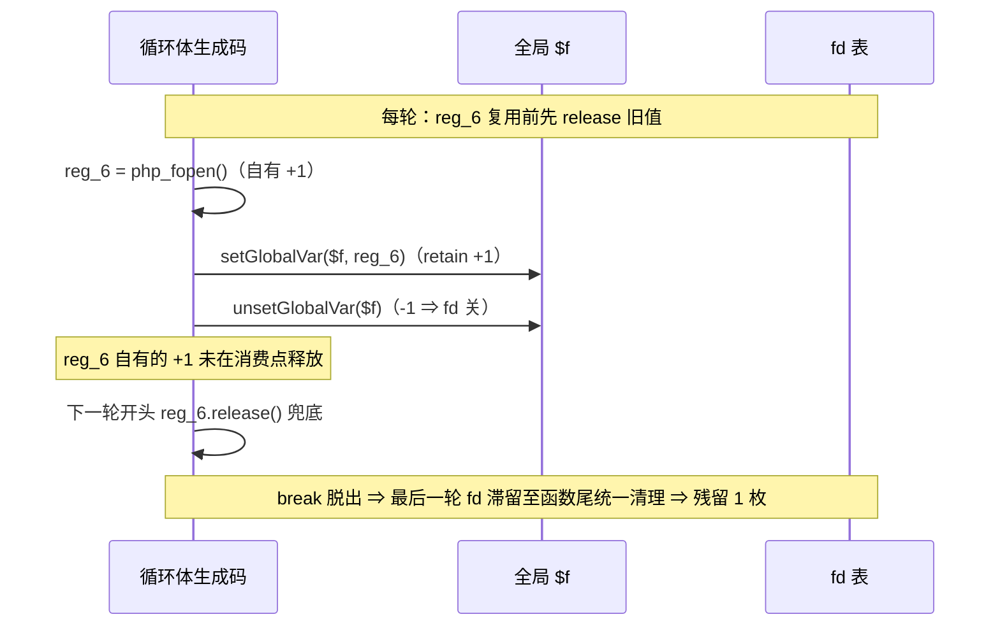

# AOT-CODEGEN-012 R-332 批次六：F-71b/F-71c 序列化形制对齐与三枚过期红核销（2026-11-04）

> 工单登记：§233 ｜ 代码状态：随工作区（本批落码未单独提交，基于 `08a6fc2`） ｜ 上一批：§232（R-331）

## 1. 高层摘要（TL;DR）

批次六核销 5 枚登记缺陷：3 枚过期红实测已绿不修（F-91 preg_last_error 族／F-66 NAN 四路径告警／F-188 尾 get_class_methods/vars TypeError）＋ 2 枚实修（F-71b debug_zval_dump 数组体、F-71c http_build_query 键编码/嵌套）。F-193（每循环结构残留 1 语句临时值）完成根因取证，因修复落在发射器活性层（引用计数精确性、链式赋值多消费点）按宪法 §六挂起待裁。过程事故一枚：模板局部变量误用 Zig 关键字 `packed` 导致并行回归后段 21 枚 FAIL_COMPILE，改 `is_packed` 并重跑主回归恢复 67 PASS + 1 SKIP 基线、零新增红。

## 2. 影响范围

| 层 | 模块 | 影响 |
|---|---|---|
| 运行时模板 | [runtime_lib_template.zig](../../../src/aot/runtime_lib_template.zig) | `php_http_build_query` 重写（+递归体 `httpBuildQueryInto`）；`php_debug_zval_dump` 数组支重写（+`debugZvalDumpArray`/`debugZvalDumpValue`） |
| 用户可见行为 | http_build_query | 键 RFC1738 编码（空格⇒`+`、`[]`⇒`%5B%5D`）；嵌套数组递归展开；null/空数组整对省略；bool false⇒`0` |
| 用户可见行为 | debug_zval_dump | 数组元素枚举/键形制/packed 标注/嵌套递归/空数组 `interned` 形制全对齐；refcount 顶层 3、嵌套 1 |
| 无变更面 | preg_last_error 族／NAN 告警／get_class_* TypeError | 探针实测已 SAME（历史批次闭环），本批零代码 |

## 3. 核心变更

| 编号 | 性质 | 一句话 |
|---|---|---|
| F-91 | 过期红 | `preg_last_error`/msg/PREG_* 常量全绿（R-182/185/186 闭环；存储＝既有 `threadlocal last_pcre_error_code`） |
| F-66 | 过期红 | NAN→字符串四路径（echo/cast/插值/print_r）告警逐字 SAME，var_dump/json 不打 |
| F-188 尾 | 过期红 | get_class_methods/get_class_vars 三形 TypeError 措辞+正路径全 SAME，C327 5/5 |
| F-71c | 实修 | http_build_query 键编码+嵌套+bool/null/空数组口径对齐 |
| F-71b | 实修 | debug_zval_dump 数组体结构全对齐；`interned` 尾标不可复刻登记豁免（§233.4） |
| F-193 | 取证待裁 | 根因＝赋值消费点不释放 owned call 结果、循环脱出后滞留函数尾；方案甲/乙见 §233.3 |

## 4. 可视化概览（Code & Logic Map）

### 4.1 F-71c 递归展开数据流

```mermaid
graph TD
    A["http_build_query(['x'=>['y'=>2,'z w'=>'v v']])"] --> B[php_http_build_query 入口]
    B --> C["httpBuildQueryInto(prefix="")"]
    C --> D{val 形态分派}
    D -->|"null/空数组"| E[整对省略]
    D -->|"数组"| F["递归 prefix='x'"]
    F --> G["键段 'x[y]' 整体编码 ⇒ x%5By%5D=2"]
    D -->|"标量"| H["键编码 + '=' + 值编码"]
    E -.->|"first 跨递归共享"| C
```

### 4.2 F-71b 渲染管线



### 4.3 F-193 根因时序（取证）



## 5. 详细变更分析

### 涉及文件列表

| 文件 | 位置 | 变更点 |
|---|---|---|
| [runtime_lib_template.zig](../../../src/aot/runtime_lib_template.zig) | `php_http_build_query:29236` | 重写为「入口 + 递归体」；键段原文拼接后整体编码；null/空数组整对省略；false⇒`0` |
| 同上 | 新增 `httpBuildQueryInto:29253` | 递归体；`first: *bool` 跨递归共享 & 分隔序 |
| 同上 | `php_debug_zval_dump:30164` 数组支 | 委托 `debugZvalDumpArray` |
| 同上 | 新增 `debugZvalDumpArray:30177`／`debugZvalDumpValue:30250` | 元素枚举/键形制/packed/refcount 口径/嵌套递归/RECURSION 防御 |
| [AOT-CODEGEN-012 工单](../../known-issues/AOT-CODEGEN-012-class-name-case-insensitive-lookup.md) | §233 | 批次六收口登记 |

### 关键判据来源（PHP 8.5.8 实测钉板）

- f71c2：`t=1&f=0&i=42&s=a+b%26c`（false=0、`&`⇒%26）；`x%5Bz+w%5D=v+v`（嵌套键段整体编码）；`deep%5Bl1%5D%5Bl2%5D=leaf`；null/空数组整对省略
- f71b2：packed 仅连续 0 起整数键；混合键/跳号不 packed；空数组 `array(0) interned {`；嵌套数组头与父值行同缩进

## 6. 影响与风险评估

- **破坏式变更**：无。http_build_query 旧实现对嵌套数组输出 `x=`（残缺）⇒ 任何依赖旧残缺输出的调用方本就在错误状态；debug_zval_dump 为调试函数。
- **零转移证据**：主回归 67 PASS + 1 SKIP；PERR 31/32（e4 既有红）／C327 5/5／FLT 67/68（e6 既有红）／C329 same=4 diff=4（F-193 登记位）／f135/f161 MATCH。
- **特别注意**：① 模板标识符禁用 Zig 关键字（本批 `packed` 事故）；② 门脚本须 `LC_ALL=C bash`（macOS bash 3.2 + UTF-8 + `→` 字面量绊点）；③ 门臂编译失败会留 `.zigphp_aot_build_*` 残目录，跑门后须清。
- **复测路径**：
  1. `timeout 600 zig build`
  2. 探针对拍：`/tmp/fb6/f91.php f66.php f188.php f71.php f71b2.php f71c2.php`
  3. 门：`LC_ALL=C bash fuzzy_scripts_720/tmp/{c093_preg_error,c327_exception_hierarchy,c052_float_format,c329_gc_buffer}_gate_tmp.sh`
  4. 防护面：`f161_spotcheck_tmp.sh` + f135/f161

## 7. 遗留问题／潜在问题

| 项 | 状态 |
|---|---|
| F-193 有界残留（发射器活性层修复方案甲/乙） | §233.3 待老铁裁 |
| debug_zval_dump `interned` 尾标豁免 | §233.4 待裁（不可复刻实现细节） |
| PERR e4：`defined("PCRE_*")` 与常量注册表不同源 | §233.4 既有红（R186 起），非本批 |
| PHP_BINDIR/PHP_BINARY、php_log2 死代码、§232.3 两枚、F-122、F-145-b | 维持挂起不动 |

## 8. 后续开发/优化建议

| 优先级 | 建议 | 影响面 | 落地成本 |
|---|---|---|---|
| P0 | F-193 方案裁决：若裁甲，先补「寄存器全消费点计数」（store＋读两侧），再做消费点释放 | 发射器活性层全局面 | 高 |
| P1 | `defined()` 与常量注册表同源化（e4 臂根治） | 常量面 | 中 |
| P1 | 模板落码流水线加「哨兵单编」步骤（任一 pass 脚本即时编译验证模板语法），防并行回归期自伤 | 开发流程 | 低 |
| P2 | debug_zval_dump 顶层非标量支（string/int/float/bool/null）与数组支的 refcount 口径统一复核 | 调试函数一致性 | 低 |
| P2 | http_build_query 对象值（public 属性展开）面登记——PHP 语义存在但本批未覆盖 | 序列化面 | 中 |
