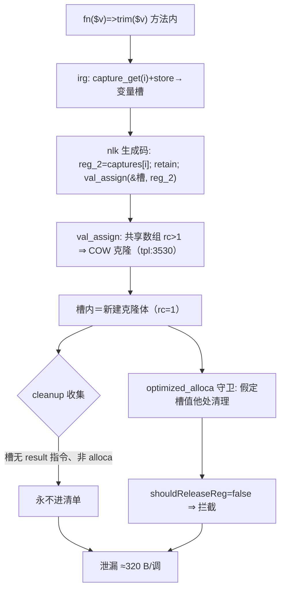
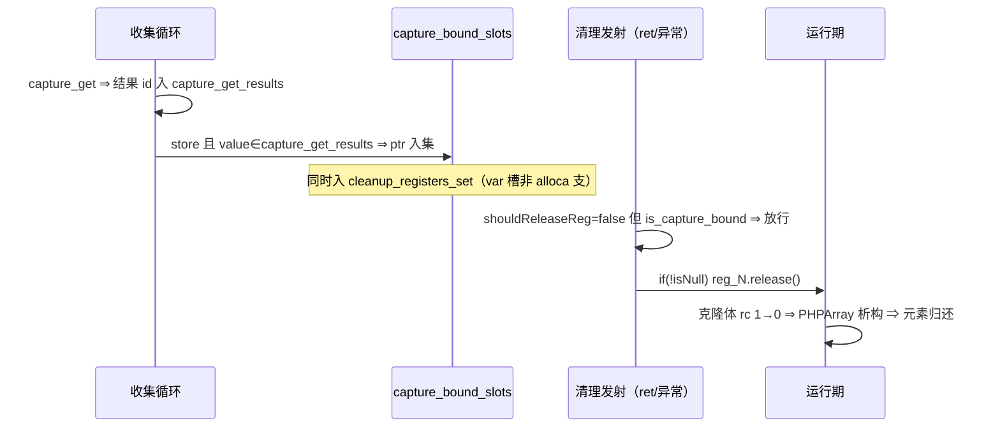
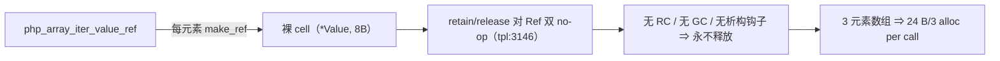

# AOT-CODEGEN-012 R-333 批次七：F-136c 捕获绑定槽 COW 克隆泄漏修复（2026-11-04）

> 工单登记：§234 ｜ 代码状态：随工作区（基于 `08a6fc2`） ｜ 上一批：§233（R-332）

## 1. 高层摘要（TL;DR）

批次七核销 4 枚登记缺陷：F-61c 过期红实测已绿不修；**F-136c 实修闭环**（array_map×闭包每调漏 1 枚数组 ≈320 B，根因＝箭头函数捕获绑定槽的 COW 克隆体被三层清理守卫连环拦死）；F-35（返回值类型不校验）与 F-139d（by-ref foreach cell 泄漏）完成取证并产出待裁方案。C249 泄漏门 a11 摘 KNOWN_LEAK 登记后全绿（flat=13/14 臂、sense_ok=1），零转移。

## 2. 影响范围

| 层 | 模块 | 影响 |
|---|---|---|
| 发射器 | [native_linker.zig](../../../src/aot/native_linker.zig) | 新增 `capture_get_results`/`capture_bound_slots` 配对收集 + `current_capture_bound_slots` 字段；三处清理发射守卫对捕获绑定槽放行 |
| 运行行为 | 一切含「箭头函数/闭包捕获绑定」的函数 | 函数尾与异常路径归还捕获绑定槽的 COW 克隆体引用（此前泄漏） |
| 门 | c249_f133_leak_gate_tmp.sh | a11 摘 KNOWN_LEAK 登记 ⇒ 回归普通 FLAT 判据 |

## 3. 核心变更

| 编号 | 性质 | 一句话 |
|---|---|---|
| F-61c | 过期红 | `$o > 0` 等五形 Notice 全 SAME（既有批次闭环） |
| F-136c | 实修 | 捕获绑定槽纳入清理（COW 克隆体归还） |
| F-35 | 取证+方案待裁 | PHP 真值矩阵（coerce/strict/void/never/类名）＋四步改法，工单 §234.3 |
| F-139d | 取证+方案待裁 | make_ref 裸 cell 无 RC 无回收（retain/release 对 Ref 双 no-op）；甲 RC 化/乙宿主数组回收表/丙退出边解 Ref，荐乙，工单 §234.4 |

## 4. 可视化概览（Code & Logic Map）

### 4.1 F-136c 根因链（修复前）

### 4.2 修复后释放链

### 4.3 F-139d 泄漏结构（待裁）

## 5. 详细变更分析

### 涉及文件列表

| 文件 | 位置 | 变更点 |
|---|---|---|
| [native_linker.zig](../../../src/aot/native_linker.zig) | 字段声明 :325 | `current_capture_bound_slots` |
| 同上 | 收集循环前 :5399-5406 | 两表声明＋注释（根因与守卫假定） |
| 同上 | 收集循环 :5544-5558 | store 支：var 槽非 alloca 入 cleanup；value∈capture_get ⇒ ptr 入 capture_bound_slots；capture_get 结果收集 |
| 同上 | 挂载点 :6782 | `current_capture_bound_slots = &capture_bound_slots` |
| 同上 | ret 清理发射（两处） | `shouldReleaseReg(reg) or is_capture_bound` 放行 |
| 同上 | 异常清理（liveness 版 :22135、generateCleanupCodeExcept :22187） | 同放行（后者 `regMayHeap or cb_rel2`） |
| [c249_f133_leak_gate_tmp.sh](../../../fuzzy_scripts_720/tmp/c249_f133_leak_gate_tmp.sh) | a11 判据＋终判 | 摘 F-136c KNOWN_LEAK 登记 |

### 关键数据（C249 a11 臂，N=1000→3000 双跑）

| 指标 | 修前 Δ | 修后 Δ |
|---|---|---|
| live_bytes | +639,864（≈320 B/call） | **0** |
| live_allocs | +2,002（≈1 alloc/call） | **0** |
| php_array_live_objects | +2,000 | **0** |

## 6. 影响与风险评估

- **破坏式变更**：无。修复只增「清理段多放几枚槽」——放行判据精确限定「store.value 是 capture_get 结果」的槽，普通 `$x=<expr>` 的 optimized_alloca 语义不变（值由他处清理）。
- **零转移证据**：C249 14 臂全绿（leak=0、sense_ok=1）；V 族 26/29（v16/v17/v26 三枚登记红同判）；C343 12/12；OBJ 35/35；f135/f161 MATCH。
- **特别注意**：① `$this` 捕获槽被 `this_regs` 守卫拦（借用语义），本批未放行——对象引用不计 array_live，其残留归入 F-139d 族统一裁决；② 调试插桩（DBG-STORE/DBG-CLEANUP）已全部清除，无残留。
- **复测路径**：`zig build` ⇒ `LC_ALL=C bash fuzzy_scripts_720/tmp/c249_f133_leak_gate_tmp.sh`（应 flat=13、kleak=0、kleak_cleared=0）⇒ c021/c343/c044/f135/f161。

## 7. 遗留问题／潜在问题

| 项 | 状态 |
|---|---|
| F-35 返回值类型校验（含 v26 臂） | §234.3 方案待裁 |
| F-139d Ref cell 泄漏 | §234.4 方案矩阵待裁（荐乙） |
| F-193／§232.3 两枚／PHP_BINDIR／php_log2／F-122／F-145-b | 维持挂起不动 |

## 8. 后续开发/优化建议

| 优先级 | 建议 | 影响面 | 落地成本 |
|---|---|---|---|
| P0 | F-35 裁决（返回类型校验是行为面大事，V 族 v24/v25/v26 判据需同步翻转） | 全部带返回类型声明的函数 | 中 |
| P0 | F-139d 裁决（荐乙：宿主数组附属 cell 表＋来源标记） | Ref/foreach 族 | 中 |
| P1 | 「捕获绑定槽」与「optimized_alloca 守卫」的语义契约写进发射器头注：今后新增守卫须先核 COW/克隆面 | 发射器可维护性 | 低 |
| P2 | 箭头函数捕获分析瘦身（实测把未使用的 `$d` 也捕获了）⇒ 减捕获数组尺寸与克隆量 | 性能 | 中 |
