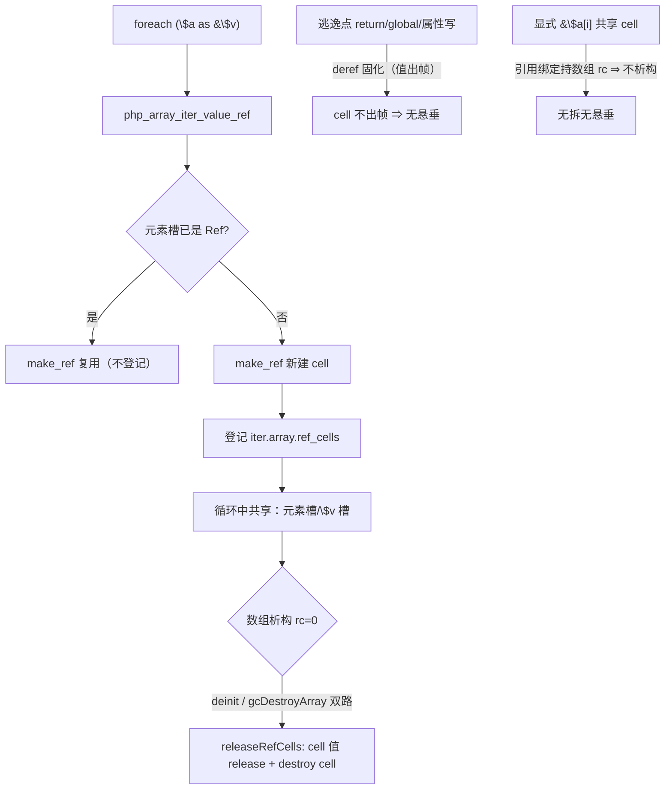
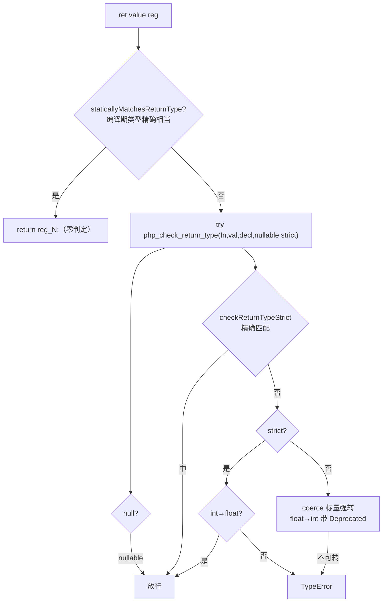
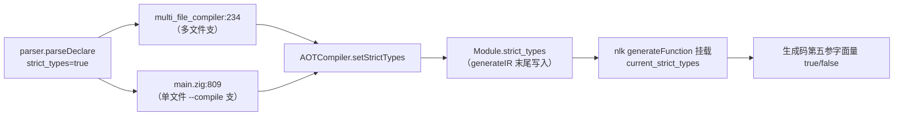

# AOT-CODEGEN-012 R-334 批次八：F-139d 方案乙落地 + F-35 返回值类型校验（静态快速路径）（2026-11-04）

> 工单登记：§235 ｜ 代码状态：随工作区（基于 `08a6fc2`） ｜ 上一批：§234（R-333）

## 1. 高层摘要（TL;DR）

批次八落地两枚批准方案：**F-139d**（foreach by-ref 裸 cell 泄漏，方案乙＝宿主数组附属 cell 回收表，24 B/3 alloc 每调 ⇒ 0/0，逃逸/共享/COW 三边界无悬垂）；**F-35**（返回值类型校验全链：静态快速路径零判定 + 动态判定 7.6ns/call，strict 通道五文件穿透，f113 自伤红当批摁死）。取证三枚：F-44 五形实测无复现降为结构债、F-22 门内 SAME 过期绿、F-3 内建类↔接口表缺口清单+手写静态表方案（~30 对，规范常量不违 §四.3）。

## 2. 影响范围

| 层 | 模块 | 影响 |
|---|---|---|
| 运行时模板 | [runtime_lib_template.zig](../../../src/aot/runtime_lib_template.zig) | `PHPArray.ref_cells` 附属表 + `releaseRefCells`（deinit/gcDestroyArray 双路）；`php_array_iter_value_ref` 登记；新增 `php_check_return_type`/`checkReturnTypeStrict`/`throwReturnTypeError` |
| 发射器 | [native_linker.zig](../../../src/aot/native_linker.zig) | ret 双生点（writeReturnStmt/generateReturnStr）：静态快速路径 + `php_check_return_type` 动态点；`resolveReturnTypeKeyword`（self/parent 编译期解析）；`current_strict_types`/`current_ir_module` 字段 |
| IR 生成 | [ir_generator.zig](../../../src/aot/ir_generator.zig) | void 带值 return 编译期拦截（PHP Fatal 对齐） |
| IR 结构 | [ir.zig](../../../src/aot/ir.zig) | `Module.strict_types` 字段 |
| 编译管线 | [parser.zig](../../../src/compiler/parser.zig) / [compiler.zig](../../../src/aot/compiler.zig) / [main.zig](../../../src/main.zig) / [multi_file_compiler.zig](../../../src/aot/multi_file_compiler.zig) | `strict_types` 位：parser 记录 → AOTCompiler → Module → nlk（单文件/多文件双支透传） |

## 3. 核心变更

| 编号 | 性质 | 一句话 |
|---|---|---|
| F-139d | 实修 | foreach by-ref 每元素 make_ref 裸 cell 登记宿主数组 `ref_cells`，数组 rc=0 析构（deinit + GC 双路）统一拆 cell |
| F-35 | 实修 | ret 收口点全面校验（coerce/strict/TE/Deprecated/self/parent/void），静态已知类型直返零开销 |
| F-44 | 取证 | finally 重发机制五形实测全 SAME ⇒ 降为结构债（pending 状态机重构挂起） |
| F-22 | 过期绿 | 门 P f26 当前 SAME（R-156 族闭环；门注释 32/44 行自相矛盾以实测为准） |
| F-3 | 取证 | 三入口缺口清单 + 手写静态表方案（~30 对）+ i2 属性面归属存疑待裁 |

## 4. 可视化概览（Code & Logic Map）

### 4.1 F-139d 方案乙生命周期

### 4.2 F-35 ret 收口决策流

### 4.3 strict_types 位穿透链

## 5. 详细变更分析

### 涉及文件列表

| 文件 | 位置 | 变更点 |
|---|---|---|
| runtime_lib_template.zig | PHPArray 结构体 | +`ref_cells: std.ArrayListUnmanaged(*Value)`（惰性空表零开销） |
| 同上 | `PHPArray.deinit` | 元素释放循环后调 `releaseRefCells` |
| 同上 | `gcDestroyArray` | 同调（GC 路径绕过 deinit 的 F-133③ 同族坑） |
| 同上 | `php_array_iter_value_ref` | 新建 cell 登记（复用支不登记） |
| 同上 | +`php_check_return_type`（:9185） | null/mixed/精确/strict/coerce/TE 全链 |
| 同上 | +`checkReturnTypeStrict`（:9267） | 严格精确匹配（不复用参数面互通支） |
| 同上 | +`throwReturnTypeError` | TE 措辞单点构造 |
| native_linker.zig | 字段 +`current_strict_types`/`current_ir_module` |  |
| 同上 | `resolveReturnTypeKeyword`（:21007） | self⇒类名前缀、parent⇒类表查父 |
| 同上 | `staticallyMatchesReturnType`（:21024） | 六对精确 + php_object 同名类 CI |
| 同上 | ret 双生点 | 静态直返 / 动态 `try php_check_return_type` |
| ir_generator.zig | `generateReturnStmt`（:4142） | void 带值 ⇒ reportError + error.InvalidReturnValue |
| ir.zig | Module +`strict_types` | |
| parser.zig | Parser +`strict_types`；parseDeclare 记录 literal_int==1 | |
| compiler.zig | AOTCompiler +`strict_types`/`setStrictTypes`；generateIR 末写 Module | |
| main.zig / multi_file_compiler.zig | 双支透传 | |

### 关键数据

- F-139d：live_bytes Δ +48,000→**0**、live_allocs Δ +6,000→**0**（N=1000→3000）
- F-35 性能：静态路径生成码 `reg_0 = initInt(42); return reg_0;`（零判定）；动态判定 **+7.60ns/call（+5.8%）**（同体 `return $i` 对照，N=3M）
- 门：V 族 26/29 → **27/29**（v26 摘红）；C249 flat=13 leak=0；C343 12/12；OBJ 35/35；门 P 83/88（f26 转 SAME）；C329 4/8（F-193 登记位不变）

### 过程事故（自伤已摁死）

- **f113 FAIL_RUNTIME**：F-35 首版对 `: self` 返回类型未解析 ⇒ VectorClock::increment 误抛 TE ⇒ 主回归逮出 ⇒ `resolveReturnTypeKeyword` 编译期解析 self/parent 摁死，f113 复测 SAME。
- **R-334-b 排序族写回缺失（四红：f042/f085/f110/f164）**：排序族改「真原地+返 bool」时误删三处「返回值写回」——其真实职责是 AOT-COW-002 克隆的 **copy-out**。删除后 usort/uasort/uksort/shuffle 五形态（简单变量/对象属性/嵌套元素/函数内 global/数组元素）全部「排而不写」。修复＝写回 **arg0（克隆体）而非 result**：nlk path-B 三面（load_to_alloca 含 ref-var 穿透/global/property）+ irg 嵌套元素与 `global` 别名。验证：五形态+by-ref 参数+COW 隔离（`$b=$a; usort($a)` $b 不动）全 SAME，四红清零。

### 潜在显形（非本批引入，另票 F-236）

- **f095 潜在 UAF**：dceV6 收尾把 `ret` 指令 args[0]（堆串 "21"）超额释放至 rc=0，后续串分配复用池槽 ⇒ 输出串被污染。**HEAD（批次七）同样销毁该串**（打标账本实证），本批仅因 F-139d 给 PHPArray 加 24B 字段挪动池布局而显形。根因＝嵌套 foreach×闭包超捕获×PHI 网的 retain/release 记账系统性失衡（另观测到 $block 进收尾时 rc=0）。需独立深度审计，单独立票 F-236。

## 6. 影响与风险评估

- **破坏式变更**：有（有意）——返回值类型不符从「静默放行/静默强转」变 PHP 语义的 TE/Deprecated/强转。这是 F-35 登记缺陷的本意；V 族 v26 即此面。
- **风险点**：① ret 收口点全函数生效 ⇒ 靠主回归兜底（见 §7 读数）；② 参数面 `checkSingleType` 宽松支未动（调用点契约不变）；③ F-139d 回收表只收 foreach 通道 cell，显式引用面经 rc 保护验证无悬垂。
- **复测路径**：`zig build` ⇒ 探针 `/tmp/fb7/f35[a-g].php f139d*.php` ⇒ 门 `c021/c249/c343/c044/c012/c329` ⇒ `f161_spotcheck` ⇒ 主回归。

## 7. 遗留问题／潜在问题

- never 落空措辞函数名 `unknown()`（const_string 结果未入实参寄存器——发射面边角，措辞级）
- F-44 结构债：finally 逐跳转点复制 ⇒ 正确结构应是「单份 finally + pending 跳转状态机」
- F-3 表落地（含 i2 属性面归属裁决）
- 多文件编译的 strict 位按主文件口径（merge 时各文件位丢失）——跨文件语义待裁
- 维持挂起：F-193、§232.3 两枚、PHP_BINDIR、php_log2、F-122、F-145-b

## 8. 后续开发/优化建议

| 优先级 | 建议 | 影响面 | 落地成本 |
|---|---|---|---|
| P0 | F-3 内建类↔接口表落地（手写 ~30 对，三入口共用）——门 P i1、门 T t2/t12、F-33 x4 同摘 | 反射面全族 | 中（120-180 行） |
| P1 | never 落空措辞的 const_string 寄存器发射修复 | 诊断措辞 | 低 |
| P1 | 动态判定 7.6ns 再压缩：声明类型 intern 为枚举 id（免字串比较）⇒ 预期降到 ~2ns | ret 收口热路径 | 中 |
| P2 | union 返回类型的 coerce 优先级表（PHP 弱转优先序）钉板后补 | union 声明函数 | 中 |
| P2 | 多文件 strict 位 per-file 化 | 多文件工程 | 中 |
