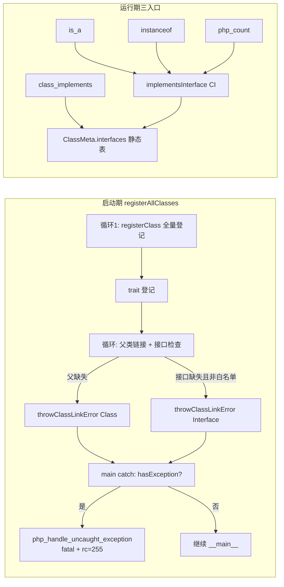

# AOT-CODEGEN-012 批次九变更摘要：F-3 内建接口表 + F-33 第二批 + F-24d 第一段（R-336/R-337）

> 日期：2026-11-04 ｜ 状态：未提交 ｜ 工单：§237 ｜ 前批：批次八（F-139d/F-35/R-334-b，§235）

## 1. 高层摘要（TL;DR）

三枚联动修复一次落地：

1. **F-3 内建类↔内建接口表**：手写静态真值表（SPL 容器/Generator/DatePeriod/反射族/异常族逐类序），`class_implements`/`is_a`/`instanceof` 三入口共读 `ClassMeta.interfaces`；顺带修复 `class_implements` 键形（int 键 ⇒ name=>name，旧版对**所有类**都错）、`is_a` 伪接口恒拒、`implementsInterface` 大小写敏感三枚暗伤。
2. **F-33 第二批**：`php_count` 的 Countable 判定从「有没有 count() 方法」换成「是否实现 Countable」——有 count() 未实现接口的类按 PHP 真值抛 TypeError；门 X 设计留红 x4 摘红（same=9 diff=0）。
3. **F-24d 第一段**：类登记时父类/接口缺失从「静默置 null」（类照登、方法全缺、调用点才炸）改为登记点抛**可捕获** `Error: Class|Interface "X" not found`（措辞/file:line/rc=255 与 PHP 逐字对齐）；登记时序不动（第二段另轮）。

## 2. 影响范围

| 层 | 文件 | 变更 |
|---|---|---|
| 模板 | runtime_lib_template.zig | F-3 静态表 9 枚 + 异常族 tf 逐类序 + collectInterfaces 键形 + is_a 口径 + implementsInterface CI + php_count 接口判定 + Exception 补 3 法 + throwClassLinkError/isBuiltinPseudoInterface 两辅助 |
| 链接器 | native_linker.zig | 父类缺失抛错（4212 区）+ 接口存在性检查（4240 区）+ registerAllClasses 启动点 catch 路由（2531 区） |

## 3. 核心变更

| # | 变更点 | 依据 |
|---|---|---|
| 1 | 静态表 9 枚（PHP 8.5.8 `class_implements` 实测传递闭包，原生序） | 50 类全量对拍 SAME |
| 2 | 异常族 `exception_specs` 加 `tf` 标志逐类直挂接口序 | PHP 实测 10 枚 T-first / 14 枚 S-first，与继承序无关 |
| 3 | collectInterfaces push ⇒ set(name=>name) | PHP 契约 `[接口名=>接口名]` |
| 4 | is_a 未注册名原样比较（与 instanceof 同口径） | 接口名不注册 ClassMeta |
| 5 | implementsInterface eql⇒eqlIgnoreCase | PHP 类/接口名 CI |
| 6 | php_count：findMethod("count") ⇒ implementsInterface("Countable") | PHP：有 count() 未实现接口 ⇒ TypeError |
| 7 | 登记点缺父/接口抛 Error + 启动点未捕获路由 | t9/t11 与 PHP 逐字（含 in file:line、rc=255） |
| 8 | Exception 补 __wakeup/getTrace/getTraceAsString（按 PHP 原生方法序插入） | t12 十枚方法表 SAME |

## 4. 可视化概览

## 5. 详细变更分析

### 涉及文件列表
- `src/aot/runtime_lib_template.zig`（表+辅助+count+Exception 方法）
- `src/aot/native_linker.zig`（登记期链接检查+启动点路由）

### 变更点行为对照
| 场景 | 修前 | 修后 | PHP 真值 |
|---|---|---|---|
| `class_implements('ArrayObject')` 键 | `0,1,2,3,4` | 五接口名键 | 同名同序 ✓ |
| `is_a($ao,'ArrayAccess')` | false | true | true |
| `count($o有count无接口)` | 调 count() | TypeError | TypeError ✓ |
| `class E extends Missing` | 静默无父，调用点炸 undefined method | 登记点 Error+rc=255 | 同 ✓ |
| `class C implements Missing` | 静默 | Error Interface not found | 同 ✓ |
| `interface X extends Missing` | 静默 | Error Interface not found | 同 ✓ |
| `class A extends B{} class B{}` | 正常 | 正常（循环顺序保证） | 正常 ✓ |
| `implements Countable` 用户类 | 正常 | 正常（白名单） | 正常 ✓ |
| Exception 方法表 | 7 枚 | 10 枚 | 10 枚 ✓ |

## 6. 影响与风险评估

- **破坏式变更**：两处语义收紧（缺父/接口现在抛；count 非 Countable 现在抛）——均属「fail-open ⇒ PHP 真值」加严，语料面工单载「未解析父/接口引用 0 枚」、`count(` 语料面已经门 X 九臂钉死。
- **已知边界（诚实登记）**：缺父错误抛在**启动期** ⇒ try 包裹的缺父声明 PHP 可 catch、AOT 第一段为启动期 fatal——时序差属 F-29 第二段（class_decl 声明点迁移），本段不动。
- **特别注意**：`implementsInterface` CI 化扩大了匹配面（小写拼写现在命中）——所有调用点（is_a/instanceof/返回类型检查/coerce）同受惠，无收窄风险。
- **复测路径**：门 X（count）、门 T（t9/t11/t12/t13）、门 P（红集不扩）、C343、f135/f161、主回归。

## 7. 遗留问题

- F-24d 第二段（登记时序迁移，irg class_decl + nlk 拆分）——压着待单独轮次。
- i1/i2（门 P）：红因＝SplFixedArray 方法/属性覆盖缺口（PHP 15 法 vs AOT 14），**非**接口表——留登记红。
- t13（门 T）：`json_encode` 不调用 `JsonSerializable::jsonSerialize`——独立缺陷，未动。
- f095（F-236 latent UAF）——待排。

## 8. 后续建议

| 优先级 | 建议 | 影响面 | 成本 |
|---|---|---|---|
| P0 | F-24d 第二段：声明点登记迁移（解锁可 catch 性 + class_exists 时序真值） | 全程序类登记时序 | 高 |
| P1 | SplFixedArray 方法/属性覆盖补齐（i1/i2 摘红） | 单类 | 低 |
| P1 | json_encode 调 JsonSerializable（t13） | json 序列化单点 | 低 |
| P2 | F-236 latent UAF 专项审计 | codegen 记账全链 | 高 |
