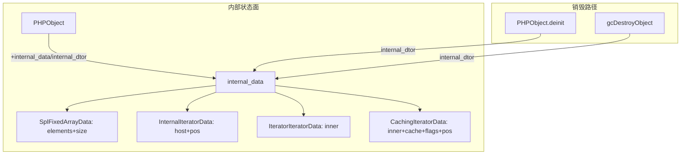
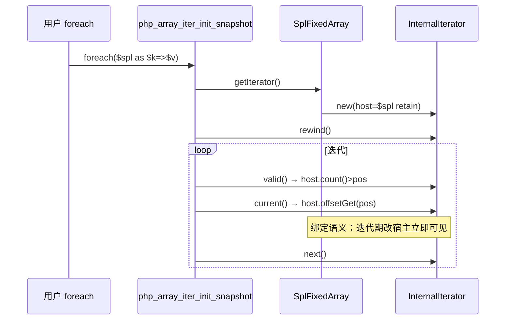

# AOT-CODEGEN-012 R-338 批次十变更摘要：SplFixedArray 覆盖度 + JsonSerialize 调用面 + F-25 销票验证

> 状态：uncommitted（待老铁裁决提交）
> 日期：2026-11-04
> 工单：docs/known-issues/AOT-CODEGEN-012-class-name-case-insensitive-lookup.md §238

## 1. 高层摘要（TL;DR）

批次十核销三枚登记红：

| 项 | 修前 | 修后 | 手段 |
|---|---|---|---|
| 门 P i1/i2（SplFixedArray 覆盖度） | DIFF | SAME | PHPObject.internal_data 新地基 + SplFixedArray 15 法逐字对齐 + InternalIterator/IteratorIterator/CachingIterator 三枚新内建类 |
| 门 T t13（JsonSerialize 调用面） | `JSON={}` | `JSON=[1,2]` | jsonEncodeValue/Pretty 对象分支接 JsonSerializable 契约 |
| F-25（用户函数名撞 Zig 标识符） | 待归因 | **销票级验证：零落码** | 22 枚撞名单全量 SAME ⇒ F-147 `__fn_` 前缀已覆盖 |

门面：门 P same=85 diff=3（i1/i2 摘红、红集未扩大）；门 T 22/22 首次全绿；C343 12/12；f135/f161 MATCH。主回归见 §7 收官。

## 2. 影响范围

| 层 | 文件 | 面 |
|---|---|---|
| 运行时模板 | src/aot/runtime_lib_template.zig | PHPObject 结构（+16B 两字段）、SplFixedArray 全段重写、三枚新迭代器类、json 序列化器两分支、unserialize 'O' 分支、Generator.__debugInfo、initRuntime 注册序列 |
| 生成码 | 全部 AOT 产物 | PHPObject 布局 +16B（internal_data/internal_dtor）——F-236 已登记红（f095）天然兜底 |
| 用户面 | 行为变更 | SplFixedArray 不再暴露 _array/_size/_position 伪属性（此三名为旧实现事故，PHP 本不可见）；foreach(SplFixedArray) 语义保持绑定（InternalIterator）；json_encode 对 JsonSerializable 对象改走契约方法（修前出 `{}` 属纯缺陷） |

## 3. 核心变更

| # | 变更 | 位置（约） | 描述 |
|---|---|---|---|
| A | PHPObject.internal_data 机制 | tpl:23946 / deinit:24111 / gcDestroyObject:1895 | 内建类内部状态的安身之处（Zend internal handlers 对应物）；双析构挂点 |
| B | SplFixedArray 重写 | tpl:12730-12900 区 | 删伪 Iterator 5 法；补 __wakeup/__serialize/__unserialize/fromArray/getIterator/jsonSerialize；状态迁 internal_data；注册序按 PHP 逐字 |
| C | InternalIterator 新类 | tpl:12240-12312 | getIterator 返回面；持宿主强引用+游标，经宿主 count/offsetGet 分派 ⇒ 绑定语义 |
| D | IteratorIterator/CachingIterator | tpl:12314-12740 区 | 7 法 / 17 法+6 常量真实实现；FULL_CACHE/tostring 位的 BadMethodCallException 真值逐字 |
| E | unserialize 'O' 整数键 | tpl:27030 | 整数键入 data_arr（__unserialize 语义需要；旧属性路径仍过滤） |
| F | json JsonSerializable 契约 | tpl:31667/31813 | 两分支对象面先查接口再落属性 |
| G | PHPObject.toString 异常面 | tpl:24939 | __toString 内 throwThrowable 的 pending 异常不再被通用 Error 覆盖 |
| H | Generator.__debugInfo | tpl:40699 | 方法面 8→9（i1 的 gn=9） |

## 4. 可视化概览（Code & Logic Map）





```mermaid
flowchart LR
    JE[json_encode] -->|对象| CHK{implementsInterface<br/>JsonSerializable?}
    CHK -->|是| JS[调 jsonSerialize() → 递归编码返回值]
    CHK -->|否| PROP[公开属性面旧路径]
    CHK -->|enum| F218[F-218 枚举面]
```

## 5. 详细变更分析

### 涉及文件

| 文件 | 改动量 | 性质 |
|---|---|---|
| src/aot/runtime_lib_template.zig | ~+700 行 / -120 行 | 唯一改动文件 |

### 真值驱动记录（先取真值后落码）

| 决策点 | PHP 8.5.8 真值 | 落地 |
|---|---|---|
| SplFixedArray 方法表 | 15 枚定序（反射实测） | 注册序逐字 |
| get_object_vars | `[]`（零属性零常量） | 状态去属性化 |
| foreach 语义 | 迭代期 `$a[1]=99` 可见（绑定） | InternalIterator 绑定宿主 |
| getIterator 返回类名 | `InternalIterator` | 同名注册 |
| 序列化往返 | `O:13:"SplFixedArray":3:{i:0;i:1;…}` | __serialize/__unserialize |
| 稀疏 unserialize | 键 5 被忽略、values 序填 | 同 |
| fromArray 负/字符串键 | InvalidArgumentException「array must contain only positive integer keys」 | 逐字 |
| fromArray 稀疏键 | size=max+1 缺位补 null | 同 |
| __wakeup 直调 | Deprecated 8.4 措辞 + null | 逐字 |
| CachingIterator getCache/count 无 FULL_CACHE | BadMethodCallException「does not use a full cache…」 | 逐字 |
| CachingIterator __toString 无 tostring 位 | BadMethodCallException「does not fetch string value…」 | 逐字 |
| Generator 方法数 | 9（含 __debugInfo） | 补 |

## 6. 影响与风险评估

| 项 | 评估 |
|---|---|
| 破坏式变更 | **是（限伪特性面）**：SplFixedArray 的 `_array/_size/_position` 伪属性不再可见——此三名为旧实现事故、PHP 本不暴露，任何依赖它们的 AOT 用户代码本就在 PHP 下无法运行 |
| PHPObject +16B 布局 | F-236（latent UAF）已登记红兜底；主回归验证零新增 |
| foreach(SplFixedArray) | 语义从「对象自带游标」迁「InternalIterator 绑定宿主」，行为对照 SAME（含迭代期改元素） |
| 风险点 | InternalIterator 泛化面（经宿主公开 count/offsetGet 分派）目前只服务 SplFixedArray；DatePeriod 等其余 IteratorAggregate 内建类的 getIterator 未接（本批范围外） |

### 复测路径

```bash
# 门面（串行）
LC_ALL=C bash fuzzy_scripts_720/tmp/c012_reflection_gate_tmp.sh   # 门 P 85/3
LC_ALL=C bash fuzzy_scripts_720/tmp/c019_fq_typepos_gate_tmp.sh   # 门 T 22/22
LC_ALL=C bash fuzzy_scripts_720/tmp/c343_loop_elseif_gate_tmp.sh  # 12/12
# 行为对照：/tmp/fb10/b10_behav.php（21 行 SAME）
```

## 7. 遗留/潜在问题

| 项 | 说明 |
|---|---|
| F-236 | 不动（latent UAF，修前不提 GC 频率的老坑纪律维持） |
| ArrayObject/SplStack/SplQueue 伪属性 | 同病未迁（`_storage` 等仍挂属性）——internal_data 机制已就位，可同药；本批范围控制未做 |
| DatePeriod getIterator | IteratorAggregate 面未接 InternalIterator（范围外） |
| F-25 正式销票 | 验证完备（22 名+反射面 SAME），待老铁下一轮正式销票 |
| 主回归读数 | **PASS=67 FAIL=1**（唯一红＝f095/F-236 latent 登记位），零新增红，与批次九持平 |

## 8. 后续建议

| 优先级 | 建议 | 影响面 | 落地成本 |
|---|---|---|---|
| P1 | ArrayObject/SplStack/SplQueue 伪属性迁 internal_data（同药） | 门 P 潜在面 + 用户 get_object_vars 真值 | 低（机制已就位，逐类搬） |
| P1 | F-25 正式销票 + 撞名普查脚本入库 | 工单卫生 | 极低 |
| P2 | DatePeriod/其余 IteratorAggregate 内建类接 InternalIterator | foreach 语义完整性 | 低 |
| P2 | F-24d 第二段（声明点登记迁移） | try 包裹缺父声明可 catch | 高（irg+nlk 双面，单独开轮） |
