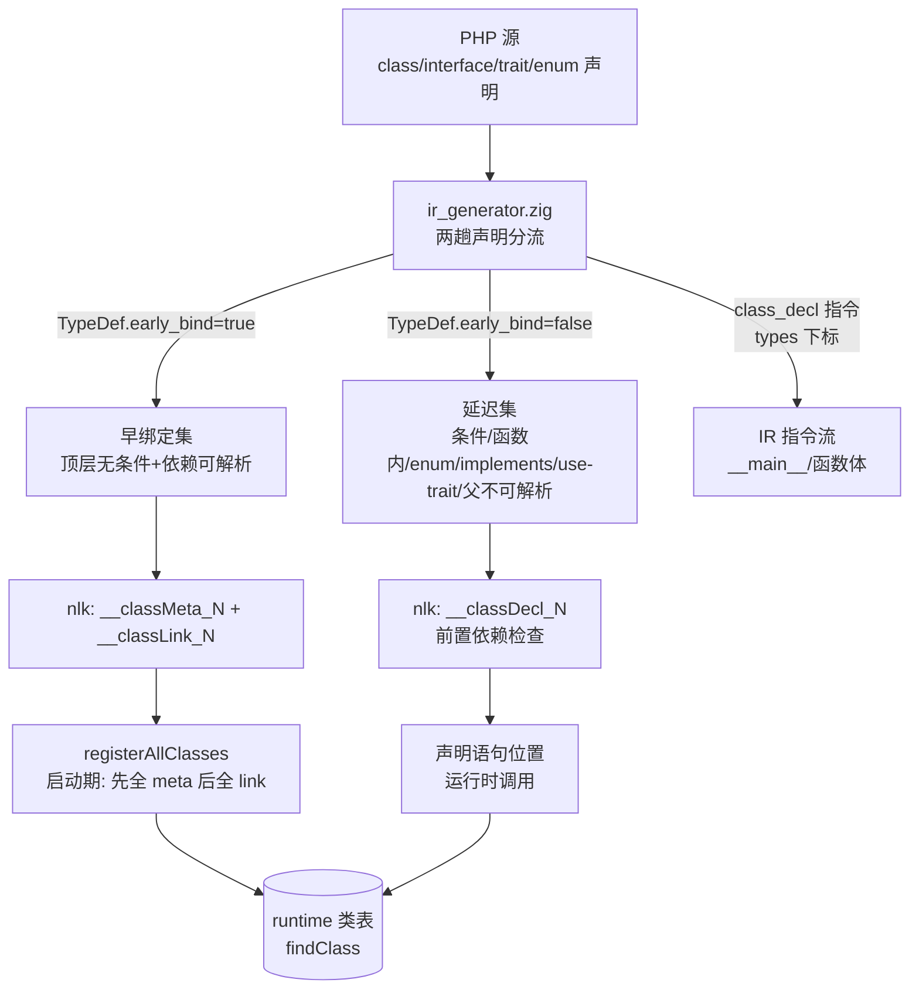
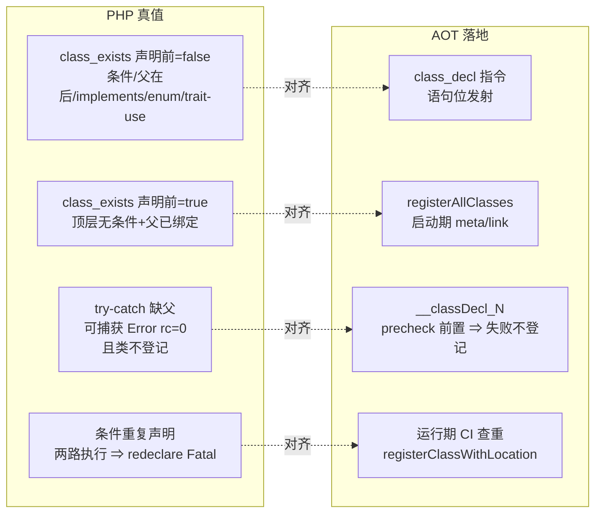
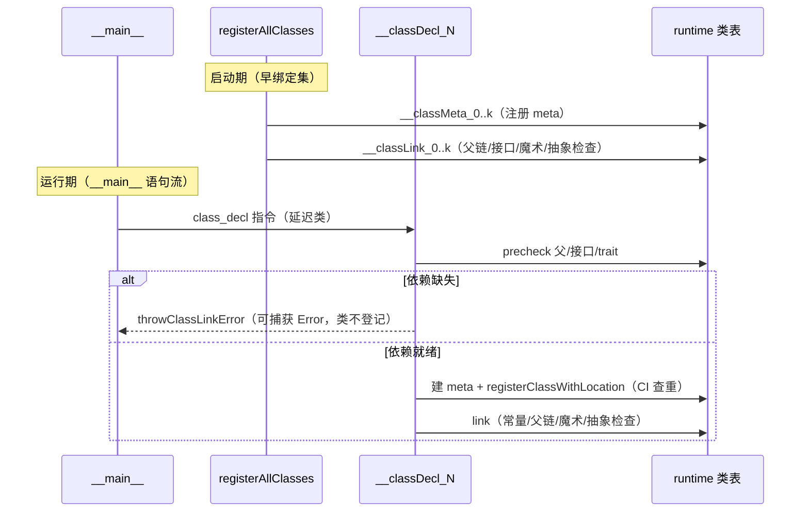

# 批次十一：内建类伪属性迁移 internal_data + F-24d 第二段（类声明时序对齐 PHP）

> 日期：2026-11-05 ｜ 工单：AOT-CODEGEN-012 §239 ｜ 状态：**未提交**（git 归老铁实时提交）
> 范围：AOT 编译及运行（宪法 §五）

## 1. 高层摘要（TL;DR）

- **伪属性迁移**：ArrayObject/ArrayIterator/SplStack/SplQueue/DatePeriod 五类内部状态从对象动态属性迁入 `internal_data` 机制（§238.1 地基），`get_object_vars`/`var_dump`/`(array)`/序列化往返全部对齐 PHP 真值。
- **F-24d 第二段**：类声明时序对齐 Zend——新增 IR `class_decl` 指令在声明语句位置做运行时登记；`registerAllClasses` 拆为 per-class `__classMeta_N`/`__classLink_N`/`__classDecl_N`；两条硬真值（`try{ class E extends Missing{} }catch(Error)` 可捕获 rc=0、`class_exists('X')` 条件未执行 false）达成。
- 门面：门 T 22/22、门 P same=85 diff=3（红集 f12/f34/d6 未扩大）、C343 12/12、C249 arms=14 leak=0、f135/f161 双 MATCH；主回归见 §6 收官。

## 2. 影响范围

| 层 | 文件 | 影响描述 |
|---|---|---|
| IR | [ir.zig](file:///Users/wangjianjun/products/parser/src/aot/ir.zig) | `Op.class_decl: u32`（types 下标）；`TypeDef.early_bind: bool = true` |
| IR 生成 | [ir_generator.zig](file:///Users/wangjianjun/products/parser/src/aot/ir_generator.zig) | 两趟声明分流 + 早绑定不动点 + 嵌套声明就地发射 |
| 优化器 | [optimizer.zig](file:///Users/wangjianjun/products/parser/src/aot/optimizer.zig) | `hasSideEffects(.class_decl)=true`；寄存器标记臂 |
| 代码生成 | [native_linker.zig](file:///Users/wangjianjun/products/parser/src/aot/native_linker.zig) | registerAllClasses 拆 per-class fn；class_decl 指令臂；缺 trait 闭包 |
| 运行时 | [runtime_lib_template.zig](file:///Users/wangjianjun/products/parser/src/aot/runtime_lib_template.zig) | 五类迁 internal_data；InternalIterator 泛化（伪属性迁移批） |

## 3. 核心变更

| 变更点 | 描述 |
|---|---|
| Zend 早绑定规则（t11-t18 实测） | 早绑定 ⇔ 顶层无条件 ∧ 非 enum ∧ 无 implements ∧ 无 use-trait ∧ （无父 ∨ 父内建 ∨ 父为更早的早绑定类） |
| irg pass1/pass2 | 顶层声明：pass1 建表 + pass2 语句位重放；条件/函数内：build 时即延迟并就地发射 |
| nlk 拆分 | 早绑定 = `__classMeta_N`+`__classLink_N`（先全 meta 后全 link）；延迟 = 单枚 `__classDecl_N`（前置依赖检查 ⇒ 链接失败类不登记） |
| 缺 trait 闭包 | 传递闭包缺失 ⇒ fn 只留 precheck 抛出面（对齐 PHP 声明点 Trait not found） |
| 条件同名重复类 | 不再编译期跳过 ⇒ 运行期 CI 查重 = PHP 声明点 redeclare Fatal |

## 4. 可视化概览（Code & Logic Map）

### 4.1 分层架构

### 4.2 业务流程（PHP 语义对齐）

### 4.3 执行流程（早绑定 vs 延迟）

## 5. 详细变更分析

### 5.1 涉及文件与变更点

| 文件 | 变更 |
|---|---|
| ir.zig:937 | `class_decl: u32` 指令变体 |
| ir.zig:197 | `TypeDef.early_bind` 字段 |
| ir_generator.zig:93-122 | `STARTUP_BUILTIN_CLASSES` + `isStartupBuiltinClass` |
| ir_generator.zig:1714-1794 | `generateTypeDeclStatement`/`emitClassDeclInstr`/`computeEarlyBindFlags`/`hasEarlierEarlyTypedef` |
| ir_generator.zig:425-465 | 主循环：类族声明同时进 top_level_stmts（pass2 重放） |
| ir_generator.zig:763 | generateStatement 四类族臂改走 `generateTypeDeclStatement` |
| native_linker.zig:3786-4090 | generateClassRegistration 拆 per-class fn + 登记壳 |
| native_linker.zig:4221-4260 | `hasMissingTraitInClosure`/`emitClassDeclPrecheck` |
| native_linker.zig:4262+ | `emitClassLinkBody`（原四趟循环逐类切片） |
| native_linker.zig:27614 | class_decl 指令臂（catch + 抛出站点路由） |
| optimizer.zig:3336/3443 | class_decl 副作用标记 |
| runtime_lib_template.zig | 五类 internal_data 迁移 + InternalIterator 泛化 |

### 5.2 关键决策

- **延迟类 precheck 前置**：PHP 实测链接失败的类不登记（catch 后 `class_exists` false）⇒ 缺父/接口/trait 检查必须在 `registerClassWithLocation` 之前。
- **两段拆分而非单 fn**：早绑定类必须保持「先全 meta 后全 link」的原多趟语义（子类 link 需父类已注册）；`{short}_meta` 提升文件级 var 共享。
- **条件重复类去编译期跳过**：`emitted_meta_globals` 只去重 Zig 全局符号；运行期 CI 查重对齐 PHP 声明点 redeclare Fatal。
- **缺 trait 闭包**：编译期组合不可能时，fn 只留 precheck 抛出面（永远不执行到 meta 构建）。

## 6. 影响与风险评估

- **非破坏式变更**：所有既有绿面保持（门 T 22/22、门 P 85/3 红集未扩大、C343/C249/f135/f161 全对）。
- **行为变更（有意对齐 PHP）**：条件/函数内类从「启动期恒登记」改为「声明点登记」——`class_exists` 时序变化（此前恒 true 是错）；缺父/接口的顶层类从「启动期 Fatal」改为「声明点可捕获 Error」。
- **需特别注意**：
  - 条件声明的类若在条件外被 `new`（未先执行声明）⇒ 现在会报 `Class not found`（PHP 一致，但依赖旧行为的脚本会变）。
  - `class B extends A {} class A {}`（父在后）⇒ B 延迟但声明点链接成功（A 已早绑定），`class_exists('B')` 声明前 false（PHP 一致）。
- **复测路径**：门 T / 门 P / C343 / C249 / f135 / f161 + t1-t18、s1-s3 探针 + 主回归。

### 6.1 主回归读数

`run_regression.sh`（串行单独跑，未与其他门并发）：**PASS=67 FAIL=1**，SELF_CHECK_OK rows=68 uniq=68；唯一红 = `f095_compiler_opt_constfold_dce_cse.php`（FAIL_DIFF）＝F-236 latent 登记位（嵌套 foreach×闭包存量缺陷，非本批引入，未动）。**与批次十基线逐枚一致，零回归**。

## 7. 遗留/潜在问题

| 项 | 描述 | 等级 |
|---|---|---|
| F-24d-t6 | redeclare fatal 的栈帧形态：`#0 file(line): f()` 帧缺失（仅 `#0 {main}`），§七.5 栈追踪面豁免，但栈帧完整性可再对齐 | P2 |
| F-24d-enum | enum 的 `use trait` 在 irg 被忽略（`else => {}` 吞掉），本就未支持；现 enum 恒延迟，若后续支持需在声明点检查 | P2 |
| F-24d-iface-ns | generateInterfaceDecl 的 extends 名未走命名空间 resolve（沿用短名，既有面） | P2 |
| 性能 | 早绑定集不变（启动期登记数量不变）；延迟类每次声明点一次 fn 调用（声明本就一次性） | — |

## 8. 后续开发/优化建议

| 优先级 | 建议 | 影响面 | 落地成本 |
|---|---|---|---|
| P1 | F-24d-t6 redeclare fatal 栈帧补全（`#0 file(line): f()`）——运行期 error 栈帧记录面 | 诊断/调试体验 | 中 |
| P1 | 门 P f12（非静态方法静态调用）/ f34 / d6（ReflectionParameter::hasDefaultValue）三枚登记红逐个击破 | 反射/方法面 | 中 |
| P2 | 内建类启动名单（STARTUP_BUILTIN_CLASSES）改为从模板登记点自动生成，消除手写漂移风险 | 编译期判定 | 低 |
| P2 | 主回归 f095/F-236（嵌套 foreach×闭包 latent UAF）独立排期 | 内存安全 | 高 |
| P2 | enum use-trait 支持 + 声明点检查 | 语言特性 | 中 |
