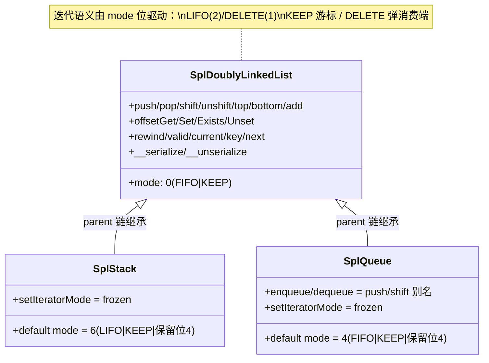
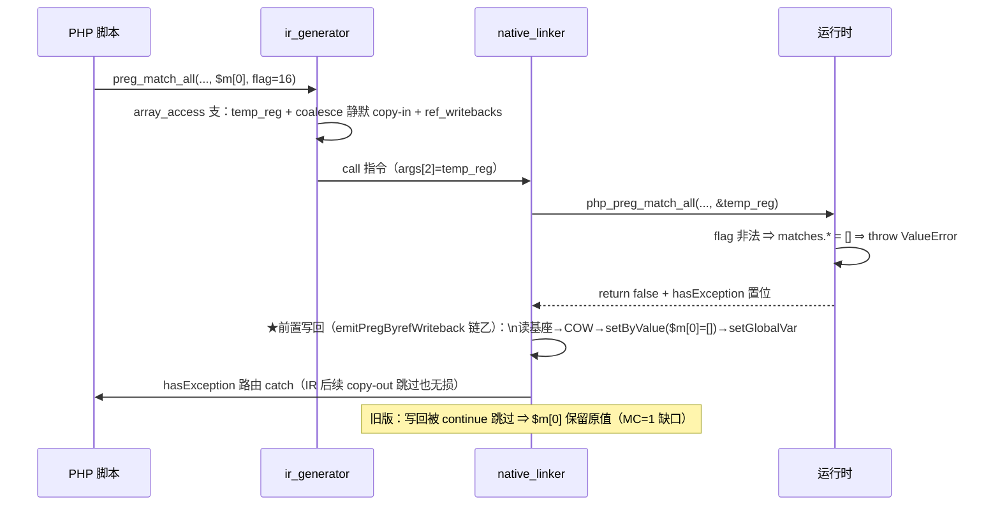

# 批次十二：SPL 基类统型 + 伪属性三类收官 + §232.3-2 by-ref 异常写回 + F-13b 销票

> 工单：`docs/known-issues/AOT-CODEGEN-012-class-name-case-insensitive-lookup.md` §241
> 日期：2026-11-05 ｜ 状态：已验收（主回归 67 PASS + 1 SKIP + 0 FAIL）

## 1. 高层摘要（TL;DR）

三件事同批，全在 `src/aot/`：

1. **伪属性三类**（ArrayObject/SplStack/SplQueue）：新注册 PHP 真值父类 `SplDoublyLinkedList`，三类方法面统一为 `splDll*`（**mode 位驱动** LIFO/FIFO/DELETE，非三套代码）；serialize 三段制真往返；var_dump 私有可见性标记（含 DLL 家族特判）；`ARRAY_AS_PROPS=2/STD_PROP_LIST=1` 常量值修正 + 权威通道注册 + 读写/isset/unset 重定向。
2. **§232.3-2**：preg flags ValueError throw 路径 `$matches` 未清空——真身是 `if (hasException()) continue` 跳过 IR 后续 copy-out（非 `try` 外逸）；发射器新增 `emitPregByrefWriteback` 前置写回（链甲全局变量/链乙数组元素）。
3. **F-13b** 销票（preg 第 3 实参为数组下标 `$m[0]` 时引用丢失）：ir_generator preg 专属支补 `.array_access`（coalesce 静默 copy-in + ref_writebacks）。**F-14/F-15 过期核销**（实测已绿，零落码）。

## 2. 影响范围

| 层 | 面 | 影响 |
|---|---|---|
| 运行时模板 | SPL 类族 | SplStack/SplQueue 改继承（行为对齐 PHP：parent/instanceof/getIteratorMode）；新增 SplDoublyLinkedList 可实例化 |
| 运行时模板 | var_dump(对象) | 全局行为变化：声明属性按声明序 + 可见性标记（向 PHP 真值靠拢；主回归 68 语料发射中性） |
| 运行时模板 | ArrayObject | 常量值修正（STD_PROP_LIST/ARRAY_AS_PROPS 旧版写反）；AS_PROPS 属性读写重定向 |
| 运行时模板 | preg_match/preg_match_all | matches 覆盖写改释放前置（泄漏修复） |
| 发射器 nlk | preg 两臂 | call 后前置 `if (hasException())` 写回（异常路径别名语义） |
| IR ir_generator | preg 专属支 | 数组下标 by-ref 装填（F-13b） |

## 3. 核心变更

| # | 变更 | 文件 |
|---|---|---|
| 1 | SplDoublyLinkedList 基类 + `splDll*` 统一方法集（mode 位驱动）+ 三注册函数 + initRuntime 注册序 | runtime_lib_template.zig |
| 2 | var_dump 对象分支重写（声明序 + 可见性标记 + DLL 家族特判） | runtime_lib_template.zig |
| 3 | AS_PROPS 四挂点重定向（get/set/isset/unset）+ 常量值/通道修正 | runtime_lib_template.zig |
| 4 | `pregMatchesAssign`（12 处 `matches.* = X` 裸覆盖改释放前置） | runtime_lib_template.zig |
| 5 | `emitPregByrefWriteback` + 预扫描三映射 + preg 两臂调用点 | native_linker.zig |
| 6 | preg 专属支补 `.array_access`（F-13b） | ir_generator.zig |
| 7 | storage 可见性字段补正（is_private）×2 类 | runtime_lib_template.zig |

## 4. 可视化概览（Code & Logic Map）

## 5. 详细变更分析

| 模块 | 变更点 | 关键决策 |
|---|---|---|
| SPL 统型 | mode 高位 4 为 PHP 8.5.8 实测保留位（默认 Stack=6/Queue=4/DLL=0；setIteratorMode `(old & ~3) \| (new & 3)`，LIFO/FIFO 位冻结 RuntimeException） | 位义未穷究，按观测真值对齐 |
| SPL 统型 | 方法实现共享但**行为由 mode 位驱动**（LIFO 栈顶⇄FIFO 队首互不套写）——满足「不许一套套三类」纪律 | 对齐 Zend spl_dllist 单实现结构 |
| SPL offset | LIFO 翻转（逻辑 0=物理栈顶）；add/迭代/serialize 保物理序 | PHP 真值 m2 推演钉死 |
| serialize | `putMethodOrdered` 不挂 magic 钩子、`serializeValue` 不沿 parent 链 ⇒ 三类各自显式挂 `magic_serialize/unserialize` | 用户子类继承序列化留待登记 |
| var_dump | DLL 家族特判（动态属性→flags→dllist live 值）；通用分支声明序+标记 | 主回归 68 语料发射中性实测 |
| AS_PROPS | 全属性名重定向 storage（含 "storage" 名本身）；未命中 Warning+null；不发 Deprecated | PHP 真值 m5 钉死 |
| §232.3-2 | 发射器前置写回（非模板补丁）；链解析仅 is_alloca 转发形命中 | 老铁指定层位 |
| F-13b | copy-in 用 `php_array_get_coalesce` 静默读（auto-vivify 不告警） | 弃 get_ref 直写路线（未定义基座写不回） |

## 6. 影响与风险评估

- **破坏式变更**：var_dump(对象) 输出形态变化（声明序+标记）——向 PHP 真值靠拢；主回归 68 语料零回归实测，语料外场景是「向真值对齐」非回归。
- **特别注意**：①F-38 教训重现一次（perl 批量替换分号错位，`zig build` 验不住模板文本，经 AOT 产物编译逮回——模板改动必须 AOT 产物编译验证）；②Zig 匿名 struct 两处求值成两类型（`PregCoalesceCall` 命名收口）。
- **复测路径**：探针 probe1/probe2/m1/m2/m3/m4/m5/m6（SPL+AS_PROPS）、preg1/preg2/preg3/preg4（§232.3-2）、f13b/f13b2（数组下标主路径+异常路径）、f14/f15（过期核销验证）。

## 7. 遗留问题 / 潜在问题

| 项 | 性质 | 处置 |
|---|---|---|
| var_dump 对象 id 恒 `#0`（PHP 为递增序列） | 既有现状（语料无命中） | 维持；后续如需对齐需对象 id 序列设施 |
| 用户子类 extends SplStack 的 serialize | magic 钩子不沿 parent 链 | 登记；如需则 serializeValue 沿链查 |
| ArrayIterator 的 ARRAY_AS_PROPS 形 | PHP 也支持（独立类同常量） | 未覆盖（老铁验收只列 ArrayObject）；同机制可扩 |
| `SplStack::setIteratorMode` 高位 4 的位义 | 未穷究（观测对齐） | 维持；PHP 源码升级时需复测 |
| 模板历史同模式（arrayObject_ksort 的 collect+deinit）泄漏 | 搬运语义未套用 | 登记；非本批范围 |

## 8. 后续开发/优化建议

| 优先级 | 建议 | 影响面 | 落地成本 |
|---|---|---|---|
| P1 | by-ref 异常写回推广到「一切抛出型 by-ref 内建」（sort 比较回调 throw 等同构缺口，§232.3 原定性「通用缺口」） | 全部 byref_funcs | 中（emitPregByrefWriteback 泛化） |
| P1 | 局部变量形的 SSA 写回异常路径审计（emitRefWritebackTarget 的 putVarRegister 零指令形，hasException 跳过 load ⇒ 新寄存器读旧值） | 函数内局部 by-ref | 中 |
| P2 | REF-004 E 路线（调用侧实参物化 × 元素引用）与 F-13b 的 copy-out 通道统一评估 | ir_generator by-ref 架构 | 大 |
| P2 | 模板 `matches.* = X` 同模式普查（其他 by-ref 内建的覆盖写释放） | 模板全局 | 小 |
| P2 | 对象 id 序列设施（var_dump `#N` 对齐） | var_dump/print_r | 中 |
