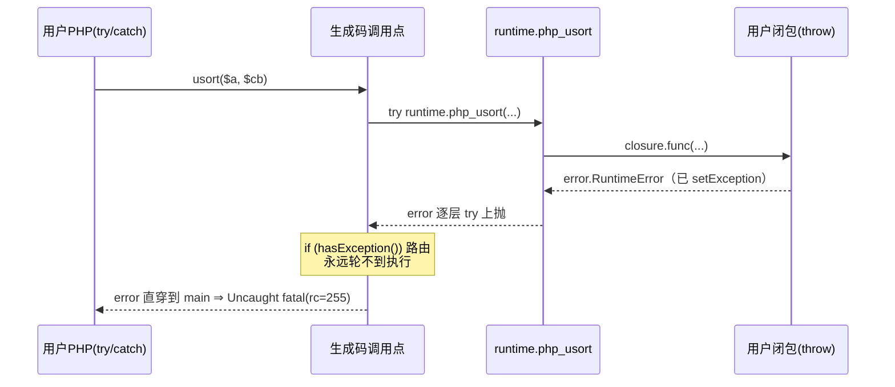
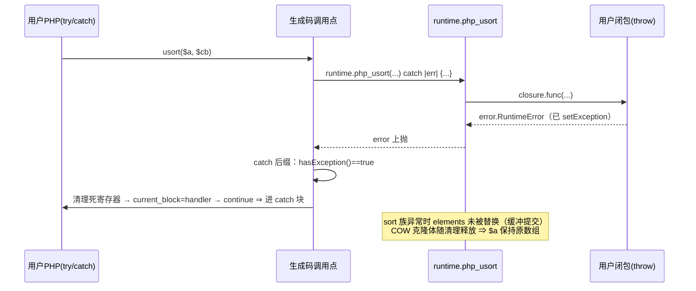
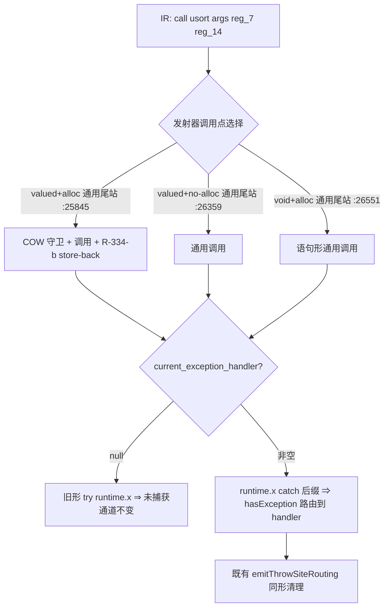

# 批次十三：抛出型 by-ref 内建普查 + 内建调用 try 区接球后缀（usort 族 / array_walk 回调 throw 可捕获）

- 日期：2026-11-05 ｜ 状态：uncommitted ｜ 范围：`src/aot/native_linker.zig`（发射器，3 站 + 1 helper）
- 并行会话说明：本会话与 SPL/preg 会话共用工作树；本批**零**触碰 `runtime_lib_template.zig`（对方热区），hot-zone 缺口全部登记待裁决（§7）。

## 1. 高层摘要（TL;DR）

任务原命题：把批次十二 preg 的「异常路径 by-ref 写回」推广到 sort 族。**15 枚探针普查实证：sort 族不存在 copy-out 缺口**（AOT-COW-002 + R-334-b 的 COW→原地排序→store-back 链路已完备），其真身缺口是**更底层的异常路由断裂**——内建回调用户函数时，用户 `throw` 以 `error.RuntimeError` 携带挂起异常逐层 `try` 上抛，直穿调用点之后的 `if (runtime.hasException())` 路由，PHP `try/catch` **永远接不到**（usort/uasort/uksort/array_walk 实测全部 Uncaught fatal）。

修法（发射器侧，与用户/间接调用既有惯用法 `:26364`/`:26626` 及 main 未捕获通道 `:2575` 对齐）：try 区内的三处通用内建调用点由裸 `try` 改为 `runtime.x(...) catch |__builtin_call_err| { if (hasException()) { 清理+路由 } return err; }`。成功路径与旧形**逐字节同构**（后缀只在 error 时介入）⇒ 既有探针零转移。

## 2. 影响范围

| 面 | 内容 | 影响 |
|---|---|---|
| 修复 | `usort`/`uasort`/`uksort` 比较器 throw、`array_walk` 回调 throw | PHP try/catch 可捕获（原 Uncaught fatal） |
| 同惠 | 一切经「通用内建尾站」且以 error 携带挂起异常返回的内建调用（try 区内） | 同机理可捕获 |
| 不变 | 未捕获通道（无 handler 仍 `try` → main fatal，rc=255）、成功路径生成码、preg 写回、所有 Style-A（setException+正常返回）路由 | 逐字节同构，零转移 |
| 不变 | 命名专列站（`php_array_map`/`php_array_multisort` 等 25407/26463 支、`php_array_filter` 25572 支、sort 族 25196 支、preg 两臂） | 本批不覆盖，登记 §7/§8 |

## 3. 核心变更

| # | 变更 | 位置 | 说明 |
|---|---|---|---|
| 1 | 新增 `emitBuiltinCallCatchSuffix` | native_linker.zig :22559 | 生成 `) catch \|__builtin_call_err\| { if (hasException()) { hint+清理+current_block=H+continue } return err; };`；仅 `current_exception_handler` 非空时调用 |
| 2 | valued+alloc 通用尾站接入 | native_linker.zig :25845 | sort 族（COW 支落点）/array_walk 实际发射支；`vg_may_raise and handler != null` 时拼后缀 |
| 3 | valued+no-alloc 通用尾站接入 | native_linker.zig :26359 | 同口径三分支（接球 / `try` / 无 `try`） |
| 4 | void+alloc 通用尾站接入 | native_linker.zig :26551 | 语句形内建调用同口径 |

**不接入**：`void+no-alloc` 通用尾站（:26602）——该集合无回调型/异常携带型内建，保持最小面。

## 4. 可视化概览（Code & Logic Map）

### 4.1 缺口根因（改前）



### 4.2 修复后（接球后缀）



### 4.3 分层架构



## 5. 详细变更分析

### 5.1 涉及文件

| 文件 | 变更 | 行数 |
|---|---|---|
| `src/aot/native_linker.zig` | +1 helper、3 调用点接入 | +62/-9 |

### 5.2 普查表（PHP 8.5.8 实测真值 vs AOT）

| # | 函数/触发 | PHP 8.5.8 真值 | AOT 改前 | AOT 改后 | 判定 |
|---|---|---|---|---|---|
| 1 | usort 比较器 throw | 捕获；数组半排序态（元素保持） | **Uncaught fatal** | 捕获 ✅；`$a` 原序（见 §7-a） | 修复（残余：中间态） |
| 2 | uasort 比较器 throw | 捕获；半排序 | Uncaught fatal | 捕获 ✅ | 同上 |
| 3 | uksort 比较器 throw | 捕获；半排序 | Uncaught fatal | 捕获 ✅ | 同上 |
| 4 | array_walk 回调 throw | 捕获；前缀已改 `[10,20,3,4,5]` | Uncaught fatal | **逐字全对** ✅ | 完全修复 |
| 5 | usort 回调不可调用 | 捕获 TypeError；数组不变 | 静默 false 比较子「排序」 | 同改前（零转移） | hot-zone §7-b |
| 6 | array_multisort 尺寸不一致 | 捕获 ValueError；两数组不变 | bool(false)+首数组已被排序 | 同改前 | hot-zone §7-c |
| 7 | array_multisort 非数组参 | 捕获 TypeError；不变 | bool(true)+已排序 | 同改前 | hot-zone §7-c |
| 8 | sort 非数组 | 捕获 TypeError；不变 | noreturn fatal（emitTypeFatalError） | 同改前 | hot-zone §7-d |
| 9 | sort 非法 flag(999) | 正常排序 | 正常排序 | — | 本就一致 |
| 10 | settype 非法 type | 捕获 ValueError；不变 | bool(false) | 同改前 | hot-zone §7-e |
| 11 | array_splice 非数组 | 捕获 TypeError；不变 | NULL | 同改前 | hot-zone §7-e |
| 12 | array_walk_recursive 回调 throw | 捕获；前缀已改 | **静默无操作** | 同改前 | hot-zone §7-f（递归支不回调，独立缺陷） |
| 13 | preg_replace_callback 5 参(limit,count) | 捕获；$count=1（增量计数） | **编译失败**（形参 4 vs 实参 6） | 同改前 | hot-zone §7-g（对方 preg 主战场） |
| 14 | array_map 回调 throw | 捕获 | Uncaught fatal | 同改前 | 残余 §7-h（命名专列站未覆盖） |
| 15 | preg_match/_all flags ValueError | 捕获；$matches=[] | 已捕获（批次十二） | SAME ✅ | 防护面零转移 |

### 5.3 探针逐字对照（核心修复面）

**probe_throw_usort.php**
```
PHP:  caught: boom / calls=3 / [1,3,2,5,4] / [1,2,3,4,5]
AOT:  caught: boom / calls=3 / [3,1,2,5,4] / [1,2,3,4,5]
      ↑ 唯一差异行＝半排序中间态（§7-a，PHP 语义未定义）
```

**probe_throw_uasort.php / probe_throw_uksort.php**：同形——caught/calls/规范化后逐字一致，仅中间态键序差异。

**probe_throw_array_walk.php**：`caught: boom / [10,20,3,4,5]` **逐字 SAME**。

**probe_throw_uncaught.php**（无 try）：PHP/AOT 均 `Uncaught Exception: boom` + rc=255（栈帧细节按宪法 §7.5 忽略）⇒ 未捕获通道零转移。

**probe_throw_fnctx.php**（函数内局部数组）、**probe_throw_nested.php**（嵌套 try + rethrow）：均逐字 SAME。

### 5.4 防护面（全 SAME）

| 探针 | 结果 |
|---|---|
| f042_array_functions_full（R-334 排序族契约） | SAME |
| f164_plugin_hook_system（R-334-b） | SAME |
| test_063_sorting_algorithms | SAME |
| test_029_callback / test_010_closures / test_051_closures_advanced | SAME |
| probe_preg_guard（批次十二 preg_match/_all 写回） | SAME |
| probe_throw_direct（用户函数 throw 基础路由） | SAME |
| usort_nc/sort_na/multisort×2/settype/splice_na/walk_rec 改前 vs 改后 AOT 输出 | 逐一零转移 |

**`timeout 600 zig build`：rc=0。**

## 6. 影响与风险评估

- **破坏式变更**：否。三站仅当 `may_raise && current_exception_handler != null` 时改形；成功路径生成码逐字节同构；无 handler 维持裸 `try`。
- **风险点 1（语法面）**：catch 后缀内 `continue`/`return err` 均为 noreturn，与既有用户调用 `catch` 惯用法同构；`zig build` rc=0 佐证。
- **风险点 2（清理面）**：后缀内清理与既有 `emitThrowSiteRouting` 同形（同调 `generateCleanupCode`），catch 块寄存器重建走 F-198 既有设施。
- **风险点 3（行为面）**：仅当内建返回 error **且**挂起 PHP 异常时路由改变（Uncaught→可捕获）——这正是修复目标；无挂起异常的真错误（OOM 等）`return err` 与旧 `try` 等价。
- **复测路径**：`probe_throw_usort/uasort/uksort/array_walk/uncaught/fnctx/nested` + `probe_preg_guard` + 防护五枚（f042/f164/test_063/test_029/test_010/test_051）。

## 7. 遗留问题 / 潜在问题

| # | 项 | 性质 | 处置 |
|---|---|---|---|
| a | usort 族 throw 后 `$a` 为**原序**而非 PHP 的半排序态（[3,1,2,5,4] vs [1,3,2,5,4]） | PHP 对该状态**无契约**（zend_sort 合并序的实现副产物；元素集保持是唯一不变量，两侧均满足）；逐字复刻需在模板内重写 zend_sort 同构算法 | **登记待裁决**；本批不修（hot-zone + 语义未定义 + 成本极高） |
| b | usort/uasort/uksort 回调不可调用：PHP 抛可捕获 TypeError、数组不变；AOT 静默以 `false` 比较子排序 | 模板缺回调校验 | 登记待裁决（hot-zone） |
| c | array_multisort 缺「先校验后排序」：PHP 尺寸不一致 ValueError/非数组 TypeError 且数组不变；AOT 先改后排返 bool | 模板校验缺位 + 变更时序错 | 登记待裁决（hot-zone） |
| d | sort 非数组走 `emitTypeFatalError`（noreturn 进程级 fatal）；PHP 为可捕获 TypeError。且 php_rsort/asort/... 同形静默 false（族内口径不一） | 模板抛错风格 | 登记待裁决（hot-zone；疑似对方会话在途） |
| e | settype 非法 type 缺 ValueError、array_splice 非数组缺 TypeError | 模板校验缺位 | 登记待裁决（hot-zone） |
| f | array_walk_recursive 回调**从未被调用**（无 throw 时也不生效） | 模板递归支独立缺陷 | 登记待裁决（hot-zone） |
| g | preg_replace_callback 不支持 limit/count 形参（5 参调用编译失败：形参 4 vs 实参 6） | 模板形参缺位 | 登记待裁决（hot-zone，对方 preg 主战场，禁止本批触碰） |
| h | array_map/array_filter/array_reduce 回调 throw 仍不可捕获（走 25407/26463/25572 命名专列站） | 同根因，未在本批 by-ref 范围 | 后续 P1：同后缀接入命名专列站（影响面 ~20 函数，需专项回归） |
| i | `fuzzy_scripts/test_065_array_walk.php` 编译失败（dim-set 字符串分支 `reg_0 = __arr_deref` 缺 `.*`，alloca 类型错） | **既有缺陷**：该脚本无 try 块、生成码不含本批后缀，与本批无关 | 登记（另案） |

## 8. 后续开发/优化建议

| 优先级 | 建议 | 影响面 | 落地成本 |
|---|---|---|---|
| P1 | §7-h：接球后缀接入命名专列站（array_map/array_filter/array_reduce/multisort 等 25407/26463/25572 支），使回调 throw 全族可捕获 | ~20 内建 | 小（同 helper 拼用）+ 中（专项回归） |
| P1 | §7-b/c/d/e：模板侧 sort/multisort/settype/splice 校验与抛错风格对齐 PHP 8.5.8（待 SPL/preg 会话收工后推进，避免热区冲突） | runtime_lib_template | 中 |
| P2 | §7-a：如验收要求逐字对齐半排序态，需模板内复刻 zend_sort（插入排序≤15 + 归并调度）；建议先争取「未定义状态」豁免口径 | 模板排序族 | 大 |
| P2 | §7-i：dim-set 字符串分支 alloca 解引用遗漏修复（test_065 编译失败） | 发射器 dim-set 支 | 小 |
| P2 | void+no-alloc 通用尾站（:26602）如日后出现 error 携带异常的内建，同形接入 | 低频 | 小 |
