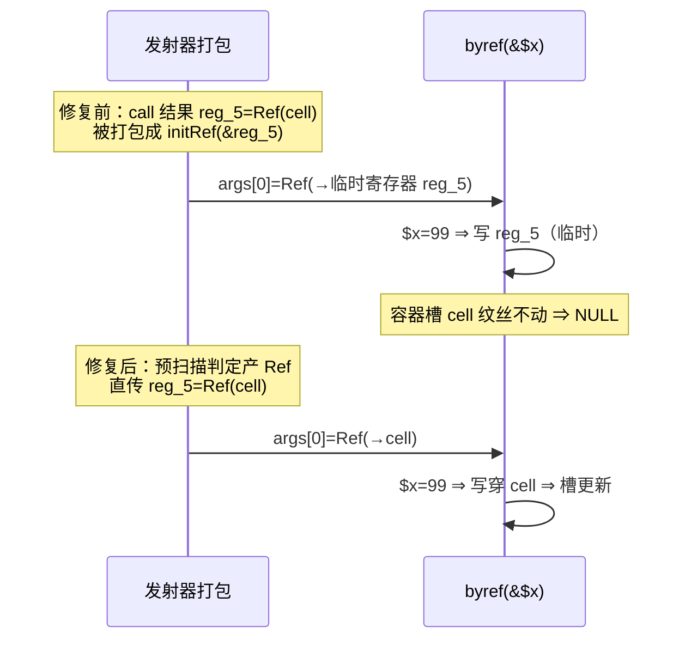

# 批次十五：dim-set alloca 解引用修复 + by-ref 实参 vivify 全链对齐

- 日期：2026-11-06 ｜ 状态：uncommitted ｜ 范围：`src/aot/native_linker.zig`、`src/aot/runtime_lib_template.zig`、`src/aot/ir_generator.zig`

## 1. 高层摘要（TL;DR）

两件「小而硬」闭环：
1. **test_065 dim-set 编译失败**（既有缺陷）：`.array_set` 字符串分支②原假设 `op.array` 恒为「非 alloca 的 load 临时」，数组字面量构建等路径把顶层/局部变量 **alloca 直参**（`*Value`）送入，回写 `reg_N = __arr_deref` 得 `*Value=Value` 类型错。按 alloca 判定补 `.*` 解引用；三面扫（字符串/数组/对象 × 顶层/局部/引用形参）全 SAME。
2. **by-ref 实参未定义 vivify 全链**（PHP 8.5.8 实测真值驱动）：内建 ref_params 未定义读取静默（preg_replace/preg_filter $count 接通、parse_str 替换式+Ref 写回）；数组元素 by-ref 改「装槽 Ref 直传链」（`php_array_elem_ref_vivify`，嵌套逐层 vivify，无需 copy-out）；对象属性 by-ref 改 `php_object_get_ref` 直传并补 PHP 8.2+ 动态属性 Deprecated；连带修掉 ref 实参打包「Ref 再包 Ref」写穿断链（发射器预扫描产 Ref 判定）。

## 2. 影响范围

| 面 | 内容 |
|---|---|
| 修复 | test_065 及同类 dim-set 编译失败；`byref($undef)`/`byref($a['missing'])`/嵌套/`byref($p->undef)`/`preg_replace(_filter) $count`/`parse_str $out` 的 vivify 静默与建槽 |
| 波及增强 | `preg_replace`/`preg_filter` 新增 `$count` 形参（⑦-b 提前闭环）；parse_str 顺带订正「整体替换」语义（旧合并式旧键残留） |
| 不变 | 非 by-ref 位未定义 Warning（r5 $u2 保留，PHP 同）；变量形 by-ref（r1 本就 SAME）；批十三/十四全部修复面 |

## 3. 核心变更

| # | 变更 | 位置 | 说明 |
|---|---|---|---|
| 1 | dim-set 字符串分支② alloca 解引用 | nlk :26921 | `reg_N.* = __arr_deref`（按 `current_alloca_regs` 判定）；test_065 编译+运行 SAME |
| 2 | `PregOutcome`+`count`、`pregReplaceOnce/Sequence` 计数穿透 | 模板 :16348/:16423/:16478/:16496 | 快路径取 pcre2_substitute rc、手写路径取循环计数、跨 pattern 累加 |
| 3 | `preg_replace`/`preg_filter` 补 `$count` 形参 | 模板 :16522/:16693 | 入口清零+defer 写回；nlk 注册 ref_params={4}+handler_params=5；preg_replace 专列站补第 5 实参 |
| 4 | `php_array_elem_ref_vivify` | 模板 :6885 | by-ref 元素静默建槽；中间层 Ref 槽非数组 ⇒ 原地 vivify 为 `[]` |
| 5 | IR array_access ref 实参支重写 | ir_gen :8154 | 嵌套链展平 + 逐层 vivify 下钻；Ref 直指容器槽**无需 copy-out**（旧 temp+Warning+写回支删除） |
| 6 | IR property ref 实参支重写 | ir_gen :8128 | `php_object_get_ref` 直传（旧 temp+Warning+object_set 写回支删除） |
| 7 | `php_object_get_ref` 补动态属性 Deprecated | 模板 :26528 | 与 php_object_set 同口径（stdClass/AllowDynamicProperties 豁免） |
| 8 | `php_parse_str` 替换式 + Ref 写 cell | 模板 :31447 + nlk ref_params={1} | PHP 实测：旧键不残留、空串⇒空数组、非数组被替换 |
| 9 | 发射器预扫描「产 Ref 指令」判定 | nlk :6404 | vivify/get_ref 系 call 与 array_get.get_ref 结果并入 `make_ref_result_regs` ⇒ ref 实参打包直传不再 `initRef(&reg)`（修 Ref 包 Ref 写穿断链） |

## 4. 可视化概览（Code & Logic Map）

### 4.1 by-ref 数组元素 vivify 链（嵌套 `$b['new']['deep']`）

### 4.2 Ref 打包断链根因（修复前后）

## 5. 详细变更分析（PHP↔AOT 对照）

| 探针 | 内容 | 结果 |
|---|---|---|
| test_065_array_walk | 批十三登记的编译失败脚本 | 编译通过 + 运行 **SAME** |
| probe_b15_dimset | 字符串/数组/对象 × 顶层/局部/引用形参 dim-set 八面 | **SAME** |
| r1 用户函数 by-ref 未定义 | 静默 vivify（本就对） | SAME |
| r2 内建 ref_params 未定义 | $cnt Warning 消除 + count=2；sort(NULL) TypeError | 实质 SAME（栈帧 §7.5） |
| r3 数组元素（单层+嵌套） | Warning 消除、missing=77、$b.new.deep=77 | 实质 SAME（var_dump 嵌套缩进 §七.4 豁免） |
| r4 对象属性 | Warning⇒**Deprecated「Creation of dynamic property」**、undef=55 | 实质 SAME（obj id #0 既有登记项） |
| r5 多参混合/parse_str | 非 by-ref 位 Warning 保留；$out 静默建成 | SAME |
| r6 扩展 | 已存在元素/函数内局部/str_replace count/settype | SAME |
| preg_count | preg_replace/filter $count（多模式/数组主题/慢路径） | SAME |

**守护面**：批十三/十四探针 + f042/f164/test_063/test_029/test_065/dimset 等 25 枚，**24 SAME + 1 登记项**（usort 中间态，批十三已裁决不碰，与批十三后逐字一致）。`timeout 600 zig build` rc=0（每刀均 AOT 产物实测）。

## 6. 影响与风险评估

- **破坏式变更**：否。dim-set 修复仅 alloca 形补解引用（非 alloca 路径逐字节同构）；vivify 链替换的是「旧 Warning+写回」支（旧行为本即偏离 PHP）。
- **语义变化点（修复性）**：parse_str 合并式⇒替换式（PHP 真值背书）；动态属性建槽补 Deprecated（PHP 8.2+ 契约；`php_object_get_ref` 的 return-by-ref 使用者同获 PHP 一致行为）。
- **风险点**：`make_ref_result_regs` 扩充后，「产 Ref 值被当普通值再 initRef」类问题在其它调用形态（方法/静态/间接调用打包支）可能同构存在——本批只覆盖函数调用打包支（探针实证面）；方法支同形问题登记。
- **复测路径**：§5 探针全量（probe_b15_*、r1-r6 留存）。

## 7. 遗留问题 / 潜在问题

| # | 项 | 处置 |
|---|---|---|
| a | 未定义**基座**的嵌套 vivify（`byref($undef['a']['b'])`——需 IR 整体写回链） | 登记（探针未覆盖；helper 值语义改不了基座变量） |
| b | by-ref `$arr[]` 追加形（append 语义） | 登记（展平支 flatten_ok=false 回退旧路径） |
| c | 魔术方法 __get/__set 类的 by-ref 属性间接修改（PHP Notice 族） | 登记 |
| d | 方法/静态/间接调用打包支的「产 Ref 再 initRef」同构审查 | 登记（函数调用支已修） |
| e | 装槽 Ref 元素的 var_dump 嵌套缩进（§七.4 豁免族） | 不处理（宪法豁免） |
| f | usort 族 throw 中间态 | 批十三已裁决不碰 |

## 8. 后续开发/优化建议

| 优先级 | 建议 | 影响面 | 落地成本 |
|---|---|---|---|
| P1 | ⑦-d：方法/静态/间接调用打包支的产 Ref 判定统一（抽公共 helper） | 调用打包全族 | 小 |
| P1 | ⑦-a：未定义基座嵌套 vivify（IR 写回链或模板深链 helper 接基座 alloca） | IR+模板 | 中 |
| P2 | ⑦-b：by-ref append 形 `$arr[]`（vivify helper 加 append 支） | 模板 | 小 |
| P2 | var_dump/print_r 对 Ref 元素解引用后的缩进层级统一（顺带 §七.4 族面收敛） | 模板打印族 | 小 |
