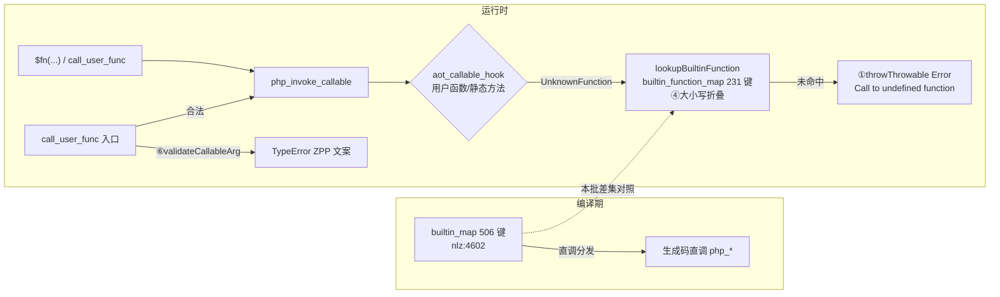

# 批次十六：AOT 变量函数调用面语义对齐 + 登记补齐 110 枚

> 日期：2026-11-06 ｜ 状态：uncommitted（工作树，与并行会话批次十三~十五共存）｜ 范围：仅 `src/aot/runtime_lib_template.zig`（AOT-only）

## 1. 高层摘要（TL;DR）

批次十四暴露 `$fn="rsort"; $fn($a)` 静默 `false`。本批先普查（PHP 8.5.8 内建 2143 vs 变量函数表 122，差集 2022＝A 328/B 1659/C 35），再六步落地：**①**未登记名兜底从静默 false 改为可捕获 `Error`（PHP 实测措辞）；**②**12 枚「包装器已备未登记」补表项；**③**高频 98 枚分族机械补齐（sort/preg/array/str/serial/sprintf/math）；**④**运行时表补大小写折叠（与编译期 `builtinInfo` 同口径）；**⑤**摘除幽灵条目 `select`；**⑥**`call_user_func`/`call_user_func_array` 无效回调分流为 PHP 同款 `TypeError`（9 形文案实测全等）。显形裁决：41 格防护面翻红仅 2 枚（均 A 类 sort 族），③后治愈，用户裁决全对齐、C 类不保留旧行为。

## 2. 影响范围

| 层 | 面 | 影响 |
|---|---|---|
| 运行时模板 | `builtin_function_map` 122 → **231** 键（+110 −1 幽灵） | 变量调用/`call_user_func` 面覆盖率 5.6% → 10.8%（以 PHP 内建全集计） |
| 运行时模板 | `php_invoke_callable` 字符串兜底 | 未登记名：静默 `false` ⇒ 可捕获 `Error`（**行为显形变更**，裁决通过） |
| 运行时模板 | `lookupBuiltinFunction` | 大小写不敏感（与编译期/PHP 一致） |
| 运行时模板 | `php_call_user_func`/`php_call_user_func_array` | 无效回调预校验 `TypeError`（ZPP 形参序） |
| 运行时模板 | `php_array_find_key`/`php_strtr` | 潜伏编译错修复（登记后懒分析暴露） |
| 非 AOT 路径 | — | 零触碰（解释器/字节码面不在模板内） |

## 3. 核心变更

| # | 变更点 | 位置 | 验证 |
|---|---|---|---|
| ① | 兜底抛 `Error: Call to undefined function {name}()` | `php_invoke_callable` 字符串支 | 捕获/未捕获/rc=255 三形实测全等 |
| ② | 12 枚登记（9×`ob_*`+`get_resource_id`/`mysqli_connect`/`token_get_all`） | map 尾段 | 变量调用 ≡ 直调（`get_resource_id` 恒 0 系既有实现缺口，另登记） |
| ③ | 98 枚包装器+表项，分族落地分族实测 | 新增 `wrapBuiltin_*` 块 + map | 族探针：SAME×7 族 |
| ④ | 小写折叠复核（≤64 栈缓冲） | `lookupBuiltinFunction` | `"STRTOUPPER"/"StrToLower"/"COUNT"/"Json_Encode"` 全等 |
| ⑤ | 摘除 `select` | map | `function_exists("select")`→false、变量调用→Error，均与 PHP 一致 |
| ⑥ | `validateCallableArg`（Argument #1 版 + 非静态拦截） | sort 校验器邻位 | PHP 实测文案 9 形全等（含 `call_user_func_array` 的 #1 先验顺序） |

## 4. 可视化概览（Code & Logic Map）



```mermaid
sequenceDiagram
    participant P as PHP 脚本
    participant V as php_invoke_callable
    participant M as builtin_function_map(231)
    participant T as throwThrowable
    P->>V: $fn="rsort"; $fn($a)
    V->>M: lookupBuiltinFunction("rsort") ③新登记
    M-->>V: wrapBuiltin_rsort
    V-->>P: true + 数组原地降序（PHP 全等）
    P->>V: $fn="undefined_x"; $fn()
    V->>M: 未命中
    V->>T: ①Error "Call to undefined function undefined_x()"
    T-->>P: 可捕获 Error / 未捕获 rc=255
```

## 5. 详细变更分析

- **涉及文件**：`src/aot/runtime_lib_template.zig`（唯一）；文档：工单 §245、本摘要。
- **变更形态**：新增 `wrapBuiltin_*` 98 枚 + 表项净增 109（+110 −`select`）+ `validateCallableArg` 93 行 + ①④⑤⑥ 站点修改 + 2 处潜伏修复。
- **生成纪律**：array/str 两族由规格表脚本生成（`/tmp/aot_census/gen_*.php`），逐枚人工核对 Zig 签名与缺省口径，插入后机械校验键↔包装器对齐（仅 `mb_str_split`/`join` 两枚白名单别名）。
- **缺省口径来源**：发射器特判（nlz :25586 preg_split、:25591 json_encode、:25304/25317/25331/25558 等 array 族）+ 实现体自带默认（chunk_split/wordwrap）+ PHP 文档默认（str_pad STR_PAD_RIGHT=1 等），逐项注明。

## 6. 影响与风险评估

- **破坏式变更**：有，且经裁决——未登记内建名的变量调用从静默 `false` 变可捕获 `Error`（对齐 PHP 8.5.8）。防护面证明语料无依赖旧行为的脚本。
- **特别注意**：①只覆盖字符串支；`php_invoke_callable` 的数组形/非标量兜底仍静默 `false`（登记 §245.4-6）。②`mysqli_connect` 等为 AOT 桩实现，登记只保证变量调用≡直调，不扩能力。
- **复测路径**：`/tmp/aot_census/probe_s3_{sort,preg,array,serial,spmath}.php` + `probe_s456.php` + 41 格面板（`panel_one.sh`）；产物命名 `aot_compile_*` 用后已清场，`.php` 源全保留。

## 7. 遗留/潜在问题

defer 13 枚 out 参族（§245.5 清单）；§245.4 新发现 6 项（双展开错位/preg_grep 键/strip_tags 白名单/get_resource_id 恒 0/array_map 族 ZPP/数组回调兜底）；B 类 425 核心 + 1234 扩展族仍能力缺口。

## 8. 后续建议

| 优先级 | 建议 | 影响面 | 落地成本 |
|---|---|---|---|
| P0 | out 参 13 枚调用点特判（copy-in/out，参照 F-53 preg 残差案） | preg/sort 族变量调用全通 | 中（逐枚设计回写） |
| P1 | `validateCallableArg` 推广至 array_map/filter/reduce 族（注意 `or null` 文案差异） | 回调校验面统一 | 低（助手已参数化 func_name） |
| P1 | 双展开 `...$a` 传参错位定位修复 | 所有变参转发场景 | 中（发射器实参打包链） |
| P2 | `preg_grep` 键保留、`strip_tags` 白名单、`get_resource_id` 资源号 | 直调+变量双侧 | 各小 |
| P2 | aot_coverage 工具扩 CI 守卫：两表漂移自动报警 | 防回归 | 小 |
