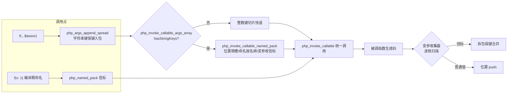
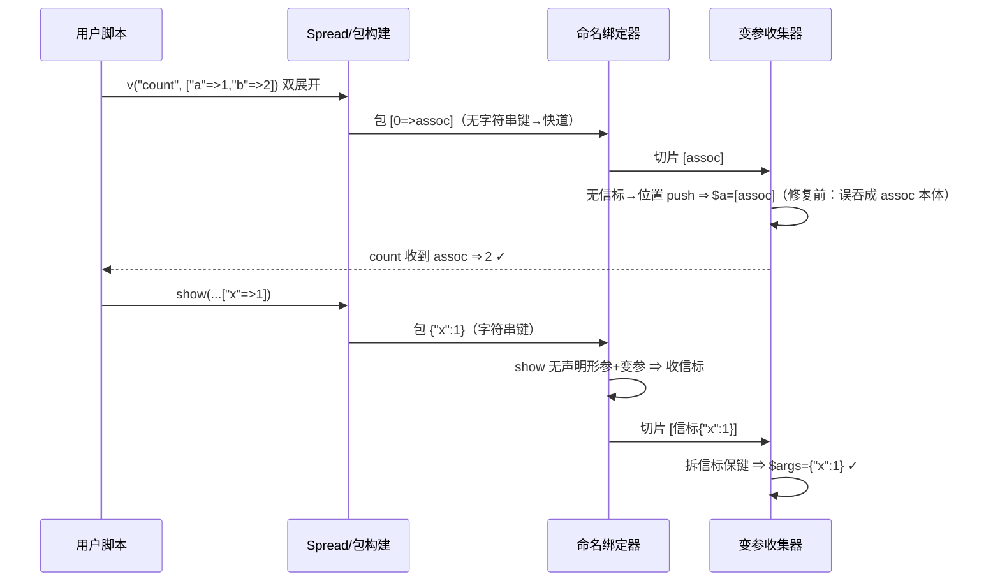

# 批次十七：A 类剩余 206 枚登记收官 + `...` 展开命名实参通道

> 日期：2026-11-06 ｜ 状态：uncommitted ｜ 文件：`src/aot/runtime_lib_template.zig` + `src/aot/native_linker.zig` + `src/aot/ir_generator.zig`（全 AOT 面）

## 1. 高层摘要（TL;DR）

① 批次十六后剩余的 206 枚 A 类函数（编译期已实现、变量函数表未登记）按 4 批全部登记，逐批真编实测；变量函数表 122 → **437** 键，PHP 8.5.8 内建覆盖率 5.6% → **20.4%**。② 修复 `...$a` 展开传参错位三层根因（变参特判误吞 + 展开丢键 + 切片再丢键），落地**命名实参信标通道**：展开字符串键→命名实参、按名绑定、变参保键收集、错误措辞逐字对齐 PHP。

## 2. 影响范围

| 层 | 变更 | 影响 |
|---|---|---|
| 变量函数表 | +316 净增（含 ① 206 + 修正） | `$fn()`/`call_user_func`/`array_map('str')` 面扩大 3.6 倍 |
| 展开语义 | 字符串键保留 + 命名绑定 | PHP 8.1+ 命名实参全语义（用户函数/闭包） |
| 变参收集器 | 信标拆包替代关联数组特判 | 位置参单关联数组不再被误吞 |
| 潜伏修复 ×5 | `get_loaded_extensions`/`realpath`/`posix_mkfifo`/`shell_exec`/变参收集 | 这些函数直调此前编不过或行为错 |

## 3. 核心变更

| # | 站点 | 变更 |
|---|---|---|
| ① | `builtin_function_map` + 98+206 包装器区 | 206 枚分 4 批（78/32/59/37）；生成器断言（参数数≡签名、覆盖集全等）+ 人工复核 + 对齐机检 |
| ②a | `php_args_append_spread` | 字符串键 `set` 保键入包 |
| ②b | `php_named_pack`/`php_namedPackUnwrap`/`php_namedPackMergeInto` | 信标对象（未注册类名不可伪造）携带命名包穿切片 ABI |
| ②c | `php_invoke_callable_named_pack` | 位置填槽 + 命名按名绑 + overwrites/Unknown 两 Error 措辞实测对齐；变参余量收信标 |
| ②d | 变参收集器发射（nlz:24188） | 信标拆包合并，普通值位置追加 |
| ②e | ir_generator | 编译期命名→变参保信标（:7896）；展开混写显式命名入键（:7542）；命名表换插入序 map；变参收集条件放宽 |

## 4. 可视化概览（Code & Logic Map）

## 5. 详细变更分析

### ① 批量登记（206 枚）

- **生成器**：`/tmp/aot_census/gen_b17.php`（规格表→Zig；断言：规格参数数≡模板签名实数、覆盖集≡`a_todo.txt`）；产物人工复核 + 插入后键↔包装器机械对齐校验。
- **缺省口径**：发射器 `handler_params/optional_defaults` 逐枚提取为主，PHP 文档默认 + 实现体自带缺省为辅。
- **每批实测读数**：A 批 61 项全等；B 批注册面全通（3 处实现口径差另登记）；C 批归一化 SAME（tempnam/sys_get_temp_dir 直调同病登记）；D 批双侧 rc=0 全等。
- **潜伏修复**（登记暴露的懒分析死码）：`pushValue`→`push`、`dupeSentinel` 多参 ×2、`Child.run`→libc `popen` 链。

### ② 命名实参通道

- 根因三层：变参特判误吞（nlz 旧 24199）+ 展开丢键 + 切片丢键。
- 实测真值 8 形 + 错误措辞 2 形全部钉死后修复；信标 defer 曾挂块级作用域致 UAF（类名被覆写成乱码被 var_dump 显形），改函数级。
- 内建命名实参为能力边界（无运行期形参名表），选**响亮报错**（`Unknown named parameter`）而非静默错值，已登记。

## 6. 影响与风险评估

- **破坏式变更**：无新增（①纯增登记；②为错误行为修正）。唯一行为收紧：`v(["a"=>1])` 单关联数组实参不再被当作命名包（这本就是 PHP 正确语义）。
- **特别注意**：`func_get_args()` 在命名展开调用里会见到信标对象（PHP 的 func_get_args 不含命名项）——边缘差异已登记。
- **复测路径**：`/tmp/aot_census/probe_b17_{a,b,c,d}.php` + `probe_spread_truth.php` + `probe_spread_extra.php` + 41 格面板。

## 7. 遗留/潜在问题（仍不覆盖清单）

- **defer 12 枚**（out 参回写）：`preg_match`/`preg_match_all`/`preg_replace`/`preg_filter`/`preg_replace_callback`/`str_replace`/`parse_str`/`settype`/`exec`/`system`/`sscanf`/`array_multisort`。
- **B 类核心 425 + 扩展族 1234**（AOT 未实现）；**C 类排除 35**。
- **登记了但实现有缺**（不计覆盖）：`get_resource_id` 恒 0、`get_resource_type` 流恒 `Unknown`、`tempnam` 不建文件、`sys_get_temp_dir` 恒 `/tmp`、`filter_var` 缺 FILTER_DEFAULT(516)、`debug_zval_dump` 直写 fd、`header()` CLI 缺告警、`preg_grep` 不保留原键、`strip_tags` 丢 `allowed_tags`、内建命名实参（响亮报错边）、`f($x,...$a,$y)` 位置后接展开未按 PHP 报编译期 Fatal、方法调用（`$obj->m(...)`/`Class::m(...)`）命名展开未接入绑定器。

## 8. 后续建议

| 优先级 | 建议 | 影响面 | 落地成本 |
|---|---|---|---|
| P0 | out 参 12 枚调用点特判（F-53 copy-in/out 先例） | preg/sort 变量调用全通 | 中 |
| P0 | 方法调用命名展开接入绑定器（ClassMeta.param_names 已有） | 命名面补齐 | 中 |
| P1 | 内建形参名表（437 枚 × 名称）→ 内建命名实参按名绑定 | PHP 8 命名语义完整 | 大（逐族核名） |
| P1 | `f($x,...$a,$y)` 编译期报 Fatal 对齐 PHP | 错误显形 | 小 |
| P2 | §245.4 各项实现缺口（get_resource_id/tempnam/preg_grep 键等） | 直调+变量双侧 | 各小 |
