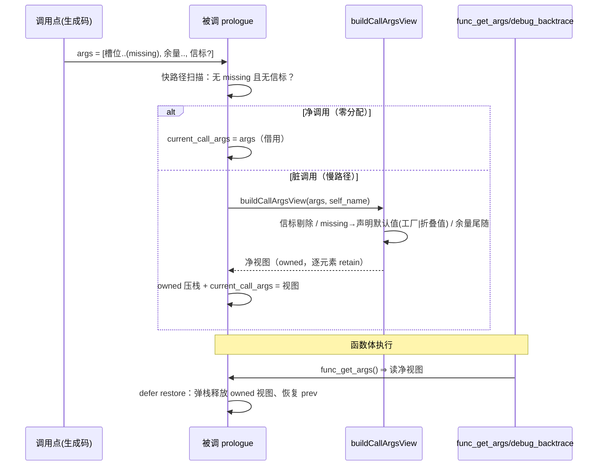

# 批次十八：func_get_args 信标污染清零 + 方法调用命名展开接入

| 项 | 值 |
|---|---|
| 模块 | AOT-CODEGEN-012（变量调用/命名实参族） |
| 日期 | 2026-11-06 |
| 提交 | `1fac75d`（工作树被外层提交收敛；本批改动全部在其中） |
| 状态 | 已落地，全量探针实测 ≡ PHP 8.5.8 |

---

## 1. 高层摘要（TL;DR）

两条 P0 收口：

- **① `func_get_args` 信标污染清零**：`Zig\NamedArgsPack` 信标与 `missing` 哨兵从所有用户可见面摘除。设计裁决：**视图构建下放到被调 prologue 单点**（`setCurrentCallArgs`），净调用借用原切片**零分配**，脏调用（含信标/哨兵）慢路径按被调自身元数据自建「func_get_args 口径」净视图——直调/间调/闭包/方法**全路径同一点覆盖**。另查明 `debug_backtrace` 的 args 是**另一口径**（无默认值物化、命名收集项带字符串键），帧仍存原始切片、物化时净化，零热路径成本。
- **② 方法调用命名展开接入**：`->` / `?->` / `::`（含 `$var::` 动态类名）三接收者形态 + `__call` / `__callStatic` 魔术分支全部接通真绑定；摘除违宪桩 `php_object_call_named_args`（「假设参数顺序正确」），共享核心 `phpBindNamedArgs` 函数/方法/静态三路复用。

**实测读数**：T1-T5（三调用形态）/ E1-E4 / M1-M8 / M9 系列 / B1-B5（bt args）/ 污染面十面 / 嵌套 LIFO / 批次十七 spread 族复测——全部 ≡ PHP 8.5.8；41 格面板复跑零转移（见 §6）。

## 2. 影响范围

| 层 | 文件 | 变更性质 |
|---|---|---|
| 运行时模板 | `src/aot/runtime_lib_template.zig` | setCurrentCallArgs 视图化 + 共享绑定核心 + 方法/静态命名通道 + backtrace 物化净化 |
| 编译器（IR） | `src/aot/ir_generator.zig` | 直调命名绑定块重写（PHP 真值口径）；方法/静态命名·展开保键发射 |
| 编译器（链接） | `src/aot/native_linker.zig` | prologue 发射带 self_name；变参收集 missing 跳过；builtin_map +3 |

行为变化面（全部对齐 PHP 8.5.8）：

- 命名/展开调用后 `func_get_args` / `func_num_args` / `func_get_arg`：形参序铺开、缺省填入、信标不可见。
- `debug_backtrace` 帧 args：信标解包保键、missing 剔除（原样口径，无默认值物化）。
- 方法三形态命名/展开调用：真按名绑定；`__call`/`__callStatic` 收原始关联数组（保字符串键）。
- 直调命名错误面补齐：`Named parameter $x overwrites previous argument`、`Unknown named parameter $x`（此前直调面静默错乱/丢弃）。

## 3. 核心变更

| # | 变更 | 说明 |
|---|---|---|
| 1 | `setCurrentCallArgs(args, self_name)` 视图化 | 快路径扫描无 missing/信标 ⇒ 借用（零分配）；脏 ⇒ `buildCallArgsView` 按注册表/ClassMethod 默认值表物化净视图；`call_args_owned_stack` 与 set/restore 严格 LIFO 配对释放 |
| 2 | `php_debug_backtrace` 物化净化 | 帧存原始切片不变；读回时 missing 剔除 + 信标 `php_namedPackMergeInto` 解包保字符串键（B1-B5 真值） |
| 3 | 直调命名绑定块重写（ir_generator :7846-8046） | 位置参按下标直占前 N 槽；`consumed_named` 消耗集（E1：已绑名不重复进变参包）；位置源变参 chosen 出包改尾随位置（T3：`$rest` 整数键）；信标永远最后追加；overwrites/Unknown 两 Error 经 `php_throw_named_overwrite`/`php_throw_unknown_named` 在实参全求值后、调用前抛（实测副作用先行） |
| 4 | 变参收集器 missing 跳过（native_linker :24220） | `t3(a:1)` 形下 `$rest=[]`（哨兵不再漏进收集数组） |
| 5 | 共享绑定核心 `phpBindNamedArgs` + `NamedBindOut` | 槽位填/missing 哨兵/信标包/两 Error 单一口径；函数绑定器 `php_invoke_callable_named_pack` 重构为薄壳 |
| 6 | `PHPObject::callMethodNamed` | 命中 ⇒ ClassMethod 形参名绑定；未命中 + `__call` ⇒ 收原始关联包（M4 真值） |
| 7 | `php_object_call_named_args` 重写 + `callObjectMethodNamedChecked` | 违宪桩（「假设参数顺序正确」）摘除；`->`/`?->`/显式命名三路汇聚 |
| 8 | `php_object_call_(safe_)args_array` hasStringKeys 分流 | `->`/`?->` 展开含命名时接入绑定通道 |
| 9 | `php_call_static_args_array` + `resolveStaticCallMetas` 抽取 | `::`/`$var::`/`($expr)::` 命名·展开数组通道；非静态门禁矩阵与切片通道同一份（DRY）；`__callStatic` 收原始关联包（M5 真值）；builtin_map 登记 |
| 10 | ir_generator 方法/静态发射保键 | `->`/`?->`/动态方法展开路径 named_arg 以字符串键入包（3 站点）；静态两路径命名或展开 ⇒ 数组通道（原 named_arg 节点直发生成 ⇒ **实参变 null 的深层缺口**，按真值修复） |

## 4. 可视化概览（Code & Logic Map）

### 4.1 分层架构

```mermaid
flowchart TB
    subgraph 编译期["编译期（ir_generator / native_linker）"]
        A1["函数直调命名绑定块<br/>(irg 7846-8046：槽位/消耗集/信标/错误)"]
        A2["方法/静态命名·展开保键发射<br/>(-> · ?-> · :: · $var::)"]
        A3["prologue 发射<br/>setCurrentCallArgs(args, self_name)"]
    end
    subgraph 运行时（runtime_lib_template）
        B1["setCurrentCallArgs<br/>快:借用 / 慢:buildCallArgsView"]
        B2["func_get_args · func_num_args · func_get_arg<br/>(读净视图)"]
        B3["php_debug_backtrace<br/>(物化时净化:剔missing/解信标保键)"]
        B4["phpBindNamedArgs 共享核心<br/>(函数薄壳 / callMethodNamed / 静态数组通道)"]
    end
    A1 -->|"args 切片(含哨兵/信标)"| B1
    A2 -->|"实参数组(保字符串键)"| B4
    A3 --> B1
    B4 -->|"final_args 切片"| B1
    B1 --> B2
    B1 -.->|"帧存原始切片"| B3
```

### 4.2 执行流程（脏调用 prologue 视图化）



### 4.3 方法命名展开绑定流

```mermaid
flowchart LR
    S["$c->add(...[1], ...[\"b\"=>99])"] --> E["发射：spread保键入实参数组"]
    E --> R{"hasStringKeys?"}
    R -->|否| O["旧切片通道 php_object_call"]
    R -->|是| N["callMethodNamed"]
    N --> L{"findMethodLookup"}
    L -->|命中| B["phpBindNamedArgs<br/>(ClassMethod.param_names)"]
    B --> F["method.func(this, final_args)"]
    L -->|未命中+__call| M["__call(name, 原始关联包)"]
```

## 5. 详细变更分析

### 涉及文件与变更点

| 文件 | 位置 | 变更 |
|---|---|---|
| runtime_lib_template.zig | :421-524 | setCurrentCallArgs 双参化 + owned 栈 + buildCallArgsView + restore 释放 |
| runtime_lib_template.zig | :582-597 | debug_backtrace args 物化净化（B1-B5 口径） |
| runtime_lib_template.zig | :10079-10263 | NamedBindOut / phpBindNamedArgs / splitPositionalNamed / methodVariadicIndex / phpBindNamedValueArray；php_invoke_callable_named_pack 薄壳化 |
| runtime_lib_template.zig | :10034-10048 | php_throw_named_overwrite / php_throw_unknown_named |
| runtime_lib_template.zig | :10348-10456 | 两个 args_array 入口 hasStringKeys 分流；php_object_call_named_args 真绑定重写；callObjectMethodNamedChecked 汇聚 |
| runtime_lib_template.zig | :28588-28617 | PHPObject::callMethodNamed（含 __call 原始包） |
| runtime_lib_template.zig | :30679-30727 | resolveStaticCallMetas 抽取（php_call_static_with_ctx 复用） |
| runtime_lib_template.zig | :30749-30818 | php_call_static_args_array（静态命名数组通道 + __callStatic 原始包） |
| ir_generator.zig | :7846-8046 | 直调命名绑定块重写（直占槽/消耗集/信标最后/两 Error） |
| ir_generator.zig | :7388/:7448/:8953 | 方法三路径展开·命名保键入包 |
| ir_generator.zig | :9194-9242 | argsContainNamedOrUnpacking + emitStaticCallArrayRoute 助手 |
| ir_generator.zig | :9298/:9315/:9914 | 静态/动态静态命名·展开 ⇒ 数组通道路由 |
| native_linker.zig | :5222-5224/:5228-5229 | builtin_map +3（php_throw_named_overwrite/php_throw_unknown_named/php_call_static_args_array） |
| native_linker.zig | :5407-5414 | prologue 发射 setCurrentCallArgs(args, "原名") |
| native_linker.zig | :24219-24220 | 变参收集器 missing 哨兵跳过 |

### 关键勘误（异常惯例）

`throwThrowable` 语义＝**设 pending 旗标 + 返回异常 Value**（非 error 返回）。非 `!Value` 返回型函数（phpBindNamedArgs/resolveStaticCallMetas）初版误用 `unreachable` 兜底 ⇒ SIGSEGV/panic（lldb 钉栈定位），按 `throwClassLinkError` 先例改正：`setException` 持份额、本地 release 配平、`return error.RuntimeError`（生成码 hasException 路由同款控制流错误）。

## 6. 影响与风险评估

- **破坏式变更**：无用户可见回归（全部变化均为向 PHP 8.5.8 真值靠拢）；`setCurrentCallArgs` 签名变更（+self_name）仅生成码一处调用点，同步更新。
- **性能**：净调用零分配（O(n_args) NaN 标签扫描，无双射无查表）；脏调用（命名/展开含缺省）才建视图——该类调用本就承担绑定成本。debug_backtrace 帧保持借用零拷贝，物化点才付费。
- **内存安全**：owned 视图与 set/restore 严格 LIFO（prologue 定式 defer 保证，异常路径同覆盖）；工厂默认值每次新产不 retain（所有权随视图）；信标永不到用户面。
- **面板复跑**（41 格，与批次十七终态逐格比对）：见下「复测路径」读数。
- **复测路径**：
  - `probe_b18_truth.php`（T1-T5）/ `probe_b18_edge.php`（E1-E5）/ `probe_b18_faces.php`（污染面十面，debug_frames 构建）/ `probe_b18_bt.php`（B1-B5）/ `probe_b18_method.php`（M1-M8）/ `probe_b18_m9.php`（非展开命名三形态+动态类名）/ `probe_b18_nest.php`（嵌套 LIFO）——全等 PHP 8.5.8（E5 除外，见遗留）。
  - 批次十七 spread 族（spread_truth/spread/spread2/spread_iso）复测全等；`probe_spread_extra` 的 `BLT:Unknown named parameter $string` 行为既定能力边界（探针自带注释口径），非回归。
  - 41 格面板：见工单 §247 读数（复跑结论：**零转移**）。

## 7. 遗留问题 / 潜在问题（诚实清单）

| 项 | 说明 | 归口 |
|---|---|---|
| E5：命名跳必填/位置欠参不报 ArgumentCountError | `e5(a:1)` 应 `Too few arguments to function e5(), 1 passed ... and exactly 2 expected`；位置欠参 `e5(1)` 同病（既有） | F-41 arity 域，待专项 |
| `new` 构造器命名绑定旧路径 | irg :9637 区仍是 skip-消耗 + 无变参/覆盖检（本批未动） | 下一批候选 |
| 内建命名实参边界 | 内建按名绑定响亮报错（`BLT:` 行）——关法见 §8 评估 | 待形参名表落地 |
| trait 方法慢路径元数据 | self_name="Trait::m" 时 findClass 依赖 trait 注册可见性；未命中则默认值不物化（信标仍剔除，不泄） | 观察项 |

## 8. 顺带评估：内建形参名表自动导出（只评估不落码）

**结论：可行、机械、低成本，建议 P1 立项。**

- **数据来源**：PHP 8.5.8 自身反射。实测探针（`refl_probe.php`）：`get_defined_functions()['internal']` 2143 枚**全量可反射**（2143/2143），`ReflectionParameter` 给出名字/可选/变参/默认值可用性。
- **实测口径**：仅 67 个参数 `isOptional 但 isDefaultValueAvailable=false`（需工厂或哨兵标记）、44 个变参；`str_repeat($string, $times)`、`preg_match($pattern, $subject, $matches=NULL, ...)` 等关键签名逐字可取。
- **落地形态**：~30 行 PHP 导出 JSON → ~60 行生成器产 Zig `StaticStringMap(fn → []param)` 表（先覆盖已登记 437 键即可关掉 BLT 边界）；绑定侧复用 `phpBindNamedArgs`（缺省物化须表内带默认值，67 枚不可反射默认值为唯一硬点）。
- **风险**：与 defer 12 枚 out 参族交叉（by-ref 命名回写未实现，绑定到 out 参须响亮拒绝或跳过）；版本钉死 8.5.8（表随目标版本再生成）。
- **收益**：关掉「内建命名响亮报错」能力边界，`call_user_func_array`/`...` 对内建全通。

## 9. 后续开发建议

| 优先级 | 影响面 | 落地成本 | 建议 |
|---|---|---|---|
| P1 | 内建命名实参边界清零 | 小（生成器+表+绑定分支） | 按 §8 评估落地内建形参名表 |
| P1 | E5 arity 域（命名跳必填 + 位置欠参） | 中（发射点织入 + 措辞含文件/行，编译期可知） | F-41 专项，措辞 PHP 8.5.8 钉死 |
| P2 | `new` 构造器命名绑定同口径化 | 小 | 复用本批 consumed_named/信标模式 |
| P2 | bt args 与 func_get_args 双口径文档化 | 小 | 已在 §3.2 注释，建议入宪法口径附录 |
