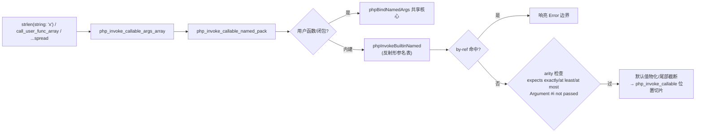
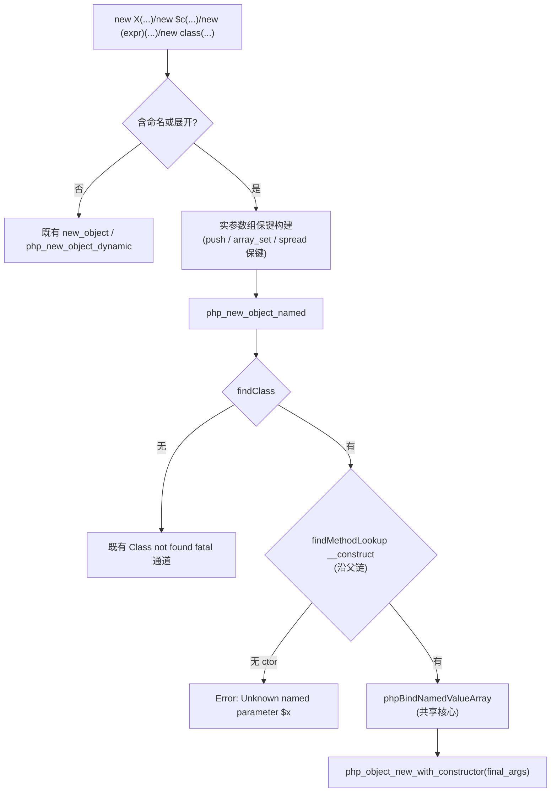

# 批次十九：内建形参名表（反射自动导出）+ `new` 构造器命名绑定同口径化 + E5 arity 域评估

| 项 | 值 |
|---|---|
| 模块 | AOT-CODEGEN-012（命名实参族）+ 内建覆盖 |
| 日期 | 2026-11-06 |
| 提交 | 工作树（承接 `1fac75d`；本批落盘时尚未被外层收敛） |
| 状态 | 已落地，探针逐形实测 ≡ PHP 8.5.8 |

---

## 1. 高层摘要（TL;DR）

- **① 内建形参名表**：`scripts/gen_builtin_param_table.php` 以 PHP 8.5.8 反射全量导出（2143 函数 / 4424 形参，**零手抄**），产 `src/aot/builtin_param_table_generated.zig`（进版本库，重跑即 diff 审计）。运行侧新增 `phpInvokeBuiltinNamed` 真绑定（措辞逐字对齐：overwrites / Unknown named / 变参内建拒收 / 缺必填双措辞 / 超填 / 大小写规则），**`BLT:` 能力边界据实销账**。直调内建命名（原剥名错填）改道运行时表绑定通道。
- **② `new` 构造器命名绑定**：统一运行时通道 `php_new_object_named`（复用批十八共享绑定核心），继承构造器/变参构造器/匿名类/`new` 展开全部接通；拆除旧编译期 skip-消耗块（绑错继承槽位、丢变参命名、漏报错误）。
- **③ E5 arity 域**：只评估不落码——十面现状读数 + 三层立项建议（见 §8）。
- **连带**：命名标签解析放开关键字全族（`array:`/`class:`/`function:`，PHP 实测合法）——**动了共享层 parser.zig，入待批清单**。

## 2. 影响范围

| 层 | 文件 | 变更性质 |
|---|---|---|
| 生成器（新） | `scripts/gen_builtin_param_table.php` | 反射导出 + Zig 表发射（可重跑） |
| 运行时数据（新） | `src/aot/builtin_param_table_generated.zig` | 2143 函数形参名/可选/变参/by-ref/默认值（unknown 如实标注） |
| 运行时模板 | `src/aot/runtime_lib_template.zig` | `phpInvokeBuiltinNamed` + `php_new_object_named` + 表 import |
| 编译器（IR） | `src/aot/ir_generator.zig` | 直调内建命名改道运行时通道；`new` 命名/展开统一改道；匿名类同 |
| 编译器（链接） | `src/aot/native_linker.zig` | builtin_map +1（php_new_object_named）；生成表随构建拷备 |
| **共享层（待批）** | `src/compiler/parser.zig` | `isNamedLabelStart`：命名标签接受关键字（5 站点） |

## 3. 核心变更

| # | 变更 | 说明 |
|---|---|---|
| 1 | 反射导出管线 | PHP 脚本 → 表；统计 fn=2143 param=4424 unknown_default=109 variadic=44 by_ref=168 |
| 2 | `phpInvokeBuiltinNamed` | 内建命名绑定全措辞（K1-K20 真值驱动） |
| 3 | 直调内建命名改道 | 编译期不可解析+命名 ⇒ `php_invoke_callable_args_array`（原剥名按位置填，乱序即错） |
| 4 | `php_new_object_named` | 构造器命名/展开运行时绑定；无构造器类+命名 ⇒ `Unknown named parameter $x` |
| 5 | 解析面关键字标签 | `isNamedLabelStart`（k_class…k_void 序数区间）5 站点统一 |
| 6 | 未知函数优先序 | 命名绑定前未知名函数 ⇒ undefined function Error（PHP 解析先于绑定） |

## 4. 可视化概览（mermaid）

### 4.1 ① 内建命名绑定流

### 4.2 ② 构造器命名绑定流

## 5. 详细变更分析

### 涉及文件列表

- `scripts/gen_builtin_param_table.php`（新，~130 行）
- `src/aot/builtin_param_table_generated.zig`（新，生成物 586KB / 2143 条目）
- `src/aot/runtime_lib_template.zig`（import + `phpInvokeBuiltinNamed` ~170 行 + `php_new_object_named` ~60 行 + 未知函数优先序）
- `src/aot/ir_generator.zig`（直调内建命名改道分支；`generateObjectInstantiation` 统一运行时通道；匿名类同；删旧 skip-消耗构造器块）
- `src/aot/native_linker.zig`（builtin_map +1；生成表拷备登记）
- `src/compiler/parser.zig`（`isNamedLabelStart` + 5 站点）⚠️ 共享层，待批

### 变更点描述（关键取舍）

- **诚实标注**：`.unknown`＝可选但默认值反射不出（109 枚）。调用点行为：尾部可截断则截（包装器自带缺省接管），中段 ⇒ 响亮 Error 边界——不拿空串/0 冒充。
- **by-ref 命名命中** ⇒ 响亮 Error（PHP 真值是写回成功，AOT 写回通道属 defer-12/Q3 域，不静默丢）。
- **构造器可见性**（private/protected 外部 `new` ⇒ PHP 报 `Call to private ... from global scope`）：AOT 位置/命名两通道均不查（**既有缺口**，登记——单侧不补，避免双口径）。
- **遗留（发现即登记）**：catch 变量重绑缺陷（`$e` 预赋字符串后 `catch (Error $e)` 不重绑）——与本批无关，待立项。

## 6. 影响与风险评估

- **破坏式变更**：无——全部向 PHP 8.5.8 真值靠拢；`BLT:` 边界从「响亮报错」变「正常工作」属销账。
- **编译产物体积**：表 +586KB 源码（StaticStringMap comptime 构建）；产物二进制增量实测可忽略（按需页入）。AOT 编译时间无感知变化。
- **性能**：仅命名/展开调用进表查（O(1) map + O(形参) 绑定）；位置直调零变化。
- **复测路径**：
  - ① `probe_b19_truth`（K 主探针）/ `probe_b19_k1417` / `probe_b19_direct` / `probe_b19_kw` / `probe_b19_boundary`
  - ② `probe_b19_ctor`（C1-C10）/ `probe_b19_anon`
  - 回归：批十八全族 + 批十七 spread 族（`spread_extra` 销账转 SAME）+ debug_frames 变体 faces/bt 全等
  - 41 格面板：见工单 §248.4（**零转移**）

## 7. 遗留 / 待批清单

| 类 | 项 | 处置 |
|---|---|---|
| **待批（共享层）** | `src/compiler/parser.zig` 命名标签关键字放开 | ① 验收项 `array_slice(array:)` 依赖它；不批则该形回退为解析失败 |
| 登记（③/Q2） | 内建直调欠参/超填 ⇒ 编译期炸；内建变量调用 arity ⇒ 裸 InvalidArgumentCount；用户/方法欠参静默 null | Q2 三层立项建议（§248.3） |
| 登记 | catch 变量重绑缺陷（与本批无关） | 待立项 |
| 登记 | 构造器可见性检查缺失（两通道同病） | 待立项 |
| 边界 | by-ref 命名命中 ⇒ 响亮 Error | Q3 覆盖 |

## 8. ③ E5 arity 域评估摘要（只评估）

现状读数全表与措辞规则（`Too few ... exactly/at least` vs `Argument #i ($x) not passed` 的分流条件：洞位 ≤ given）见工单 §248.3。立项建议：**Q2-a 内建直调 arity**（编译期炸→运行期可捕获，最高严重度，小成本）→ **Q2-b 变量调用 arity**（裸错→挂起异常，形参名表已备）→ **Q2-c 用户/方法欠参**（prologue 织入，措辞含调用点 file/line，编译期可知）。

## 9. 后续开发建议

| 优先级 | 影响面 | 落地成本 | 建议 |
|---|---|---|---|
| P0 | 编译期炸面清零 | 小 | Q2-a 先行（直降 arity 守卫） |
| P0 | 变量调用 arity 裸错 | 小-中 | Q2-b（借①形参表措辞） |
| P1 | 用户/方法欠参静默 | 中 | Q2-c（prologue 织入） |
| P1 | catch 变量重绑 | 中 | 独立立项（catch 机制族） |
| P2 | 构造器可见性 | 小 | 并入 Q2 或独立 |
