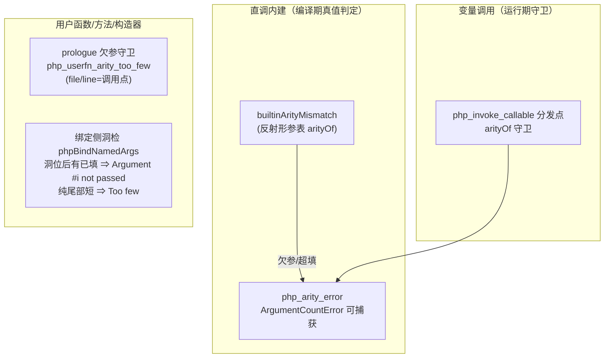

# 批次二十（Q2）：E5/F-41 arity 域落地——全通道 ArgumentCountError

| 项 | 值 |
|---|---|
| 模块 | AOT arity / 调用通道 |
| 日期 | 2026-11-06 |
| 提交 | 工作树（承接批十九） |
| 状态 | 已落地，全量实测 ≡ PHP 8.5.8 |

## 1. 高层摘要（TL;DR）

按批十九 ③ 的评估三层落地：内建直调 arity（**编译期炸 → 运行期可捕获 ArgumentCountError**）、内建变量调用 arity（**裸 InvalidArgumentCount 进程死 → 可捕获**）、用户函数/方法/构造器欠参（**静默 null 补齐 → 可捕获**，含命名跳必填的洞/not-passed 双措辞分流）。关键机制勘误：本族异常通道是「异常 Value 正常返回 + pending 旗标 + 调用后 hasException 路由」，Zig error 通道会在 `try`+后检站点绕过局部 catch——全族按值返回约定统一。

## 2. 影响范围与核心变更

| 层 | 文件 | 变更 |
|---|---|---|
| 运行侧 | `runtime_lib_template.zig` | `php_arity_error`（内建措辞）/ `php_userfn_arity_too_few`（用户措辞，嵌调用点 file/line）/ `php_arity_too_few_v` / `php_arity_not_passed_v`（IR 用 Value 形版）；`phpBindNamedArgs` 必填洞检（+required_params/display_name 参数，四调用点跟进）；`php_invoke_callable` 内建分发守卫 |
| 编译期 | `native_linker.zig` | `builtinArityMismatch` + `emitBuiltinArityGuard`（直降双漏斗顶置）；prologue 欠参守卫（setCurrentCallArgs 后）；builtin_map +2 |
| 编译期 | `ir_generator.zig` | 命名绑定块必填洞检（洞追踪 + 发射两形） |
| 数据 | `builtin_param_table_generated.zig` | 生成器增 `arityOf` 共享判定（编译期/运行期单一来源） |

## 3. 可视化概览（mermaid）

## 4. 验收读数

- 探针全等 PHP 8.5.8：`probe_q2a`（直调八形）/ `iso_b2`（变量调用四形）/ `probe_b19_arity_user`（U1-U3/M1-M3/U4-U6）/ `probe_q2c_extra`（洞首/构造器/闭包/静态）。
- 回归电池 17 探针零漂移；debug_frames 变体 faces/bt 全等；41 格面板零转移（工单 §249.4）。

## 5. 影响与风险

- **行为变化**：欠参/超填从「编译期炸/裸错进程死/静默 null」变为「可捕获 ArgumentCountError」——纯向 PHP 靠拢，无用户可见回退。
- **措辞单一来源**：`php_arity_error`（内建）与 `php_userfn_arity_too_few`（用户）双函数；判定单一来源 `arityOf`。
- **遗留**：`{closure}` 名的 `{closure:file:line}` 后缀差（§七.5 豁免）；prologue 守卫对「实参求值副作用先于错误」的序保持 PHP 实测（直调内建欠参时实参表达式已求值——本批保持该序）。

## 6. 后续建议

| 优先级 | 影响面 | 落地成本 | 建议 |
|---|---|---|---|
| P1 | arity 族剩余面 | 小 | `call_user_func` 对 by-ref 形参族的 ValueError 文案对齐（遇 Q3 一并） |
| P2 | 措辞完备 | 小 | 闭包 `{closure:file:line}` 后缀如需精确，需编译期注入声明点（§七.5 现豁免） |
