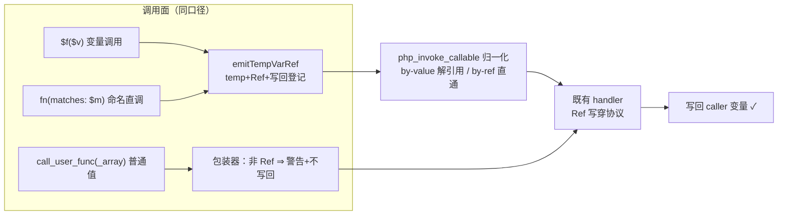
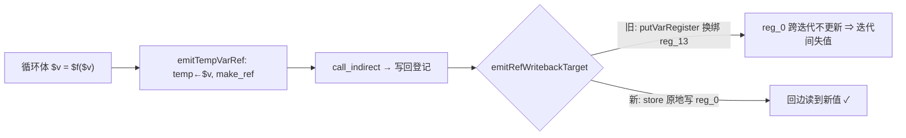

# 批次二十一（Q3）：13 枚 out 参族的变量/间接调用面写回

| 项 | 值 |
|---|---|
| 模块 | AOT 变量调用 / by-ref 通道 |
| 日期 | 2026-11-06 |
| 状态 | 已落地，验收探针 ≡ PHP 8.5.8 |

## 1. TL;DR

defer-12 out 参族（preg_match/preg_match_all/preg_replace/preg_filter/preg_replace_callback/str_replace/str_ireplace/parse_str/settype/exec/system/sscanf/array_multisort）从「变量调用报 undefined function」落地为全通道 PHP 真值：写回（Ref 直通）、警告（非引用值）、异常路径写回（批十四约定）、vivify（批十五口径）逐形对齐。连带修通**用户函数经 `$f()` 变量调用的 by-ref 写回**（既有大缺口）与 `php_exec`/`php_system` 的 Zig 0.17 `Child.run` 潜伏编译错（迁 libc popen）。

## 2. 核心变更

| # | 变更 | 位置 |
|---|---|---|
| 1 | 13 枚包装器（Ref 直通 + `q3WarnByRefValue` 警告协议）+ 注册 | runtime_lib_template |
| 2 | `emitTempVarRef`/`emitPlainVarWritebacks` 共享化（RefWriteback 提升容器级） | ir_generator |
| 3 | `$f($v)` 变量调用纯变量实参 Ref 化 + `call_indirect` 早退支补写回 | ir_generator |
| 4 | 命名通道 by-ref 命中位 make_ref + 保 Ref 存数组（`setKeepRef`/`pushRaw`） | ir_generator + runtime |
| 5 | `php_invoke_callable` 内建分发 Ref 归一化（by-value 解引用、by-ref 直通、变参尾继承） | runtime_lib_template |
| 6 | `phpInvokeBuiltinNamed` by_ref 三态（直通/警告+隔离槽/未填隔离槽） | runtime_lib_template |
| 7 | 直调右值传 by-ref ⇒ 可捕获 Error `could not be passed by reference` | ir_generator + runtime |
| 8 | prologue by-ref 绑定收到非 Ref ⇒ PHP 警告 | native_linker |
| 9 | `php_exec`/`php_system` 迁 popen（Zig 0.17 移除 Child.run） | runtime_lib_template |

## 3. 可视化（mermaid）

## 4. 验收读数

- 探针全等：`probe_q3_truth`（R 族）/ `probe_q3_accept`（W1-W7）/ `iso_r3` / `iso_rval`。
- 回归电池 19 探针零漂移；41 格面板零转移（工单 §250.3）。

## 4.5 回归事故与修复（f047/f152/f164——循环内写回断链）

Q3 中期面板翻红 5 格。两段修复：

1. **by-value 形参 deref 化**（nlk :24233-:24319）：`$f($v)` Ref 化后 by-value 被调形参持 Ref、体内再传不解引用内建即断 ⇒ prologue by-value 绑定各分支统一 `runtime.q3Deref`（PHP 本体语义）。修好 f006/f104。
2. **写回原地化**（irz `emitRefWritebackTarget` 单点）：原 `putVarRegister` 纯 SSA 换绑把循环内被写回变量引到新寄存器，而循环体烘焙读点位仍指旧寄存器 ⇒ 回边后变量重置（闭包内 `$v = $f($v)` 迭代间失值；探针 q3_regress2/3/4 二分 + q3_min 生成码铁证）。改 alloca 变量原地 `store`（同普通赋值口径）。修好 f047/f152/f164。

复验：12 Q3 探针 + 5 回归探针全等；41 格面板与 b17 基线逐格一致零转移。

## 5. 遗留（诚实清单）

| 项 | 说明 | 处置 |
|---|---|---|
| 数组元素引用 | `&$m` 入数组不产活引用 ⇒ cufa-引用形写回缺 | **待批**（需动 parser.zig/ast.zig + PHPArray 元素 Ref 语义） |
| by-value 被调+未定义变量 | 变量调用面静默（by-ref 偏置），PHP 发 Undefined variable | 登记 |
| fscanf | B 类 | 不动 |

## 6. 后续建议

| 优先级 | 影响面 | 落地成本 | 建议 |
|---|---|---|---|
| P1 | 数组元素引用（`&$m` 字面量/追加形） | 中-大 | 待批后立项：parser `&` 元素节点 + PHPArray 元素 Ref 读侧解引用已备，写侧保链 |
| P2 | `array_multisort` 多数组混 flag 全形 | 中 | 既有 handler 已校验族，补多数组 out 写回实测 |
