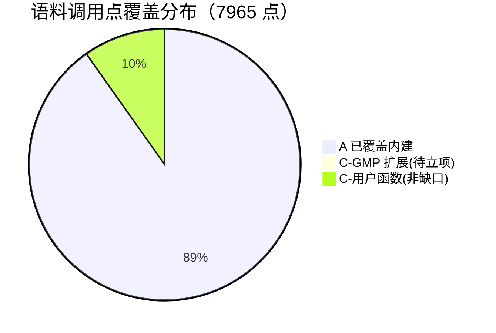
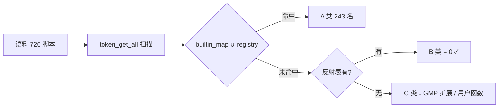

# 批次二十三（Q5）：覆盖重普查 + fputs 别名补登

## 1. TL;DR

Q4 后重跑覆盖普查（新写 `/tmp/aot_census/q5_census.php`，token 级）：语料 fuzzy_scripts_720 的 460 个自由函数名 / 7965 调用点中，**A 类已覆盖 243 名 / 7128 点（89.5%），B 类（PHP 内建未覆盖）= 0**——语料内建函数全覆盖，内建战线收口。C 类 217 名分桶：GMP 扩展 10 名 63 点（待立项评估），其余 207 名为语料脚本的用户自定义函数（非缺口）。普查顺手暴露 `fputs` 别名缺失，已双表补登。

## 2. 核心变更

| 项 | 内容 |
|---|---|
| 普查口径 | 语料 token 级扫描（排除 -> 、::、function、new、语言构造）；覆盖集＝builtin_map ∪ 运行期 registry；内建判定＝builtin_param_table_generated.zig 反射表 |
| fputs 别名 | nlk builtin_map + rt registry 各一条（→ php_fwrite / wrapBuiltin_fwrite） |

## 3. 可视化（mermaid）

## 4. 读数与清单

见工单 §252（含 C 类分桶明细与「仍不覆盖清单」处置）。

## 5. 影响与风险

- 纯增量（普查 + 两条别名登记），无破坏面。
- 复测：41 格面板复跑（panel_q5.txt）零转移。

## 6. 后续建议

| 优先级 | 影响面 | 落地成本 | 建议 |
|---|---|---|---|
| P2 | GMP 扩展族（10 名 63 点） | 大 | 独立立项评估：先 `gmp_init/strval/add/mul/pow` 五枚高频；语义层可借知识库 `bigdecimal` 的蓝本思路但 GMP 是任意精度整数（非定点），需新内核 |
| P2 | 普查脚本进仓 | 小 | `q5_census.php` 目前 /tmp；建议固化到 `scripts/`（供后续批次复跑） |
