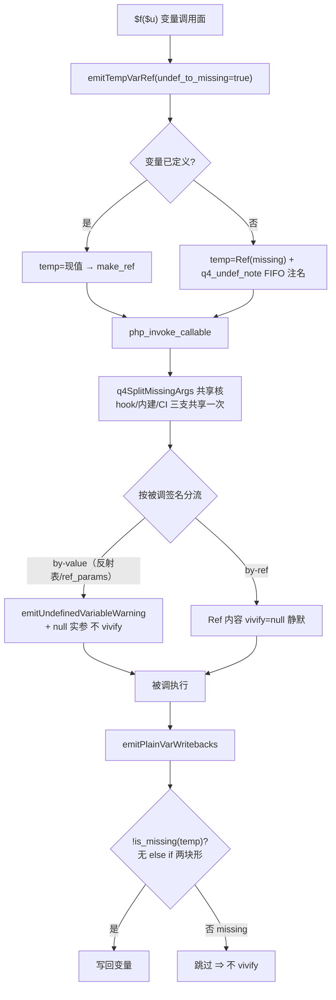
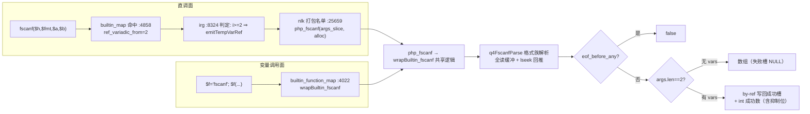
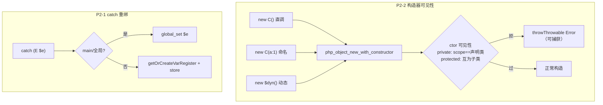

# AOT-CODEGEN-012 batch24：P2 小项全清（catch 重绑 / 构造器可见性 / 变量调用面未定义分流 / fscanf / 普查固化）

- 日期：2026-11-06 ｜ 状态：uncommitted（工作树）｜ 基线 HEAD：da624f3
- 工单：§253（[AOT-CODEGEN-012-class-name-case-insensitive-lookup.md](../../known-issues/AOT-CODEGEN-012-class-name-case-insensitive-lookup.md)）
- 关联 patch 说明：[isNamedLabelStart_关键字命名标签_patch说明_f6e5e2a.md](../../patches/2026-11-06/isNamedLabelStart_关键字命名标签_patch说明_f6e5e2a.md)

## 1. 高层摘要（TL;DR）

P2 队列 5 小项全清，全部 src/aot 内闭环：① catch 变量按 PHP 无块作用域改为普通赋值语义（连带修 optimizer CSE 跨块纯常量共享洞）；② 构造器可见性在 `php_object_new_with_constructor` 单点汇聚检查（三通道同口径）；③ 变量调用面未定义实参按 PHP 真值分流（by-value 告警+null+不 vivify / by-ref 静默 vivify）——落地期连破两个深层结构性坑（nlk cond_br 边界算法的块序假设、php_invoke_callable 下落链的分流重复消费）；④ fscanf 完整格式族实现 + `ref_variadic_from` 变参 by-ref 新机制（首开变参内建直调面 by-ref 通路）；⑤ 普查脚本固化进仓可复跑。41 格面板两批复跑零转移。

## 2. 影响范围

| 面 | 文件 | 性质 |
|---|---|---|
| IR 生成 | src/aot/ir_generator.zig | catch 语义重写、emitTempVarRef 加 undef_to_missing、emitPlainVarWritebacks 守卫（两块形）、变参 by-ref 判定支 |
| 优化器 | src/aot/optimizer.zig | CSE 纯常量限同块 |
| 运行时 | src/aot/runtime_lib_template.zig | q4_undef FIFO/钩子、q4SplitMissingArgs 共享核、php_invoke_callable 三支共享分流、构造器可见性检查、fscanf 全家（q4FscanfParse/wrapBuiltin_fscanf/php_fscanf）、builtin_function_map 登记 |
| 代码生成 | src/aot/native_linker.zig | BuiltinInfo 加 ref_variadic_from、getBuiltinRefVariadicFrom、builtin_map fscanf 条目、打包名单加 php_fscanf、registerFunctionRefParams 发射、q4GlobalLookupForUndef 模板、php_check_param_type 双发射点 missing 守卫 |
| 工具链 | scripts/q5_census.php | 固化（root 自动定位 + 语料噪音静默） |

## 3. 核心变更

| # | 变更 | 根因/动机 | 修法一句话 |
|---|---|---|---|
| P2-1 | catch 变量不重绑 | 旧实现「unique 名+恢复旧映射」双错（main 面读 global_get 不看 SSA；恢复映射与 PHP 语义相反） | 改普通赋值语义（global_set / store），删 unique 机制 |
| P2-1b | CSE 跨块纯常量共享 | 纯常量跨块消重 ⇒ nlk 按块物化/释放下跨块引用失联 | 纯常量只在同块消重（零性能损失） |
| P2-2 | 构造器可见性不查 | 直调/命名/动态三通道都不查 | `php_object_new_with_constructor` 单点检查（private/protected 判定 + PHP 实测措辞 + 可捕获 Error） |
| P2-2b | missing 哨兵误炸类型检查 | 命名缺省位的 missing 送 php_check_param_type | 双发射点补 `!isMissing()` 守卫 |
| P2-3 | 未定义变量实参静默 | Q3 全量 Ref 化绕过变量读通道 ⇒ 告警丢失 + 误 vivify | missing 哨兵 + FIFO 注名 + q4SplitMissingArgs 按 by-ref 分流 + 写回守卫 |
| P2-3a | 写回守卫 IR 消失 | 三块形（含空 skip）被 optimizer 压成反序两块 ⇒ 越出 nlk 边界算法支持面 | 改发「无 else if」两块形（已验证路径同构） |
| P2-3b | hook 未命中后 FIFO 二消费 | 内建支用原 args 重复分流 ⇒ take 空 ⇒ missing 漏进 handler | hook→内建→CI 三支共享一次分流结果 |
| P2-4 | fscanf 缺实现 | B 类编译期表缺名 | 完整格式族 + 全读回推流策略 + ref_variadic_from 新机制 + 双表登记 |
| P2-5 | 普查脚本漂移在 /tmp | 不可复跑 | 固化 scripts/q5_census.php（去硬编码 + 静默语料噪音） |

## 4. 可视化概览（Code & Logic Map）

### 4.1 P2-3 未定义实参分流链路（核心新增）

### 4.2 fscanf 双通路登记（新机制 ref_variadic_from）

### 4.3 P2-1/P2-2 单点汇聚

## 5. 详细变更分析

### 5.1 涉及文件与变更点

| 文件 | 位置 | 变更 |
|---|---|---|
| ir_generator.zig | :4082-4128 | generateCatchClause 普通赋值语义重写 |
| ir_generator.zig | :229-279 | emitTempVarRef 加 undef_to_missing 形参 |
| ir_generator.zig | :284-306 | emitPlainVarWritebacks missing 守卫（两块形） |
| ir_generator.zig | :8300-8301, :8324-8327 | 变参 by-ref 判定支 |
| optimizer.zig | :5364-5412 | CSE 纯常量限同块 |
| runtime_lib_template.zig | :94-220 | q4_undef FIFO/钩子/三桥 + q4SplitMissingArgs |
| runtime_lib_template.zig | :11834-11917 | php_invoke_callable 三支共享分流 |
| runtime_lib_template.zig | :32231-32252 | php_object_new_with_constructor 可见性检查 |
| runtime_lib_template.zig | :8758-9108 | fscanf 全家（Q4FscanfOutcome/q4FscanfAccum/q4FscanfParse/php_fscanf/wrapBuiltin_fscanf） |
| runtime_lib_template.zig | :4022 | builtin_function_map 登记 fscanf |
| native_linker.zig | :4605-4607, :4634-4638 | BuiltinInfo.ref_variadic_from + 访问器 |
| native_linker.zig | :4858 | builtin_map fscanf 条目 |
| native_linker.zig | :25659 | 打包名单加 php_fscanf |
| native_linker.zig | :2659-2678, :2270-2273, :2410 | registerFunctionRefParams 发射 + main.zig q4GlobalLookupForUndef 挂钩 |
| native_linker.zig | :5620, :5666 | php_check_param_type missing 守卫 ×2 |
| scripts/q5_census.php | 全文件 | 固化（dirname(__DIR__) + @token_get_all） |

### 5.2 数据流/语义层

- missing 哨兵生命周期：emitTempVarRef 产出 →（分流消费：告警 or vivify）→ 写回点守卫拦截 ⇒ **全程不泄漏进 PHP 值域**（var_dump(missing) 无输出即为泄漏事故，已被 P2-3b 修复封死）。
- fscanf 流位置管理：全读（res.eof 置位）→ 解析得 consumed → 未消耗后缀 lseek 回推 + eof 复位 ⇒ ftell/fgets 后续读位置正确（p2_4v 顺序消费实测验证）。

## 6. 影响与风险评估

- **破坏式变更**：无。所有新机制默认关闭（ref_variadic_from 默认 null；undef_to_missing 仅变量调用面传 true；CSE 同块限制仅收敛不扩张）。
- **影响范围**：catch 语义（全量 PHP try/catch 路径——面板 41 格含异常格零转移佐证）；变量调用面（Q3 批十五探针全绿）；内建表（新增键不影响既有键）。
- **需要特别注意**：① nlk cond_br 边界算法的块序假设（then_idx < else_idx）是隐性契约——后续 irg 新增条件块必须走「无 else if」或「if/else 物理递增」同构形；② q4_undef FIFO 16 槽环形，实参求值期异常逃逸会残留（仅告警措辞错，低频，已注释登记）；③ fscanf 不可 seek 流（pipe）回推失败时多读字节丢失（已注释登记，语料未见）。
- **复测路径**：`php scripts/q5_census.php`（B=0）；三枚 fscanf 探针 + p2_3 主探针（/tmp/aot_census/p2_*，.php 保留）；41 格面板（panel_all.sh）。

## 7. 遗留问题/潜在问题

| 项 | 性质 | 跟踪 |
|---|---|---|
| Deprecated-null 机制（内建非 nullable 形参收 null 的 Deprecated 告警族） | 既有缺口，P2-3 探针残余 diff 全属此族 | p2_3_gap_deprecated_null.php 跟踪，待立项 |
| strrev(null) 返回 NULL vs PHP string(0)"" | Deprecated-null 伴生弱转换口径 | 同上 |
| sscanf 直调面带 vars 编译炸（定参 vs 变参） | 既有缺口（fscanf 已用 ref_variadic_from 避开） | 可照 fscanf 通路回头修 sscanf（P1 建议） |
| php://memory 流空壳（file_handle=null） | 既有缺口，探针载体误用时暴露 | 待批立项（内存缓冲字段进 PHPResource） |
| 数组元素引用真 Ref 化 | 待批（取证见工单 §253.7-①） | 等老铁裁决 |
| GMP 扩展族 | 待批（取证见工单 §253.7-②） | 等老铁裁决 |

## 8. 后续开发/优化建议

| 优先级 | 建议 | 影响面 | 落地成本 |
|---|---|---|---|
| P0 | sscanf 直调面照 fscanf 通路（ref_variadic_from=2 + 切片签名）重修，消「带 vars 编译炸」既有缺口 | builtin_map 条目 + php_sscanf 切片包装 | 小（通路已验证） |
| P1 | Deprecated-null 机制立项：内建非 nullable 形参收 null ⇒ Deprecated 告警 + 弱转换（strrev 等全族受益） | 反射表 nullable 位已有，归一化点单点发散 | 中（单点 + 措辞表） |
| P1 | nlk cond_br 边界算法补「反序两块」支持或 irg 侧加块序不变量断言（防再造 P2-3a 形坑） | buildControlFlowBoundaries / createBlock 文档 | 小-中 |
| P2 | php://memory 流内存缓冲（PHPResource 加 buffer 字段） | 流族全益（fwrite/fread/fgets/ftell） | 中 |
| P2 | q4_undef FIFO 异常逃逸清扫（setjmp 路径清环） | 告警措辞正确性边角 | 小 |
