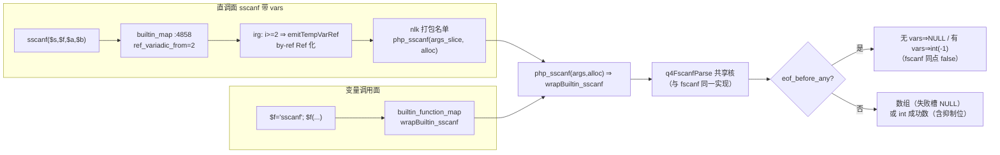
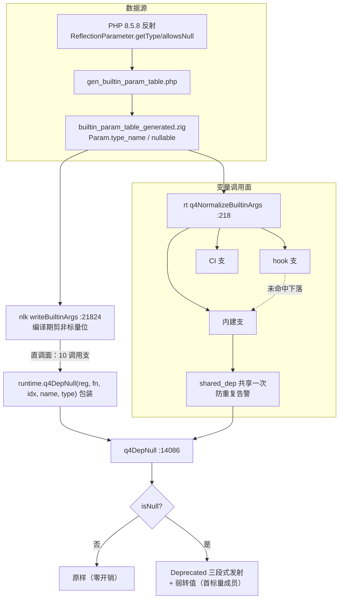
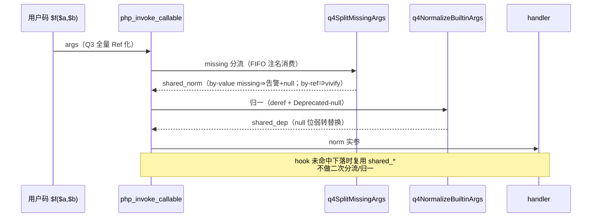

# AOT-CODEGEN-012 batch25：sscanf 直调面重修 + Deprecated-null 机制

- 日期：2026-11-07 ｜ 状态：uncommitted（工作树）｜ 基线：batch24 落地后工作树
- 工单：§255（[AOT-CODEGEN-012-class-name-case-insensitive-lookup.md](../../known-issues/AOT-CODEGEN-012-class-name-case-insensitive-lookup.md)）

## 1. 高层摘要（TL;DR）

两项连落：① **sscanf 直调面重修**（P0）——消「带 vars 直调编译炸」既有缺口，照 fscanf 通路（切片签名 + ref_variadic_from），格式解析与 fscanf 共核（q4FscanfParse 复用，零重复实现），sscanf 特有 EOF 口径（NULL/-1）实测钉死；② **Deprecated-null 机制**——内建非 nullable 标量形参收 null 的 Deprecated 告警 + 弱转换，反射表扩 type_name/nullable 双字段（2143 函数全量重生成），直调面（writeBuiltinArgs 插桩）与变量调用面（q4NormalizeBuiltinArgs 共享归一）双路同口径。两探针全 SAME，p2_3 主探针转 FULLY_SAME。

## 2. 影响范围

| 面 | 文件 | 性质 |
|---|---|---|
| 运行时 | runtime_lib_template.zig | php_sscanf 切片化 + wrapBuiltin_sscanf 重写（共享核）+ q4DepNull + q4NormalizeBuiltinArgs + php_invoke_callable 归一管线重构 |
| 代码生成 | native_linker.zig | builtin_map sscanf 条目改造、打包名单 +php_sscanf、writeBuiltinArgs Deprecated 插桩 |
| 数据源 | scripts/gen_builtin_param_table.php + builtin_param_table_generated.zig | Param 加 type_name/nullable，全量重生成（2143 fn / 4424 param 计数不变） |

## 3. 核心变更

| # | 变更 | 根因/动机 | 修法 |
|---|---|---|---|
| 3.1 | sscanf 带 vars 直调编译炸 | 定参签名（3）vs 变参实参（N） | 切片签名 + ref_variadic_from=2 + 打包名单（fscanf 通路复用） |
| 3.2 | sscanf 格式族残缺 | 旧实现仅 %d/%s | wrapBuiltin_sscanf 重写共享 q4FscanfParse（全格式族）；EOF 口径差异（NULL/-1 vs false）wrapper 分派 |
| 3.3 | Deprecated-null 全缺 | 反射表无类型/nullable 数据 | 生成器加 typeToZig（ReflectionType 原文+allowsNull）；Param 加双字段 |
| 3.4 | 变量调用面归一分散 | missing 分流 / deref / depnull 三处各自为政 | q4NormalizeBuiltinArgs 统一归一；hook→内建→CI 下落链共享（shared_dep，防 hook 未命中后重复告警） |
| 3.5 | 直调面无 Deprecated | 内建直调逐参传递无检查点 | writeBuiltinArgs 写参循环按反射表包装 q4DepNull 内联守卫（非 null 零开销） |
| 3.6 | **缺省占位误警（面板翻红 f105/f110/f161）** | irg 12 枚占位特判补 `const_null` ⇒ 与「字面 null」不可区分 ⇒ 被 depnull 误警+弱转 | 占位全改 `const_missing`（哨兵本义）；4 枚 handler 缺省判定扩 `or isMissing()`（substr/explode/array_splice×2）；PHP 真值：`trim($s,null)` 显式警+不剥 vs `trim($s)` 缺省不警+剥 |

## 4. 可视化概览（Code & Logic Map）

### 4.1 sscanf 重修通路

### 4.2 Deprecated-null 双路发散

### 4.3 归一管线时序（变量调用面一次调用）

## 5. 详细变更分析

### 5.1 涉及文件列表与变更点

| 文件 | 位置 | 变更 |
|---|---|---|
| runtime_lib_template.zig | :7151-7199 | wrapBuiltin_sscanf 重写（共享核 + sscanf EOF 口径） |
| runtime_lib_template.zig | :40524-40528 | php_sscanf 切片签名转发（旧定参实现退役） |
| runtime_lib_template.zig | :214-280 | q4NormalizeBuiltinArgs 新增 |
| runtime_lib_template.zig | :14086-14128 | q4DepNull 新增 |
| runtime_lib_template.zig | :12281-12331 | php_invoke_callable 归一管线重构（shared_dep） |
| native_linker.zig | :4856-4858 | sscanf 条目改造（ref_variadic_from=2 + bi()） |
| native_linker.zig | :25661 | 打包名单 +php_sscanf |
| native_linker.zig | :21824-21874 | writeBuiltinArgs Deprecated 插桩 |
| scripts/gen_builtin_param_table.php | :66-85, :103-114, :143-154 | typeToZig + Param 双字段 |
| builtin_param_table_generated.zig | 全量 | 重生成（diff 可审计） |

### 5.2 关键语义决策

- **sscanf EOF 口径**：无 vars ⇒ NULL、有 vars ⇒ int(-1)（PHP 8.5.8 实测；fscanf 同点 false）——共享核只产出 `eof_before_any` 布尔，两 wrapper 各自映射。
- **无反射条目保守直通**：q4NormalizeBuiltinArgs 对表外函数返回 null（不 deref）——保持 Q3 既有「不知 by-ref 位 ⇒ Ref 留 wrapper 自理」口径，零回归面。
- **by-ref 位不参与 depnull**：真值未覆盖（罕见组合），登记边界（§255.3）。

## 6. 影响与风险评估

- **破坏式变更**：无。sscanf 旧直调（无 vars）生成码从「逐参」变「切片打包」⇒ 语义等价（面板 41 格零转移佐证）；Deprecated 插桩对非 null 实参恒原样。
- **变更影响范围**：全部内建直调生成码（writeBuiltinArgs 10 支）——仅当反射表命中且形参非 nullable 标量才多一个内联守卫调用包装。
- **需要特别注意**：① q4NormalizeBuiltinArgs 的 canon 折叠限 64 字符（与既有 CI 折叠同口径）；② 变参位类型继承变参声明位（fscanf 的 `&...$vars` 型 mixed ⇒ 不警 ✓）；③ 生成器重跑要求 PHP 8.5.8 环境（与初版同）。
- **复测路径**：`php scripts/q5_census.php`（B=0 应保持）；p0_sscanf / p0c_depnull / p2_3 三探针；41 格面板。

## 7. 遗留问题/潜在问题

见工单 §255.3/§255.4：by-ref 标量形参收 null 边界、writeValueArgs 直写特殊支未插桩、php://memory 流空壳（待立项）、占位 missing 化的 handler 兼容面（4 枚必修已落；`isString()` 判定族与 `requireOptionalNumParam` 天然兼容）。

## 8. 后续开发/优化建议

| 优先级 | 建议 | 影响面 | 落地成本 |
|---|---|---|---|
| P0 | php://memory 流内存缓冲立项（PHPResource 加 mem_buf/mem_pos + 全族流函数适配） | 流族全益 + fscanf 探针可用 memory 载体 | 中 |
| P1 | Deprecated-null 对 writeValueArgs 直写特殊支（array_* 族）补插桩 | 直调面覆盖完整化 | 小 |
| P1 | by-ref 标量形参收 null 的 PHP 真值补测 + 覆盖 | 口径完整性 | 小 |
| P2 | q4NormalizeBuiltinArgs 的 need 判定可借位缓存（StaticStringMap 编译期预算「该函数是否需要归一」） | 变量调用面热路径微优化 | 中 |
