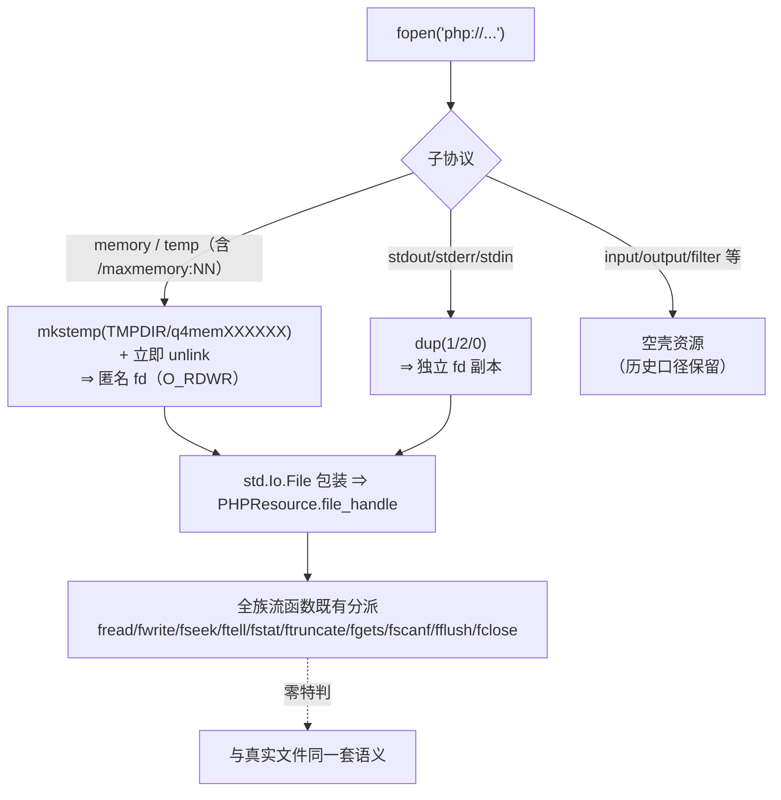
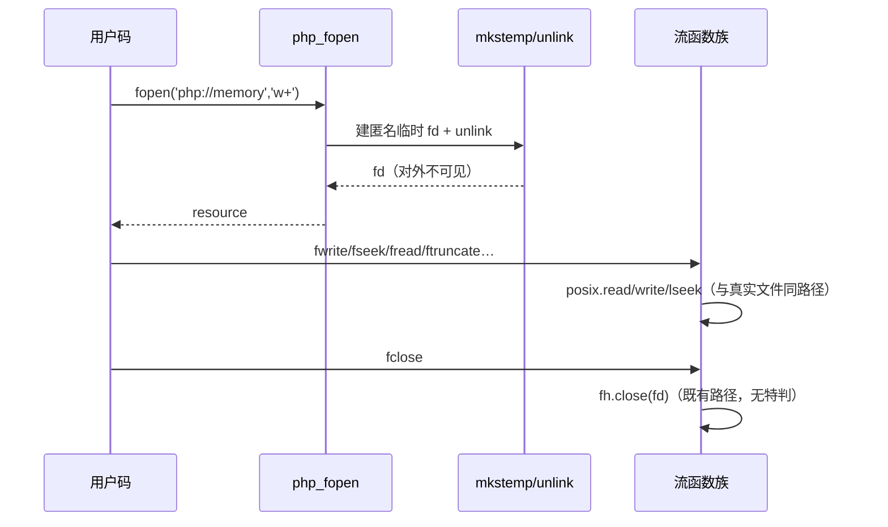

# AOT-CODEGEN-012 batch26：php://memory/temp 承载落地 + stdio 族 dup + stream_get_contents/fflush

- 日期：2026-11-07 ｜ 状态：uncommitted（工作树）
- 工单：§256（[AOT-CODEGEN-012-class-name-case-insensitive-lookup.md](../../known-issues/AOT-CODEGEN-012-class-name-case-insensitive-lookup.md)）

## 1. 高层摘要（TL;DR）

php://memory/temp/stdout 全系空壳（fwrite 静默丢数据）收口。方案按「不造第二套语义」红线选中 **mkstemp 匿名临时文件承载**（+立即 unlink）：真 fd ⇒ 全族流函数（fread/fwrite/fseek/ftell/fstat/ftruncate/fgets/fgetc/fscanf/stream_get_contents/fflush/fclose）与真实文件零分派差异；stdio 族用 dup 包装（fclose 不动进程标准 fd）。族探针全 SAME，顺手补登两枚族内既有缺口（stream_get_contents、fflush——含 offset 缺省不 seek 的 missing 哨兵口径）。

## 2. 影响范围

| 面 | 文件 | 性质 |
|---|---|---|
| 运行时 | runtime_lib_template.zig | php_fopen 的 php:// 支三向改造（memory/temp⇒mkstemp / stdio⇒dup / 其余空壳）+ php_stream_get_contents + php_fflush + extern 封装 |
| 代码生成 | native_linker.zig | builtin_map +stream_get_contents（handler_params=3+optional_defaults）/fflush |
| 运行期表 | runtime_lib_template.zig builtin_function_map | +stream_get_contents/fflush 两枚 wrapper |

## 3. 核心变更

| # | 变更 | 动机 | 修法 |
|---|---|---|---|
| 3.1 | php://memory/temp 空壳 | 语料 4 点静默丢数据 | mkstemp(TMPDIR 或 /tmp)+立即 unlink ⇒ 匿名 fd；包 std.Io.File 进 PHPResource，复用既有全族分派 |
| 3.2 | php://stdout/stderr/stdin 空壳 | 语料 stdout 直写 2 点 | dup 标准 fd（fclose 关副本不动原 fd，PHP 实测口径） |
| 3.3 | stream_get_contents 未实现 | p0m 探针暴露 | 新实现：length null/<0⇒读至 EOF、0⇒""；offset 缺省（missing 哨兵）⇒不 seek、显式⇒seek |
| 3.4 | fflush 未实现 | 同上 | fd 直写无用户态缓冲 ⇒ 资源恒 true |
| 3.5 | php://input 空壳 | CLI 下常见形态 | PHP 实测 CLI 下=空只读流 ⇒ mkstemp 空文件 + O_RDONLY 重开（写拒绝由 access mode 承载） |
| 3.6 | file_get_contents 不认 php:// | p0h 探针暴露 | 委托 php_fopen+stream_get_contents 同路径；负 offset 先 SEEK_END 再委托 |
| 3.7 | php_fwrite 吞写错误 | 只读 fd 恒返全长（input 探针暴露） | std.c.write 自查循环：负 errno⇒false、部分写⇒实际字节数 |
| 3.8 | depnull 直写特殊支无守卫 | writeBuiltinArgs 只覆盖 10 支 | 守卫下沉公共核 `writeDepNullArg`；writeValueArgsNamed/writeValueArgsArrayNamed（func_name+param_offset 切片位偏）统一替换 83 处直写点；writeBuiltinArgs 手写循环删除回归防双重；7 处非内建支（call_indirect/构造/静态调用/channel 族）人工核查回退 |
| 3.9 | php://memory 'r' 模式写入违规成功 | mkstemp fd 恒 RDWR | fmode 降级——'r'（无 +）⇒ O_RDONLY 重开（unlink 前）；PHP 实测写拒绝=静默 false，与 fwrite 的 std.c.write 自查（EBADF⇒false）同口径 |

## 4. 可视化概览（Code & Logic Map）

## 5. 详细变更分析

见工单 §256.3（变更点表）。关键实现细节：
- `std.posix.getenv/unlink/close/dup` 在 Zig 0.17 均已收 ⇒ 经 `std.c.getenv` / `std.Io.Dir.deleteFile` / `std.Io.File.close` / `@extern(name="dup")` 四路绕行（q4c_dup 的 @extern 为避让 :31001 局部变量撞名）。
- `std.Io.File` 构造必填 `flags.nonblocking=false`（0.17 新字段）。
- stream_get_contents 的 offset 缺省区分：直调面 `optional_defaults=["null","missing"]`（missing 哨兵），变量调用面 wrapper 同口径。

## 6. 影响与风险评估

- **破坏式变更**：无。旧空壳路径仅保留给 php://input/output/filter 等未覆盖子协议。
- **风险点**：① mkstemp 失败路径（fd<0）⇒ fopen 返 false（与 PHP 一致）；② 'r' 模式开 memory 的写拒绝语义未模拟（fd 恒 RDWR）——登记边界（§256.5）；③ TMPDIR 不可写时 mkstemp 失败 ⇒ fopen false（PHP 同语义方向）。
- **复测路径**：p0m/p0m2 探针；41 格面板（panel_p28.txt）。

## 7. 遗留问题/潜在问题

见工单 §256.5：'r' 模式写拒绝未模拟、php://input 等空壳保留。

## 8. 后续开发/优化建议

| 优先级 | 建议 | 影响面 | 落地成本 |
|---|---|---|---|
| P1 | php://memory 'r' 模式写拒绝（PHPResource 加 mode 位 / fwrite 检查） | 语义完整性边角 | 小 |
| P1 | php://input（CLI 下 = stdin 内容）——dup(0) 或读入缓冲 | CLI 脚本生态 | 小 |
| P2 | 大内存流场景的真内存承载（>maxmemory 才落盘）——当前恒文件介质，性能特征与 PHP 有差 | 性能（非语义） | 中 |
