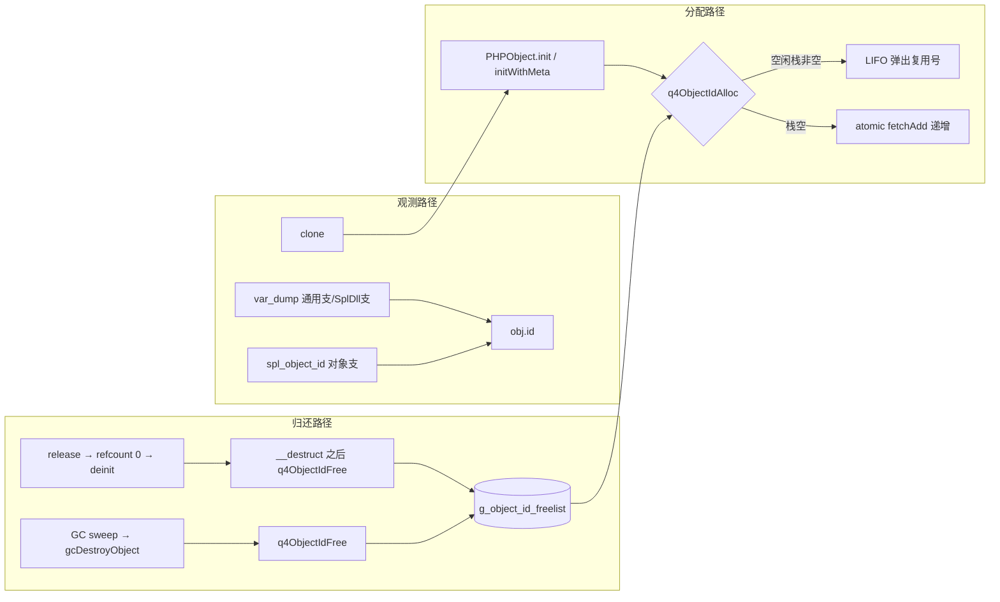
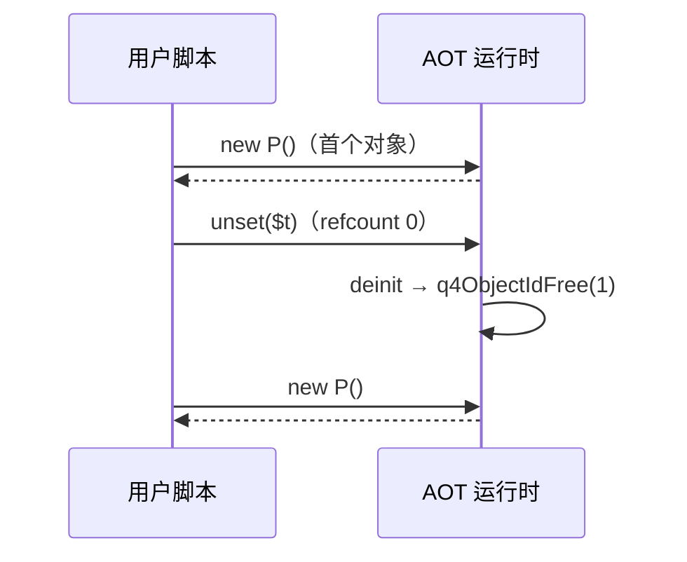

# AOT-CODEGEN-012 批次二十七：对象序号 `#N` 真值化 + 槽位 LIFO 复用

- 日期：2026-11-07
- 状态：uncommitted（工作树）
- 关联工单：docs/known-issues/AOT-CODEGEN-012-class-name-case-insensitive-lookup.md §257

## 1. 高层摘要（TL;DR）

var_dump 对象打印原**硬编码 `#0`**（违宪法禁硬编码），spl_object_id 用指针掩码、与 var_dump 不同源，clone 无新号概念。本批为 PHPObject 增加真实序号字段（atomic 计数器从 1 起 + Zend objects_store 同构的 LIFO 空闲栈复用），var_dump 双打印点、spl_object_id、clone 全族同源对齐 PHP 8.5.8 真值。主探针 8 形态 SAME；面板 46 探针零转移，sort_na 格从「格式差」收窄为「销毁时机差」（残余已登记 §257.5，方案待老铁拍板）。

## 2. 影响范围

| 面 | 说明 |
|---|---|
| 用户可见 | var_dump 对象输出 `object(X)#N` 为真实序号；spl_object_id 与 `#N` 同值；clone 得新号 |
| 运行时结构 | PHPObject +8 字节（id 字段）；全局 +4096×8 字节空闲栈与一枚自旋锁 |
| 性能 | 对象构造/销毁各加一次 O(1) 栈操作（锁内两条指令级操作）；热路径无分配 |
| 兼容 | 无破坏式变更；闭包支 spl_object_id 保持原指针口径 |

## 3. 核心变更

| # | 变更 | 位置 |
|---|---|---|
| 1 | 序号分配器：atomic 计数器（从 1）+ LIFO 空闲栈（4096，溢出即弃） | runtime_lib_template.zig :31233-31263 |
| 2 | PHPObject 加 `id: u64`；init/initWithMeta 两构造入口统一分配 | :31276、init/initWithMeta |
| 3 | 销毁双挂点归还序号：deinit（__destruct 之后）+ gcDestroyObject | :31458、:2325 |
| 4 | var_dump 两处 `#0` 硬编码 ⇒ `#{d}`(obj.id)（SplDll 支 + 通用支） | :16451、:16472 |
| 5 | spl_object_id 对象支：指针掩码 ⇒ obj.id | :22824-22826 |
| 6 | clone 经 PHPObject.init 自动取新号（无额外代码） | :24811 |

## 4. 可视化概览（Code & Logic Map）

时序（PHP 真值锚点）：

## 5. 详细变更分析

- 端：AOT 运行时库（runtime_lib_template.zig）单文件改动；nlk/irg/optimizer 零触碰。
- 数据层：PHPObject 内存布局 +8 字节；序号生命周期 = 对象生命周期（deinit/gcDestroyObject 双挂点全覆盖，无第三销毁路径——已 grep 核实全部 `destroy(o)`/`destroy(self)` 站点）。
- 并发：分配/归还走 std.atomic.Mutex 自旋锁（与 profiler.zig 同款，Zig 0.17 无 std.Thread.Mutex）；计数器本身 atomic.fetchAdd（.monotonic 足够——仅需唯一性）。
- 协程安全：锁内仅两条栈操作，无分配、无递归锁风险。

## 6. 影响与风险评估

- 破坏式变更：无。
- 风险点：① 序号复用要求「销毁时无存活引用」——deinit 仅在 refcount 0 触发，PHP 层面无悬空观测点（spl_object_id 无法对已毁对象调用）；② 空闲栈溢出（>4096 个已毁对象号积压）⇒ 溢出号丢弃不复用，安全降级为单调递增；③ __destruct 内 var_dump($this) 仍打印本号（归还点在析构之后），与 PHP 一致。
- 复测路径：objid 探针 8 形态 SAME；objid3 函数作用域探针部分 SAME（复用生效段）；46 探针面板 panel_p32 零转移。

## 7. 遗留问题/潜在问题

对象销毁时机语义四格（§257.5）：G1 顶层作用域即时销毁缺、G2 循环退出边 liveness 滞留、G3 catch 异常对象终身保留、G4 store 释放顺序与 PHP 反相。全部只影响「对象先死后生再观测序号」的脚本形态，无语义副作用。方案甲/乙/丙已报老铁，推荐乙（G3+G1 先修）。

## 8. 后续开发/优化建议

| 优先级 | 建议 | 影响面 | 落地成本 |
|---|---|---|---|
| P1 | G3+G1 销毁时机修复（待老铁拍板方案乙） | try/catch 与顶层脚本序号全等 | 中（catch 出口释绑定 + 全局表 release） |
| P2 | G2/G4 liveness 与 store 顺序评估 | 循环相位差收敛 | 大（需全语料回归） |
| P2 | q4NormalizeBuiltinArgs 反射表查询结果缓存（P2 性能项） | 变量调用面热路径省哈希查表 | 小 |
