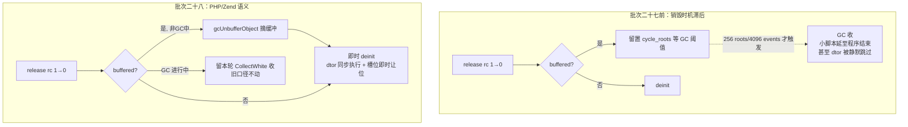
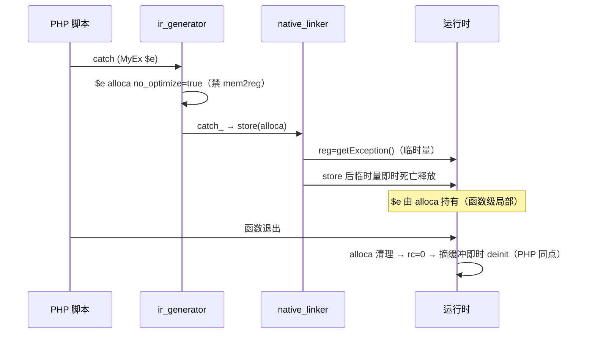

# AOT-CODEGEN-012 批次二十八：对象销毁时机对齐（方案乙：G3 catch 绑定生命周期 + G1 顶层即时销毁）

- 日期：2026-11-07
- 状态：uncommitted（工作树）
- 关联工单：docs/known-issues/AOT-CODEGEN-012-class-name-case-insensitive-lookup.md §258
- 前置：批次二十七（对象序号 #N 真值化 + LIFO 复用）

## 1. 高层摘要（TL;DR）

批次二十七遗留的「对象序号复用相位差」根因是 **AOT 对象销毁时机晚于 PHP**：rc 归零时若对象曾被 GC 缓冲（任何 rc>0 的 release 事件都会缓冲），旧路径留置等 GC 阈值而非同步销毁。本批按老铁批准的方案乙落地：release() 的 rc==0 分支改为「摘缓冲 + 即时 deinit」（PHP/Zend 语义：rc=0 必同步销毁）；irg 侧 catch 绑定变量 alloca 禁 mem2reg 提升（防块出口提前销毁）+ catch 无变量形态不取结果寄存器（入点即毁）。**sort_na 面板格治愈转 SAME**；G3 双探针（主+扩展含嵌套/rethrow/finally/无变量）全 SAME；46 探针面板 36 SAME + 10 DIFF（全为既有解释族），零转移。

## 2. 影响范围

| 面 | 说明 |
|---|---|
| 用户可见 | `__destruct` 执行位置对齐 PHP（函数退出/语句点）；对象序号复用相位在函数作用域内全等；sort_na 格治愈 |
| 运行时 | release() rc==0 路径从「等 GC」改「即时销毁」——内存占用峰值下降（对象不再积压到 GC 阈值），dtor 不再因 class_registry 先清而被静默跳过 |
| 生成码 | catch 绑定变量的 alloca 不提升（每枚 catch 变量一次 store/load，性能影响可忽略——正确性优先） |
| 兼容 | 无破坏式变更；GC 进行中路径维持旧口径 |

## 3. 核心变更

| # | 变更 | 位置 |
|---|---|---|
| 1 | 新增 `gcUnbufferObject`（摘 GC roots 缓冲：清标记 + swapRemove） | runtime_lib_template.zig :1561-1575 |
| 2 | release() rc==0 & buffered & 非 GC 中 ⇒ 摘缓冲即时 deinit | runtime_lib_template.zig :31400-31416 |
| 3 | catch 无绑定变量 ⇒ catch_ 不取结果（nlk 无结果支 getException+即释 ⇒ 入点即毁） | ir_generator.zig :4135-4145 |
| 4 | catch 绑定变量 alloca `no_optimize=true`（禁 mem2reg，与引用变量同例） | ir_generator.zig :4163-4175 |

## 4. 可视化概览（Code & Logic Map）

## 5. 详细变更分析

### 5.1 真值钉死（PHP 8.5.8 实测，修正先验假设）

| 形态 | PHP 销毁时机 |
|---|---|
| 函数内 catch 绑定 | **函数退出时**（非 catch 块出口） |
| catch 内重绑 `$e = new X()` | **重绑语句点**即毁旧异常 |
| 顶层 catch | 程序结束（顶层变量生命周期） |
| catch 无变量 | **catch 入点**即毁 |
| 顶层 unset/覆盖 | 立即（与函数内一致） |

### 5.2 根因链（生成码逐行取证）

1. release() 缓冲延迟：rc==0 & buffered ⇒ 旧路径留置等 GC（阈值 256 roots/4096 events）⇒ 小脚本程序结束才毁，甚至 dtor 随 class_registry 先清被静默跳过（f() 的 MyEx 从未打印 dtor）。
2. catch 变量 alloca 被 mem2reg 提升为纯寄存器 ⇒ 块出口 liveness 死释放提前杀（finally 前毁）；且 catch_ 结果与变量寄存器合一 ⇒ 重绑旧值多挂一份引用到作用域尾。
3. catch 无变量仍取结果寄存器 ⇒ 滞留至函数退出。

### 5.3 涉及文件

- src/aot/runtime_lib_template.zig（+18 行 / 改 1 处分支）
- src/aot/ir_generator.zig（catch 子句生成两处）

## 6. 影响与风险评估

- **破坏式变更**：无。
- **风险点**：① deinit 级联中子对象同样走新路径（递归摘缓冲，非迭代期，安全）；② gcUnbufferObject 仅在非 GC 进行中调用，GC 批内/批外口径不变；③ no_optimize 仅影响 catch 变量一枚 alloca，性能损失可忽略（正确性优先，宪法四.4）。
- **复测路径**：G3 主/扩展探针、G1 双探针、sort_na、46 探针面板（panel_p34，36 SAME+10 DIFF 零转移）、zig build test（289/290，1 枚失败为既有测试腐坏——剥离本批改动复跑同枚失败，确证无关）。

## 7. 遗留问题/潜在问题

| 项 | 状态 |
|---|---|
| 顶层覆盖写旧值延至程序结束毁 | 冻结（global_set 死值不释放 = liveness 域，老铁令禁动） |
| 函数内 unset/覆盖延至函数退出毁 | 冻结（creation 寄存器死亡时机 = store lowering/liveness 域） |
| PHPArray/PHPClosure 的同构缓冲延迟 | 登记备查（§258.6：数组无 __destruct 观测面，未动） |
| test_loop_unroll CSE-dominance 断言腐坏 | 登记（既有，待拍板） |

## 8. 后续开发/优化建议

| 优先级 | 建议 | 影响面 | 落地成本 |
|---|---|---|---|
| P1 | 解冻后修 global_set 死值释放 + store 后 creation 寄存器即时归还 | 顶层/函数内销毁时机全等 | 中（liveness/store lowering，需全语料回归） |
| P2 | 数组/闭包 release 同构修复评估 | ArrayObject 等包装语义对齐 | 小（照 §258.3 同法） |
| P2 | test_loop_unroll 断言照 R-166 先例维护到当前优化器行为 | zig build test 转绿 | 小 |
| P2 | q4NormalizeBuiltinArgs 反射表查询缓存（需先出基准数据证明值得） | 变量调用面热路径 | 小 |
