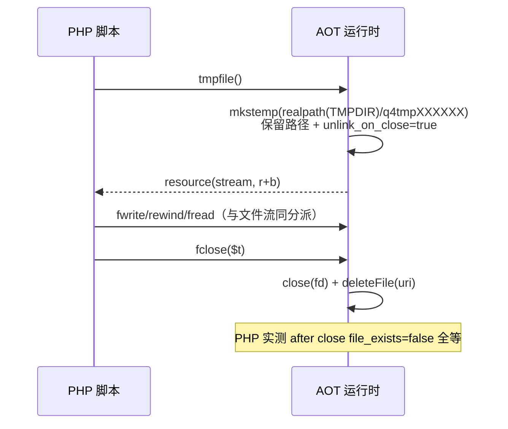

# AOT-CODEGEN-012 批次二十九：流族收面（空壳/半壳清剿）

- 日期：2026-11-07
- 状态：uncommitted（工作树）
- 关联工单：docs/known-issues/AOT-CODEGEN-012-class-name-case-insensitive-lookup.md §259

## 1. 高层摘要（TL;DR）

承接批次二十六（php://memory/temp 承载落地），本批对流族做**普查驱动的清剿**：先普查三分（真实现/空壳半壳/未登记），再按 PHP 8.5.8 实测真值逐项真实现或诚实失败。落地 9 枚新函数（stream_get_meta_data/set_blocking/set_timeout/get_line/tmpfile/get_wrappers/context 三件套），修正 3 处红线病（register_wrapper 假成功桩、get_resource_type 恒 Unknown 桩、未知 php:// 子协议假资源），修 flock 的 PHP→POSIX 常量映射与关流 TypeError，fopen mode 全量解析（e 后缀受理、非法措辞）。7 枚探针全 SAME（豁免项除外），46 探针面板 36 SAME + 10 DIFF 零转移。

## 2. 影响范围

| 面 | 说明 |
|---|---|
| 用户可见 | 9 枚流函数从 Undefined 变可用；stream_wrapper_register 从假成功变诚实 false；get_resource_type 返回真类型名；flock LOCK_UN 语义正确 |
| 运行时结构 | PHPResource +6 字段（uri/mode/blocked/timed_out/context_options/unlink_on_close，全默认值零扰动既有创建点） |
| 兼容 | **轻微行为变化（向 PHP 对齐）**：未知 php:// 子协议从假资源变 false+Warning；get_resource_type 从 "Unknown" 变真名。依赖旧假行为的脚本会感知，但旧行为本身即 BUG |
| 性能 | get_line 分隔符路径逐字节读（正确性优先）；无分隔符路径分块 8K；其余路径零新增开销 |

## 3. 核心变更

| # | 变更 | 位置 |
|---|---|---|
| 1 | PHPResource 元数据承载 + release 统一回收（含 tmpfile 归零删除） | runtime_lib_template.zig :3328-3375 |
| 2 | fopen mode 全量解析（rwaxc + 任意序 +/b/t/e/n；非法 Warning+false） | :9890-9935 |
| 3 | 全创建点挂 uri+归一化 mode（force_b 分族）；php://output 真实现（dup(1)）；未知子协议诚实失败 | fopen 各支 |
| 4 | q4StreamArgCheck（TypeError 双口径）+ q4StreamKinds（uri 单源推导） | :10708-10731 |
| 5 | stream_get_meta_data（9 键 PHP 定序）/ set_blocking（分族）/ set_timeout / get_line / tmpfile / get_wrappers / context 三件套 | :10734-10900 |
| 6 | flock：PHP LOCK_UN=3→POSIX 8 映射 + 关流/非资源 TypeError | :10960 |
| 7 | get_resource_type 废桩返真名；register_wrapper 假成功桩 ⇒ Warning+false | :50114/:50126 |
| 8 | 双表注册：builtin_function_map +9、nlk builtin_map +9 | 两文件 |

## 4. 可视化概览（Code & Logic Map）

```mermaid
flowchart TD
    subgraph fopen 统一入口
        A[php_fopen] --> B{mode 解析<br/>rwaxc + 任意序 +/b/t/e/n}
        B -->|非法| C[Warning + false<br/>PHP 原文措辞]
        B -->|合法| D{协议分派}
        D -->|真实文件| E[openFile/createFile<br/>uri=路径 canon=实参]
        D -->|memory/temp| F[mkstemp+unlink<br/>canon 强制+b]
        D -->|stdout/stderr/stdin| G[dup 标准 fd<br/>canon 按实参]
        D -->|output| H[dup(1)<br/>canon 强制+b]
        D -->|input| I[mkstemp 空文件<br/>O_RDONLY 重开<br/>canon 强制+b]
        D -->|未知子协议| J[Warning + false<br/>operation failed]
        E & F & G & H & I --> K[PHPResource<br/>uri/mode/blocked/...]
    end
    subgraph 观测面
        K --> L[stream_get_meta_data<br/>9 键 PHP 定序]
        K --> M[stream_set_blocking<br/>分族: MEMORY/TEMP/Input 忽略]
        K --> N[flock: op 映射 LOCK_UN 3→8]
        K --> O[get_resource_type: type_name 真值]
    end
```



## 5. 详细变更分析

### 5.1 真值锚点（全量实测，钉死进代码注释）

- meta 9 键定序与分族值表（§259.2）；mode 归一化 force_b 分族（memory/temp/input/output 恒 b，stdout/stderr/stdin/文件按实参）
- set_blocking 分族受理矩阵（文件/stdout/stderr/output 受理、memory/temp/input 忽略）
- stream_context_set_option 的 Deprecated 归属**两参数组形**（四参形静默）——初版按直觉挂反，探针纠偏
- throwThrowable 语义纠偏：是「setException 置旗 + 返回异常 Value」，**不是** Zig error——辅助函数改返回 `union{ok, thrown}`，调用方原样 return（首版按 error 传播写 unreachable 在 Debug 档即爆）

### 5.2 涉及文件

- src/aot/runtime_lib_template.zig（+约 330 行：9 函数 + 4 辅助 + 9 wrapper + 3 处修正 + 结构字段）
- src/aot/native_linker.zig（builtin_map +9 条）

## 6. 影响与风险评估

- **破坏式变更**：两处向 PHP 对齐的行为变化（见 §2 兼容行）——均属旧假行为废止。
- **风险点**：① tmpfile 不再即时 unlink（语义要求保留路径至 fclose）⇒ 进程异常退出可能留尸（PHP 同形）；② 4 参形 set_option 在 PHP 8.5 的真实口径已实测钉死（Deprecated 在两参形）；③ q4_te_buf 全局缓冲——编译产物单线程运行无并发写者（已注释登记）。
- **复测路径**：s1-s8 探针；46 探针面板（panel_p35，36 SAME+10 DIFF 零转移）；zig build test（186/187，唯一失败为既有腐坏 §258.4）。

## 7. 遗留问题/潜在问题

| 项 | 状态 |
|---|---|
| stream_register_wrapper 真实现（派发桥 400-600 行 + 14 方法面 + 每流函数入口插桩） | **方案与成本已报老铁，等拍板** |
| stream_select | 按令明确不支持（无事件循环，未登记） |
| popen/pclose/fsockopen/stream_socket_*/stream_filter_* | 未登记（Undefined 诚实失败） |
| var_dump 嵌套缩进 2 vs 4 | §7.4 豁免项 |

## 8. 后续开发/优化建议

| 优先级 | 建议 | 影响面 | 落地成本 |
|---|---|---|---|
| P1 | 拍板 register_wrapper 真实现与否（不建议——收益面窄） | 用户态协议模拟 | 大 |
| P2 | get_line 分隔符路径升级缓冲读+lseek 回退（当前逐字节） | 大文件按行解析性能 | 小 |
| P2 | feof 状态机与 fread 边界的全形探针固化（本批实测覆盖主要路径） | 回归防线 | 小 |
| P2 | stream_get_meta_data 对关流资源的 PHP 真值补齐（"Unknown (closed)"？） | 边缘形态 | 小 |
