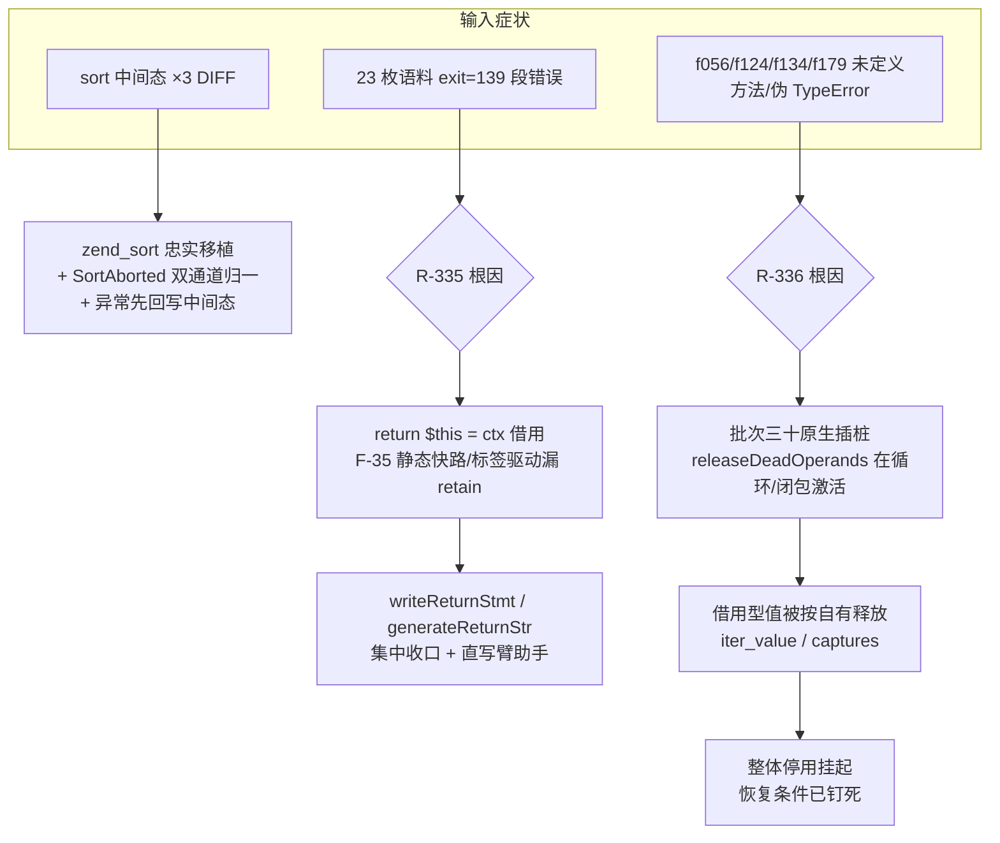
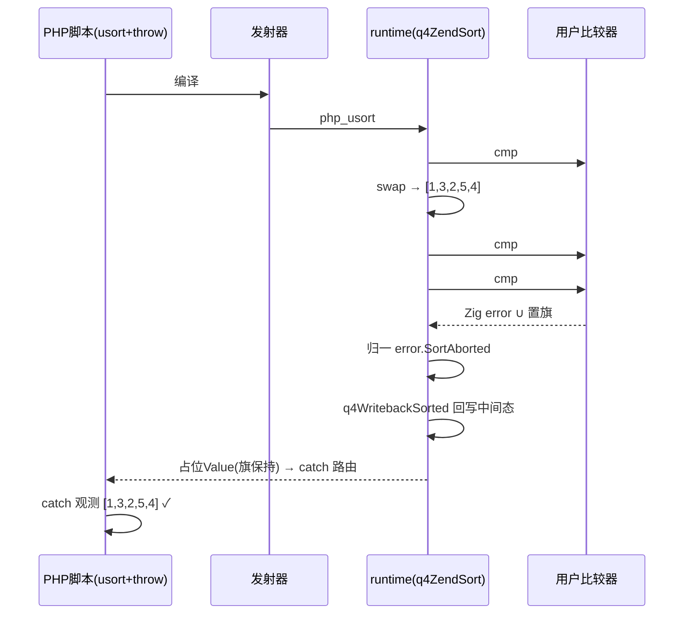
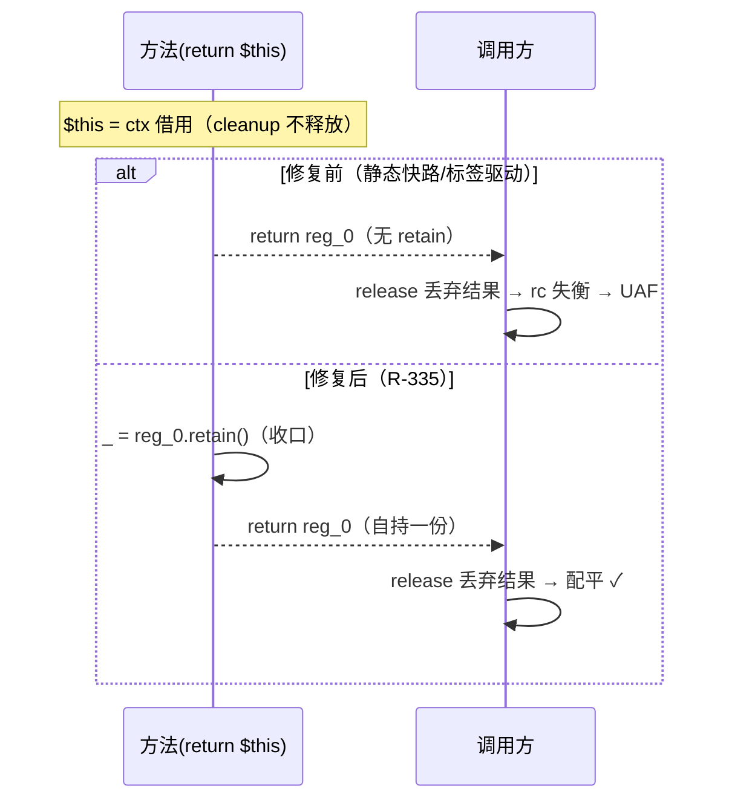

# 批次三十一变更摘要：zend_sort 忠实移植 + R-335 `$this` retain 收口 + R-336 批次三十原生插桩停用

> 日期：2026-11-07 ｜ 模块：AOT-CODEGEN-012 ｜ 状态：uncommitted ｜ 工单：§261

## 1. 高层摘要（TL;DR）

720 语料（68 枚）在批次三十二进制下爆出 32 失败（11-05 基线 67/68 绿）。逐层二分定位**三条独立根因**并全部收口：① zend_sort 忠实移植补齐「比较器抛异常回写中间态」（sort 面板格 ×3 转绿）；② **R-335** `return $this` 借用引用在 F-35 静态快速路径/标签驱动路径漏 retain ⇒ 23 枚语料段错误根因；③ **R-336** 批次三十原生路径插桩系统性违反借用型值所有权契约（iter_value 借用支、闭包 captures 借用读）⇒ 整体停用挂起。终态：**47 探针面板 40 SAME + 7 DIFF（零转移、3 格转绿+1 新增绿）、zig build test 全绿、f051/f056/f124/f134/f179 全愈**。

## 2. 影响范围

| 面 | 影响 |
|---|---|
| 排序族（usort/uasort/uksort） | 比较/交换序列与 PHP 8.5.8 逐字节一致；比较器抛异常即刻终止 + 中间态可观测；稳定性（等值保原序） |
| 对象生命周期 | `return $this`（流式接口/建造器族）在所有发射路径正确 retain，段错误族清零 |
| 销毁时机（G1/G4 收益） | **回退**：批次三十原生插桩停用 ⇒ 循环/闭包内 __destruct 时机退回批次二十九口径（正确性优先） |
| 共享层（parser.zig/ast.zig） | **零触碰** |

## 3. 核心变更

| # | 变更 | 文件 | 性质 |
|---|---|---|---|
| 1 | zend_sort 忠实移植（Q4ZendSort/q4InsertSort/q4Sort2-5，KV 带 orig_idx 稳定决胜） | runtime_lib_template.zig :36409-36596 | 新增 |
| 2 | invokeUserCompare 异常双通道归一（Zig error ∪ 置旗 ⇒ SortAborted） | runtime_lib_template.zig :37346 | 修复 |
| 3 | usort/uasort/uksort：SortAborted ⇒ 先回写中间态再返占位（旗保持） | runtime_lib_template.zig :37462+ | 修复 |
| 4 | R-335：`return $this` retain 收口 writeReturnStmt/generateReturnStr；主路径旧 retain 删除；appendThisRetainIfNeeded 补 simple-if-else 两直写臂 | native_linker.zig :21491/:21546/:7357/:974/:7634/:7832 | 修复 |
| 5 | R-336：generateInstructionTracked 停用布点（纯透传） | native_linker.zig :22999 | 停用挂起 |

## 4. 可视化概览（Code & Logic Map）

## 5. 详细变更分析

| 层 | 文件 | 变更点 |
|---|---|---|
| 运行时 | runtime_lib_template.zig | zend_sort 移植、SortAborted、三入口异常回写 |
| 发射器 | native_linker.zig | R-335 retain 收口 ×2 + 助手 + 两直写臂；R-336 插桩停用 |
| 探针 | probe_sort_zend_faithful.php（新增保留） | 插入/分区/五点三路径 + 稳定性 + 保键 + 降序 + 1100 元素 |
| 文档 | 工单 §261 / 本摘要 | — |

## 6. 影响与风险评估

- **破坏式变更**：无。R-336 停用是行为回退（销毁时机），但回退到的是批次二十九已验证口径。
- **需特别注意**：① R-335 给所有 `$this` 返回加一次 retain——RC 泄漏侧零风险（成对 release 本就该有）；② R-336 停用后批次三十的 G1/G4 探针收益挂起（见 §261.4 恢复条件）。
- **复测路径**：11 枚最小复现 + sort 四探针 + f051/f056/f124/f134/f179 + 47 面板 + zig build test + 720 语料（在跑）。

## 7. 遗留问题/潜在问题

- **R-336 恢复（P0 候选）**：借用型产出点普查建「不可释放」登记表（`php_array_iter_value` 借用支、`ctx.captures[N]`、`iter.current`），或借用函数统一 retain（需性能数据）。恢复后重跑 68 语料 + 11 最小探针 + f051/f124 族。
- `zig build --optimize=debug` 下 f124 报 `AstDirectGenerationFailed`（debug 档标签驱动既有缺口，与本批无关，登记）。
- 旧 `quickSort*WithCallback` 三枚孤儿函数沿 §260.5 保留待批。

## 8. 后续开发/优化建议

| 优先级 | 建议 | 影响面 | 落地成本 |
|---|---|---|---|
| P0 | R-336 恢复：借用产出点登记表（首选）或借用统一 retain（先出性能数据） | 销毁时机全对齐 | 中（普查 2-3 处 + 回归） |
| P1 | `AstDirectGenerationFailed` debug 档缺口修复（标签驱动路径块处理） | debug 档可用性 | 中 |
| P2 | `q4NormalizeBuiltinArgs` 反射表查询缓存（需先出 hot path 耗时占比数据，无数据不动） | 性能 | 低-中 |
