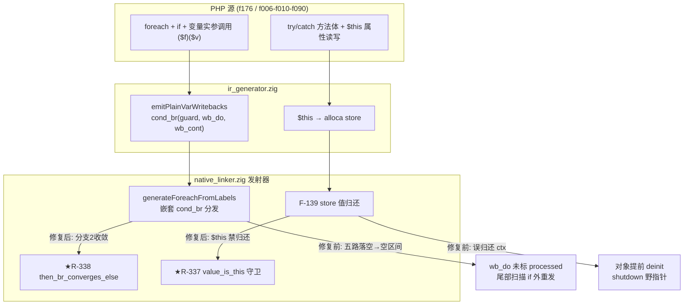
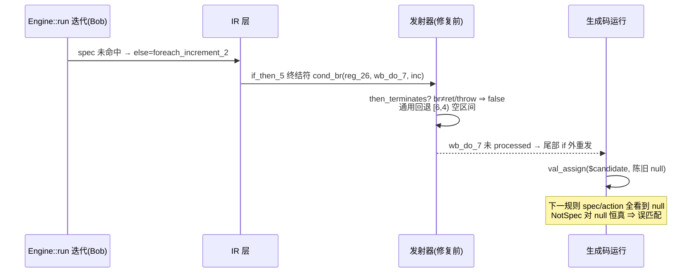
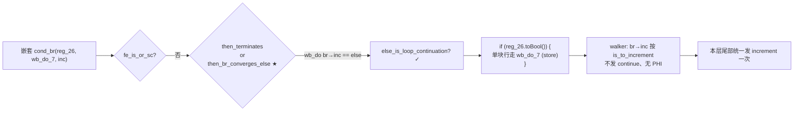

# AOT-CODEGEN-012 批次三十二+三十三：R-337 `$this` 借用守卫 / R-338 foreach Q3 写回守卫（wb_do 收敛形）

- 日期：2026-11-08
- 工单：§262（批次三十二 R-337）、§263（批次三十三 R-338）
- 关联：批次三十一（zend_sort 忠实移植 + R-335 + R-336，见 `docs/changes/2026-11-07/AOT-CODEGEN-012_batch31_zend_sort_this_retain_instrument_suspend_2026-11-07_uncommitted.md`）
- 基线 commit：`99ab362`（工作区未提交变更）

---

## 1. 高层摘要（TL;DR）

闭环 720 语料回归最后 4 枚 FAIL 中的 3 枚运行期崩溃与 1 枚输出差异：

- **R-337**：状态机函数（try/catch 族）把 `$this` 抬入变量 alloca 的 store 被 **F-139 store 值归还**误判为"可归还临时量"，吃掉了**调用方所有的借用引用** ⇒ 对象提前 deinit ⇒ shutdown 阶段 `findMethodLookup("__destruct")` 读野 ClassMeta ⇒ 段错误（f006/f010/f090）。修复 = F-139 归还增加 `value_is_this` 守卫。
- **R-338**：foreach 体嵌套 if 的 Q3 by-ref 写回守卫（`cond_br(reg_26, wb_do_7, foreach_increment_2)`，wb_do 以 `br` 折返与 else 相同的循环延续块——**收敛形**）在 `generateForeachFromLabels` 嵌套分发中五路全落空，通用回退推得空区间 `[6,4)`，wb_do 块被尾部扫描在 if **外**无条件重发 ⇒ 未命中规则的迭代用陈旧 null 覆写 `$candidate`（f176 Specification 链）。修复 = 新增 `then_br_converges_else` 判定并入既有守卫内联分支。
- 附带拆除批次三十一/三十二取证用的六处 `Q4_TRACE_*` BISECT 插桩（runtime_lib_template.zig）。

两案共同教训：**"借用型值"（borrowed value）在发射器任何通用归还/重发路径上都必须显式守卫**；**标签驱动发射器的"通用范围回退"对索引乱序的守卫块会静默吞掉条件语义**——收敛形（then br→else）必须与发散形（then br→merge）分开收口。

## 2. 影响范围

| 维度 | 范围 | 说明 |
|---|---|---|
| 编译器发射器 | `generateForeachFromLabels` 嵌套 cond_br 分发 | 新增 1 个判定 blk + 1 处分支条件放宽（仅 foreach 拷贝；for/while 由链式收口覆盖） |
| 编译器指令发射 | F-139 store 值归还（:23450 区） | 新增 `value_is_this` 守卫，影响所有含 `$this` 入 alloca 的状态机函数 |
| 运行库 | `PHPArray.retain/release`、`ref_aware_store`、`php_invoke_callable`、`PHPObject.retain/release` | 仅拆除临时插桩，无行为变更 |
| 语料修复 | f006/f010/f090（shutdown 崩）、f176（输出 DIFF） | 全部转 SAME |
| 语料零转移 | 46+1+7 探针面板 + min_r/q/m 族 | 全量面板 8 DIFF 均属 §七豁免族，与批次三十二基线逐格一致 |

## 3. 核心变更

| # | 文件 | 位置 | 变更 | 性质 |
|---|---|---|---|---|
| 1 | src/aot/native_linker.zig | :23449-23450 | F-139 归还条件追加 `!value_is_this`（`current_this_regs` 命中 ⇒ 禁归还 ctx 借用引用） | R-337 |
| 2 | src/aot/native_linker.zig | :13120-13139 | 新增 `then_br_converges_else`：嵌套 then 块 `.br` 目标 == 嵌套 else 块 ⇒ 收敛形 | R-338 |
| 3 | src/aot/native_linker.zig | :13187 | 分支 2 条件 `then_terminates` ⇒ `(then_terminates or then_br_converges_else)` | R-338 |
| 4 | src/aot/runtime_lib_template.zig | :2926/:3028/:4075/:12951/:31863/:31873 | 拆除六处 `Q4_TRACE_*` 环境变量插桩 | 清场 |

## 4. 可视化概览（Code & Logic Map）

### 4.1 分层与定位



### 4.2 R-338 业务流程（f176 错位链）



### 4.3 R-338 执行流程（修复后）



### 4.4 R-337 变更点时序

```mermaid
sequenceDiagram
    participant C as 调用方
    participant F as 状态机方法(try/catch)
    participant S as F-139 store 归还
    C->>F: 传入 ctx=$this (借用, 归 C 所有)
    F->>F: reg_0=ctx; val_assign(alloca, reg_0)
    F->>S: store(ptr=alloca, value=reg_0=ctx)
    alt 修复前
        S->>S: single_store && !live && heap ⇒ release ctx
        Note over S,C: 吃掉调用方引用 → rc 提前归零 → shutdown 野指针
    else 修复后 ★
        S->>S: value_is_this ⇒ 跳过归还
        Note over S,C: ctx 所有权留调用方 → 对象寿终正寝
    end
```

## 5. 详细变更分析

### 5.1 涉及文件列表

| 文件 | 行数级 | 变更点描述 |
|---|---|---|
| src/aot/native_linker.zig | +21/-0（R-338）、+1 条件（R-337） | 见 §3 #1-#3 |
| src/aot/runtime_lib_template.zig | -25 | 六处 Q4_TRACE_* 插桩拆除（纯清场） |
| docs/known-issues/AOT-CODEGEN-012-*.md | +§262/§263 | 工单落档 |
| /tmp/min_r{1..8}*.php、min_q* | — | 取证探针（结论用，保留在 /tmp） |

### 5.2 端/模块层/业务层/数据层

- **端（生成码形态）**：foreach 内嵌套 if 含 Q3 写回点的函数，生成码从「守卫变量被算但写回无条件」变为「`if (guard.toBool()) { 写回 }`」；状态机函数 `$this` 入 alloca 后不再跟 `release ctx`。
- **模块（发射器）**：foreach 嵌套 cond_br 分发由 5 路补为 6 路（收敛形）；F-139 归还谓词由 6 条件补为 7 条件。
- **业务（PHP 语义）**：`($rule['action'])($candidate)` 变量实参 Ref 化写回严格只在「实参非 missing」时发生；`$this` 借用语义穿越 try/catch 状态机不被截断。
- **数据（RC 生命周期）**：写回 temp（reg_24）的 retain/release 配对恢复只在写回路径发生；ctx 引用计数全程守恒。

## 6. 影响与风险评估

- **破坏式变更**：否。两处均为「增加守卫/收窄放行」，无任何路径从"不发"变"发"。
- **变更影响范围**：仅命中 ① foreach 体内嵌套 if 且 then 块终结符为 wb_do 收敛形 cond_br 的函数（f176 族）；② 含 try/catch 且 `$this` 入 alloca 的方法（f006/f010/f090 族）。
- **需要特别注意的点**：
  - walker 对 `br→increment` 的 is_to_increment 口径（:9836）保证守卫内不提前发 `continue`，增量仍由尾部统一发射——已在 min_r7 生成码逐行核验；
  - F-139 归还随 store 移入守卫内：missing 跳过时 temp 不归还，由函数 cleanup/下轮覆盖兜底，无泄漏路径；
  - R-338 只改 foreach 拷贝；for/while 同位拷贝由 `generateNestedContinueChain` 覆盖本形（登记 §263.4 残余：链式收口被拒时的回退缺陷）。
- **复测路径**：
  1. `php min_r7.php` vs AOT 编译产物 → SAME（16 枚 r 族探针）；
  2. f176 原语料 → SAME；
  3. 全量探针面板 → 46 PASS + 8 豁免 DIFF；
  4. `zig build test` → 全绿；
  5. `bash scripts/regression_test_720.sh`（批次合并里程碑，后台在跑）。

## 7. 遗留问题/潜在问题

| 项 | 级 | 说明 |
|---|---|---|
| min_r4 对象 id 顺序 | P2 | PHP 句柄池复用 vs AOT 单调计数，仅 var_dump `#N` 序号差异（既有，非本族根因，A/B 对照证实） |
| for/while 通用回退同形缺陷 | P2 | 链式收口被拒（链长>24/夹循环头）时才暴露；登记不预防性扩散 |
| f026 timeout / f004 SKIP | 既有 | 维持登记，与本批无关 |
| R-336 原生路径插桩恢复 | P0 候选 | 前提已钉死（借用产出点建不可释放登记表 或 借用函数一律 retain），批次三十三未触碰 |

## 8. 后续开发/优化建议

| 优先级 | 影响面 | 落地成本 | 建议 |
|---|---|---|---|
| P0 | 720 语料 FAIL 清零 | 低 | 720 全量回归确认 f006/f010/f090/f176 转 PASS 后，将四枚移入 pass 基线并冻结 |
| P1 | 发射器健壮性 | 中 | 收敛形判定（then br→else）抽为 `Self` 级谓词（如 `nestedConvergesOnElse`），for/while/foreach 三拷贝共用，消除未来回退缺陷的散布面 |
| P1 | 队列推进 | 高 | 数组元素引用（IR 层元素 Ref+COW）按新验证节奏立项：先探针矩阵锁语义面，再动 IR |
| P2 | 保真度 | 中 | 对象句柄 id 池化（复用已释放序号）对齐 PHP var_dump `#N` 序号 |
| P2 | 防御 | 低 | 发射器通用范围回退增加「起点≥终点 ⇒ 断言/诊断」哨兵，把静默空区间变成编译期可见失败 |
