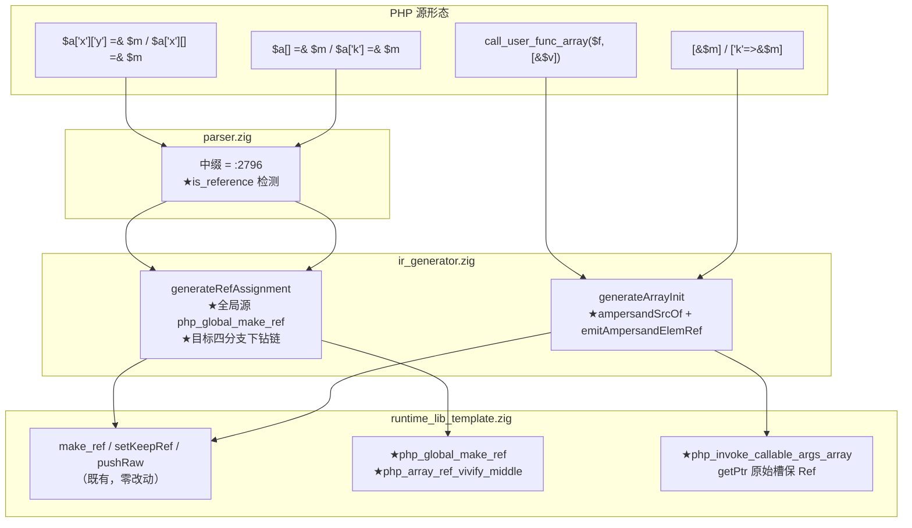
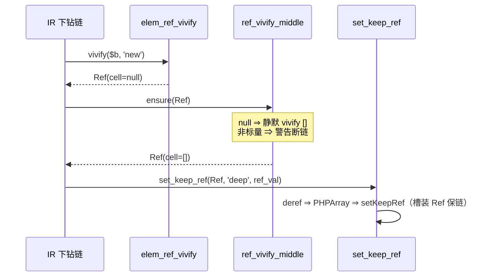

# AOT-CODEGEN-012 批次三十四：R-339 数组元素引用三形落地（§250.4 待批族销账）

- 日期：2026-11-08
- 工单：§264
- 关联：§250.4（Q3 待批族登记）、批次十五（php_array_elem_ref_vivify）、批次二十一（keep_ref 原语）
- 基线 commit：`99ab362`（工作区未提交变更）

---

## 1. 高层摘要（TL;DR）

`[&$m]` / `$a[] =& $m` / `['k'=>&$m]` / 多维下钻 / cufa 实参包五类数组元素引用形态全链路落地，§250.4 待批族销账。跨四层最小面改动：parser 中缀 `=` 补 3 行 `&` 检测（与语句级对称化），IR 侧接通既有件（keep_ref/get_ref/elem_ref_vivify/make_ref），运行时新增 2 枚小原语（全局槽 Ref 化、中间层数组化），cufa 收集改原始槽保 Ref。**未引入任何新数据结构**——全部复用既有 Ref cell 语义，COW/unset/写穿边界经探针矩阵逐形验证。

## 2. 影响范围

| 维度 | 范围 | 说明 |
|---|---|---|
| 共享层 | parser.zig 中缀 `=` | 仅 `=&` 形行为从错变对；非 `=&` 形零影响（一次 tag 比较） |
| IR 生成 | generateRefAssignment 目标分支 + generateArrayInit 元素 | 死路改接验收件；新增 ampersand 元素识别 |
| 运行库 | +2 原语、keep_ref 收 Ref、cufa 收集保 Ref | 全部向后兼容（Ref 解包是纯放宽） |
| 产物模板 | main.zig 全局槽 Ref 化实现+挂载 | 产物侧状态经既有钩子模式反向暴露 |
| PHP 语义 | 元素引用五形 + 中间层 vivify/警告 | 15 探针全等 PHP 8.5.8 |

## 3. 核心变更

| # | 文件 | 变更 | 缺口 |
|---|---|---|---|
| 1 | parser.zig :2801-2808 | 中缀 `=` 补 is_reference | G1 |
| 2 | ir_generator.zig :5436-5468 | 全局源×数组目标 → php_global_make_ref | G3 |
| 3 | ir_generator.zig :5517-5604 | 目标四分支（push/内层push/单键/多维）接 keep_ref | G2/G6 |
| 4 | ir_generator.zig :9771-9895 | emitAmpersandElemRef + array_init 元素识别 | G4 |
| 5 | runtime_lib_template.zig :12504-12539 | php_global_make_ref + php_array_ref_vivify_middle | G3/G6 |
| 6 | runtime_lib_template.zig :7150-7163 | keep_ref 收 Ref 中间层 | G6 |
| 7 | runtime_lib_template.zig :13294-13303 | cufa 收集 getPtr 保 Ref | G5 |
| 8 | native_linker.zig 模板/登记 | 产物侧实现+挂载+builtin_map+产 Ref 登记 | 配套 |

## 4. 可视化概览（Code & Logic Map）

## 5. 详细变更分析

- **端（生成码形态）**：`[&$m]` 产 `php_global_make_ref`/`make_ref` + `php_array_push_keep_ref`；`$a[] =& $m` 走 generateRefAssignment 目标四分支；多维产 vivify+ensure 下钻链。
- **模块（发射器）**：nlk 仅登记两原语与产物侧模板函数，无发射逻辑变更。
- **业务（PHP 语义）**：元素引用双向写穿；中间层 null 静默 vivify、非标量 "Trying to access array offset on {type}" 警告断链（与 PHP 同形失败）。
- **数据（RC/内存）**：Ref cell 单堆单元被变量槽与元素槽共享；cloneDeep 对 Ref 元素 retain 不克隆；unset 源变量后 cell 由元素 Ref 持 rc 不析构（s8 探针实证）。

## 6. 影响与风险评估

- **破坏式变更**：否。parser 改动只影响 `=&` 形；keep_ref 收 Ref 是纯放宽；cufa 收集保 Ref 只让 Q3 协议「元素是引用 ⇒ 直通」真正生效（此前该路径拿不到 Ref）。
- **需特别注意**：`php_array_push_ref/set_ref` 死代码原地保留（无调用点不实例化，删除走确认机制）；AOT 对 call-time by-ref `f(&$x)` 过接受属既有缺口（登记 §264.4）。
- **复测路径**：15 探针矩阵（/tmp/eref_s*.php，PHP 8.5.8 对参）全 SAME；b15_r3 面板格零转移；`zig build test` 全绿。

## 7. 遗留问题/潜在问题

| 项 | 级 | 说明 |
|---|---|---|
| `$a[]['y'] =&` 混合形 | P2 | 落单键分支按 set 处理，罕见形登记 |
| 中间层对象/资源下钻 | P2 | 按非标量警告断链，魔术方法差异未覆盖 |
| call-time by-ref 过接受 | P1 | PHP 8 parse error vs AOT 接受，既有缺口待批 |
| push_ref/set_ref 死代码 | P2 | 保留登记，删除需确认 |

## 8. 后续开发/优化建议

| 优先级 | 影响面 | 落地成本 | 建议 |
|---|---|---|---|
| P1 | 语法保真 | 低 | call-time by-ref `f(&$x)` 在 parser 拦 parse error（对齐 PHP 8） |
| P1 | 队列推进 | 高 | GMP-α 开工（核心 25 函数，extern mpz_* 静态链接，/opt/homebrew/lib/libgmp.a 已勘） |
| P2 | 健壮性 | 中 | 混合 push+键形（`$a[]['y'] =&`）补下钻分支 |
| P2 | 死代码 | 低 | push_ref/set_ref 实现补全或确认删除（走确认机制） |
